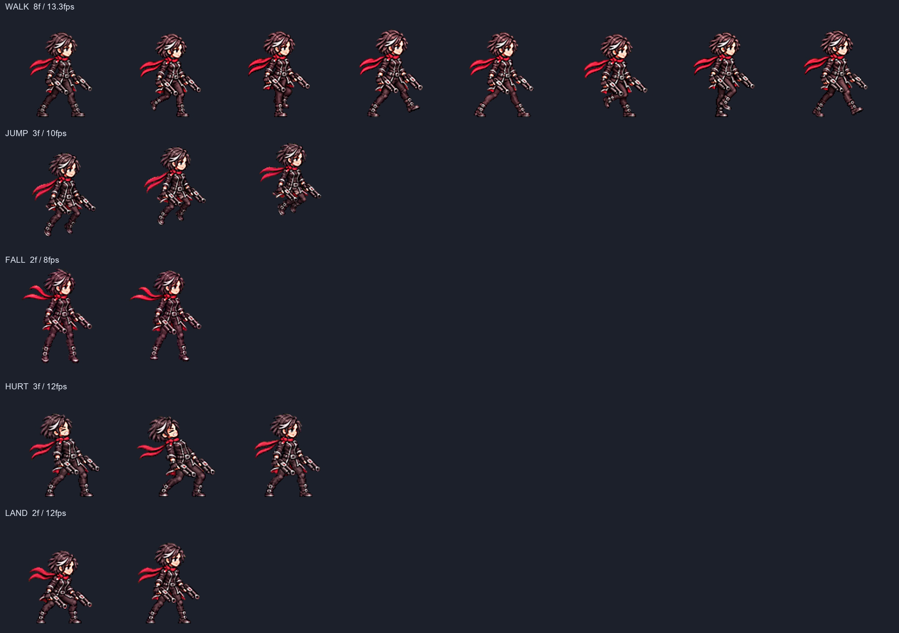

# Xion B · ART-97B · 걷기와 공중/피격/착지 후보

**완료:** B2 대기 앵커를 따라 5행·18프레임과 JSON, 4× 검토판, 원본/프롬프트, 측정 자료를 만들었다. **현재 상태:** 카드의 파일·머리·디테일·여백·번짐 및 걷기 발 기준을 확인한 후보이며, 아래 육안/측정 제한이 있다. 게임 연결·Godot 재생·커밋은 하지 않았다.

| 행 | 프레임 | fps | factor | 머리 배율 | 디테일 지표 / 앵커 비율 | 납품 |
|---|---:|---:|---|---|---|---|
| walk | 8 | 13.3 | 0.102–0.11086957, 생성 장당 하나 | 중앙값 1.00, 8/8 신뢰 | 124.16–137.19 / 115.5–127.7% | 완료 |
| jump | 3 | 10 | 0.180 | 중앙값 0.96, 3/3 신뢰 | 130.21–137.68 / 121.2–128.1% | 완료 |
| fall | 2 | 8 | 0.150 | 중앙값 1.00, 2/2 신뢰 | 116.37–117.35 / 108.3–109.2% | 완료 |
| hurt | 3 | 12 | 0.176 | 4× 수동 비교, 자동 신뢰 1/3 | 112.93–116.65 / 105.1–108.5% | 완료 |
| land | 2 | 12 | 0.145 | 중앙값 0.96, 2/2 신뢰 | 120.82–121.64 / 112.4–113.2% | 완료 |

후보 위치: `art/bakeoff/xion/b/xion-{walk,jump,fall,hurt,land}-b2.png` 및 같은 이름의 `.json`. 셀은 전부 128px. 실제 PNG 폭은 각각 1024 / 384 / 256 / 384 / 256px이며 빈 셀은 없다. 기본 시트용 한 장은 카드대로 **jump F2 / fall F1 / hurt F1**을 권장한다. 프레임 번호는 1부터 센다.

## 실제 결과

위 그림은 최종 후보 전체를 같은 2× 배율로 놓은 것이다. 각 행의 `walk.png`, `jump.png`, `fall.png`, `hurt.png`, `land.png`는 앵커 옆에 놓은 4× 최근접 비교판이다. 각 `<row>-4x.gif`도 있다. GIF는 미리보기 반복이고, 게임용 반복 여부는 JSON을 따른다.

## 측정한 것

- 최종 18개 셀 모두 이진 알파, 테두리 침범 0, 초록 번짐 0. 최소 여백은 walk 7 / jump 5 / fall 4 / hurt 7 / land 7px. 번짐 정의는 공용 정규화 도구의 `G > max(R,B)+20`이다.
- LANCZOS + 선명화 60 + despill auto + palette none + 초록 배경 제거. 지상 행은 `ground-all`; jump/fall은 이를 쓰지 않고 공통 `lift-all 8`로 원본의 상대 공중 높이를 유지했다. 몸을 웅크린 높이로 크기를 정하거나 머리/팔다리를 붙이지 않았다.
- 머리는 `head_scale.py`와 같은 함수로 앵커 F1과 비교했다. walk는 0.96–1.02, jump는 1.02/0.96/0.96, fall은 1.00/1.00, land는 0.96/0.96이다. hurt는 눈을 감고 기울어진 F1·F2 점수가 0.481/0.464로 낮다. F3만 1.00(0.909)이므로 자동 중앙값으로 합격시키지 않고 `heads-4x-2.png`, `heads-4x-3.png`에서 직접 비교했다.
- 디테일은 내부 명암 변화량이다. 앵커 F1의 107.47과 비교했으며, 해부학이나 미술 품질의 백분율이 아니다.
- 걷기 F3/F7 지지발은 각각 하나. 지지발 중심 61.0/57.0px, 이웃 중간점 오차 +3.0/−2.75px, 들린 발의 최저점은 y110/y112(발선 위 10/8px)다.
- 발끝 하단 띠의 중심을 연결한 2D 이동량은 루프 연결까지 포함해 최대 **24.19px**. 지지발 검출은 자동, 들린 발 사각형과 near/far 다리 소속은 육안으로 지정했다. `feet.json`, `feet-motion.json`, `onion.png`에 근거가 있다.
- 최종 걷기 보브는 `0,0,0,+1,−1,+1,+2,0px`. 발 아래 행은 바뀌지 않았다. 새 프레임을 다시 조립할 때마다 **보브 전 정규화 원본**에서 시작했으며 최종 납품본에는 1회만 적용했다. 이미 보정된 그림에 재적용하지 않았다.
- 스카프는 굽힘을 고려해 목 뒤에서 끝까지 **사람이 지정한 천 경로의 다각선 길이**로 비교했다. 앵커 경로 약 33.23/36.30px, 후보의 명목 오차 −9.10~+5.97%. 좌표 약 ±1px, 길이 약 ±2px의 추정 오차가 있어 엄밀한 물리 길이 검증은 아니다. 목–끝 직선거리도 `scarf.json`에 별도로 남겼다. 길이를 바꾸지 않고 구부려도 그 직선거리는 달라진다. `scarf-landmarks-*.png`의 선과 점이 실제 사용한 수동 경로다.

## 눈으로 판단한 것과 남은 제한

- 생성 시도 전부를 정규화 후 4×로 보고 최종 18프레임도 앵커와 비교했다. 검은 짧은 코트·은색 선·두 버클 부츠·짧은 검은 머리와 은색 띠·손가락 없는 장갑·양손의 같은 산탄총 두 자루·두 갈래 붉은 스카프가 유지된다. 얼굴은 하나이며 손/총/스카프가 얼굴을 가리지 않는다. 효과·연기·발광은 없다. 작은 손가락 전부를 낱개로 분리해 셀 수 있는 해상도는 아니다.
- 연속 프레임과 겹침판에서는 두 다리가 번갈아 지지하고 지나가는 걷기로 읽힌다. 다만 옷이 모두 검어서 near/far 구분은 주로 겹침에 의존한다. 얼굴 템플릿의 **수평 위치가 F1 대비 −5~0px**로 달라지는 작은 상체 흔들림과 총 각도 변화는 남아 있다. 수직 보브가 맞는 것을 수평 떨림까지 없다는 뜻으로 보고하지 않는다.
- hurt의 자동 머리 일치 검증은 불충분하다. 4×에서는 기울어진 머리가 앵커와 비슷한 크기로 보이지만 자동 0.96–1.04 통과와 동등한 증거는 아니다.
- jump F3의 아래 스카프 경로는 앵커 대비 −9.10%로 허용 경계에 가깝다. 수동 추정 오차까지 포함하면 ±10% 안을 보장할 수 없다. 리드의 확대 검수가 필요하다.
- 원래 B2 앵커의 약 3.46등신(이전 보고서의 수동 정의)과 스카프 각도 보류를 이번 작업이 해결한 것은 아니다. 이번에는 사용자가 지정한 B2를 기준으로 따랐다.
- 실시간 GIF 재생을 눈으로 관찰하거나 Godot 안에서 플레이하지 않았다. 프레임 순서·겹침판·파일 구조·타이밍 메타데이터를 확인했다. GIF의 10ms 시간 단위 때문에 미리보기 fps는 근삿값이며 게임 JSON은 지정 fps 그대로다.

## 제작 이력과 재현

내장 ImageGen 사용, 패키지 설치 없음. 사용·실패 생성 원본과 참조는 `art/raw/xion-97b/`에 복사했다. `prompts.txt`에 모든 요청과 원본 경로가 있다. 걷기 생성 횟수 F1–F8은 **1/1/3/1/1/2/2/1**, jump 1, fall 2, hurt 1, land 1이다. 총 17회로 카드 상한 안이다.

회색 마네킹은 ART-57 Frey 스크립트를 이 보고서로 복사해 3등신과 양손 낮은 총 자세를 적용하고 ART-58의 통과 자세를 넣었다. 현재 게임 Xion 걷기는 외형이 다른 임시 그림이므로 Image 3/4에서 다리 자세만 사용하도록 명시했다. `walk_feet.py`로 현재 행 F3의 중앙 지지발 하나를 확인해 통과 자세 참조로 골랐다. 두 번째 이후 모든 생성의 Image 3은 승인한 걷기 F1로 고정했다.

F3의 1차는 발이 뒤에 남고 다음 프레임 이동량이 컸다. 2차 F3 및 1차 F7은 발 들림 5px로 부족해 다시 생성했다. F6은 7번으로 가는 발 이동이 26.5px여서 안쪽으로 접는 자세로 한 번 다시 생성했다. fall은 짧아 보이던 아래 꼬리를 두 번째 생성에서 늘렸다.

`rebuild.ps1`은 지정 Python과 `PYTHONDONTWRITEBYTECODE=1`로 정규화 → 보브 전 조립 → 보브 한 번 → 측정 → 후보 저장을 재현한다. raw가 git 제외이므로 이 클론에서 재현 가능하다. `commit.ps1`은 리드용 명시적 경로 배열이며 **실행하지 않았다**. `smash-nine-prototype/`과 공용 파이프라인 파일은 수정하지 않았다.

재현 스크립트를 실제로 끝까지 실행해 **5개 후보 PNG의 실행 전후 SHA-256 일치**를 확인했다(`reproducibility.json`). PowerShell 두 스크립트의 구문 오류는 0이며, 커밋 배열 53개 항목은 모두 존재하고 허용 범위에 있다. UTF-8 텍스트 읽기·PNG 규격·GIF 프레임 수도 확인했다. 미리보기 평균 fps는 walk 13.333 / jump 10 / fall 8 / hurt 12 / land 11.765이며 게임 JSON은 표의 지정값이다.

이번 작업 자료는 약 **29.9MiB**. 기존 자료를 포함한 전체 클론 `C:\Users\TH\Documents\AI\GameProject\SmashNine-units\art-b\SmashNine`은 약 **4.163GiB**다(`workspace-size.json`, 긴 경로를 포함해 측정 오류 0). 큰 영상 중간 파일은 만들지 않았다.

**남은 작업:** 리드의 후보 검수·채택 및 제품 조립/연결. 다른 유닛의 공격·방어·승리·패배는 이 보고서의 작업/판정 범위에 포함하지 않는다. 할 일 위젯 항목은 추가하지 않았다.
