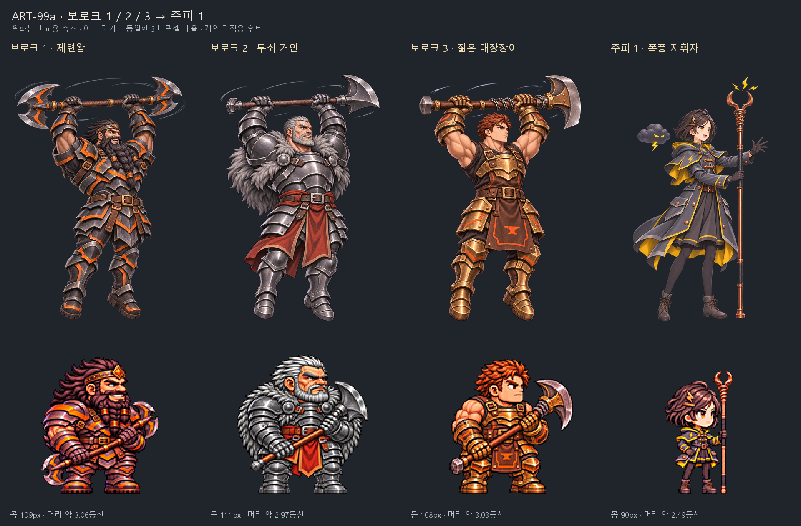
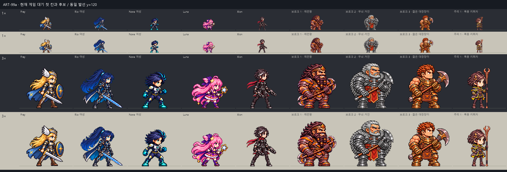

# ART-99a · 보로크 1·2·3, 주피 1

**완료:** 네 외형의 투명 전신, 얼굴, 대기 1프레임과 JSON을 납품한다. 내장 이미지 도구로 제작했고 원본은 `art/raw/newchar-99a/`에 보관했다. 게임 미적용 후보이며 `smash-nine-prototype/` 변경·Godot 실행·커밋은 하지 않았다.

**보로크 1 · 제련왕:** 낮은 철관, 땋은 검은 수염, 주황색 도장 이음매를 넣은 검은 판금이다.  
양끝에 날이 달린 제련 도끼를 머리 위에서 돌리는 장면으로 왕의 힘과 비행 기술을 함께 보여준다.  
모피형 2안과 달리 각진 갑옷·긴 수염, 젊은 3안과 달리 관과 연륜으로 구분한다.

**보로크 2 · 무쇠 거인:** 짧은 회색 머리와 수염, 둥근 전신 판금, 회색 모피와 녹슨 붉은 천이다.  
긴 자루의 큰 도끼를 돌리는 무거운 노장의 모습이며, 대기의 붉던 금속·모피 음영을 중성 회색으로 다시 그렸다.  
세 안 중 모피와 둥근 어깨가 가장 크게 벌어져 방벽 같은 인상을 준다.

**보로크 3 · 젊은 대장장이:** 수염 없는 젊은 얼굴, 굵은 팔, 가죽 앞치마 위 두꺼운 청동 판금이다.  
사슬을 자루에 감은 외날 도끼와 앞치마의 모루 문양으로 대장장이 배경을 드러낸다.  
왕관·모피 없이 근육과 작업복으로 구분하며, 원화는 같은 머리 위 회전 기술을 보여준다.

**주피 1 · 폭풍 지휘자:** 단발, 회색 케이프 코트와 노란 안감, 구리 단추·피뢰침 스태프다.  
몸보다 긴 스태프 끝의 번개와 얼굴 옆 작은 먹구름으로 원거리 번개술사와 소환 기술을 표현한다.  
분홍 트윈테일·별·짧은 지팡이 대신 단정한 실루엣을 썼으며, 대기에는 구름과 번개를 넣지 않았다.

위 그림은 납품 원화를 축소하고, 아래에 대기 프레임을 동일한 3배 배율로 놓은 비교판이다.

## 납품과 측정

공통 위치는 `art/bakeoff/newchar-2026-11-26/`이다. 각 폴더에 `<이름>_illustration-<번호>.png`, `<이름>_face-<번호>.png`, `<이름>-idle-<번호>.png` 및 같은 이름의 JSON이 있다.

| 폴더 / 파일 묶음 | 규격 | 실제 픽셀 측정 | 수동 등신 추정: 원화 / 대기 | 납품 |
|---|---|---|---|---|
| `borok/1/borok*` | 전신 1024×1536 / 얼굴 256×256 / 대기 128×128 | 몸 109px, 여백 ≥7px, 디테일 113.41% | 7.34 / 3.06 | 완료 |
| `borok/2/borok*` | 동일 | 몸 111px, 여백 ≥7px, 디테일 139.26% | 6.92 / 2.97 | 완료 |
| `borok/3/borok*` | 동일 | 몸 108px, 여백 ≥6px, 디테일 119.27% | 6.96 / 3.03 | 완료 |
| `jupi/1/jupi*` | 동일 | 몸 90px, 스태프 포함 98px, 여백 ≥7px, 디테일 139.05% | 7.16 / 2.49 | 완료 |
| `lineup.png` / `concepts.png` / `faces.png` / `heads-4x.png` | PNG | 현재 게임 첫 대기와 1×·3×, 두 배경, 얼굴 및 4× 측정선 | 육안 검수용 | 완료 |
| `metrics.json` / `prompts.txt` / `provenance.json` / `verification.json` | UTF-8 | 수치·수동 기준점·23회 생성 이력·검증 결과 | 자동/수동 구분 | 완료 |
| `commit.ps1` | UTF-8 | 허용 파일을 명시한 문자열 배열 | 작성만 함 | 미실행 |

- 네 대기는 **발 y=120, 이진 알파, 초록 번짐 0, 1px 테두리 침범 0**이다. 원화는 모두 RGBA, 알파 0–255이며 투명 픽셀 RGB 잔류와 외곽 테두리 알파가 0이다. 얼굴 눈높이는 수동 표본 기준 약 40%다.
- 디테일은 `normalize.py`의 내부 RGB 대비 지표다. 보로크는 **Rio 여성 첫 프레임**, 주피는 **Nova 여성 첫 프레임**과 비교했다. 그림의 의미·손가락 정확도·미적 품질을 자동 채점한 값이 아니다.
- 등신은 눈으로 고른 정수리·턱·발 좌표로 계산했다. 대기는 ±2px, 원화는 ±10px 정도의 기준점 오차가 있으며, 수염에 턱이 가려지는 보로크 1 원화는 ±15px다. 머리 장식·길게 땋은 수염·떠 있는 잔머리를 머리 길이에 넣지 않았다.
- 비교판에서 세 보로크 몸 높이는 기존 다섯 대기의 최대 99px보다 크다. 몸통의 넓고 무거운 인상은 육안 판단이다. 전체 알파 너비에는 Rio의 검과 머리카락도 포함되므로 이를 몸통 너비라고 부르지 않았다.

위 비교판은 Frey·Rio 여성·Nova 여성·Luna·Xion의 현재 첫 대기와 후보를 같은 픽셀 배율·발선으로 놓았다. 위 두 줄은 1×, 아래 두 줄은 3×이며 어두운 배경과 밝은 배경을 모두 썼다.

## 직접 확인한 것과 처리

- 모든 생성 원화와 최종 원화를 원본 크기로 봤다. 최종 네 장은 1024×1536 밝은/어두운 합성판으로도 확인했다. 어깨→팔꿈치→손목 연결, 손잡이를 감싼 손·엄지, 도끼 양끝/스태프 끝, 두 발, 얼굴 가림을 확인했다. 쥔 손에서 가려진 손가락 끝까지 모두 셌다는 뜻은 아니다.
- 보로크 세 원화는 두 팔이 올라가고 도끼 아래 얼굴이 보인다. 회전선은 도끼 주변에만 있다. 주피의 펼친 손은 다섯 손가락으로 읽히며 먹구름은 얼굴 밖에 있다. 추가 팔다리나 잘린 소품은 보이지 않았다.
- 생성 대기를 모두 정규화한 뒤 4× 최근접 확대에서 봤다. 초기 대기는 머리 크기·도끼 폭이 맞지 않아 전체를 다시 그렸다. 머리·팔다리 붙여넣기나 부위별 코드 변형은 하지 않았다.
- 대기는 카드 지정 `--cell 128 --grid 1x1 --resample lanczos --sharpen 60 --despill auto --palette none --bg '#00ff00'`으로 처리했다. 보로크 높이는 109/111/108, 주피는 몸 90px에 맞춘 공통 배율 0.10538642다. 기본 6열 출력에서 도구가 저장한 첫 128px 프레임을 변경 없이 복사했다.
- 원화는 생성 알파의 극미량 잔여를 정리하고 전체를 한 배율로 재배치했다. 알파 2 이하는 0, 250 이상은 255, 사이는 선형 보정했다. 배경 그림을 새로 만들거나 인물 부위를 재조합하지 않았다. 얼굴은 이 최종 원화에서 잘랐다.
- `verify_delivery.py`: **72/72 검사 통과**. 파일 규격·알파·여백·발선·초록·디테일·정규화 프레임 일치·한국어 JSON·제품 소스 변경 없음 등을 확인했다. `commit.ps1`은 PowerShell 파서로 구문만 확인하며 실행하지 않는다.

## 남은 문제 · 다음 권장 단계

- 대기에서는 보로크 1의 원화보다 도끼 날과 자루가 작게 읽힌다. 셀 안에서 낮게 들도록 다시 그린 결과이며, 채택 후 다른 동작의 도끼 크기 기준을 정할 때 함께 봐야 한다.
- 128px에서 손가락 하나하나, 주피의 코일 각 회전은 낱개 판독이 약하다. 보로크 1 원화의 등신은 수염 때문에 다른 안보다 측정 불확실성이 크다.
- **미납품 안 없음:** art-a의 보로크 1·2·3, 주피 1은 모두 있다. Doron과 주피 2·3은 이 유닛 범위가 아니다. 애니메이션·게임 연결·픽컵 게시를 수행하지 않았다.
- 다음은 리드의 시안 월드컵 반영과 사용자 선택이다. 재현은 지정 Python으로 `rebuild.ps1`, 픽셀 검증은 `verify_delivery.py`다. 커밋 목록에는 최종 후보와 핵심 보고서만 넣었고, 원본·중간 검수판은 이 클론에 남긴다.
