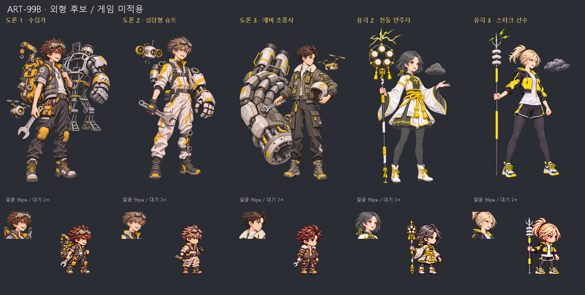
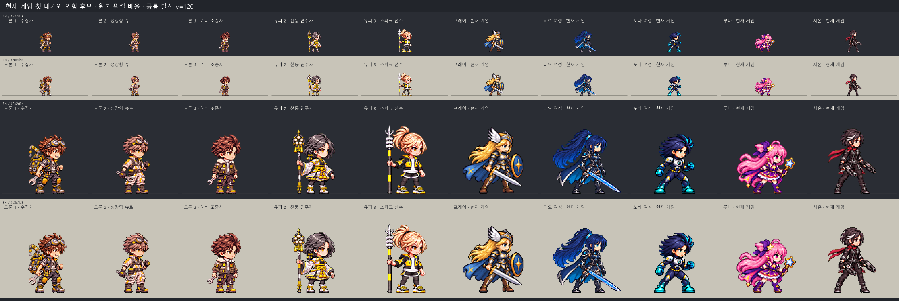

# ART-99B · 도론 1·2·3, 유피 2·3

**도론 1 · 수집가:** 큰 노란 배낭, 접이식 크레인, 매달린 부품과 렌치로 수집형 정비공을 표현했다.  
원화 뒤의 빈 조종석·강철 팔·등 부스터가 미완성 골리앗이며, 소년은 밖에 서 있다. 작은 고철 드론도 보인다.  
다른 두 안보다 배낭이 넓고 거칠며, 대기는 메카·드론 없이 배낭과 렌치를 든 소년이다.

**도론 2 · 성장형 슈트:** 흰 작업복에 한쪽 로켓 펀치 팔, 다리 보강대, 반쪽 부스터와 빈 장착부를 붙였다.  
원화는 성장 중인 단계, 대기는 부품을 얻기 전의 평범한 양팔과 렌치다. 작은 원통형 드론은 원화에만 있다.  
1안의 큰 배낭과 3안의 비행복 대신 밝고 간결한 작업복 실루엣으로 구분했다.

**도론 3 · 예비 조종사:** 올리브 회색 비행 재킷, 흰 털 칼라, 팔에 낀 헬멧과 가슴 리모컨을 사용했다.  
원화에서 부스터가 달린 거대한 골리앗 손을 렌치로 정비하며, 공구상자형 드론이 따른다.  
고글을 벗긴 얼굴과 짧은 재킷이 다른 안과 다르고, 대기에는 헬멧·메카·드론을 넣지 않았다.

**유피 2 · 천둥 연주자:** 짧은 검은 단발·옆 땋은 머리, 흰 의식복과 노란 매듭을 사용했다.  
긴 지팡이의 고리에 작은 북 다섯 개를 달았으며, 원화에는 먹구름과 지팡이 끝 번개가 있다.  
넓은 소매와 고리 장식이 특징이다. 대기에는 먹구름·번개가 없고, 루나의 분홍·보라·별·쌍갈래 머리를 쓰지 않았다.

**유피 3 · 스파크 선수:** 검정·레몬색 운동 재킷, 반바지 아래 타이츠, 운동화와 짧은 한 갈래 포니테일이다.  
후드는 내렸고 흰 티셔츠가 배를 덮는다. 긴 지팡이에 흰 애자 세 개와 피뢰침 끝을 달았다.  
2안의 의식복과 다른 운동복 실루엣이며, 먹구름과 번개는 원화에만 있다.

## 완료 · 현재 상태

다섯 안 모두 **1024×1536 RGBA 원화, 256×256 얼굴, 128×128 대기 한 프레임, 한국어 JSON**을 납품한다. 외형 선택용 후보이며 게임에 연결하지 않았다. `codex/newchar-99b`에서 카드의 art-b 허용 경로만 썼다. 제품 코드와 게임 자산은 수정하지 않았다.

내장 `image_gen`으로 원화 10장(최초 5장·배경 정리 5장), 대기 16장을 생성했다. 원본과 사용한 참조는 `art/raw/newchar-99b/`에 보존했고 커밋 대상에서 제외했다. `prompts.txt`에 보정 요청까지 기록했다. `commit.ps1`은 작성만 하며 실행하지 않는다.

| 파일 묶음 (`art/bakeoff/newchar-2026-11-26/` 아래) | 규격 | 측정한 대기 | 납품 |
|---|---|---|---|
| `doron/1/doron_illustration-1.png`, `doron_face-1.png`, `doron-idle-1.png/.json` | 원화 1024×1536 / 얼굴 256² / 대기 128² | 몸 88px, 약 2.44등신, 내부 대비 기준의 150.60% | 완료 |
| `doron/2/doron_illustration-2.png`, `doron_face-2.png`, `doron-idle-2.png/.json` | 동일 | 몸 88px, 약 2.51등신, 138.58% | 완료 |
| `doron/3/doron_illustration-3.png`, `doron_face-3.png`, `doron-idle-3.png/.json` | 동일 | 몸 88px, 약 2.32등신, 134.10% | 완료 |
| `jupi/2/jupi_illustration-2.png`, `jupi_face-2.png`, `jupi-idle-2.png/.json` | 동일 | 몸 89px / 지팡이 포함 96px, 약 2.47등신, 142.98% | 완료 |
| `jupi/3/jupi_illustration-3.png`, `jupi_face-3.png`, `jupi-idle-3.png/.json` | 동일 | 몸 90px / 지팡이 포함 102px, 약 2.57등신, 135.1% | 완료 |

## 수치로 확인한 것

- `verify_delivery.py`의 자동 검사 **112개가 통과**했다. 규격·알파·발 위치·최소 여백·원본 프레임 일치·파일 해시·UTF-8·커밋 경로 범위를 검사했다. 이것은 아래의 수동 비율·그림 품질 판단과 별개다.
- 다섯 대기 모두 **발 y=120, 최소 여백 7px, 1px 테두리 침범 0, 초록 번짐 0, 이진 알파**다. `normalize.py --cell 128 --grid 1x1 --resample lanczos --sharpen 60 --despill auto --palette none --bg '#00ff00'`을 사용했다. 최종 파일은 도구가 저장한 첫 128px 프레임과 픽셀 단위로 같다.
- 스프라이트별 공통 배율은 순서대로 **0.09421842 / 0.11282051 / 0.10463734 / 0.13812950 / 0.13972603**이다. 머리나 팔다리를 붙이거나 코드로 부위별 변형하지 않았다.
- 내부 대비는 명암 변화량 지표이며 장식 보존률·그림 품질 점수가 아니다. 도론 3은 루나 첫 대기, 나머지는 노바 여성 첫 대기를 기준으로 했다. 모두 90% 기준을 넘었다.
- 원화 모두 알파 0–255이며 외곽 테두리 침범과 정의한 녹색 우세 픽셀은 0이다. 최초 투명 출력에는 넓은 광륜이 남아 내장 도구로 단색 초록 배경으로 다시 정리한 뒤 크로마키·디스필했다. 도론 2 원화만 **그림 전체를 0.93배** 축소해 여백을 확보했다.
- 얼굴은 원화에서 잘랐으며 눈 높이는 수동 기준 약 **39–41%**다. 초상화에서 잘린 머리카락 일부는 얼굴 구도에 따른 크롭이다.

## 수동 측정과 직접 검수

- 원화를 각각 **1024×1536 원본 크기**로 보고, 밝고 어두운 배경에서도 경계·얼굴·양팔 연결·도구의 완전한 형태·양발을 확인했다. 손은 2배 확대판도 남겼다(`*-anatomy.jpg`). 가려진 손가락을 모두 다섯 개라고 자동 판정하지 않았다. 유피 2의 펼친 손은 손가락 일부가 겹치는 각도다.
- 도론 1의 배낭 크레인·빈 조종석·강철 팔, 도론 2의 장착부·다리 보강대·부스터, 도론 3의 큰 손·부스터·헬멧·리모컨을 확인했다. 세 원화 모두 소년은 메카 밖에 있다.
- 유피 2는 북 다섯 개, 유피 3은 애자 세 개와 지팡이의 위·아래 끝을 확인했다. 먹구름은 얼굴을 가리지 않는다. 유피 3의 첫 원화에서 다리와 겹친 지팡이 하단은 내장 도구로 다시 그렸다.
- 최종 대기를 각각 **4배 최근접 확대**로 확인했다. 미사용 생성본도 `attempts-contact.png`에서 정규화한 4배로 비교했다. 도론 1은 과하게 짧아진 두 번째 버전을 버리고 첫 버전을 채택했다. 도론 2와 유피 3은 비율 보정 중간본을 제외했다.
- 등신은 자동 인체 검출값이 아니다. `*-landmarks.png`에 사람이 고른 정수리·턱·발 좌표를 표시했다. 대기는 머리카락까지 포함하되 유피의 포니테일과 지팡이를 제외하며 **좌표 오차 ±1px**다. 원화는 솟은 머리카락·고글·포니테일을 뺀 해부학적 정수리를 추정했고 **±4px**, 순서대로 약 **6.90 / 7.25 / 7.18 / 6.52 / 6.83등신**이다. 정확한 계산값은 `metrics.json`에 있다.

위 비교판은 각 원화, 얼굴 크롭과 실제 대기 후보를 함께 보여준다.

위 비교판은 후보 다섯 안과 현재 프레이·리오 여성·노바 여성·루나·시온의 대기 첫 프레임이다. 위 두 줄은 1배, 아래 두 줄은 3배이며 배경은 `#2a2d34`와 `#c8c4b8`이다.

## 남은 문제 · 다음 권장 단계

- 도론 2의 수동 측정 **2.51등신**은 목표 상단 2.5에 걸치고, 유피 3은 **2.57등신**으로 목표 2.5보다 조금 길다. ±1px 기준점 오차가 있으므로 엄밀한 비율 합격으로 단정하지 않는다. 채택하면 그 한 안의 대기를 최종 앵커로 확정할 때 다시 판단할 수 있다.
- 도론 3·유피 2·유피 3의 원화 인물 높이(머리카락 포함, 수동)는 약 **84% / 82% / 82%**로 카드의 약 88%보다 작다. 큰 메카 손과 긴 지팡이를 함께 담은 구도다. 원화 가장자리의 아주 가는 머리카락·번개는 밝은 배경에서 다소 거칠게 보일 수 있다.
- 유피 3 대기의 애자·금속·의상에 남던 보랏빛은 내장 도구의 다섯 번째 생성본에서 회색 위주로 수정했다. 포즈를 유지한 색상 수정이며 부위를 붙이거나 코드로 다시 칠하지 않았다.
- 1배에서는 손가락, 드론의 나사, 리모컨 버튼, 북의 끈을 낱개로 읽기 어렵다. 드론·메카·먹구름은 원화의 구성 요소이며 별도 게임 자산으로 납품한 것이 아니다.
- 미납 외형은 없다. 애니메이션·게임 실행·전투 연결·시안 월드컵 게시·커밋은 수행하지 않았다. 다음은 리드의 후보 검토와 외형 선택이다.

검증 명령: 지정 Python과 `PYTHONDONTWRITEBYTECODE=1`로 `verify_delivery.py`. 재현은 원본이 있는 이 클론에서 `process.py <doron|jupi> <번호>` → `review_grids.py` → `review_attempts.py` → `package_review.py` 순서다. 새 패키지는 설치하지 않았다.

커밋 스크립트는 경로 72개가 모두 존재하고 무시된 경로가 없음을 확인했다. PowerShell 문법 오류 0개이며 실행하지 않았다.
