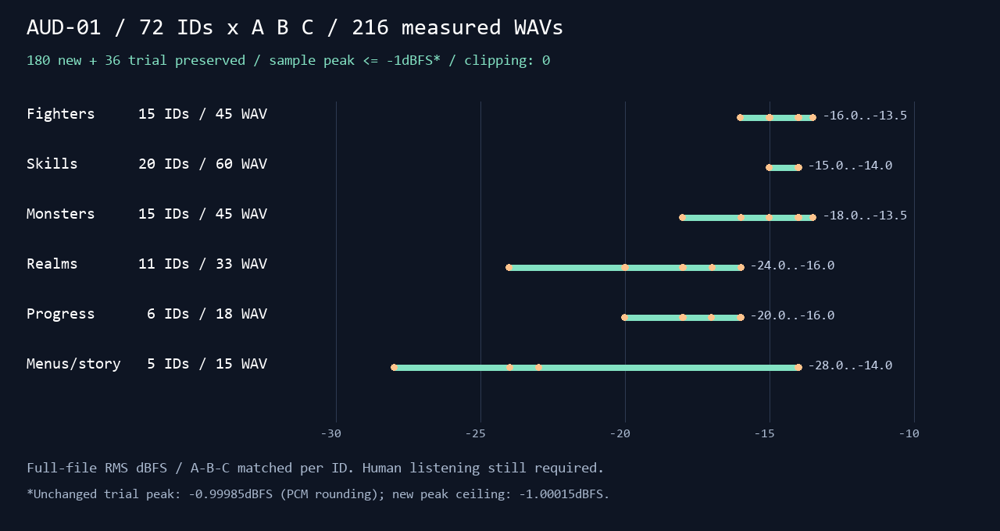
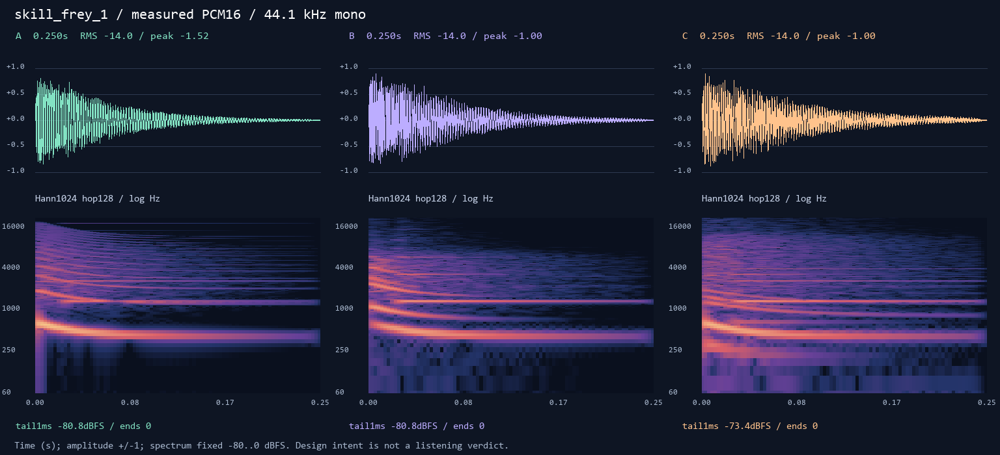

# AUD-01 · 전체 효과음 후보와 청음 페이지

## 완료

카드 순서대로 **새 효과음 60종 × A/B/C = 180 WAV**를 만들었다. 시험 12종·36 WAV를 그대로 보존하여 음악 제외 카탈로그 **72종·216 WAV**가 모두 준비됐다. 원본 수식·고정 시드 잡음만 사용했다. 다운로드·설치·샘플·Godot 실행·게임 파일 수정은 없다. 브랜치는 `codex/aud-01`이다.

| 청음 그룹 | 전체 ID 수 / 스타일당 WAV | A+B+C 전체 WAV | 이번 새 ID / 새 WAV | 포함한 공용 폴백 |
|---|---:|---:|---:|---|
| 선수 | 15 | 45 | 6 / 18 | swing (시험 보존) |
| 기술·궁극기 | 20 | 60 | 20 / 60 | skill_cast, ult_start |
| 몬스터 | 15 | 45 | 15 / 45 | monster_attack |
| 렐름 | 11 | 33 | 10 / 30 | — |
| 성장·진행 | 6 | 18 | 6 / 18 | — |
| 메뉴·스토리 | 5 | 15 | 3 / 9 | — |
| **합계** | **72** | **216** | **60 / 180** | **카탈로그 Fallback 4종을 기능별로 배치** |

재생 상황·카탈로그 그룹·gap_ms도 각 레코드에 남겼다. `story_text`는 글자마다가 아니라 **실제 대사 한 줄 표시 시 한 번**이다. 파일은 `art/audio_bakeoff/<id>-<a|b|c>.wav`, 규격은 모두 **44.1kHz / 16-bit PCM / mono**다.

## 합성 의도 · 청음 판단과 구분

아래는 코드로 설계한 음색이다. 사람이 들었을 때 좋은지, 다른 효과와 잘 섞이는지는 확인하지 않았다.

- **A 칩튠:** 시험판의 사각파·삼각파·계단 잡음. **B 16비트:** 감쇠 FM과 둥근 몸통. **C 레이어드 아케이드:** 순간 잡음·FM 몸통·추가 배음·저역을 동작에 맞춰 겹쳤다.
- **선수:** 가벼운/무거운 휘두름, 위로 튀는 발사 적중, 추진 대시, 두 펄스 회전, 세 음 복귀. 기존 시험의 타격·방어·점프 등은 보존했다.
- **기술:** 프레이=강철·날개·밝은 종, 루나=별 아르페지오·부드러운 종, Brave=주먹/킥 몸통·무거운 별, 유키=종이·부채 스냅·방울, 노바=서보·충전·에너지 펄스, 리오=룬·차원 마찰·검 공명. 공용 두 폴백은 중립 음색이다. 기술은 0.22~0.38초, 궁극기는 0.90~1.18초다.
- **몬스터:** 준비 예고와 10개 행동을 각각 별도 레시피로 썼다. 물기는 턱 스냅, 돌진은 발굽 펄스, 도약은 상승, 내려찍기는 저역 지면 타격, 껍질은 세 공명, 직사/곡사/급강하/순간이동/유도는 서로 다른 음정·시간 구조다. 피격·쓰러짐·정예 뿔피리와 공용 공격도 있다.
- **렐름:** 분출·지진·빛·덩굴·벨트·달빛 문·수풀을 분리했다. 붕괴 경고는 중저음 3박이 0→0.24→0.42초로 빨라지며, 기본음은 330/440Hz다. 날카롭지 않다는 청음 판정은 아니다.
- **성장·메뉴:** 소울·카드·시작·결과·승리, 아주 짧은 이동·대사 틱·넘김. 승리는 직접 작곡한 D-A-D-F-A-D의 **1.65초 팡파르**다. 결과는 승패 공용인 만큼 중립 하강형이다.

## 실제 측정

| 항목 | 결과 |
|---|---|
| 신규 180개의 최대 샘플 피크 | **−1.0001519 dBFS** (≤ −1 통과) |
| 보존한 시험 36개의 최대 샘플 피크 | **−0.9998545 dBFS** (원래 PCM 반올림 +0.0001455dB, 수정하지 않음) |
| 클리핑 | **216개 모두 0샘플** |
| 같은 ID의 A/B/C RMS 차이 최대 | **0.0000791 dB** |
| −60dBFS 기준 시작 지연 최대 | **0.2494ms** (요구 ≤5ms) |
| 첫·끝 샘플 | **216개 모두 0** |
| 마지막 1ms의 가장 큰 피크 | **−57.6396 dBFS** |
| 마지막 1ms 최대 인접 샘플 차이 | **0.00076294 full-scale** |
| 재합성 | **216 PCM 바이트 일치** |
| 시험판 보존 | **36 SHA256 원본 일치** |
| 완결성·중복 | **음악 제외 카탈로그 72/72, 서로 같은 WAV 0** |

| 음량 클래스 | RMS 목표 dBFS |
|---|---:|
| 타격·피격·몬스터 내려찍기 | −13.5 |
| 일반 기술·궁극기·대부분 공격·방어·점프 | −14 |
| 휘두름·대시·공용 기술 | −15 |
| KO·복귀·일부 환경·정예·시작·승리 | −16 |
| 붕괴 경고·카드 적용 | −17 |
| 몬스터 예고·위험 예고·빛·문·카드 제안·결과 | −18 |
| 소울·덩굴·벨트 | −20 |
| 대사 넘김 | −23 |
| 수풀·메뉴 이동 | −24 |
| 대사 한 줄 표시 | −28 |
| **기존 확인·취소** | **−14 유지** |

새 메뉴·대사·환경 보조음은 낮췄지만, 기존 시험의 확인·취소 음량은 카드대로 보존했다. 채택할 때 이 둘의 체감 음량도 비교해야 한다. RMS는 파일 전체 에너지다. 체감 음량·LUFS·oversampled true peak를 측정한 것이 아니다. 낮은 꼬리 진폭과 0 끝점은 절단 클릭 점검이며 귀로 무클릭을 확정한 것은 아니다.

## 시각적 확인

점은 효과별 측정 RMS, 선은 그룹 범위다. 세 스타일은 같은 ID끼리 맞췄고, 메뉴·대사·환경 보조음은 타격보다 낮게 두었다. 기존 확인·취소 때문에 메뉴 그룹의 상단은 −14다.

같은 시간·진폭·색상 축에서 A의 규칙적인 배음, B의 초기 FM 분포, C의 복합 몸통을 비교한다. [전체 ID 그림 목록·직접 살핀 그림 기록](visual-review.md)도 남겼다. ID당 한 장, 총 72장이다.

## 청음 페이지와 검증

- [로컬 청음 페이지](preview/index.html): `audio/`와 함께 열 것. 재생성 산출물로 커밋에는 포함하지 않는다. [빌드·재게시 안내](../../tools/sound_viewer/README.md).
- 그룹·한국어 상황·검색, 상단 스타일 전환, 표시한 효과음 이어듣기, 개별 A→B→C 비교, 음량·정지, 기존 개별 채택 유지.
- 전체 효과음 스타일은 **`sound_picks/style`에 `{style,note}`만 저장**한다. 기존 효과음/음악 문서는 네 필드를 유지하며 전체 스타일을 골라도 덮어쓰지 않는다.
- 효과음도 음악처럼 **외부 WAV**다. 현재 AUD-02a 음악 2곡·6 WAV를 함께 읽었고 신규 음악은 만들지 않았다. 전체 AUD-02 병합 후 재빌드하면 `reports/codex-aud-02*/measurements.json`의 새 곡을 자동으로 읽는다.
- 현재 빌드의 외부 WAV는 **222개 / 41,216,454바이트**, HTML 포함 약 **41.5MB·223파일**, 게시 **1묶음**이다. 250파일·60MB 초과 시 번호 목록을 만든다. HTML의 파일 수·용량도 한도에 포함했다.
- [음원 독립 검사](verification.json): 디스크를 다시 열어 모든 규격·수치·재현성 확인. [216행 표](measurements.md), [원본 수치·SHA256](measurements.json).
- [페이지 검사](viewer-checks.json): Node 모의 DOM·오디오·DB **19개 시나리오 통과**. 실제 외부 파일 바이트, 선택 저장·복원·오류·기존 선택 보존, 필터·전체 스타일 이어듣기, 251파일/60MB 초과 분할과 누락·중복, 미래 AUD-02* 발견을 검사했다.
- 실제 브라우저 UI를 열려 했으나 **로컬 origin `http://127.0.0.1:8077` 승인 거부**로 화면·디코딩은 확인하지 못했다. 게시·실제 DB 저장·모바일·스피커 청음·게임 내 중첩 믹스도 미검증이다.

## 먼저 들을 순서

1. **타격감 기준:** `hit_heavy`(시험) → `hit_launch` → `swing_light`/`swing_heavy`. A/B/C를 비교하고 전체 스타일을 정한다.
2. **캐릭터 구분:** `skill_frey_1` → `skill_luna_1` → `skill_luna_brave_1` → `skill_yuki_1` → `skill_nova_1` → `skill_rio_1`. 같은 스타일에서 정체성이 충분히 다른지 듣는다.
3. **큰 기술·경고:** `ult_frey`, `ult_luna_brave`, `ult_nova`, `monster_windup` → `monster_slam`, `collapse_warning`. 준비 신호가 묻히거나 고음이 피곤하지 않은지 확인한다.
4. **작은 반복음:** `ui_move`, `story_text`, `story_advance`, `bush_rustle`; 기존 `ui_select`/`ui_cancel`과 비교한다.
5. 마지막으로 `victory`와 음악을 비교한다. 현재 페이지는 단독 재생이므로 실제 경기 믹스 승인은 아니다.

## 남은 작업 · 리드와 사용자

요청한 음원·그림·페이지 소스의 미완성 항목은 없다. 남은 것은 **실제 청음**, **AUD-02 병합 후 재빌드·게시**, **브라우저/Artifact DB 검증**, **채택 후 게임 연결·혼합 재생 점검**이다. 여러 게시 요청의 첨부 누적 동작은 호스트에서 확인해야 한다. 현재 한 묶음은 누적 게시가 필요 없다.

`commit.ps1`은 작성·문법 검사만 했으며 **실행하지 않았다**. 지정 파일만 stage하며, 기존 시험 WAV·music_*·다른 유닛 보고서·preview/dist·run.log·__pycache__는 포함하지 않는다. 게임 폴더 변경은 없고 Godot도 실행하지 않았다. 150분 제한 안에서 마쳤다.
