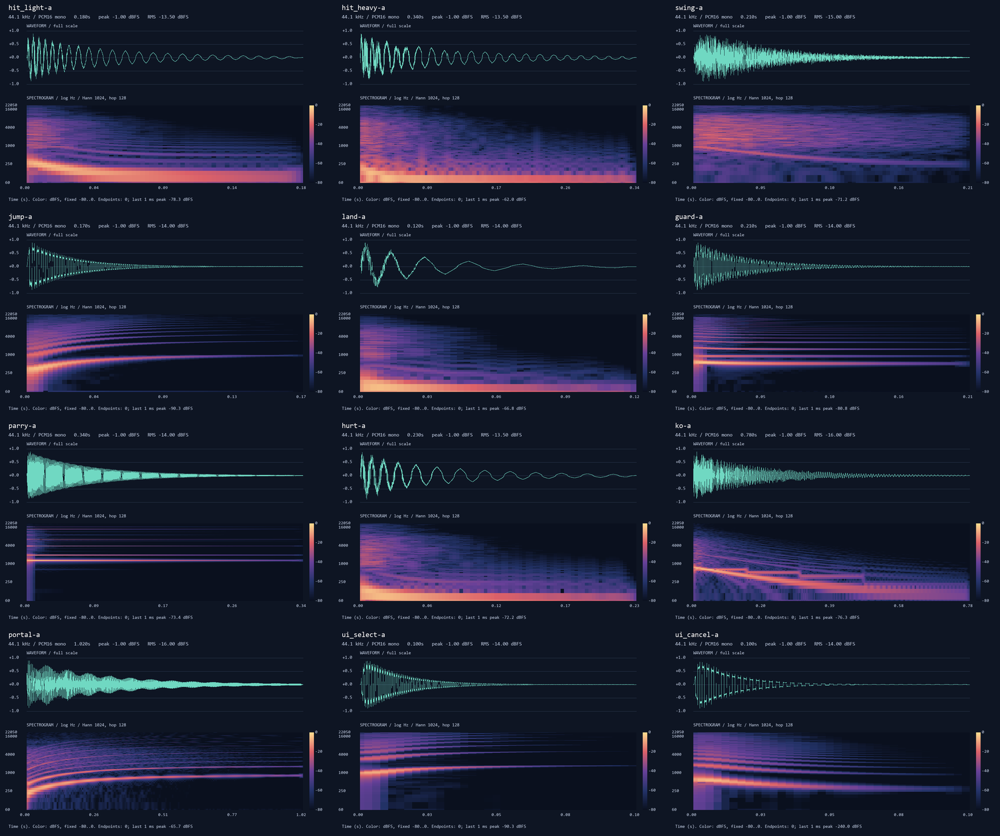
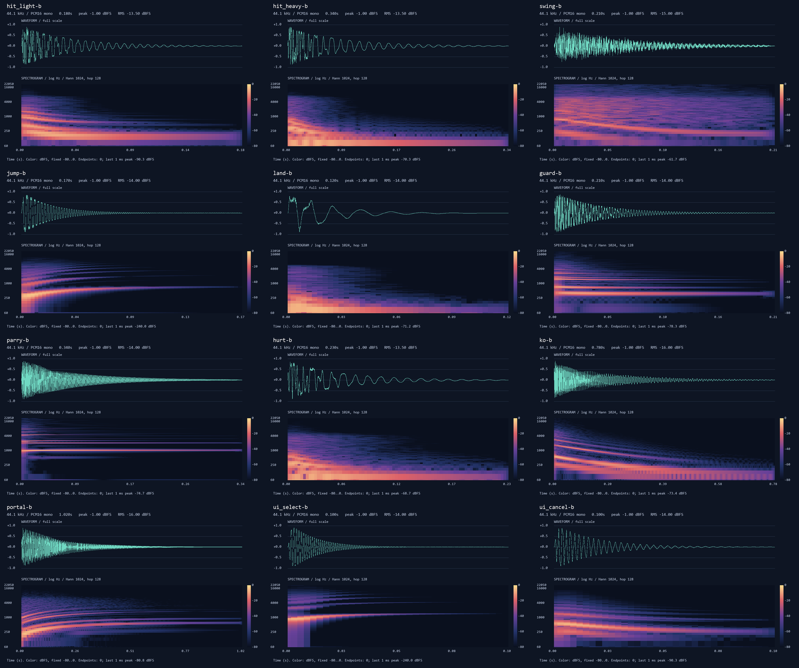
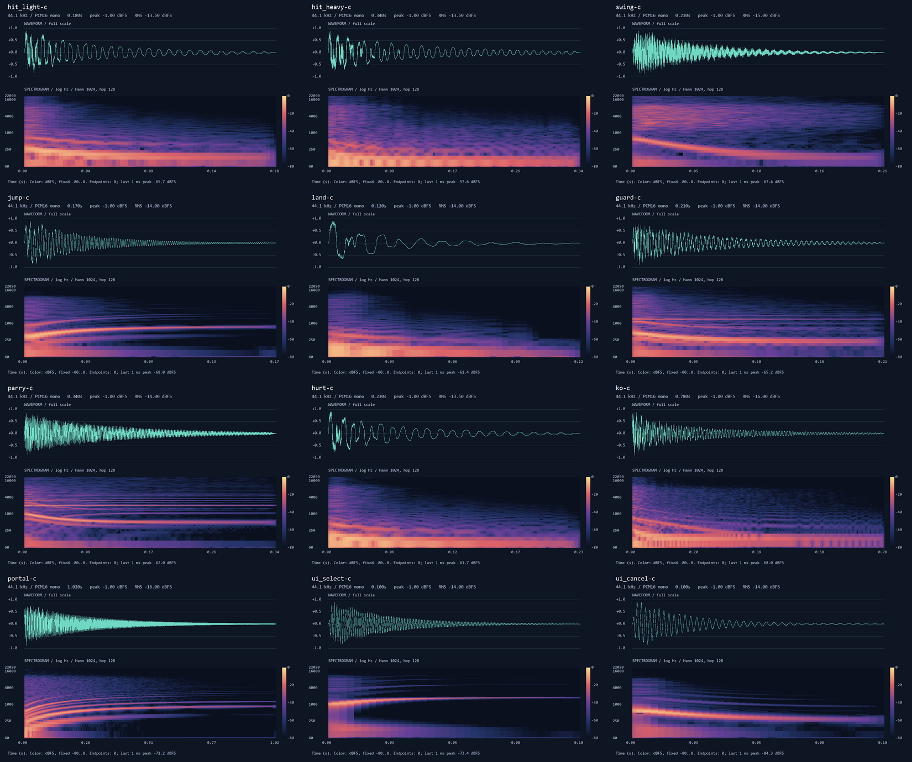

# AUD-01a · 첫 효과음 비교판

완료: 카드 순서대로 12개 동작의 A/B/C 후보 **36 WAV**, 개별 파형+스펙트로그램 **36 PNG**, 스타일별 모음 **3 PNG**, 수치 보고, 재현 가능한 numpy 합성 코드, 청음·채택 페이지를 만들었다. 게임 프로젝트는 수정하지 않았다. 브랜치는 `codex/aud-01a`다.

## 결과와 음색 방향

아래 음색 표현은 **합성 구조·그림·수치에 근거한 의도와 판단**이다. 이 유닛은 직접 소리를 듣지 않았으므로 청음 평가나 사용자 채택 결과로 보고하지 않는다.

| 스타일 | 의도한 소리 | 구성·그림에서 확인한 차이 | 측정 RMS 범위 |
|---|---|---|---:|
| A · 칩튠 | `팟`, `삐융`, `챙`처럼 또렷하고 게임기다운 소리 | 사각·삼각파 배음 선, 계단 잡음, 점프·메뉴의 분명한 상승/하강 | −16.0 ~ −13.5 dBFS |
| B · 16비트 | `톡`, `둥`, `딩`처럼 둥근 몸통과 FM 울림 | 초기에 FM 측대역이 생겼다가 줄어들고 몸통 음정이 남음 | −16.0 ~ −13.5 dBFS |
| C · 레이어드 아케이드 | `탁쿵`, `퍽`, `샤앙`처럼 잡음 뒤에 무게가 남는 소리 | 초반 넓은 잡음층, 몸통의 내려가는 음정, 짧은 저음층 | −16.0 ~ −13.5 dBFS |

각 스타일 모두 피크는 −1.00 dBFS다. 같은 효과의 세 후보는 RMS를 맞췄으며, 전체 36개 중 가장 조용한 클래스는 KO·포털(−16.0), 타격·피격은 −13.5다. RMS를 같게 맞췄다고 체감 음량까지 같다고 판단하지 않는다.

## 청음 페이지

- [빌드된 청음 페이지](../../tools/sound_viewer/dist/index.html): WAV 내장, HTML 하나로 로컬 청음 가능. dist는 git 제외이므로 다른 클론에서는 다시 빌드한다.
- [페이지 소스](../../tools/sound_viewer/index.html), [빌드·Artifact 재게시·선택 읽기 안내](../../tools/sound_viewer/README.md).
- 각 동작에 A/B/C 재생과 전체 재생, DB 연결 시 채택 버튼 하나와 메모 입력. 선택은 `sound_picks/<sound>`에 네 필드로 저장한다.
- Artifact 게시와 게임 연결은 리드의 후속 작업이다. 이 유닛은 실제 채택 기록을 만들지 않았다.

## 측정과 검증

- [파일별 36행 측정표](measurements.md): Peak / RMS / 길이 / 클리핑 수.
- [원본 수치·SHA256](measurements.json), [독립 재검증·스펙트럼 지표](verification.json).
- 36개 모두 **44,100 Hz / 16-bit PCM / mono**, 지정 길이, **클리핑 0**, −1 dBFS 피크 통과.
- 같은 효과 A/B/C RMS 최대–최소 차이: **0.000013 dB**(소수점 둘째 자리에서는 모두 일치).
- −60 dBFS 기준 최대 시작 지연: **0.159 ms**(요구 ≤5ms).
- 첫·끝 샘플은 36개 모두 **0**. 마지막 1ms의 최댓값은 **−57.640 dBFS**, 그 구간의 최대 인접 샘플 차이는 **0.000427 full-scale**다. 끝의 급격한 절단을 수치로 점검했다. 귀로 무클릭을 확정한 결과는 아니다.
- 고정 시드로 36개를 메모리에서 다시 합성했고, 모든 PCM이 납품 파일과 **바이트 단위 일치**했다.
- [페이지 검사](viewer-checks.json): Node 모의 DOM·오디오·DB로 **11개 동작 검사 통과**. 36개 내장 WAV·복사 WAV·원본 WAV 바이트 일치도 포함한다.

명령과 합성 방식은 [audio_synth README](../../tools/audio_synth/README.md)를 따른다. 검증 중 초기 재현 검사에서 실제 측정 RMS를 재합성 목표에 넣어 반올림 차이가 났다. 검증기를 원래 클래스 목표값으로 바로잡았으며 최종 36개 재현 검사는 통과했다. 음원은 바뀌지 않았다.

## 시각적 확인

A의 모든 결과를 확인했다. 상승·하강 음정과 규칙적인 배음 선이 보이며, 파형은 끝에서 0으로 줄어든다.

B의 모든 결과를 확인했다. FM 배음이 초기에 복잡하고 감쇠 뒤에는 몸통 음정이 남는다.

C의 모든 결과를 확인했다. 잡음의 순간 타격과 음정 몸통·저음층이 구분된다. 세 그림은 같은 진폭 축과 색상 척도를 쓴다. [효과별 관찰 기록](visual-review.md)에 36개 결과의 관찰을 정리했다. 개별 큰 그림은 `<sound>-<style>.png`다.

## 현재 제한과 남은 작업

1. **사용자 청음이 필요하다.** 날카로움·따뜻함·타격감은 음색 의도이며, 실제 만족도를 확인하지 못했다. 고음 패링과 메뉴음의 체감 음량도 청음해야 한다.
2. **실제 브라우저 화면·휴대폰 폭·디코딩·Artifact DB는 미검증**이다. 브라우저 목록이 비었고 in-app browser 열기도 사용할 수 없었다. 반응형 CSS와 저장 동작은 코드·모의 환경에서만 검증했다.
3. **게임 내 중첩 재생·타이밍·믹스는 미검증**이다. 카드대로 게임 폴더는 변경하지 않았다. 다음은 리드의 새 Artifact 게시 → 사용자 선택 → 후속 연결 카드다.
4. `commit.ps1`은 작성하고 문법만 확인했으며 **실행하지 않았다**. 자신의 파일만 명시적으로 stage하고 `git add -f` 및 `art/raw/`를 사용하지 않는다. 기존 빈 `run.log`와 다른 유닛의 파일은 포함하지 않는다.

120분 제한 안에서 요청 납품물은 모두 작성했다. 미완성 음원 종류는 없다. 남은 것은 위의 실제 청음·호스팅·게임 통합 검증이다.
