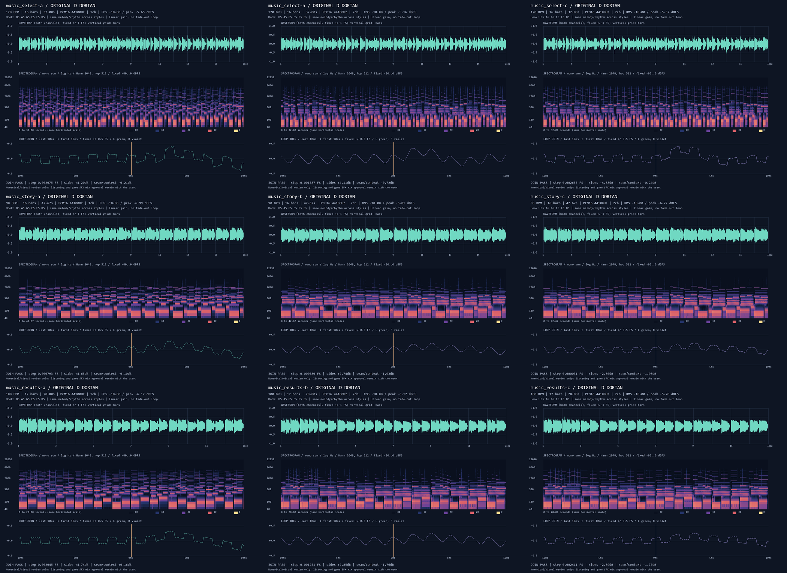

# AUD-02 · 선택·스토리·결과 음악 후보 완료

**오리지널 3곡 × A/B/C = WAV 9개**를 작곡·합성했다. 각 후보의 마디별 악보 TXT/JSON 9쌍, 파형·스펙트로그램·루프 경계 PNG 9개와 모음 그림, 측정·검증 JSON을 남겼다. `codex/aud-02`에서 지정 Python의 numpy로 모든 오디오를 합성했으며 샘플·다운로드·설치는 없다. Pillow는 그림에만 사용했다.

## 먼저 들을 것

1. **[선택 B](../../art/audio_bakeoff/music_select-b.wav)**의 0–8초를 기준으로 듣고 [A](../../art/audio_bakeoff/music_select-a.wav)·[C](../../art/audio_bakeoff/music_select-c.wav)를 같은 음량으로 비교한다. 기존 타이틀/전투 B와 같은 FM 계열이므로 비교의 출발점으로 제안한 순서이며, 청음 후 우수하다고 판정한 추천은 아니다.
2. **[스토리 B](../../art/audio_bakeoff/music_story-b.wav)** 0–10.7초: 두 마디 모티프와 낮은 응답. 대사를 읽으면서 선율이 주의를 빼앗는지, [A](../../art/audio_bakeoff/music_story-a.wav)·[C](../../art/audio_bakeoff/music_story-c.wav)의 고음이 거슬리는지 판단한다.
3. **[결과 B](../../art/audio_bakeoff/music_results-b.wav)** 0–9.6초: 4.8초까지 두 마디 팡파르, 그 뒤의 이완. [A](../../art/audio_bakeoff/music_results-a.wav)·[C](../../art/audio_bakeoff/music_results-c.wav)와 비교하고, 각 곡을 두 번 반복해 경계를 듣는다.

## 작곡·악기: 아래는 설계 의도

공통 모티프는 **D5 A5 G5 E5 F5 D5**, 조성은 D 도리안(D E F G A B C), 박자는 4/4다. 직접 들은 평가가 아니며 선율의 만족도·고음 피로도·대사와의 어울림은 사용자 판단으로 남긴다.

| 곡 | 구성·모티프 위치 | 템포·마디·길이 |
|---|---|---|
| 선택 | 1·9마디에 새로운 엇박 훅, 5–8마디에 낮은 응답. 전투보다 적은 선율·드럼 어택으로 가벼운 자신감을 의도 | 120 BPM · 16마디 · 32.00초 |
| 스토리 | 1–2·9–10마디에 늘인 모티프, 3–8·11–16마디의 낮은 응답. 고역과 어택을 줄여 신비·다짐과 대사 공간을 의도 | 90 BPM · 16마디 · 42.67초 |
| 결과·엔딩 | 1–2마디(0–4.8초) 팡파르 → 3마디부터 긴 음·드문 북. 9마디 훅은 낮춘 강도로 재현. 따뜻한 회고를 의도 | 100 BPM · 12마디 · 28.80초 |

| 곡·스타일 | 악기·설계 |
|---|---|
| 선택 A | 엇박 펄스 훅·삼각파 베이스·작은 잡음 북: 가벼운 영웅 선택. 펄스 두 파트·삼각파 저음·계단 잡음 북, 모노(중앙에 모으는 칩튠) |
| 선택 B | FM 훅·베이스와 짧은 패드 응답: 둥근 16비트 선택곡. FM 선율·FM 저음·배음 패드·합성 북·23/41/67/89ms 방 잔향, 스테레오(화성·공간 분리) |
| 선택 C | 칩 훅·넓은 패드·절제한 겹친 드럼: 산뜻한 선택곡. 칩 선율·FM 저음·부드러운 패드·저음/잡음층을 겹친 북·같은 잔향, 스테레오(중앙 선율·측면 화성) |
| 스토리 A | 고역을 줄인 펄스의 느린 모티프·삼각파·드문 잡음 북. 펄스 두 파트·삼각파 저음·계단 잡음 북, 모노(중앙에 모으는 칩튠) |
| 스토리 B | 부드러운 FM 선율·긴 패드·낮은 북: 대사 아래의 여정. FM 선율·FM 저음·배음 패드·합성 북·23/41/67/89ms 방 잔향, 스테레오(화성·공간 분리) |
| 스토리 C | 낮춘 칩 선율·넓은 패드·작은 겹친 북: 신비와 다짐. 칩 선율·FM 저음·부드러운 패드·저음/잡음층을 겹친 북·같은 잔향, 스테레오(중앙 선율·측면 화성) |
| 결과·엔딩 A | 두 마디 펄스 팡파르에서 여유로운 칩 선율로. 펄스 두 파트·삼각파 저음·계단 잡음 북, 모노(중앙에 모으는 칩튠) |
| 결과·엔딩 B | FM 팡파르 뒤 둥근 저음·따뜻한 패드로 쉬어가는 결과곡. FM 선율·FM 저음·배음 패드·합성 북·23/41/67/89ms 방 잔향, 스테레오(화성·공간 분리) |
| 결과·엔딩 C | 칩 팡파르·겹친 북 뒤 패드와 긴 음으로 마무리. 칩 선율·FM 저음·부드러운 패드·저음/잡음층을 겹친 북·같은 잔향, 스테레오(중앙 선율·측면 화성) |

같은 곡의 A/B/C는 선율·저음·드럼 악보가 같다. A는 두 번째 펄스가 단음 화성을, B/C는 패드가 코드를 연주한다. 스토리는 펄스 선율 배음을 2.4kHz까지, 펄스 화성을 2.2kHz까지 제한하고, FM 변조량·2배음과 선율 게인을 줄였으며 선율 어택을 5→25ms로 완만하게 했다. 특정 하드웨어 채널 제한을 정밀하게 재현하는 에뮬레이터는 아니다.

결과곡의 팡파르는 루프가 돌 때 다시 나온다. 일회성 도입부와 별도 본체 파일로 나눈 구조는 아니다. 경계의 D는 앞 회차에서 이어지는 음으로 시작하므로 첫 재생은 부드럽게 열린다.

## 실제 측정·검증

**LUFS는 측정하지 않았다. 카드의 대체 기준인 전곡 RMS −18 dBFS를 사용했다.** 아래는 납품 WAV를 다시 읽은 수치다. 피크는 sample peak이며 oversampled true peak는 미측정이다. PCM 16-bit·44,100Hz, 클리핑은 9개 모두 0, 각 파일은 8MB 이하(10진 MB)다.

| WAV | RMS dBFS | 피크 dBFS | MB | 경계 차이 FS | 전후 10ms 차이 dB | 경계/주변 dB |
|---|---:|---:|---:|---:|---:|---:|
| [선택 A](../../art/audio_bakeoff/music_select-a.wav) | -18.00 | -5.65 | 2.822 | 0.002075 | +4.20 | -0.21 |
| [선택 B](../../art/audio_bakeoff/music_select-b.wav) | -18.00 | -5.16 | 5.645 | 0.001587 | +4.11 | -0.72 |
| [선택 C](../../art/audio_bakeoff/music_select-c.wav) | -18.00 | -5.37 | 5.645 | 0.002655 | +4.88 | -0.24 |
| [스토리 A](../../art/audio_bakeoff/music_story-a.wav) | -18.00 | -6.99 | 3.763 | 0.000793 | +4.65 | -0.10 |
| [스토리 B](../../art/audio_bakeoff/music_story-b.wav) | -18.00 | -6.81 | 7.526 | 0.000580 | +2.74 | -1.93 |
| [스토리 C](../../art/audio_bakeoff/music_story-c.wav) | -18.00 | -6.72 | 7.526 | 0.000031 | +2.80 | -1.98 |
| [결과·엔딩 A](../../art/audio_bakeoff/music_results-a.wav) | -18.00 | -6.12 | 2.540 | 0.002045 | +4.74 | +0.16 |
| [결과·엔딩 B](../../art/audio_bakeoff/music_results-b.wav) | -18.00 | -6.12 | 5.080 | 0.001251 | +2.85 | -1.76 |
| [결과·엔딩 C](../../art/audio_bakeoff/music_results-c.wav) | -18.00 | -5.70 | 5.080 | 0.002411 | +2.89 | -1.77 |

마지막 D를 첫 D에 붙임줄로 이어 중복 어택을 생략하고, 음의 릴리스와 짧은 잔향은 원형 버퍼에 합산했다. 끝 페이드·무음 패딩·경계 크로스페이드·압축·리미터 없이 DC 제거와 일정 게인만 적용했다.

- 루프 경계는 정확한 마디 끝이며 샘플 수가 `마디 × 4 × 60/BPM × 44100`과 일치한다.
- 경계 마지막→첫 샘플 차이 <0.01 FS, 전후 각 10ms RMS 차이의 절댓값 <6dB, 합친 20ms RMS가 주변 400ms보다 12dB 넘게 낮지 않은지 **9개 모두 통과**했다. 전후 음량이 완전히 같다는 의미는 아니다. 경계 뒤 저음 어택으로 측정값이 증가한다.
- [검증기 결과](verification.json): **새 9개 + 기존 6개 = 15개**를 메모리에서 재합성해 납품 PCM과 바이트 단위 일치. 마디별 TXT·JSON 악보, 도리안 음계·모티프 최소 두 번·A/B/C 공통 파트도 대조했다.
- [사전 해시](baseline.json): 기존 타이틀·전투 WAV 6개와 공유 `synth.py`는 변경 전 SHA256 그대로다. 기존 AUD-02a 보고서도 수정하지 않았다.
- 원수치·SHA256: [measurements.json](measurements.json). 기존 AUD-02a의 `{motif, records}` 구조와 `sound`, `track`, `style`, `file`, `label`, `note` 등 필드를 유지해 AUD-01 청음 페이지가 읽을 입력을 준비했다. 이 유닛에서 페이지를 수정·빌드·게시하거나 페이지의 읽기를 확인하지는 않았다.

### 밀도·고역: 측정 사실

| 곡 | 선율 어택/초 | 드럼 어택/초 | 최고 선율음 |
|---|---:|---:|---|
| 선택 | 1.844 | 4.000 | B5 |
| 스토리 | 0.844 | 0.938 | A5 |
| 결과·엔딩 | 1.181 | 1.389 | B5 |
| 기존 전투 | 2.472 | 9.500 | D6 |

어택 수는 악보상 발음 수이며, 루프 첫 붙임줄은 새 어택으로 세지 않는다. 드럼은 킥·스네어·하이햇 합계다. RMS를 맞췄으므로 스토리의 전곡 평균 음량 자체가 더 낮다는 뜻은 아니다.

| 곡 | 4kHz 이상 에너지 비중 A / B / C |
|---|---|
| 선택 | 1.1197% / 0.0769% / 0.7130% |
| 스토리 | 0.0025% / 0.0016% / 0.0013% |
| 결과·엔딩 | 0.9063% / 0.0428% / 0.5730% |

고역 비중은 전곡 L/R 평균(모노 합성)의 FFT 전력 비율이다. 스토리의 고역·발음 밀도가 적다는 근거이며, 실제 대사 가독성이나 청각 피로가 검증됐다는 의미는 아니다. [supplemental.json](supplemental.json)에 결과곡 첫 두 마디/나머지 마디 RMS와 스테레오 상관계수도 남겼다. 결과 팡파르는 이후 구간보다 RMS가 1.54–2.03dB 높다. B/C의 L/R 상관계수는 0.990–0.999로 중앙 성분이 강하고 실제 좌우 분리는 미세하다. 넓은 화성 배치는 설계 의도이지 큰 스테레오 폭을 측정한 평가가 아니다.

## 시각적 확인



위부터 선택·스토리·결과, 왼쪽부터 A·B·C다. 각 칸은 전곡 파형 → 로그 주파수 스펙트로그램 → 끝 10ms와 첫 10ms 연결이며, 주황선이 루프 경계다. 세 곡의 시간 길이는 서로 다르므로 가로 폭만으로 음표 밀도를 직접 비교하지 않는다. 스토리의 고역이 적고, 경계에서 별도 단절이 두드러지지 않는 것을 그림으로 확인했다.

| 곡 | A | B | C |
|---|---|---|---|
| 선택 | [그림](music_select-a.png) · [악보](music_select-a-score.txt) | [그림](music_select-b.png) · [악보](music_select-b-score.txt) | [그림](music_select-c.png) · [악보](music_select-c-score.txt) |
| 스토리 | [그림](music_story-a.png) · [악보](music_story-a-score.txt) | [그림](music_story-b.png) · [악보](music_story-b-score.txt) | [그림](music_story-c.png) · [악보](music_story-c-score.txt) |
| 결과·엔딩 | [그림](music_results-a.png) · [악보](music_results-a-score.txt) | [그림](music_results-b.png) · [악보](music_results-b-score.txt) | [그림](music_results-c.png) · [악보](music_results-c-score.txt) |

[시각 검토 기록](visual-review.md)에 그림별 관찰과 한계를 적었다. 그림·수치 검사로 실제 무클릭이나 음악의 완성도를 확정하지 않았다.

## 재생성·검증 명령

저장소 루트에서 실행한다. 출력 순서는 카드대로 선택 → 스토리 → 결과다. 기본 합성 명령은 새 AUD-02 경로만 쓴다. `--collection aud02a`는 기존 시험을 재생성하는 명시적 선택이며 이번 작업에서는 실행하지 않았다.

```powershell
$env:PYTHONDONTWRITEBYTECODE = '1'
$audioPython = 'C:/Users/TH/.cache/codex-runtimes/codex-primary-runtime/dependencies/python/python.exe'
& $audioPython tools/audio_synth/music.py --collection aud02
& $audioPython tools/audio_synth/verify_music.py
& $audioPython reports/codex-aud-02/build_report.py
```

`music.py --plots-only --collection aud02`는 기존 새 WAV에서 그림·악보·측정 문서만 새로 만든다. 검증기의 기본값은 두 묶음 전체이며 `--collection aud02`로 새 묶음만 고를 수도 있다. 검증 결과는 항상 이 유닛의 `verification.json`에 기록한다.

## 현재 상태·남은 작업

- **완료:** 9 WAV, 악보 9쌍, 개별 분석 그림 9개·모음 1개, 측정·재현 검증, 한국어 보고서, [commit.ps1](commit.ps1). 커밋 스크립트는 작성·구문 검사만 했고 실행하지 않았다. 변경 경로는 카드 허용 범위이며 게임 파일 변경·Godot 실행은 없다.
- **남은 작업:** 사용자 직접 청음·스타일 채택. 실제 대사/SFX와 겹칠 때의 체감 음량·마스킹, 반복 경계의 청각적 자연스러움, 결과곡이 패배 화면에도 어울리는지는 미검증이다.
- **다음 권장 단계:** AUD-01의 청음 페이지에 이 묶음과 기존 6 WAV를 sidecar로 함께 반영하고, 사용자가 스타일을 고른 뒤 리드가 게임에 연결한다. 이번 카드 안에서 남긴 미제작 곡은 없다. 게시·채택·게임 연결은 수행하지 않았다.
