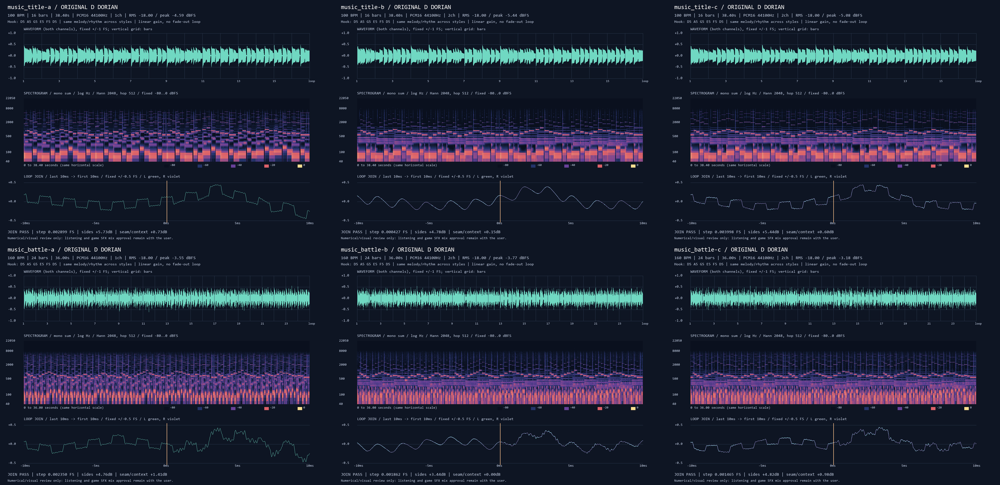

# AUD-02a · 첫 음악 후보 완료

타이틀·전투의 오리지널 곡 두 개를 작곡하고 A/B/C로 각각 합성했다. **6 WAV, 6개 마디별 악보 TXT와 동일 데이터 JSON, 6개 분석 PNG와 모음 그림**, 측정·검증 결과, 음악을 추가한 청음 페이지를 준비했다. 브랜치 `codex/aud-02a`; 게임 프로젝트 파일은 변경하지 않았고 Godot은 실행하지 않았다.

## 작곡과 음색

공통 모티프는 **D5 → A5 → G5 → E5 → F5 → D5**. 단조의 F와 도리안의 밝은 B를 함께 쓰는 **D 도리안(D E F G A B C)**으로, 나무·룬·여행의 신비감과 작은 위험을 의도했다. 기존 곡·샘플·다운로드·외부 오디오 패키지 없이 직접 악보를 작성했다. 아래 음색 설명은 합성 설계에 근거한 **의도이며 직접 청음한 평가가 아니다.**

| 곡·스타일 | 템포·길이 | 의도한 소리와 악기 | 채널 선택 |
|---|---|---|---|
| 타이틀 A | 100 BPM · 38.4초 | 두 펄스의 또렷한 룬 선율·아르페지오, 삼각파 저음과 작은 잡음 북. 가볍고 신비한 고전 게임 시작 화면 | 모노: 칩 악기의 중앙 집중·단순함 |
| 타이틀 B | 100 BPM · 38.4초 | 종을 닮은 FM 선율, 둥근 FM 저음, 부드러운 코드 패드와 작은 방 잔향. 따뜻한 탐험 초대 | 스테레오: 화성과 짧은 공간감 |
| 타이틀 C | 100 BPM · 38.4초 | 맑은 펄스 선율, 패드, 부드럽게 낮춘 겹친 킥·스네어. 고전 선율과 넓은 배경의 결합 | 스테레오: 중앙 선율·저음과 양옆 패드 |
| 전투 A | 160 BPM · 36초 | 같은 6음 훅을 빠르게 연주하는 두 펄스, 뛰는 삼각파 베이스, 짧은 계단 잡음 드럼. 밝고 경쾌한 질주 | 모노: 칩 악기의 선명한 중심 |
| 전투 B | 160 BPM · 36초 | FM 선율·탄력 있는 FM 베이스, 짧은 패드 응답, 합성 킥·스네어와 방 잔향. 둥글고 빠른 16비트 전투 | 스테레오: 중앙 타격과 화성 분리 |
| 전투 C | 160 BPM · 36초 | 칩 선율 위에 부드러운 패드, 저음층·짧은 잡음층을 겹친 킥·스네어. 여섯 후보 중 타격 추진력을 강조 | 스테레오: 선율은 중앙, 패드는 측면 |

타이틀은 4/4·16마디, 전투는 4/4·24마디다. 훅은 타이틀 **1·9마디**, 전투 **1·9·17마디**에 정확히 돌아온다. 전투 13–16마디는 긴 음으로 숨을 돌리고 17마디에 훅이 돌아온다. 같은 곡의 선율·베이스·드럼 악보는 A/B/C가 같고, 화성은 A의 단음 아르페지오와 B/C의 짧은 코드 패드로 편곡했다. 전투에서도 선율을 매 박 잘게 채우거나 긴 고역 잡음을 깔지 않았다.

## 실제 측정

**LUFS는 측정하지 않았으며 카드에서 허용한 RMS −18 dBFS 대체 기준을 사용했다.** 아래 값은 납품 PCM16 WAV를 디스크에서 다시 읽어 측정한 값이다. 피크는 샘플 피크이며 oversampled true peak는 아니다. 모두 44,100Hz·16-bit PCM, 클리핑 **0**, 8MB 이하.

| WAV | RMS dBFS | Peak dBFS | 초 | MB(10진) | 경계 샘플 차이 FS | ±10ms 측정 |
|---|---:|---:|---:|---:|---:|---|
| [타이틀 A](../../art/audio_bakeoff/music_title-a.wav) | −18.00 | −4.59 | 38.40 | 3.39 | 0.002899 | 통과 |
| [타이틀 B](../../art/audio_bakeoff/music_title-b.wav) | −18.00 | −5.44 | 38.40 | 6.77 | 0.000427 | 통과 |
| [타이틀 C](../../art/audio_bakeoff/music_title-c.wav) | −18.00 | −5.08 | 38.40 | 6.77 | 0.003998 | 통과 |
| [전투 A](../../art/audio_bakeoff/music_battle-a.wav) | −18.00 | −3.55 | 36.00 | 3.18 | 0.002350 | 통과 |
| [전투 B](../../art/audio_bakeoff/music_battle-b.wav) | −18.00 | −3.77 | 36.00 | 6.35 | 0.001862 | 통과 |
| [전투 C](../../art/audio_bakeoff/music_battle-c.wav) | −18.00 | −3.18 | 36.00 | 6.35 | 0.001465 | 통과 |

### 루프 검사 방법

마디 끝과 시작을 정확히 연결했다. 마지막 D음을 첫 D음과 붙임줄로 연결하고 중복 어택을 생략한다. 음의 릴리스·23/41/67/89ms 방 잔향을 원형 버퍼에 합산한다. **끝 페이드·무음 패딩·경계 크로스페이드가 없다.** DC 제거 뒤 일정 게인만 적용했으며 압축·리미터를 쓰지 않았다.

- 경계 마지막→첫 샘플 차이: 최대 **0.003998 FS**(−47.96 dBFS), 기준 <0.01 FS. 실제 차이는 주위의 정상 샘플 기울기보다 작고 그림에서 경계의 독립적인 수직 단절이 보이지 않는다.
- 끝 10ms와 첫 10ms RMS 차이: **+3.44~+5.73dB**, 기준 절댓값 <6dB. 첫 박 킥·베이스의 정상 어택으로 상승하며 경계에서 꺼지지 않는다. 양쪽 에너지가 완전히 같다는 뜻은 아니다.
- 합친 20ms 경계 RMS / 주변 400ms RMS: **+0.0007~+1.41dB**. 기준 −12dB보다 높고 경계의 에너지 구멍이 없다.
- 전체 샘플 수가 `마디 × 4 × 60/BPM × 44100`과 일치한다. PCM 재합성·SHA256·악보와 출력 대조는 [verification.json](verification.json), 반올림 전 수치는 [measurements.json](measurements.json)에 있다.

이는 수치·시각 검증이며 귀로 무클릭이나 음악적 만족도를 확정한 것은 아니다.

## 시각적 확인

각 칸 위는 전곡 파형, 중간은 고정 −80~0dBFS 색상·40–22,050Hz 로그축 스펙트로그램, 아래는 **끝 10ms → 시작 10ms** 확대다. 주황선이 실제 루프 경계다. 모음은 축소본이며 개별 그림에서 세부를 확인한다.

| 곡 | A 분석·악보 | B 분석·악보 | C 분석·악보 |
|---|---|---|---|
| 타이틀 | [PNG](music_title-a.png) · [악보](music_title-a-score.txt) | [PNG](music_title-b.png) · [악보](music_title-b-score.txt) | [PNG](music_title-c.png) · [악보](music_title-c-score.txt) |
| 전투 | [PNG](music_battle-a.png) · [악보](music_battle-a-score.txt) | [PNG](music_battle-b.png) · [악보](music_battle-b-score.txt) | [PNG](music_battle-c.png) · [악보](music_battle-c-score.txt) |

여섯 그림을 직접 확인했다. A의 펄스 배음, B의 매끄러운 FM 파형, C의 펄스+패드, 전투의 촘촘한 저역 타격을 그림에서 구별했다. 8kHz 위는 대체로 어둡고 고역 잡음은 짧은 타격으로 나타난다. [파일별 시각 검토](visual-review.md)에 관찰과 제한을 기록했다.

## 청음 페이지와 검사

- [빌드된 페이지](../../tools/sound_viewer/dist/index.html): **음악** 두 카드에 세 스타일, 한국어 설명, 재생·정지·반복. 기존 효과음은 유지했다.
- 효과음 36개는 기존처럼 내장. 음악 6개는 **외부 `audio/music_*.wav`**이며 `dist/files.json`에 모든 파일을 기록했다. **HTML만 재게시하면 음악이 빠진다.**
- 같은 `sound_picks` 컬렉션에 **`music_title`**, **`music_battle`** 문서 id를 사용한다. 기존 네 필드와 DB 연결·실패·복원 패턴을 유지한다.
- 모의 DOM·Audio·DB로 **14개 동작 검사**를 통과했다. 기존 효과음 순서·정지·음량·채택, 음악 반복 전환·상호 중단·외부 파일·두 음악 id 채택·복원을 포함한다. [viewer-checks.json](viewer-checks.json)
- 재생성 명령: [합성 도구 README](../../tools/audio_synth/README.md). 재게시 경로·sidecar 동봉·기존 db 보존: [청음 페이지 README](../../tools/sound_viewer/README.md).

## 현재 상태·남은 작업

1. **완료:** 후보 6개와 악보·그림·검증 자료, 청음 페이지와 빌더·검증기, 실행하지 않은 [commit.ps1](commit.ps1). 설치·다운로드·샘플 사용이 없으며 모든 쓰기는 카드 허용 경로에 한정했다.
2. **미검증:** 직접 청음, 체감 음량·선율의 만족도·고음 피로도·타격감, 게임 내 효과음 마스킹. 특히 같은 RMS라도 칩 파형이 FM보다 선명하게 느껴질 수 있다. 아직 어떤 스타일도 실제 사용자 채택으로 간주하지 않는다.
3. **미검증:** 실제 브라우저 화면·오디오 디코딩·루프 스케줄링·모바일, 실제 Artifact DB. computer-use에서 연결된 앱·브라우저가 모두 빈 목록이었다. 모의 검사는 실제 브라우저 재생 품질을 보장하지 않는다.
4. **다음 권장 단계:** 리드가 같은 사운드 Artifact에 HTML과 sidecar 파일을 함께 재게시(db 유지) → 사용자가 두 곡의 A/B/C 청음·채택 → 선택된 음악의 게임 내 효과음 믹스와 반복을 별도 카드에서 검증한다. 이 유닛은 게시·게임 연결·커밋 실행을 하지 않았다.
