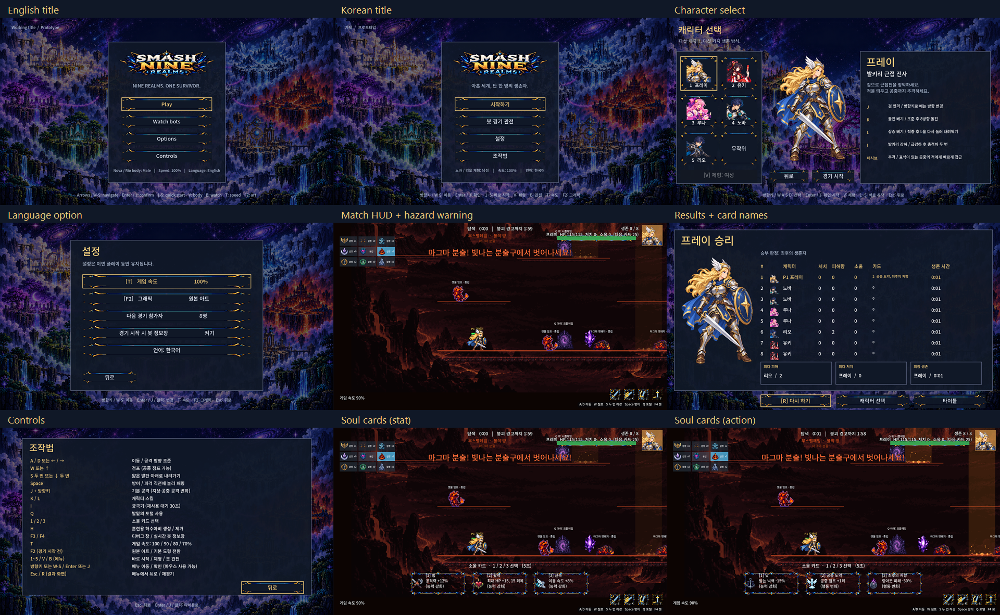

# CODEX-LANG-01 작업 결과

- 작업일: 2026-10-22
- 브랜치: `codex/lang-01`, 시작 커밋: `8fa7430`
- 상태: 번역·언어 옵션·한글 배치·테스트·캡처 완료. `.git` 쓰기 제한으로 커밋은 하지 못했으며 `commit.ps1`을 준비했다.

## 완료한 내용

`assets/i18n/strings.csv`에 **315개 키**를 등록했다. 키와 `en` 열은 기존 영어 원문을 그대로 유지하며, `ko` 열에는 짧은 게임 한국어를 넣었다. 고정 문구와 동적으로 합치는 문구 모두 표시 단계에서 번역한다. 실행 창의 제목도 언어를 따르며, 저장 폴더를 결정하는 프로젝트 이름은 바꾸지 않았다.

| 영역 | 번역한 내용 |
| --- | --- |
| 타이틀·메뉴 | 시작, 봇 관전, 설정, 조작법, 안내 문구, 현재 체형·속도·언어 |
| 캐릭터 선택 | 5명 이름·역할·설명·J/K/L/I·패시브 설명, 체형, 무작위, 경기 시작 |
| 설정·조작법 | 속도·그래픽·참가자 수·봇 정보창·언어, 조작키 설명 |
| 결과 | 승리·무승부·판정 이유·열 제목·수상 항목·카드 이름·버튼·툴팁 |
| 경기 HUD | 단계·다음 이벤트·속도·생존자·소울·렐름 이름과 부제·미니맵 상태·조작 안내 |
| 경기 중 알림 | 붕괴·중앙 개방·서든데스·승리·탈락·포털 이동·카드 선택·훈련 허수아비·속도 변경 |
| 렐름·몬스터 | 기믹 이름과 경고, 포털 방향·목적지, 봉인·붕괴 표시, 몬스터 18종 이름·정예 접두사·중립/적대·정예 출현 |
| 성장·전투 표시 | 소울 카드 6종 이름·효과·종류·선택 시간, 카드 획득 부유 문구, 크리스탈 소울 획득, 궁극기 컷인 이름 |

설정에 `Language: English` / `언어: 한국어` 버튼을 추가했다. `Language.cycle()` 후 기존 그래픽 전환과 같은 경로로 프런트엔드를 다시 만들어, 다음 화면과 다음 경기에 선택한 언어를 적용한다. 타이틀 하단에도 현재 언어를 표시한다.

설정 화면은 5개 항목이 들어가도록 간격을 조정했고, 메뉴 라벨에는 한글 줄바꿈을 적용했다. 경기 시계 글자는 17px로 맞췄다. 활력 카드 문구는 기존 상자 안에 한 줄로 들어가도록 `최대 HP +15, 15 회복`으로 줄였다. **HP 바와 소울 카드 선택 패널의 생성·크기·배치 로직은 변경하지 않았다.** 해당 부분은 문구를 `tr()`에 통과시키는 변경만 했다.

메인 씬 없이 몬스터 등을 생성하는 기존 테스트도 영어로 실행되도록, 번역 문구를 만드는 컴포넌트의 생성 시 기존 `Language.load_saved()`를 호출한다. 경기 단계·캐릭터/몬스터 내부 이름·렐름 데이터·카드 ID·아트 경로는 영어 원문을 유지했다. 게임 규칙·전투 수치·타이밍·AI 판단은 바꾸지 않았다.

## 영어로 남는 부분과 이유

- **F3 디버그 창과 F4 봇 판단 정보**: 작업 카드에서 허용한 개발 도구다. 내부 상태명과 진단 문구를 영어로 유지한다.
- **이미지 로고의 `SMASH NINE REALMS`**: 기존 PNG 안에 그려진 브랜드명이며, 해당 아트 파일은 쓰기 허용 범위 밖이다. 코드로 그리는 대체 타이틀에는 한국어 번역을 등록했다.
- **키 이름·기호·표준 약어**: `Enter`, `Space`, `Esc`, `J/K/L/I`, `P1`, `HP`, `%`, 시계 숫자 등은 실제 입력 키와 통상 표기를 유지한다. 언어의 자국어 이름인 `English`도 그대로 표시한다.
- 소스 데이터의 영어 이름은 식별·아트 조회·기존 테스트에 필요하다. 플레이어에게 보이는 이름은 번역한다. 수정 권한 밖인 `RealmWorld.gd`의 포털 안내와 `PlayerBase.gd`의 이름 라벨은 **실제로 생성되는 영어 문자열 전체를 CSV 키로 등록**하여 Godot의 자동 번역을 이용한다.

## 실제 실행 화면



영어 타이틀과 한국어 메뉴·캐릭터 선택·언어 설정·기믹 경고·결과·조작법·소울 카드 6종을 실제 Godot 창에서 캡처했다. 이미지를 수정해 게임 문구를 합성하지 않았다. 위 모음은 캡처를 축소 배치하고 설명만 붙였다.

| 파일 | 내용 |
| --- | --- |
| [01-title-en.png](01-title-en.png) | 영어 타이틀 |
| [02-title-ko.png](02-title-ko.png) | 같은 타이틀의 한국어 표시 |
| [03-select-ko.png](03-select-ko.png) | 한국어 캐릭터 선택 |
| [04-options-ko.png](04-options-ko.png) | 한국어 설정 및 언어 항목 |
| [05-hazard-hud-ko.png](05-hazard-hud-ko.png) | 무스펠헤임 HUD·마그마 경고·포털 안내 |
| [06-results-ko.png](06-results-ko.png) | 한국어 결과·카드 이름·수상 항목 |
| [07-controls-ko.png](07-controls-ko.png) | 한국어 조작법 |
| [08-soul-cards-ko.png](08-soul-cards-ko.png) | 힘·활력·신속 카드 |
| [09-soul-cards-action-ko.png](09-soul-cards-action-ko.png) | 닻·공중 도약·최후의 저항 카드 |

캡처는 창 하나에서 순차적으로 수행하고 곧 종료했다. 경고 화면은 기존 `RealmHazards.trigger(4)` 테스트 훅으로 만들었다. 결과 화면은 짧은 테스트 경기에서 승리 처리를 호출한 화면이므로, 완주 경기의 기록 사진은 아니다. 완주 및 게임 동작 검증은 아래 소크 기록으로 구분한다.

## 확인 및 테스트

### 전체 테스트

**테스트 스크립트 37개(`visual_preview` 포함) + 영어 8인 소크 1회 통과, `ALL PASSED`.**

- [tests.log](tests.log): 최종 전체 실행 결과.
- [capture.log](capture.log): 최종 창 모드 언어 테스트 및 캡처 성공.
- [review.log](review.log): 최종 로그·허용 경로·언어 간 소크 비교 검사.
- [raw-logs/](raw-logs/): 인증서 진단을 포함한 원본 엔진 출력.

추가 소스 비교에서도 UI 외 수정 파일 7개의 모든 숫자 리터럴이 시작 커밋과 같고, `MatchHud._build_hp_bar`와 `_build_card_panel` 함수 본문이 원본과 같은 것을 확인했다.

새 `tests/test_language.gd`를 `run_all.ps1`의 `test_restart` 앞에 한 항목 추가했다. 다음을 검사한다.

- CSV 315개 키의 중복·누락·빈 한국어·영어 원문 변경·서식 자리표시자 변경.
- `scripts/`, `characters/`의 `tr("...")` 리터럴 46개와 메뉴 헬퍼의 리터럴.
- 캐릭터 설명·역할·궁극기 이름, 조작법, 렐름과 기믹, 카드, 생성되는 몬스터 이름의 키 누락.
- 실제 언어 버튼 → 씬 재생성 → 한국어 메뉴 → 한국어 경기 → 한국어 결과 → 영어 복원.
- 경기 중 속도 변경 알림, 정예 몬스터 이름, 무승부 알림의 자연스러운 `승자 없음` 표현, 카드 6종이 기존 152×80 텍스트 영역에 들어가는지 확인.
- 헤드리스/테스트 실행에서 언어 설정 파일의 내용·수정 시각이 바뀌지 않음.

### 한글 배치 측정

[layout-metrics.json](layout-metrics.json)에 실제 UI 글꼴로 측정한 **54개 텍스트 블록**을 기록했다. 5명 캐릭터의 설명·스킬, 기믹 경고 6종, 붕괴 배너·긴 붕괴 알림, 경기 단계 6종 시계에서 측정한 영역 초과는 없었다. [layout-probe.log](layout-probe.log).

### 일반 실행에서 저장·복원

[saved-choice.log](saved-choice.log): 별도 임시 AppData에서 일반 창 모드 실행을 세 번, 헤드리스를 한 번 순차 실행했다.

`영어 시작 → 한국어 저장 → 헤드리스는 영어 시작/저장 파일 유지 → 일반 재실행은 한국어 복원 → 영어 저장`

네 단계가 통과했다. 사용자의 실제 저장 폴더는 바꾸지 않았다. 재현: `powershell -ExecutionPolicy Bypass -File reports/codex-lang-01/check-saved-choice.ps1`.

### 한국어 경기의 동작 동일성

한국어에서도 기존 `tests/soak_match.gd`를 그대로 상속하여 seed `1001`, 8인, 고정 60fps로 한 경기 더 실행했다. **영어 경기와 최종 JSON의 모든 필드가 일치**했다: 리오 승리, 305.6초, PvP 적중 708회, 링아웃 13회, 기믹 적중 9회, NaN 위치 0.

- [ko-soak.log](ko-soak.log)
- [locale-parity.json](locale-parity.json)

이 비교는 같은 시드 한 경기의 확인이며 모든 시드의 동일성을 주장하지 않는다.

## 재임포트와 재현

CSV 편집 후 **반드시 먼저** `--headless --path smash-nine-prototype --import`를 실행했다. 최종 `strings.en.translation` / `strings.ko.translation`을 실제 로드하여 모든 키를 검사했다. 이 두 파일은 저장소의 기존 ignore 대상이며, 커밋은 CSV 원본을 전달한다. [import-final.log](import-final.log).

샌드박스에서는 편집기 AppData 쓰기가 제한되어 `APPDATA`와 `LOCALAPPDATA`를 `%TEMP%/smashnine-lang01-appdata`로 지정했다. Windows의 알려진 `ERROR: Failed to read the root certificate store.`와 바로 뒤 엔진 위치만 테스트용 래퍼에서 제외했다. **그 외 엔진 오류는 모두 실패로 처리**했고, 최종 원본 로그 45개도 별도로 검사했다. 래퍼 소스는 [GodotNoiseFilter.cs](GodotNoiseFilter.cs)에 있다.

저장소 루트에서 다음으로 재현할 수 있다. 패키지 설치나 다운로드는 사용하지 않았다.

```powershell
# 임시 AppData, CSV 임포트, 기존 run_all.ps1 전체 실행(소크 포함)
powershell -ExecutionPolicy Bypass -File reports/codex-lang-01/run-checks.ps1

# 창 하나에서 언어 테스트와 캡처, 실행 후 자동 종료
powershell -ExecutionPolicy Bypass -File reports/codex-lang-01/run-checks.ps1 -Capture
powershell -ExecutionPolicy Bypass -File reports/codex-lang-01/contact-sheet.ps1

# 최종 산출물·원본 로그·영어/한국어 소크 JSON 비교
node reports/codex-lang-01/review.mjs
```

## 남은 작업 및 리드 인계

- 구현 범위 안에서 확인된 미해결 번역·테스트 실패는 없다.
- `.git/index.lock` 생성이 `Permission denied`로 실패하여 실제 커밋은 만들지 못했다. [commit.ps1](commit.ps1)은 **이번에 수정한 허용 파일과 이 보고서 폴더만** 스테이징하고 `codex/lang-01`에서 커밋한다. 커밋 메시지는 요청한 `Co-Authored-By: Codex <noreply@openai.com>`으로 끝난다. 기존 다른 작업의 미추적 파일은 포함하지 않는다.
- 기존 `Language.gd`, UI 글꼴, `project.godot`과 규칙·전투·AI 판단 로직은 수정하지 않았다. `PlayerBase.gd`는 부유 문구 부분만 변경했고, `run_all.ps1`은 테스트 이름 한 항목만 추가했다.
- Godot 임포트가 생성한 `.uid` 등 자동 산출물은 커밋 스크립트의 개별 소스 파일 목록에 포함하지 않는다.
- 리드의 병합·배포 및 웹 빌드 실행은 하지 않았다. 다음 권장 단계는 리드 검수 후 병합하고, CSV를 임포트한 웹 빌드에서 언어 선택을 한 번 확인하는 것이다.
