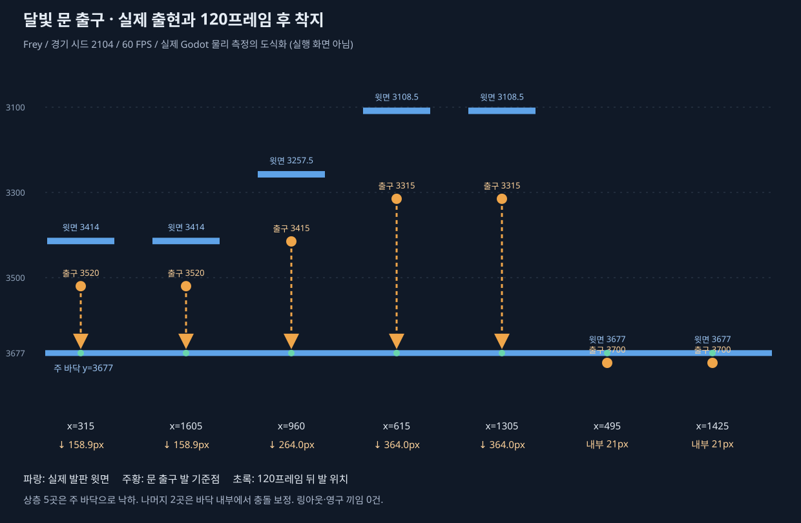

# CODEX-QA-21 — 새 시스템 버그 헌트

2026-10-23 · analyst · `codex/qa-21` · 기준 `e9a71fb8836219407b57242fedf18a8c4ac3b832`.

제품 코드·수치·규칙은 수정하지 않았다. 아래는 수정 제안과 재현 자료다. **확정 버그 2건(중 1, 하 1), 카드 요구와 구현의 불일치 1건(중)**을 분리했다. 상 등급의 진행 불가·저장 유실·엔딩 도달 불가는 재현하지 못했다.

## 발견 사항 — 심각도 순

### QA21-G1 · 중 · 달빛 문이 발판 윗면 대신 발판 아래 또는 내부로 이동시킨다

- 재현: [gate_geometry.gd](../../smash-nine-prototype/tests/analysis/codex_qa_21/gate_geometry.gd), 경기 시드 **2104**. 각 행의 `selector_seed`는 실제 문 선택기의 RNG 시드다.
- 수치 원본: [gate-geometry.json](gate-geometry.json), [실행 로그](logs/gate_geometry.log). 프레임은 새 프로세스의 물리 프레임 기준이다.
- 실제 Main의 배틀 생성·월드 충돌·문 선택기·`_carry_through_gates()`를 사용한다. 해당 선택기가 생성하는 유효한 쌍을 시험 상태에 넣고, 정지한 Frey가 문을 통과한 뒤 120프레임 동안 실제 물리로 착지하게 했다. 발판 데이터·중력·캐릭터 규칙은 바꾸지 않았다.

| 출구 x, y | 선택기 시드 / 시작 프레임 | 해당 발판 윗면 y | 문 발 기준점의 오차 | 통과 후 추가 낙하 |
|---|---|---:|---:|---:|
| 315, 3520 | 1 / 4 | 3414 | 아래 106px | 158.95px |
| 1605, 3520 | 18 / 124 | 3414 | 아래 106px | 158.95px |
| 960, 3415 | 5 / 244 | 3257.5 | 아래 157.5px | 263.97px |
| 615, 3315 | 7 / 364 | 3108.5 | 아래 206.5px | 363.97px |
| 1305, 3315 | 3 / 484 | 3108.5 | 아래 206.5px | 363.97px |
| 495, 3700 | 0 / 604 | 3677 | 바닥 안쪽 23px | 0px, 위로 충돌 보정 |
| 1425, 3700 | 2 / 724 | 3677 | 바닥 안쪽 23px | 0px, 위로 충돌 보정 |

**측정:** 7/7 위치가 표면과 맞지 않는다. 상층 출구 5/5는 아래 주 바닥(y≈3676.97)으로 떨어진다. 나머지 2곳은 순간이동 발 위치가 y=3698로 바닥 내부 21px이며, 충돌 보정 후 y≈3676.93이 된다. 7건 모두 120프레임 후 접지했고 **링아웃·영구 끼임은 0건**이다. “상층 발판 사이 이동”이 “공중 출현 후 아래층 낙하”로 바뀌는 문제다.

자연 발생한 재현도 있다. [16봇 시드 2105](gate-soak-2105.json)에서 유키가 **t=126.10초 / 프레임 7567**, `(545.2361, 3676.994)`에서 `(960, 3413)`으로 실제 문을 통해 이동했다. 선택기만 직접 호출한 시험 상태에서만 발생하는 좌표가 아니다.

**원인 추정 / 수정 위치:** `scripts/realms/RealmCatalog.gd:104`의 `hazard.spots`가 발판 중심 y(420/315/215/600)를 넣는다. 발판 윗면은 404/300/201/577이다. `RealmCatalog.gd:269`의 `_scaled_stand_point()`는 표면보다 아래인 점을 그 발판의 서는 위치로 인정하지 않아 다른 아래 발판을 기준으로 보정하거나 단순 배율을 적용한다. 해당 기믹의 원본 점을 실제 윗면에 맞추는 수정이 우선 후보이며, 글로벌 배율 보정 함수를 이 한 데이터에 맞춰 바꾸는 것은 피한다.

**소유권 체크:** 문 위치의 원본 데이터는 `RealmCatalog`, 배율·표면 변환은 `RealmCatalog`/`RealmLayout`, 이동은 `RealmHazards.gd:473` 소유다. `Main`, 캐릭터 중력·충돌, 봇 위치 보정으로 덮을 문제가 아니다. 수정 뒤 이 재현의 7개 표면 오차가 허용 범위 안에 들고 원치 않는 낙하가 없어야 한다.

### QA21-M1 · 중 · 몬스터가 달빛 문·벨트에 참여하지 않는다 — 카드 요구 불일치

- 재현: [gimmick_actors.gd](../../smash-nine-prototype/tests/analysis/codex_qa_21/gimmick_actors.gd), 시드 **2104**.
- 원본: [gimmick-actors.json](gimmick-actors.json), [로그](logs/gimmick_actors.log).
- Main에서 실제 생성된 사람·봇·몬스터를 같은 문/벨트 조건에 둔다. 벨트는 실제 물리로 30프레임 접지한 다음 자체 이동만 정지시키고 기믹 이동량을 분리한다.

| 측정 | 사람 | 봇 | 몬스터 |
|---|---:|---:|---:|
| 기믹 참여자 목록에 등록 | 예 | 예 | 아니오 |
| 문 이동 후 출구까지 거리 | 2px | 2px | 545.39px, 입구에 남음 |
| 출구에 90틱 그대로 있을 때 재이동 | 없음 | 없음 | 해당 없음 |
| 접지한 벨트에서 0.5초 동안 Δx | +45px | +45px | 0px |

**측정:** 카드의 “fighters, bots and monsters all use them”과 달리 몬스터는 두 위치 기믹 모두 무시한다. **범위 해석:** D41의 문 설명과 현 코드 주석은 선수를 대상으로 한다. 따라서 이것은 카드 기준 요구 불일치이며, 리드가 선수 전용이 의도라고 확정하면 결함 목록에서 제외할 수 있다. 몬스터 AI가 문을 적극 선택해야 한다는 주장은 하지 않는다.

이 JSON에 함께 남은 `gate_floor_samples.unsafe`는 ±64px ray 범위 내 바닥 미검출 표본 수(141/200)다. 맵 밖·끼임 횟수가 아니며, 최종 위치 판정은 G1의 7개 출구 실제 착지 검사로 구분했다.

**소유권 / 수정 후보:** `Main.gd:534`는 선수만 `hazards.register_combatant()`에 넣는다. 몬스터 생성은 `RealmMonsterSpawner.gd:99`, 스토리 몬스터는 `StorySession.gd:107`의 `_spawn_wave()`에서 별도 처리한다. 위치 기믹은 `RealmHazards.gd:409`/`:473`이 소유한다. 현재 등록 API는 `ground_traction`, `attack_lock_timer`, `is_defeated` 등 선수 필드를 전제로 하므로 몬스터를 그대로 등록하면 다른 하자드에서 오류가 날 수 있다. 위치 기믹용 참여자 계약을 분리하고 생성/해제 경로에서 연결하는 것이 수정 후보다. 몬스터 AI에서 임의 순간이동을 추가하는 방식은 소유권에 맞지 않는다.

### QA21-S1 · 하 · 후속 대화 중 궁극기 컷인이 남는다

- 재현: [story_cutin.gd](../../smash-nine-prototype/tests/analysis/codex_qa_21/story_cutin.gd), 시드 **2101**, Frey 2장.
- 원본: [story-cutin.json](story-cutin.json), [로그](logs/story_cutin.log).
- 실제 I 키로 궁극기 컷인을 띄우고, 직후 실제 몬스터 `apply_hit()` API로 남은 적을 처치한다. 보호 상태와 강제 큰 피해는 전투 난이도를 배제한 완료 프레임 시험 조건이다.

**측정:** `phase=post`, 대화 표시, 전투 시계 숨김 상태에서 컷인이 **물리 프레임 13~63, 총 51프레임=0.85초** 표시된다. 영역은 x=0, y=172, 560×112px이다. 대화 진행 불가나 저장 문제는 없다. 헤드리스의 노드 가시성·투명도·좌표 측정이며 실제 화면 캡처는 하지 않았다.

**원인 추정 / 수정 위치:** `StorySession.gd:359`의 `_play_scene()`은 `MatchHud._set_match_hud_visible(false)`를 부르지만 `MatchHud.gd:924`의 숨김 목록에 `cutin_root`/`flash_rect`가 없다. `MatchHud.gd:639`에서 만든 컷인 Tween은 별도로 끝날 때까지 남는다.

**소유권 체크:** HUD 구성과 Tween 정리는 `MatchHud` 소유다. HUD 숨김 계약에서 컷인·번쩍임을 정리하는 것이 수정 후보이며, 스토리/결과 각 화면이나 캐릭터 궁극기에서 따로 숨기는 처리는 피한다. 번쩍임 잔류는 별도 수치를 재지 않았으므로 컷인 외 추가 확정 결함으로 세지 않았다.

## 시각적 확인 — 측정된 흐름



실제 실행에서 측정한 출현·착지 관계다. 세로는 실측 월드 y에 비례하며 가로는 출구별 비교 열이다(실제 맵의 가로 배치가 아님). 스크린샷이나 수정 후 화면이 아니며, 제품 수정은 수행하지 않았다. `node reports/codex-qa-21/draw-gates.mjs`로 원본 JSON에서 다시 만든다. SVG XML 문법 검사 통과.

## 검증 범위와 통과 결과

| 영역 | 실행과 근거 | 결과 |
|---|---|---|
| 1~9장 연속 진행 | [story_journeys.gd](../../smash-nine-prototype/tests/analysis/codex_qa_21/story_journeys.gd), [결과](continuous-journeys.json) | 5명·7체형 × 보통/쉬움 = 14여정, 126스테이지, 1,051검사 통과. 실제 타이틀/선택/지도/포털 Q/결과/엔딩, 소울·카드 유지 |
| 대화 끝까지 입력 | [dialogue_keys.gd](../../smash-nine-prototype/tests/analysis/codex_qa_21/dialogue_keys.gd), [결과](dialogue-keys.json) | 양언어 190장면, J 980회, 종료 신호 190회, 실패 0 |
| 저장·경계 | [story_edges.gd](../../smash-nine-prototype/tests/analysis/codex_qa_21/story_edges.gd), [결과](story-edges.json) | 8장 마지막 카드 선택과 F2 동일 프레임에도 결과 도달. 5주인공 시험 파일 save/load 왕복 값 일치 |
| 메뉴 반복 | [menu_cycles.gd](../../smash-nine-prototype/tests/analysis/codex_qa_21/menu_cycles.gd), [결과](menu-cycles.json) | 양언어 7체형 각각 선택→경기→R 재대결→선택/타이틀. 14회 모두 정상, 타이틀 노드 1,235 고정, 고아 0. 속도 1.0/0.9/0.8/0.7 |
| 몬스터 | [monster_matrix.gd](../../smash-nine-prototype/tests/analysis/codex_qa_21/monster_matrix.gd), [결과](monster-matrix.json) | 실제 9렐름 지형, 18스킨×일반/정예 36조건 각 480프레임. 전부 공격 발동·생존, 예고 없는 공격 0, 경계+80px 관측 범위 밖 0. 기존 생태 250검사도 통과 |
| 시트 경로 | 위 몬스터 행렬 + 기존 모션 검사 | 현재 게임의 기존 4행 시트는 36조건 모두 `six_row=false`. 새 아트 미병합 상태를 오류로 세지 않음 |
| 글자 영역 | [text_slots.gd](../../smash-nine-prototype/tests/analysis/codex_qa_21/text_slots.gd), [결과](text-slots.json) | 양언어 308화면 구성, Label/Button 4,618개. 요청 슬롯 높이 초과(4px 허용)·`story.*` 키 노출 0 |

연속 여정은 SYS-04의 기존 여정 프로브를 허용 경로로 가져와 출력 위치만 QA-21로 바꿨다. 보호 상태와 공개 처치/수정 타격 API를 사용하므로 진행 검증이며, 실제 사람의 전투 완주·난이도 검증은 아니다. 스토리 저장은 생산 `StoryProgress.save/load_saved(test_path)`로 별도 시험 파일만 사용했다. 실제 `user://story.cfg`는 건드리지 않았다.

### 기존 전체 검사

[suite-summary.log](suite-summary.log): 기존 **51개 테스트 + 봇 경기 1회 `ALL PASSED`**, 종료 0, 벽시계 950.59초. 8봇 시드 1001은 331.7초에 Nova 승리, 탈락 7명, NaN 위치 0, PvP 적중 709, 몬스터 적중 111이었다. 통계는 안정성 관측이며 밸런스 평가가 아니다.

기존 `test_realm_gimmicks`와 `test_story_presentation`도 통과한다. 전자는 실제 문 출구의 발판 표면 일치를, 후자는 진행 중인 궁극기 컷인의 장면 진입 정리를 검증하지 않아 새 재현이 별도로 필요했다. 재시작 10회도 타이틀 노드 1,235로 일정했다.

샌드박스의 정확한 `ERROR: Failed to read the root certificate store.`만 분리했다. 기존 테스트 실행기가 51회 집계했으며 soak의 stderr에도 같은 소음이 있다. 그 밖의 `SCRIPT ERROR`/`ERROR`/`Parse Error`는 실패 처리한다. 신규 프로브 초안의 자료형 선언 오류는 수정했고, 인계하는 최종 실행 로그에는 해당 파싱 오류가 없다. 결함 프로브의 종료 1과 엔진 오류는 구분한다.

### 자연 발생 문 통과 관측

[gate_soak.gd](../../smash-nine-prototype/tests/analysis/codex_qa_21/gate_soak.gd)는 기존 `soak_match.gd`를 상속해 위치와 문 상태만 읽는다. 봇 판단·난수·피해·맵 데이터는 바꾸지 않는다. 문 양 끝 100px 안에서 1프레임에 350px 이상 반대 끝으로 이동한 사건을 기록한다.

| 16봇 시드 | 종료 / 승자 | 문 활성 구간 | 관측 통과 | 같은 활성 구간·같은 봇의 최대 통과 | NaN |
|---|---|---:|---:|---:|---:|
| [2105](gate-soak-2105.json) | 292.2초 / Nova | 13 | 5 | 1 | 0 |
| [2106](gate-soak-2106.json) | 278.6초 / Nova | 13 | 9 | 1 | 0 |

두 시드, 26활성 구간, 14관측 통과에서 반복 왕복 루프는 보지 못했다. 게임 전체에서 루프가 불가능하다는 증명은 아니다. `[soak]` 원본과 통과별 프레임·좌표는 `logs/gate-soak-2105.log`, `logs/gate-soak-2106.log` 및 JSON에 있다. `run-gate-soaks.ps1`로 한 프로세스씩 두 시드를 다시 실행한다.

## Web 크기와 첫 로드 — 변경 없이 측정

**빌드 시각 2026-10-23 02:20:55 KST.** 기존 Web 프리셋으로 보고서의 `web/`에만 별도 export했다. `tools/build_web.ps1`은 기본 출력 폴더를 바꾸므로 실행하지 않았고, CLI 출력 경로만 지정했다. 프리셋·프로젝트·아트는 수정하지 않았다. export 종료 0, 인증서 소음 외 엔진 오류 0이다. 기존 `tests/art_preview/story_70/import_check`의 중첩 프로젝트를 무시한다는 경고 1건은 [원본 로그](logs/web-export.log)에 남겼다.

`export_presets.cfg` SHA-256은 전후 동일: `eed4c9b3f1e8cdfa0f86a98926204af83861dc0d9dc960288b0f8a9cd7231a05`. `git diff --name-only`에도 제품 변경이 없다.

측정기 [web-size.mjs](web-size.mjs), 전체 [web-size.json](web-size.json). 실제 PCK 포맷 4의 디렉터리를 읽고 **613개 항목 모두 경계와 MD5를 검증**했다. 아래 gzip은 오프라인 level 9 측정치이며, 9개 출력 파일 전부 압축→해제한 바이트가 원본과 같다.

| 파일 | 원본 바이트 | 원본 MiB | gzip MiB |
|---|---:|---:|---:|
| `index.wasm` | 39,509,339 | 37.68 | 9.68 |
| `index.pck` | 26,512,796 | 25.28 | 23.31 |
| `index.js` | 279,815 | 0.27 | 0.07 |
| **핵심 3개 합계** | **66,301,950** | **63.23** | **33.06** |

HTML·아이콘·worklet 등을 포함한 출력 9개 전체는 66,349,478바이트다. 핵심 합계는 브라우저 요청 전체나 첫 화면까지의 시간을 뜻하지 않는다. Godot 초기 로더가 필요로 하는 엔진·팩과 런타임 JS의 크기를 따로 표시했다. 게시용 5MiB 분할·ZIP은 만들지 않았으며, 분할 자체는 총 데이터량을 줄이지 않는다(`tools/web_part_loader.js`).

팩 내부 파일 종류별 크기(헤더·정렬 패딩 제외):

| 종류 | 개수 | MiB |
|---|---:|---:|
| 텍스처 `.ctex` | 238 | 19.78 |
| `icudt_godot.dat` | 1 | 4.58 |
| 스크립트 `.gdc` | 55 | 0.46 |
| 글꼴 `.fontdata` | 1 | 0.27 |
| 번역 `.translation` | 4 | 0.05 |
| import 정보 `.import` | 241 | 0.05 |

나머지 종류별 수치는 JSON의 `pack_types`에 있다. 가장 큰 텍스처는 타이틀 배경 1.33MiB, Frey 기술 시트 0.89MiB, Rio 여성/남성 기술 시트 0.81/0.79MiB다. 가장 큰 단일 팩 항목은 `icudt_godot.dat` 4.58MiB다. `_source`, `contact_sheet`, `tests/` 이름의 패키지 항목은 **0개**, 1KiB 초과의 바이트 동일 중복 항목도 **0개**다.

**보이는 내용을 바꾸지 않는 측정된 절감 후보:** 압축되지 않은 전송 대비 gzip은 핵심 파일에서 **30.17MiB(47.72%)** 작다. 엔진 wasm의 감소가 대부분이다. 현재 로컬 `tools/serve_web.js`는 `Content-Encoding` 압축을 제공하지 않는다. 실제 호스트가 이미 압축하면 이 수치는 추가 절감량이 아니다. 서버·배포·export 변경은 하지 않았다. 그림 품질·크기·글자 범위를 줄여도 차이가 없다는 검증은 하지 않았으므로 그에 따른 절감량을 제시하지 않는다.

**미측정:** 실제 브라우저의 cold load, 다운로드 시간, 컴파일·첫 프레임 시간, 배포 호스트의 응답 헤더/캐시. 파일 크기와 gzip 라운드트립만 측정했다.

```powershell
powershell -ExecutionPolicy Bypass -File reports/codex-qa-21/run.ps1 -ExportWeb
node reports/codex-qa-21/web-size.mjs
```

측정용 `web/`은 커밋 대상에서 제외한다. 원본 바이트 크기·SHA-256·팩 전체 항목은 JSON에 보존했다.

## 실행 방법

저장소 루트에서 먼저 가져오기 한 번을 실행하고 이후 한 프로세스씩 실행한다. 래퍼는 프로세스의 APPDATA/LOCALAPPDATA만 `%TEMP%/SmashNine-QA21-cache`로 지정한다. 제품 설정은 바꾸지 않는다.

```powershell
powershell -ExecutionPolicy Bypass -File reports/codex-qa-21/run.ps1 -Import
powershell -ExecutionPolicy Bypass -File reports/codex-qa-21/run.ps1 -Script tests/analysis/codex_qa_21/gate_geometry.gd
powershell -ExecutionPolicy Bypass -File reports/codex-qa-21/run.ps1 -Script tests/analysis/codex_qa_21/gimmick_actors.gd
powershell -ExecutionPolicy Bypass -File reports/codex-qa-21/run.ps1 -Script tests/analysis/codex_qa_21/story_cutin.gd
```

세 결함 재현은 현 코드에서 **종료 코드 1**이 기대값이다. 엔진 오류를 만들어 실패시키는 방식이 아니다. 수정 후 같은 관측 조건이 해소되면 0이 된다. 다른 프로브도 `-Script tests/analysis/codex_qa_21/<이름>.gd`로 실행한다.

## 현재 한계 / 다음 권장 단계

- 헤드리스만 사용했으므로 실제 렌더 화면, 사람 조작감·난이도·밸런스, 아트 품질은 판단하지 않았다. QA-20·스킬 밸런스는 범위 밖이다.
- 글자 측정은 지정된 1280×720 레이아웃과 텍스트 영역 기준이다. 모든 창 비율의 픽셀 렌더, 이미지와 글자의 모든 겹침까지 증명하지 않는다. 언어는 실제 옵션 왕복과 각 화면 생성 전 locale 적용으로 확인했다. 설정 진입 경로가 없는 대화 중에 별도 언어 버튼이 있다고 가정하지 않았다.
- 저장 직렬화와 메뉴 Continue는 검사했으나, 브라우저의 영구 저장소 동기화·브라우저 종료 뒤 복원은 확인하지 않았다. 헤드리스에서 생산 코드가 실제 사용자 저장을 의도적으로 막으므로 시험 경로 API와 프로세스 내 진행을 사용했다.
- 몬스터 행렬은 각 스킨의 소속 렐름과 한 공격 레인에서 측정했다. 모든 발판·상태·타격 조합의 부재 증명은 아니다. 새 ART-71 그림 자체는 이 기준 커밋에 없다.
- 리드는 G1 원본 좌표를 먼저 수정·재현하고, M1의 몬스터 참여 범위를 확정한 뒤 S1의 HUD 정리를 권장한다. 이번 유닛은 제품 수정을 하지 않는다.
- `.git`은 이 세션의 읽기 전용 영역이므로 커밋하지 않았다. [commit.ps1](commit.ps1)은 QA-21 경로만 stage하며, 기존 무관한 stage가 있으면 중지한다. `run.log`, 측정용 web 빌드, 시험 저장 파일, `__pycache__`는 제외한다. 커밋 메시지 끝에 지정된 Co-Authored-By를 넣었다.

최종 [verification.json](verification.json)에 기준 커밋, 주요 제품 파일 SHA-256, 결과/스크립트 해시와 검사 수를 남겼다. 추적 파일 diff는 비어 있고, 최종 실행 로그의 인증서 소음 외 엔진 오류는 0줄이다. 로그는 메시지 내용을 유지한 채 UTF-8/LF로 통일했다. PowerShell 스크립트 4개는 문법 오류 0이며 `commit.ps1`은 실행하지 않았다.
