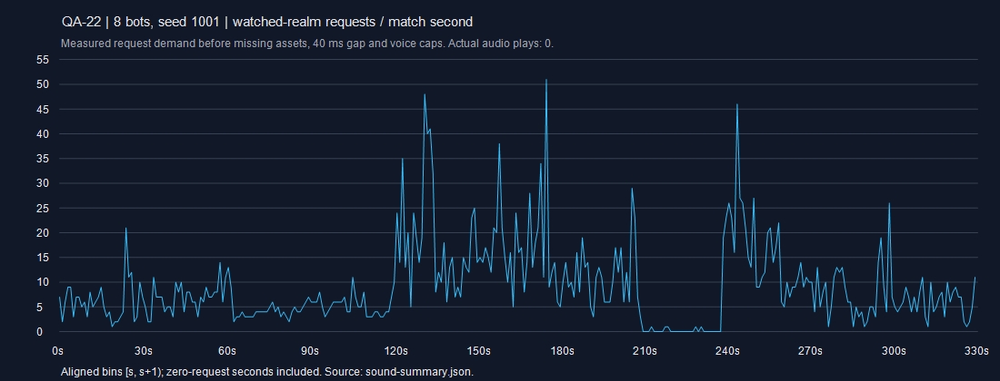

# CODEX-QA-22 — QA-21 재검증과 사운드 요청 실측

| QA-21 항목 | 이전 측정 | 같은 입력의 현재 측정 | 판정 |
|---|---|---|---|
| G1 · 중 · 달빛 문 출구 | 7/7 표면 불일치, 오차 +23~206.5px; 상층 5/5 아래층 낙하, 최대 363.97px | 0/7 불일치, 오차 7곳 모두 0px; 7/7 해당 발판 착지, 낙하 각각 1.96094px; 링아웃 0 | **수정 확인** |
| M1 · 중 · 몬스터 문·벨트 참여 요구 | 등록 안 됨; 문 출구와 545.39px, 벨트 0px/0.5초 | 여전히 등록 안 됨; 출구와 626.26px, 벨트 0px/0.5초. 사람·봇 각각 문 출구 2px, 벨트 +45px | **요구 불일치 유지**; 선수 전용 의도인지 리드 결정 필요 |
| S1 · 하 · 후속 대화의 궁극기 컷인 | post 대화와 51프레임=0.85초 겹침 | 실제 I 입력으로 컷인 생성 확인 후 post 대화 진입; 겹침 **0프레임** | **수정 확인** |

2026-10-23 KST · analyst · `codex/qa-22` · 기준 `86bb7eb3bc8740e59c6a5791624124dc4c09e01d`. 제품 소스·수치·규칙·음원을 수정하지 않았다. Godot 4.7, headless, 사전 `--import`, 실행은 한 번에 하나다.

## 재검증 근거

QA-21의 gate_geometry/story_cutin/gimmick_actors/gate_soak를 **보고서 출력 경로만** 바꿔 실행했다. G1의 경기 시드 2104, S1의 2101/Frey 2장, 16봇 시드 2105·2106/480초 제한을 그대로 유지했다. 수정된 문 좌표에 대해 기존 선택기 검색을 그대로 하므로 출구를 고르는 파생 selector_seed는 달라진다. 이를 이전 좌표·파생 시드까지 동일하게 고정한 시험이라고 표현하지 않는다.

원본: [문 기하](gate-geometry.json), [컷인](story-cutin.json), [몬스터 참여](gimmick-actors.json). G1/S1 종료 0, M1 종료 1은 요구 불일치 재현 결과이며 엔진 오류가 아니다. M1 재현 시각은 [스크립트](../../smash-nine-prototype/tests/analysis/codex_qa_22/gimmick_actors.gd)의 시드 2104 문 시험과 이어지는 30프레임 벨트 시험이다. 소유·수정 후보는 `Main.gd:539`의 선수 등록, `RealmHazards.gd:478` 문 이동 및 `RealmMonsterSpawner`/`StorySession`의 몬스터 생성 계약이다. 단순 선수 API 등록은 다른 하자드의 선수 필드 전제를 깨뜨릴 수 있어 위치 기믹 참여 계약을 먼저 결정해야 한다.

### 문 자연 발생 소크

| 16봇 시드 | 종료 초 이전→현재 | 문 활성 구간 | 관측 통과 이전→현재 | 같은 봇·활성 구간 최대 이전→현재 | NaN |
|---|---|---:|---|---|---:|
| 2105 | 292.2 → 330.1 | 13 → 13 | 5 → 17 | 1 → 2 | 0 |
| 2106 | 278.6 → 288.9 | 13 → 13 | 9 → 25 | 1 → 4 | 0 |

재통과는 증가했다. 같은 봇·활성 구간의 재통과 간 최단 간격은 2105에서 3.55초, 2106에서 1.00초(60물리프레임)였다. 시드 2106 Frey는 t=153.250/154.250/155.250/157.467초에 4회 통과했다. 즉시 매 프레임 왕복은 관측되지 않았지만, QA-21처럼 “구간당 최대 1회” 상태도 아니다. 이것만으로 무한 루프나 전투 불능을 확정하지 않는다. [시각·좌표 원본](regression-comparison.json), [2105](gate-soak-2105.json), [2106](gate-soak-2106.json). 소유는 `RealmHazards.gd:478`의 접촉 이탈/쿨다운이며, 봇 판단 조정은 이번 범위 밖이다.

## 사운드 — 무엇을 세었는가

독립 [기록기](../../smash-nine-prototype/tests/analysis/codex_qa_22/audio_recorder.gd)는 AudioManager를 상속하고 기존 play/play_music/watch를 super로 각각 한 번 호출한다. 생산 `probe_enabled`/`requests`/`world_probe` 증분으로 결과를 분류한다. 스트림 주입·난수·카메라·봇·재생 제한 변경은 없다. BR은 원래 `soak_match.gd` 드라이버를 상속해 8봇 관전을 그대로 사용했다.

- **관찰 렐름 요청**: 월드 필터를 통과한 재생 후보. 음원 조회 실패와 40ms 간격·voice 제한을 적용하기 전 수요다.
- **다른 렐름 차단** / **비활성**(봇 성장음) / **전역 SFX** / **음악**은 따로 집계했다. 전역음을 월드 필터의 누락으로 세지 않았다.
- 초별 수치는 경기 시계 `match_elapsed`의 [s,s+1) 구간이며 무요청 초도 포함한다. 별도로 이동 1초/5초 창과 같은 물리프레임의 요청 묶음을 계산했다. 각 ID·각 초 전체는 [sound-summary.json](sound-summary.json)의 `seconds[].ids`에 있다.
- **실제 SFX 재생 및 관측 voice 피크는 측정 6실행에서 0**이다. 음원 길이가 없으므로 미래의 재생 중첩 수와 최종 청감은 측정할 수 없다. 아래 “같은 프레임” 수치는 동시 시작 **요청 수**이며 재생 중 voice 수가 아니다. 음원을 넣으면 기존 최대 24 voice, ID별 상한 및 40ms 제한이 실제 재생을 줄일 수 있다.
- 스토리 1/5/9장은 QA-21과 같은 보호된 Frey, 공개 적 처치/수정 타격 API, 파동 사이 3프레임, 실제 Q 출구로 진행했다. 이는 실제 스토리 시스템의 **진행 훅 검사**이며 자연 전투·사람의 플레이 밀도 표본이 아니다. 대화 시간에는 경기 시계가 멈추므로 스토리의 초별 묶음을 실시간 연사로 해석하지 않는다.

### 실행별 집계

| 실행 | 경기 시간 | 관찰 렐름 | 다른 렐름 차단 | 전역 SFX | 비활성 | no_realm | 최다 5초 | 한 프레임 최대 요청 |
|---|---:|---:|---:|---:|---:|---:|---|---|
| br-1001 | 331.700s | 3026 | 3964 | 5 | 458 | 0 | 130.467–135.467s: 189 | 14 (176.700s) |
| br-2105 | 240.000s | 2012 | 3387 | 5 | 346 | 0 | 128.750–133.750s: 118 | 12 (139.033s) |
| br-2106 | 307.100s | 2549 | 4037 | 5 | 452 | 0 | 254.933–259.933s: 105 | 8 (219.650s) |
| story-1 | 0.250s | 11 | 0 | 10 | 0 | 0 | 0.000–5.000s: 11 | 4 (0.000s) |
| story-5 | 0.200s | 2 | 0 | 9 | 0 | 0 | 0.000–5.000s: 2 | 1 (0.000s) |
| story-9 | 0.000s | 10 | 0 | 12 | 3 | 0 | 0.000–5.000s: 10 | 8 (0.000s) |

[ID별 전체 표](sound-tables.md), [초별·피크·검증 JSON](sound-summary.json). 카탈로그는 이벤트 71 + 폴백 전용 4 = 75개다. 원요청 캡처는 `sound-*-events.json.gz`에 이벤트 시각·프레임·요청 ID·출발/관찰 렐름·판정과 카탈로그를 보존했다. gzip 왕복 바이트 일치를 검사했다.

### 가장 바쁜 ID와 제한 검토 지점

BR 3판의 관찰 렐름 누계: `land` 1946회, `hurt` 1085회, `hit_light` 845회, `swing_light` 741회, `jump` 663회, `monster_hurt` 491회, `monster_windup` 313회, `swing_heavy` 266회.

| 실행 | ID / 범위 | 최대/정수 1초 (시각) | 최대/이동 1초 (시작) | 같은 프레임 최대 (시각/프레임) |
|---|---|---|---|---|
| br-1001 | hit_launch / watched | 9 (176s) | 9 (176.583s) | 4 (176.700s / 10603) |
| br-1001 | hit_light / watched | 15 (133s) | 19 (132.500s) | 4 (133.667s / 8021) |
| br-1001 | hurt / watched | 17 (132s) | 22 (132.500s) | 5 (176.700s / 10603) |
| br-1001 | land / watched | 22 (300s) | 22 (300.017s) | 2 (121.267s / 7277) |
| br-1001 | tumble / watched | 9 (176s) | 9 (176.583s) | 4 (176.700s / 10603) |
| br-2105 | hit_light / watched | 9 (122s) | 10 (149.683s) | 4 (146.517s / 8792) |
| br-2105 | hurt / watched | 11 (139s) | 12 (138.833s) | 5 (139.033s / 8343) |
| br-2105 | land / watched | 11 (136s) | 14 (64.550s) | 2 (25.233s / 1515) |
| br-2106 | land / watched | 14 (257s) | 16 (250.400s) | 2 (1.633s / 99) |
| story-9 | hurt / watched | 5 (0s) | 5 (0.000s) | 4 (0.000s / 7) |
| story-9 | ko / watched | 5 (0s) | 5 (0.000s) | 4 (0.000s / 7) |
| story-9 | soul_pickup / global | 5 (0s) | 5 (0.000s) | 4 (0.000s / 7) |

위 표는 **이동 1초에 8회 초과 또는 같은 프레임 동일 ID 요청 3회 초과**인 모든 ID다. **중 · 조정 검토 관측**으로 분류하며, 들리는 소리의 결함으로 확정하지 않는다. 정확한 재현은 표의 시드/시각과 `sound_soak.gd --players=8 --seconds=480 --seed=<시드>`, 스토리는 `sound_story.gd --stage=<장>`다. 소유·후보 위치는 착지 조건 `characters/common/PlayerBase.gd:1108–1128`, 타격 묶음 `scripts/audio/AudioManager.gd:249`, 제한 `AudioManager.gd:142–163` 및 `AudioCatalog.gd`의 ID별 voices다. `land`는 접지 전이만 세지만 매우 잦다. 미세한 이탈/재접지나 전투 영향은 **원인 추정**이며, 이동 규칙을 바꾸기보다 최소 공중 시간·낙하 속도 또는 소리 전용 재요청 간격의 필요성을 먼저 확인할 후보로 제시한다.



시드 1001의 실제 요청 기록이다. 파란 선은 매 경기 초의 월드 필터 통과 수요이며, 음원 재생 수나 화면 캡처가 아니다.

### 한 번도 직접 요청되지 않은 ID

전체 6실행 공통 미발동: `monster_attack`, `music_select`, `skill_cast`, `story_advance`, `story_text`, `swing`, `ui_cancel`, `ui_move`, `ui_select`, `ult_start`. 각 실행의 전체 미발동 목록과 원요청/차단 여부는 [ID별 표](sound-tables.md), 원인 분류는 [never-fired.md](never-fired.md)에 있다.

**하 · 연결 공백(현재 AUDIO 계약에도 명시):** 스토리 대화·진행을 실제 거쳤지만 `story_text`/`story_advance`는 0회다. 스토리 결과/엔딩과 Q 출구에서도 BR용 `results`/`victory`/`music_results`/`portal` 훅이 연결되지 않는다. 아래 음악 표와 스토리 체크포인트가 재현 근거다. 소유·후보 위치: `StoryDialogue.gd:26,156`, `StorySession.gd:404,433`, `StoryScreens.gd:179,200`. 대화/결과/출구의 소유 함수에서 연결하는 후보이며 Main 외부 우회는 제안하지 않는다. 미발동 전체를 연결 결함으로 세지 않는다: 폴백 전용 4개는 직접 이벤트가 없고, 미발생 기술·몹 행동·기믹·방문하지 않은 화면은 실행 표본의 미관측이다.

### 음악 화면 전환

| 경로 / 체크포인트 | 화면 | 요청 후 current_music | 음악 요청 누계 |
|---|---|---|---|
| BR title | title | music_title | music_title:1 |
| BR select | select | music_select | music_select:1, music_title:1 |
| BR battle | select | music_battle | music_battle:1, music_select:1, music_title:1 |
| BR results | results | music_results | music_battle:1, music_results:1, music_select:1, music_title:1 |
| 스토리 1: combat_start | story_start / combat | music_story | music_story:1, music_title:1 |
| 스토리 1: post_dialogue | story_start / post | music_story | music_story:1, music_title:1 |
| 스토리 1: story_result_or_ending | story_result / result | music_story | music_story:1, music_title:1 |
| 스토리 5: combat_start | story_start / combat | music_story | music_story:1, music_title:1 |
| 스토리 5: post_dialogue | story_start / post | music_story | music_story:1, music_title:1 |
| 스토리 5: story_result_or_ending | story_result / result | music_story | music_story:1, music_title:1 |
| 스토리 9: combat_start | story_start / combat | music_story | music_story:1, music_title:1 |
| 스토리 9: mid_dialogue | story_start / mid | music_story | music_story:1, music_title:1 |
| 스토리 9: post_dialogue | story_start / post | music_story | music_story:1, music_title:1 |
| 스토리 9: story_result_or_ending | story_ending / ending | music_story | music_story:1, music_title:1 |

BR의 title → select → battle → results는 각 트랙 요청이 바뀐다. 스토리는 시작 시 `music_story`를 요청한 뒤 대화/전투/중간 대화/결과·엔딩에서 그대로 유지한다. 스토리 결과용 전환은 현재 미연결이며, 대화마다 다른 곡을 요구한다는 판정은 하지 않는다. 원본 [music-screens.json](music-screens.json). 전부 음원 미해결이므로 실제 교차 전환 청음은 하지 않았다.

## 회귀

| 지표 | QA-21 두 시드 편차 | 시드 2105 이전→현재 (변화) | 시드 2106 이전→현재 (변화) |
|---|---:|---|---|
| seconds_simulated | 13.6 | 292.2 → 330.1 (+37.9 **편차 초과**) | 278.6 → 288.9 (+10.3) |
| defeats | 0 | 15 → 15 (0) | 15 → 15 (0) |
| nan_positions | 0 | 0 → 0 (0) | 0 → 0 (0) |
| node_count | 1 | 1799 → 1822 (+23 **편차 초과**) | 1800 → 1821 (+21 **편차 초과**) |
| monster_hits | 11 | 140 → 141 (+1) | 129 → 147 (+18 **편차 초과**) |
| pvp_hits | 24 | 1248 → 1398 (+150 **편차 초과**) | 1272 → 1214 (-58 **편차 초과**) |
| ringouts | 0 | 23 → 19 (-4 **편차 초과**) | 23 → 19 (-4 **편차 초과**) |

**중 · 변화 관측:** 2105 경기 길이 +37.9초는 이전 시드 간 13.6초 편차를 넘고, 2106 몬스터 적중 +18도 이전 편차 11을 넘는다. 노드·PvP·링아웃도 표에 표시한 변화가 있다. 이 표의 두 시드만으로 악화·밸런스 회귀 또는 사운드의 인과를 확정하지 않는다. 문 기하와 투사체 아트 연결도 함께 바뀐 최신 main과의 비교이며 A/B 원인 분리는 하지 않았다. 생산 AudioManager는 24 SFX + 2 음악 player + manager = 27노드다(캡처 실측). 기존 frontend/restart 검사에서도 타이틀 노드는 QA-21의 1,235에서 1,262로 정확히 27 늘고 재시작 10회 동안 일정했다. 따라서 노드 종단 차이를 곧바로 누수로 해석하지 않는다. 소유·추가 확인 위치는 `RealmCatalog.gd:104`/`RealmHazards.gd:478`의 문 이동과 `AudioManager.gd:72`의 고정 풀이다. 제품 조정은 리드 소유다.

전체 `tests/run_all.ps1` **53개 검사 스크립트 + 기본 소크 1회**, 종료 0, 벽시계 482.97초. **ALL PASSED**. [전체 요약](suite-summary.log), [메타](suite-meta.json), 개별 원문 `suite/`.

기본 소크: SOAK_RESULT {"defeats":7,"defeats_by_cause":{"player":7},"defeats_by_player":{"Frey":1,"Luna":2,"Nova":1,"Rio":2,"Yuki":1},"eliminations":["Yuki t=195 by player ringouts=2 dmg_dealt=88","Frey t=216 by player ringouts=2 dmg_dealt=138","Luna t=247 by player ringouts=2 dmg_dealt=187","Rio t=253 by player ringouts=1 dmg_dealt=274","Rio t=261 by player ringouts=2 dmg_dealt=193","Nova t=284 by player ringouts=1 dmg_dealt=355","Luna t=332 by player ringouts=0 dmg_dealt=215"],"first_pvp_hit":8.3,"hazard_hits":11,"match_over":true,"monster_hits":111,"nan_positions":0,"node_count":1648,"playable_realms":1,"players":8,"pvp_hits":709,"ringouts":13,"seconds_simulated":331.7,"shared_realm_ratio":0.94,"souls":["Yuki:89/3","Luna:171/3","Luna:105/3","Nova:186/3","Nova:257/3","Rio:154/3","Rio:210/3","Frey:143/3"],"winner":"Nova"}

QA-21의 8봇 시드 1001 기준(331.7초 / 탈락 7 / NaN 0 / 몬스터 적중 111)은 사운드 관전 기록에서도 동일했다. 요청 기록기의 event 수·ID별 원요청은 생산 requests와 일치하고, watched/filtered/no_realm은 world_probe와 일치한다. 검증값은 각 실행 summary의 validation에 남겼다.

## 오류·재실행·인계

최종 Godot 원문 67개에서 인증서 소음 67줄, 그 외 엔진 오류 **0줄**, 오디오 경고 **0줄**이다. [verification.json](verification.json)에 개별 로그 집계와 제품 파일 해시를 보존했다. 샌드박스의 정확한 `ERROR: Failed to read the root certificate store.`만 따로 세며, 그 밖의 SCRIPT ERROR/ERROR/Parse Error와 오디오 경고는 별도로 검사한다. import에는 기존 `story_70/import_check` 중첩 프로젝트 무시 경고가 있다. 초기 실행 래퍼는 성공 시 exit 0을 명시하지 않아 호출 측이 성공 실행을 실패로 오판했다. 래퍼를 고친 뒤 해당 BR을 다시 실행했으며 제품 결함으로 세지 않았다.

저장소 루트에서 다음을 **순차** 실행한다.

```powershell
powershell -ExecutionPolicy Bypass -File reports/codex-qa-22/run.ps1 -Import
powershell -ExecutionPolicy Bypass -File reports/codex-qa-22/retest.ps1
powershell -ExecutionPolicy Bypass -File reports/codex-qa-22/run-sound.ps1
powershell -ExecutionPolicy Bypass -File reports/codex-qa-22/regression.ps1
node reports/codex-qa-22/compare.mjs
node reports/codex-qa-22/analyze.mjs --compact
powershell -ExecutionPolicy Bypass -File reports/codex-qa-22/render-chart.ps1
node reports/codex-qa-22/build-report.mjs
node reports/codex-qa-22/verify.mjs
```

**완료:** 카드 순서의 동일 입력 재검증, BR 3시드·스토리 3장 요청 측정, 화면별 음악 관측, 전체 회귀. **현재 상태:** 제품 변경 없이 보고·프로브만 작성했다. **남은 작업/측정 불가:** 음원 채택 후 실제 중첩/최종 제한 통과량·청감·웹 첫 입력 및 실제 화면은 확인하지 않았다(headless 제한). 스토리 자연 전투 밀도·사용자 난이도와 변화의 원인 A/B도 하지 않았다. **다음 권장 단계:** 리드가 M1 참여 범위를 확정하고, 빈번한 land/타격 소리의 재요청 정책과 스토리 미연결 훅을 검토한 뒤 채택 음원으로 청음한다.

`commit.ps1`은 작성만 했고 실행하지 않았다. QA-22 두 허용 경로만 stage하고, 무관한 stage/`__pycache__`/1MB 초과 로그를 거부하며 `git add -f`를 사용하지 않는다. 커밋 메시지 마지막은 지정된 Co-Authored-By다.
