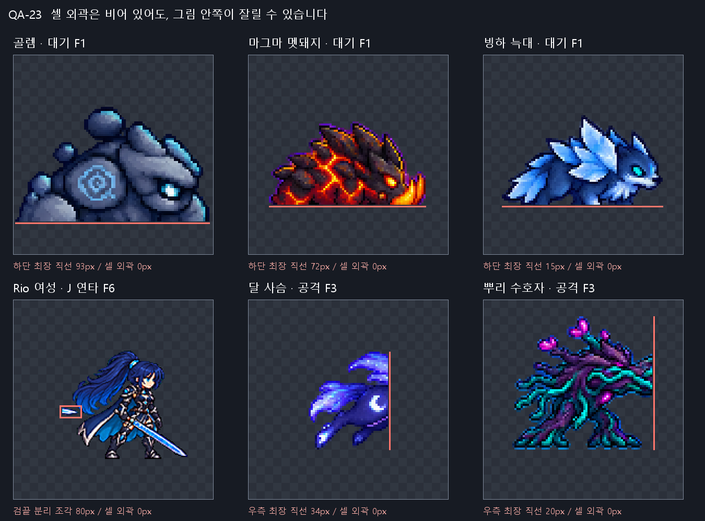

# QA-23 스프라이트 전수 검사

| 범위 | 이미지 | 사용 프레임 | 육안 확인 |
|---|---|---|---|
| 현재 게임: 캐릭터 기본/기술 | 16 | 658 | 16개 전체 |
| 현재 게임: 몬스터 몸 | 18 | 270 | 18개 전체 |
| 현재 게임: 투사체 | 9 | 9 | 9개 전체(현재는 모두 단일 그림) |
| 후보: 캐릭터/몬스터/초상화 | 349 | 1955 | 계측 경고 70개 전체 |

| 문제 종류 | 현재 상 | 현재 중 | 현재 하 | 후보 상 | 후보 중 | 후보 하 |
|---|---|---|---|---|---|---|
| 몸/효과 혼합 | 0 | 0 | 8 | 0 | 0 | 0 |
| 발 기준 | 0 | 1 | 1 | 0 | 0 | 0 |
| 색 테두리 | 0 | 2 | 0 | 0 | 0 | 0 |
| 여백 | 0 | 0 | 2 | 0 | 0 | 22 |
| 잘림/잔여 조각 | 7 | 11 | 0 | 0 | 1 | 0 |
| 장비/형태 불연속 | 0 | 2 | 0 | 0 | 0 | 0 |
| 크기 불일치 | 0 | 2 | 2 | 0 | 0 | 0 |

**완료:** 현재 43개 이미지·937프레임·207논리 행을 계측하고 전부 보았다. 후보 349개 계측, 경고 70개를 보았다. 현재 수리 38건(상 7, 중 18, 하 13), 후보 중복 제거 수리 23건(상 0, 중 1, 하 22). 이 수는 결함 프레임 수가 아니라 수리 항목 수다.

현재 시트 치수/프레임 수/빈 셀 검사는 모두 맞았다. 하지만 셀 안에서 이미 잘린 그림은 이 검사에 통과한다. Rio 여성 J의 검끝, 달 사슴 공격, 뿌리 수호자 공격, 세 몬스터 대기 하단이 대표 사례다. 게임·아트는 수정하지 않았고 Godot 및 git은 실행하지 않았다.

[수리 목록](fix-list.md) · [후보 전체 행 표](candidate-rows.md) · [생성 파일 목록](files.txt) · [JSON 집계](metrics/summary.json)

원본을 최근접 확대해 조합한 검사 이미지다. 실행 화면이 아니며 화살표/수치는 관찰 위치를 설명한다.

## 판정과 측정 방법

- `좋음`은 이번 계측/접촉 이미지에서 확정 수리 결함을 보지 못했다는 뜻이다. 애니메이션 재생 품질이나 모든 해부학적 정확성을 보장하지 않는다. `손질`은 이동·패딩·픽셀 정리·다시 자르기, `다시 그림`은 형태/크기·효과 분리가 필요한 행이다.
- alpha≥128을 몸 윤곽으로 계측하고 alpha>0 외곽도 별도로 보존했다. bbox 오른쪽/아래는 포함하지 않는 좌표다. H/W=전체 그림 높이/너비, A=보이는 픽셀 면적이며 무기·머리카락도 포함한다. 인접 변화에는 마지막→처음 연결을 제외했고 루프 동일 여부는 별도로 기록했다.
- 바깥 1px 접촉과 안쪽 4px 여백 침범은 별도다. bbox의 긴 직선만으로 잘림을 확정하지 않고 확대 그림과 함께 판단했다. L/R/B는 bbox 왼쪽/오른쪽/아래의 최장 연속 픽셀 수다.
- 기본은 128셀·발 y120, 기술은 192셀·발 y152. 몬스터 현재 96셀의 일반 행은 마지막 불투명 y71(경계 y72), 구 골렘은 y79(경계 y80)이다. 기존 코드가 사용하는 경계 좌표 때문에 생기는 1px 차이는 결함으로 세지 않았다. 후보 6행은 주로 마지막 y72다. 최하단은 검/머리카락일 수도 있어 발 위치 확정에는 부츠/발도 보았다.
- 공중/혼합/비행 행은 아래 표에 표시하고 고정 접지선 판정을 생략했다. star_comet은 지상/공중 겸용이며 지상 그림은 기준선을 확인했다. 지상 공격의 도약 역시 자동 feet 경고만으로 수리하지 않는다.
- D35 이후 고정 팔레트 검사는 하지 않았다. RGB 분포 거리, 초록/자홍/백색 외곽, 부분 알파의 위치, 8방향 연결 성분을 저장했다. 식물의 녹색·눈/마법의 발광색·LANCZOS의 부분 알파는 그 자체로 오류가 아니다. 작은 분리 성분도 실제 그림에서 잔여물로 확인된 것만 지적했다.
- 머리 메타데이터는 발견되지 않아 `tools/sprite_pipeline/head_scale.py`의 피부 성분/30px 템플릿 비교를 읽기 전용으로 사용했다. 같은 스케일/17×17 이동 탐색을 FFT로 계산했고 원 함수와 대조했다. 신뢰도 0.6 미만은 제외했다. 표의 추정치는 얼굴 각도/가림에 민감하다. Yuki·회전·변신·비인간형 몬스터의 머리 크기는 신뢰할 자동 수치를 확보하지 못한 경우 명시했다. 머리만 붙이는 수정은 금지다.
- 후보 349개는 지정한 6개 폴더 최상위 PNG 기준이다. 32개 초상화, 18개 6행 합본과 개별 스트립을 포함한다. 130개는 sidecar `adopted`가 있고 나머지는 채택 표시가 없다는 뜻이며 실제 대기 상태라고 단정하지 않는다. 합본/스트립 프레임 중복은 전체 계측 프레임 수에 포함된다. retired 등 하위 보관 폴더는 이번 최상위 범위에서 제외했다.

## 기존 검사보다 더 확인한 것

`test_sprite_frames.gd`, `test_moves_sheet.gd`, `test_monster_motion.gd`, `test_fighter_motion.gd`의 행/개수/크기/기준선 계약을 읽었다. 재실행하지 않았다. 이번 검사는 실제 픽셀의 1px/4px 경계, 셀 내부 절단, bbox/면적/중심 변화, 해시 중복, 색/부분 알파 위치, 머리 추정과 접촉 이미지의 직접 관찰까지 더했다. 예를 들어 Rio mana_combo F6의 80px 분리 조각은 외곽 접촉 0이고 면적 변화도 작아 크기 검사만으로 찾기 어렵다.

## 현재 게임 — 이미지별 행 판정

### frey_sheet

[frey_sheet.png](../../smash-nine-prototype/assets/art/frey/frey_sheet.png) — 768×1024, 셀 128×128, 치수 일치 True; 추가 그림 셀 0개.

금발·검·방패가 이어진다. 보행 8칸, 점프/낙하/피격 각 1칸을 확인했다.

[2배 접촉 이미지](contact/frey_sheet_2x.png) · [프레임별 원자료](metrics/frey_sheet.json)

| 행/물리 시작행 | 판정 | 프레임·이유 | W/H/A 범위 | 인접 최대 변화 | F1 대 idle | 최하단/접지 판정 | 1px/4px | 머리 추정(유효/전체) |
|---|---|---|---|---|---|---|---|---|
| idle / R1 / 6칸 | 좋음 | 확정 결함 없음 | 90–94 / 99–101 / 5161–5552 | A 5.21%; 중심 1.58px; H 1px | H +0.00%; A +0.00% | y 120–120 / ground | 0 / 0 | 1.00 (6/6) |
| walk / R2 / 8칸 | 좋음 | 확정 결함 없음 | 96–99 / 103–107 / 5531–6001 | A 8.5%; 중심 1.8px; H 3px | H +6.06%; A +10.93% | y 120–120 / ground | 0 / 0 | 1.02 (8/8) |
| jump / R4 / 1칸 | 좋음 | 확정 결함 없음 | 106 / 98 / 5674 | A 0%; 중심 0px; H 0px | H -1.01%; A +9.94% | y 109–109 / air | 0 / 0 | 1.02 (1/1) |
| fall / R5 / 1칸 | 좋음 | 확정 결함 없음 | 96 / 107 / 5592 | A 0%; 중심 0px; H 0px | H +8.08%; A +8.35% | y 112–112 / air | 0 / 0 | 검출 보류 (0/1) |
| attack / R6 / 6칸 | 다시 그림 | L37 F3–6 크기 불일치 | 82–117 / 82–92 / 4099–4711 | A 8.1%; 중심 14.5px; H 10px | H -17.17%; A -20.23% | y 120–120 / ground | 0 / 0 | 0.92 (6/6) |
| shield / R7 / 6칸 | 좋음 | 확정 결함 없음 | 92–105 / 93–94 / 5103–5441 | A 3.59%; 중심 3.5px; H 1px | H -5.05%; A +1.92% | y 120–120 / ground | 0 / 0 | 1.01 (6/6) |
| hurt / R8 / 1칸 | 좋음 | 확정 결함 없음 | 105 / 91 / 5801 | A 0%; 중심 0px; H 0px | H -8.08%; A +12.40% | y 120–120 / ground | 0 / 0 | 검출 보류 (0/1) |

| 행 | 부분 알파(외곽/안쪽) | 초록 외곽/자홍/백색 외곽 | RGB 거리 범위 | 빈 칸/인접 동일/루프 동일 | 작은 분리 픽셀(≤3px 성분) |
|---|---|---|---|---|---|
| idle | 0 (0/0) | 0/0/0 | 0.0–0.0828 | 0/0/False | 0 |
| walk | 0 (0/0) | 0/0/0 | 0.3109–0.3897 | 0/0/False | 0 |
| jump | 0 (0/0) | 0/0/0 | 0.1897 | 0/0/False | 0 |
| fall | 0 (0/0) | 0/0/0 | 0.1761 | 0/0/False | 0 |
| attack | 0 (0/0) | 0/0/0 | 0.195–0.2246 | 0/0/False | 0 |
| shield | 0 (0/0) | 0/0/0 | 0.2638–0.2876 | 0/0/False | 0 |
| hurt | 0 (0/0) | 0/0/0 | 0.1905 | 0/0/False | 0 |

### frey_moves_sheet

[frey_moves_sheet.png](../../smash-nine-prototype/assets/art/frey/frey_moves_sheet.png) — 1152×1728, 셀 192×192, 치수 일치 True; 추가 그림 셀 0개.

검·방패를 유지하며 위/아래 베기, 돌진, 상승, 검을 꽂는 하강, 한 바퀴 텀블이 구분된다. 커다란 합성 검광은 보이지 않았다.

[2배 접촉 이미지](contact/frey_moves_sheet_2x.png) · [프레임별 원자료](metrics/frey_moves_sheet.json)

| 행/물리 시작행 | 판정 | 프레임·이유 | W/H/A 범위 | 인접 최대 변화 | F1 대 idle | 최하단/접지 판정 | 1px/4px | 머리 추정(유효/전체) |
|---|---|---|---|---|---|---|---|---|
| attack_up / R1 / 6칸 | 좋음 | 확정 결함 없음 | 97–118 / 77–122 / 5680–6683 | A 14.81%; 중심 14.04px; H 28px | H -22.22%; A +10.06% | y 152–152 / ground | 0 / 0 | 1.01 (6/6) |
| attack_down / R2 / 6칸 | 좋음 | 확정 결함 없음 | 100–130 / 93–129 / 6009–6682 | A 8.22%; 중심 17.27px; H 23px | H +30.30%; A +29.47% | y 152–152 / ground | 0 / 0 | 1.01 (6/6) |
| attack_air_side / R3 / 6칸 | 좋음 | 확정 결함 없음 | 92–130 / 91–105 / 5143–5498 | A 6.46%; 중심 14.33px; H 14px | H +6.06%; A +0.39% | y 132–144 / air | 0 / 0 | 1.02 (4/6) |
| dash_strike / R4 / 6칸 | 좋음 | 확정 결함 없음 | 100–146 / 86–91 / 5246–5686 | A 8.39%; 중심 18.56px; H 3px | H -10.10%; A +3.88% | y 152–152 / ground | 0 / 0 | 1.01 (6/6) |
| rising_cleave / R5 / 6칸 | 좋음 | 확정 결함 없음 | 99–112 / 84–132 / 5675–6158 | A 6.84%; 중심 21.55px; H 33px | H -15.15%; A +9.96% | y 136–152 / mixed | 0 / 0 | 1.02 (6/6) |
| spike_followup / R6 / 6칸 | 좋음 | 확정 결함 없음 | 100–132 / 96–120 / 5727–6698 | A 12.33%; 중심 10.3px; H 24px | H +21.21%; A +26.37% | y 123–144 / air | 0 / 0 | 1.02 (6/6) |
| descent / R7 / 6칸 | 좋음 | 확정 결함 없음 | 71–117 / 76–149 / 4903–5553 | A 10.61%; 중심 35.65px; H 69px | H -18.18%; A -0.06% | y 152–152 / mixed | 0 / 0 | 0.96 (2/6) |
| tumble / R8 / 6칸 | 좋음 | 확정 결함 없음 | 74–101 / 72–99 / 4767–5290 | A 9.89%; 중심 9.0px; H 27px | H -10.10%; A -1.96% | y 127–144 / air | 0 / 0 | 0.98 (2/6) |
| attack_chain / R9 / 6칸 | 좋음 | 확정 결함 없음 | 88–141 / 90–113 / 5137–5742 | A 9.86%; 중심 31.5px; H 20px | H -7.07%; A +2.52% | y 152–152 / ground | 0 / 0 | 1.01 (6/6) |

| 행 | 부분 알파(외곽/안쪽) | 초록 외곽/자홍/백색 외곽 | RGB 거리 범위 | 빈 칸/인접 동일/루프 동일 | 작은 분리 픽셀(≤3px 성분) |
|---|---|---|---|---|---|
| attack_up | 0 (0/0) | 0/1/0 | 0.3482–0.3718 | 0/0/False | 0 |
| attack_down | 0 (0/0) | 0/1/0 | 0.2266–0.2471 | 0/0/False | 0 |
| attack_air_side | 0 (0/0) | 0/0/0 | 0.2009–0.2271 | 0/0/False | 0 |
| dash_strike | 0 (0/0) | 0/1/0 | 0.2446–0.2633 | 0/0/False | 0 |
| rising_cleave | 0 (0/0) | 0/11/0 | 0.226–0.2488 | 0/0/False | 0 |
| spike_followup | 0 (0/0) | 0/0/0 | 0.2596–0.3014 | 0/0/False | 5 |
| descent | 0 (0/0) | 0/1/5 | 0.3196–0.3617 | 0/0/False | 0 |
| tumble | 0 (0/0) | 0/0/0 | 0.2063–0.2333 | 0/0/False | 0 |
| attack_chain | 0 (0/0) | 0/0/0 | 0.2057–0.2294 | 0/0/False | 0 |

### luna_sheet

[luna_sheet.png](../../smash-nine-prototype/assets/art/luna/luna_sheet.png) — 768×1024, 셀 128×128, 치수 일치 True; 추가 그림 셀 0개.

분홍 머리·리본·별 지팡이가 유지된다. 방어는 별 방벽 대신 몸의 준비 자세다.

[2배 접촉 이미지](contact/luna_sheet_2x.png) · [프레임별 원자료](metrics/luna_sheet.json)

| 행/물리 시작행 | 판정 | 프레임·이유 | W/H/A 범위 | 인접 최대 변화 | F1 대 idle | 최하단/접지 판정 | 1px/4px | 머리 추정(유효/전체) |
|---|---|---|---|---|---|---|---|---|
| idle / R1 / 6칸 | 좋음 | 확정 결함 없음 | 88–89 / 78–81 / 4147–4302 | A 2.72%; 중심 1.58px; H 2px | H +0.00%; A +0.00% | y 120–120 / ground | 0 / 0 | 1.00 (6/6) |
| walk / R2 / 8칸 | 좋음 | 확정 결함 없음 | 87–90 / 80–85 / 3961–4345 | A 7.95%; 중심 4.03px; H 4px | H +2.50%; A -5.51% | y 120–120 / ground | 0 / 0 | 1.00 (7/8) |
| jump / R4 / 1칸 | 좋음 | 확정 결함 없음 | 83 / 80 / 3550 | A 0%; 중심 0px; H 0px | H +0.00%; A -15.31% | y 113–113 / air | 0 / 0 | 1.00 (1/1) |
| fall / R5 / 1칸 | 좋음 | 확정 결함 없음 | 84 / 91 / 3872 | A 0%; 중심 0px; H 0px | H +13.75%; A -7.63% | y 118–118 / air | 0 / 0 | 검출 보류 (0/1) |
| attack / R6 / 6칸 | 좋음 | 확정 결함 없음 | 78–107 / 79–82 / 4093–4406 | A 6.4%; 중심 16.0px; H 2px | H +0.00%; A -2.36% | y 120–120 / ground | 0 / 0 | 1.00 (6/6) |
| shield / R7 / 6칸 | 좋음 | 확정 결함 없음 | 80–98 / 79–80 / 4010–4441 | A 9.71%; 중심 4.0px; H 1px | H -1.25%; A +5.94% | y 120–120 / ground | 0 / 0 | 1.02 (6/6) |
| hurt / R8 / 1칸 | 좋음 | 확정 결함 없음 | 89 / 71 / 3925 | A 0%; 중심 0px; H 0px | H -11.25%; A -6.37% | y 120–120 / ground | 0 / 0 | 1.02 (1/1) |

| 행 | 부분 알파(외곽/안쪽) | 초록 외곽/자홍/백색 외곽 | RGB 거리 범위 | 빈 칸/인접 동일/루프 동일 | 작은 분리 픽셀(≤3px 성분) |
|---|---|---|---|---|---|
| idle | 0 (0/0) | 0/6830/0 | 0.0–0.101 | 0/0/False | 0 |
| walk | 0 (0/0) | 0/9292/0 | 0.2595–0.4143 | 0/0/False | 0 |
| jump | 0 (0/0) | 0/933/0 | 0.1772 | 0/0/False | 0 |
| fall | 0 (0/0) | 0/1005/0 | 0.1855 | 0/0/False | 0 |
| attack | 0 (0/0) | 0/5906/0 | 0.1643–0.1783 | 0/0/False | 0 |
| shield | 0 (0/0) | 0/6314/0 | 0.1751–0.1862 | 0/0/False | 0 |
| hurt | 0 (0/0) | 0/972/0 | 0.1762 | 0/0/False | 0 |

### luna_moves_sheet

[luna_moves_sheet.png](../../smash-nine-prototype/assets/art/luna/luna_moves_sheet.png) — 1152×1536, 셀 192×192, 치수 일치 True; 추가 그림 셀 0개.

지팡이 동작과 몸 회전이 보인다. 변신 12칸은 두 물리 행으로 이어지고 F9 착지 뒤 Brave 자세로 끝난다.

[2배 접촉 이미지](contact/luna_moves_sheet_2x.png) · [프레임별 원자료](metrics/luna_moves_sheet.json)

| 행/물리 시작행 | 판정 | 프레임·이유 | W/H/A 범위 | 인접 최대 변화 | F1 대 idle | 최하단/접지 판정 | 1px/4px | 머리 추정(유효/전체) |
|---|---|---|---|---|---|---|---|---|
| star_up / R1 / 6칸 | 좋음 | 확정 결함 없음 | 76–97 / 82–106 / 4394–4538 | A 2.18%; 중심 11.1px; H 22px | H +5.00%; A +4.82% | y 152–152 / ground | 0 / 0 | 1.02 (5/6) |
| star_down / R2 / 6칸 | 좋음 | 확정 결함 없음 | 89–95 / 60–80 / 3827–4406 | A 15.13%; 중심 7.5px; H 15px | H +0.00%; A +2.60% | y 152–152 / ground | 0 / 0 | 1.01 (6/6) |
| star_comet / R3 / 6칸 | 좋음 | 확정 결함 없음 | 82–111 / 78–84 / 4710–4935 | A 4.6%; 중심 8.56px; H 5px | H +5.00%; A +12.55% | y 152–152 / ground_or_air | 0 / 0 | 1.01 (6/6) |
| moon_ring / R4 / 6칸 | 좋음 | 확정 결함 없음 | 90–95 / 81–82 / 4261–4604 | A 7.54%; 중심 11.0px; H 1px | H +1.25%; A +6.01% | y 152–152 / ground | 0 / 0 | 1.00 (4/6) |
| transform / R5 / 12칸 | 좋음 | 확정 결함 없음 | 65–80 / 66–116 / 2877–3834 | A 15.91%; 중심 15.51px; H 27px | H +1.25%; A -14.77% | y 138–152 / mixed | 0 / 0 | 0.92 (1/12) |
| tumble / R7 / 6칸 | 좋음 | 확정 결함 없음 | 78–83 / 71–81 / 3492–3845 | A 8.97%; 중심 5.7px; H 6px | H -10.00%; A -8.28% | y 130–136 / air | 0 / 0 | 검출 보류 (0/6) |
| star_side / R8 / 6칸 | 좋음 | 확정 결함 없음 | 80–110 / 81–84 / 4310–4648 | A 7.84%; 중심 16.5px; H 2px | H +3.75%; A +4.03% | y 152–152 / ground | 0 / 0 | 1.02 (6/6) |

| 행 | 부분 알파(외곽/안쪽) | 초록 외곽/자홍/백색 외곽 | RGB 거리 범위 | 빈 칸/인접 동일/루프 동일 | 작은 분리 픽셀(≤3px 성분) |
|---|---|---|---|---|---|
| star_up | 0 (0/0) | 0/7771/0 | 0.2098–0.2333 | 0/0/False | 0 |
| star_down | 0 (0/0) | 0/6651/0 | 0.1975–0.2097 | 0/0/False | 0 |
| star_comet | 0 (0/0) | 0/7800/0 | 0.1813–0.1977 | 0/0/False | 0 |
| moon_ring | 0 (0/0) | 0/7946/0 | 0.2432–0.295 | 0/0/False | 0 |
| transform | 0 (0/0) | 0/13008/1 | 0.3098–0.3486 | 0/0/False | 0 |
| tumble | 0 (0/0) | 0/6803/0 | 0.1867–0.2167 | 0/0/False | 0 |
| star_side | 0 (0/0) | 0/6168/0 | 0.1683–0.1749 | 0/0/False | 0 |

### luna_brave_sheet

[luna_brave_sheet.png](../../smash-nine-prototype/assets/art/luna/luna_brave_sheet.png) — 768×1024, 셀 128×128, 치수 일치 True; 추가 그림 셀 0개.

장갑·부츠·포니테일이 유지되며 공격의 주먹과 차기가 구분된다.

[2배 접촉 이미지](contact/luna_brave_sheet_2x.png) · [프레임별 원자료](metrics/luna_brave_sheet.json)

| 행/물리 시작행 | 판정 | 프레임·이유 | W/H/A 범위 | 인접 최대 변화 | F1 대 idle | 최하단/접지 판정 | 1px/4px | 머리 추정(유효/전체) |
|---|---|---|---|---|---|---|---|---|
| idle / R1 / 6칸 | 좋음 | 확정 결함 없음 | 73–78 / 77–86 / 3400–3602 | A 4.68%; 중심 3.04px; H 6px | H +0.00%; A +0.00% | y 120–120 / ground | 0 / 0 | 0.99 (6/6) |
| walk / R2 / 8칸 | 좋음 | 확정 결함 없음 | 77–85 / 87–93 / 3926–4453 | A 11.49%; 중심 2.69px; H 5px | H +7.06%; A +22.24% | y 120–120 / ground | 0 / 0 | 1.02 (5/8) |
| jump / R4 / 1칸 | 좋음 | 확정 결함 없음 | 74 / 85 / 3705 | A 0%; 중심 0px; H 0px | H +0.00%; A +2.86% | y 110–110 / air | 0 / 0 | 1.00 (1/1) |
| fall / R5 / 1칸 | 좋음 | 확정 결함 없음 | 72 / 113 / 4033 | A 0%; 중심 0px; H 0px | H +32.94%; A +11.97% | y 120–120 / air | 0 / 0 | 검출 보류 (0/1) |
| attack / R6 / 6칸 | 좋음 | 확정 결함 없음 | 74–108 / 86–95 / 3662–4069 | A 11.11%; 중심 5.41px; H 6px | H +2.35%; A +3.44% | y 120–120 / ground | 0 / 0 | 1.02 (1/6) |
| shield / R7 / 6칸 | 좋음 | 확정 결함 없음 | 79–82 / 84–89 / 3787–4000 | A 4.28%; 중심 7.02px; H 4px | H +2.35%; A +8.36% | y 120–120 / ground | 0 / 0 | 1.00 (1/6) |
| hurt / R8 / 1칸 | 좋음 | 확정 결함 없음 | 84 / 87 / 3915 | A 0%; 중심 0px; H 0px | H +2.35%; A +8.69% | y 120–120 / ground | 0 / 0 | 검출 보류 (0/1) |

| 행 | 부분 알파(외곽/안쪽) | 초록 외곽/자홍/백색 외곽 | RGB 거리 범위 | 빈 칸/인접 동일/루프 동일 | 작은 분리 픽셀(≤3px 성분) |
|---|---|---|---|---|---|
| idle | 0 (0/0) | 0/6181/0 | 0.0–0.1059 | 0/0/False | 0 |
| walk | 0 (0/0) | 0/8760/0 | 0.257–0.3557 | 0/0/False | 0 |
| jump | 0 (0/0) | 0/1062/0 | 0.1938 | 0/0/False | 0 |
| fall | 0 (0/0) | 0/1070/0 | 0.184 | 0/0/False | 0 |
| attack | 0 (0/0) | 0/6073/0 | 0.2615–0.2677 | 0/0/False | 0 |
| shield | 0 (0/0) | 0/6414/0 | 0.1587–0.1776 | 0/0/False | 0 |
| hurt | 0 (0/0) | 0/1070/0 | 0.183 | 0/0/False | 0 |

### luna_brave_moves_sheet

[luna_brave_moves_sheet.png](../../smash-nine-prototype/assets/art/luna/luna_brave_moves_sheet.png) — 1152×1728, 셀 192×192, 치수 일치 True; 추가 그림 셀 0개.

콤보의 주먹/차기, 상승, 낮은 차기, 돌진, 하트 손짓, 텀블이 구분된다. 중복 머리는 보이지 않았다.

[2배 접촉 이미지](contact/luna_brave_moves_sheet_2x.png) · [프레임별 원자료](metrics/luna_brave_moves_sheet.json)

| 행/물리 시작행 | 판정 | 프레임·이유 | W/H/A 범위 | 인접 최대 변화 | F1 대 idle | 최하단/접지 판정 | 1px/4px | 머리 추정(유효/전체) |
|---|---|---|---|---|---|---|---|---|
| brave_combo / R1 / 6칸 | 좋음 | 확정 결함 없음 | 74–108 / 87–95 / 3700–4126 | A 11.51%; 중심 5.83px; H 6px | H +3.53%; A +6.16% | y 152–152 / ground | 0 / 0 | 1.01 (2/6) |
| brave_upper / R2 / 6칸 | 좋음 | 확정 결함 없음 | 77–83 / 73–104 / 3830–4323 | A 12.29%; 중심 15.52px; H 17px | H -14.12%; A +6.33% | y 133–152 / mixed | 0 / 0 | 0.97 (2/6) |
| brave_low / R3 / 6칸 | 좋음 | 확정 결함 없음 | 77–106 / 73–86 / 3665–3911 | A 3.52%; 중심 8.38px; H 12px | H +1.18%; A +5.08% | y 152–152 / ground | 0 / 0 | 1.02 (3/6) |
| brave_air_side / R4 / 6칸 | 좋음 | 확정 결함 없음 | 77–111 / 79–86 / 3566–4129 | A 9.08%; 중심 12.85px; H 5px | H +1.18%; A +3.25% | y 134–140 / air | 0 / 0 | 1.02 (3/6) |
| brave_dive / R5 / 6칸 | 좋음 | 확정 결함 없음 | 74–99 / 80–100 / 3531–4004 | A 8.27%; 중심 19.46px; H 15px | H +9.41%; A -1.97% | y 128–152 / air | 0 / 0 | 1.02 (1/6) |
| comet_drive / R6 / 6칸 | 좋음 | 확정 결함 없음 | 82–114 / 71–84 / 3950–4427 | A 6.91%; 중심 9.06px; H 10px | H -16.47%; A +9.66% | y 143–152 / mixed | 0 / 0 | 1.02 (5/6) |
| luna_breaker / R7 / 6칸 | 좋음 | 확정 결함 없음 | 71–117 / 85–90 / 3457–4015 | A 13.42%; 중심 6.5px; H 5px | H +1.18%; A +4.44% | y 152–152 / mixed | 0 / 0 | 1.02 (1/6) |
| heart_laser / R8 / 6칸 | 좋음 | 확정 결함 없음 | 74–93 / 83–85 / 3512–3901 | A 5.38%; 중심 3.5px; H 1px | H +0.00%; A -0.61% | y 152–152 / ground | 0 / 0 | 1.00 (5/6) |
| tumble / R9 / 6칸 | 좋음 | 확정 결함 없음 | 71–81 / 69–81 / 3592–3876 | A 7.33%; 중심 13.5px; H 12px | H -11.76%; A +1.22% | y 125–140 / air | 0 / 0 | 1.02 (2/6) |

| 행 | 부분 알파(외곽/안쪽) | 초록 외곽/자홍/백색 외곽 | RGB 거리 범위 | 빈 칸/인접 동일/루프 동일 | 작은 분리 픽셀(≤3px 성분) |
|---|---|---|---|---|---|
| brave_combo | 0 (0/0) | 0/6149/0 | 0.2631–0.2716 | 0/0/False | 0 |
| brave_upper | 0 (0/0) | 0/7006/0 | 0.1782–0.2207 | 0/0/False | 0 |
| brave_low | 0 (0/0) | 0/6361/0 | 0.2361–0.2676 | 0/0/False | 0 |
| brave_air_side | 0 (0/0) | 0/5965/0 | 0.1719–0.1828 | 0/0/False | 0 |
| brave_dive | 0 (0/0) | 0/8263/0 | 0.249–0.275 | 0/0/False | 0 |
| comet_drive | 0 (0/0) | 0/6432/0 | 0.1898–0.2227 | 0/0/False | 0 |
| luna_breaker | 0 (0/0) | 0/6135/0 | 0.1614–0.2017 | 0/0/False | 0 |
| heart_laser | 0 (0/0) | 0/5946/0 | 0.179–0.1946 | 0/0/False | 0 |
| tumble | 0 (0/0) | 0/6435/1 | 0.1884–0.2373 | 0/0/False | 0 |

### nova_male_sheet

[nova_male_sheet.png](../../smash-nine-prototype/assets/art/nova/nova_male_sheet.png) — 768×1024, 셀 128×128, 치수 일치 True; 추가 그림 셀 0개.

대기·공격·방어의 슈트와 주먹은 이어진다. 보행 F3 장비 형태는 별도 지적했다.

[2배 접촉 이미지](contact/nova_male_sheet_2x.png) · [프레임별 원자료](metrics/nova_male_sheet.json)

| 행/물리 시작행 | 판정 | 프레임·이유 | W/H/A 범위 | 인접 최대 변화 | F1 대 idle | 최하단/접지 판정 | 1px/4px | 머리 추정(유효/전체) |
|---|---|---|---|---|---|---|---|---|
| idle / R1 / 6칸 | 좋음 | 확정 결함 없음 | 61–62 / 89–95 / 3230–3388 | A 4.66%; 중심 2.06px; H 4px | H +0.00%; A +0.00% | y 120–120 / ground | 0 / 0 | 1.00 (6/6) |
| walk / R2 / 8칸 | 다시 그림 | L09 F3 (비교 2·4·7) 장비/형태 불연속 | 52–68 / 99–102 / 2928–3660 | A 13.21%; 중심 3.16px; H 2px | H +9.78%; A +12.34% | y 120–120 / ground | 0 / 0 | 0.96 (8/8) |
| jump / R4 / 1칸 | 좋음 | 확정 결함 없음 | 59 / 83 / 2694 | A 0%; 중심 0px; H 0px | H -9.78%; A -17.08% | y 108–108 / air | 0 / 0 | 1.00 (1/1) |
| fall / R5 / 1칸 | 좋음 | 확정 결함 없음 | 57 / 101 / 2898 | A 0%; 중심 0px; H 0px | H +9.78%; A -10.80% | y 108–108 / air | 0 / 0 | 1.02 (1/1) |
| attack / R6 / 6칸 | 좋음 | 확정 결함 없음 | 65–110 / 73–78 / 2818–3430 | A 15.8%; 중심 10.5px; H 4px | H -20.65%; A -11.63% | y 120–120 / ground | 0 / 0 | 1.02 (6/6) |
| shield / R7 / 6칸 | 좋음 | 확정 결함 없음 | 59–64 / 81–86 / 2716–2847 | A 2.63%; 중심 2.55px; H 5px | H -6.52%; A -12.37% | y 120–120 / ground | 0 / 0 | 1.02 (3/6) |
| hurt / R8 / 1칸 | 좋음 | 확정 결함 없음 | 89 / 81 / 3019 | A 0%; 중심 0px; H 0px | H -11.96%; A -7.08% | y 120–120 / ground | 0 / 0 | 검출 보류 (0/1) |

| 행 | 부분 알파(외곽/안쪽) | 초록 외곽/자홍/백색 외곽 | RGB 거리 범위 | 빈 칸/인접 동일/루프 동일 | 작은 분리 픽셀(≤3px 성분) |
|---|---|---|---|---|---|
| idle | 0 (0/0) | 0/0/0 | 0.0–0.0925 | 0/0/False | 0 |
| walk | 0 (0/0) | 0/0/2 | 0.1711–0.2389 | 0/0/False | 0 |
| jump | 0 (0/0) | 0/0/0 | 0.2705 | 0/0/False | 0 |
| fall | 0 (0/0) | 0/0/0 | 0.2674 | 0/0/False | 0 |
| attack | 0 (0/0) | 0/0/0 | 0.2413–0.2752 | 0/0/False | 0 |
| shield | 0 (0/0) | 0/0/0 | 0.1947–0.1992 | 0/0/False | 0 |
| hurt | 0 (0/0) | 0/0/0 | 0.2717 | 0/0/False | 0 |

### nova_male_moves_sheet

[nova_male_moves_sheet.png](../../smash-nine-prototype/assets/art/nova/nova_male_moves_sheet.png) — 1152×1728, 셀 192×192, 치수 일치 True; 추가 그림 셀 0개.

펀치·상승·찍기·수평 비행·정지·팔 뻗기가 구분된다. 큰 청록 공격 잔상이 몸을 덮지는 않는다.

[2배 접촉 이미지](contact/nova_male_moves_sheet_2x.png) · [프레임별 원자료](metrics/nova_male_moves_sheet.json)

| 행/물리 시작행 | 판정 | 프레임·이유 | W/H/A 범위 | 인접 최대 변화 | F1 대 idle | 최하단/접지 판정 | 1px/4px | 머리 추정(유효/전체) |
|---|---|---|---|---|---|---|---|---|
| vector_side / R1 / 6칸 | 좋음 | 확정 결함 없음 | 65–110 / 73–78 / 2818–3430 | A 15.8%; 중심 10.5px; H 4px | H -20.65%; A -11.63% | y 152–152 / ground | 0 / 0 | 1.02 (6/6) |
| vector_upper / R2 / 6칸 | 좋음 | 확정 결함 없음 | 51–78 / 73–108 / 3127–3416 | A 4.07%; 중심 16.29px; H 25px | H -20.65%; A -3.76% | y 131–152 / mixed | 0 / 0 | 0.96 (4/6) |
| compression_stomp / R3 / 6칸 | 좋음 | 확정 결함 없음 | 59–72 / 74–104 / 3102–3619 | A 14.25%; 중심 11.07px; H 21px | H +13.04%; A +9.33% | y 152–152 / ground | 0 / 0 | 1.02 (6/6) |
| air_side / R4 / 6칸 | 좋음 | 확정 결함 없음 | 64–116 / 65–75 / 2729–3336 | A 17.53%; 중심 15.01px; H 7px | H -18.48%; A -13.73% | y 124–140 / air | 0 / 0 | 1.01 (6/6) |
| meteor_kick / R5 / 6칸 | 좋음 | 확정 결함 없음 | 63–84 / 76–105 / 3251–3691 | A 13.53%; 중심 17.1px; H 25px | H -8.70%; A +0.06% | y 111–152 / air | 0 / 0 | 1.04 (6/6) |
| vector_shift / R6 / 6칸 | 좋음 | 확정 결함 없음 | 73–111 / 63–87 / 3094–3373 | A 6.14%; 중심 11.0px; H 24px | H -27.17%; A -4.77% | y 138–152 / mixed | 0 / 0 | 1.00 (6/6) |
| gravity_brake / R7 / 6칸 | 좋음 | 확정 결함 없음 | 64–102 / 84–92 / 3195–4078 | A 24.79%; 중심 3.64px; H 5px | H -8.70%; A +13.14% | y 152–152 / ground | 0 / 0 | 1.02 (6/6) |
| slingshot_start / R8 / 6칸 | 좋음 | 확정 결함 없음 | 74–96 / 89–92 / 3352–3841 | A 12.73%; 중심 8.02px; H 2px | H +0.00%; A +9.54% | y 152–152 / ground | 0 / 0 | 0.98 (6/6) |
| tumble / R9 / 6칸 | 좋음 | 확정 결함 없음 | 48–91 / 53–83 / 2863–3038 | A 3.77%; 중심 10.55px; H 30px | H -20.65%; A -7.11% | y 120–140 / air | 0 / 0 | 검출 보류 (0/6) |

| 행 | 부분 알파(외곽/안쪽) | 초록 외곽/자홍/백색 외곽 | RGB 거리 범위 | 빈 칸/인접 동일/루프 동일 | 작은 분리 픽셀(≤3px 성분) |
|---|---|---|---|---|---|
| vector_side | 0 (0/0) | 0/0/0 | 0.2413–0.2752 | 0/0/False | 0 |
| vector_upper | 0 (0/0) | 0/0/0 | 0.2438–0.2738 | 0/0/False | 0 |
| compression_stomp | 0 (0/0) | 0/0/0 | 0.235–0.2633 | 0/0/False | 0 |
| air_side | 0 (0/0) | 0/0/0 | 0.2115–0.2447 | 0/0/False | 0 |
| meteor_kick | 0 (0/0) | 0/0/1 | 0.2132–0.2289 | 0/0/False | 0 |
| vector_shift | 0 (0/0) | 0/0/0 | 0.2205–0.2365 | 0/0/False | 0 |
| gravity_brake | 0 (0/0) | 0/0/0 | 0.19–0.2159 | 0/0/False | 0 |
| slingshot_start | 0 (0/0) | 0/0/0 | 0.2489–0.2703 | 0/0/False | 0 |
| tumble | 0 (0/0) | 0/0/0 | 0.1841–0.214 | 0/0/False | 0 |

### nova_female_sheet

[nova_female_sheet.png](../../smash-nine-prototype/assets/art/nova/nova_female_sheet.png) — 768×1024, 셀 128×128, 치수 일치 True; 추가 그림 셀 0개.

슈트·짧은 머리·건틀릿이 이어진다. 피격 한 칸의 부유 위치는 별도 지적했다.

[2배 접촉 이미지](contact/nova_female_sheet_2x.png) · [프레임별 원자료](metrics/nova_female_sheet.json)

| 행/물리 시작행 | 판정 | 프레임·이유 | W/H/A 범위 | 인접 최대 변화 | F1 대 idle | 최하단/접지 판정 | 1px/4px | 머리 추정(유효/전체) |
|---|---|---|---|---|---|---|---|---|
| idle / R1 / 6칸 | 좋음 | 확정 결함 없음 | 61 / 88–91 / 3203–3368 | A 4.53%; 중심 1.0px; H 2px | H +0.00%; A +0.00% | y 120–120 / ground | 0 / 0 | 1.01 (6/6) |
| walk / R2 / 8칸 | 좋음 | 확정 결함 없음 | 54–65 / 98–103 / 3103–3693 | A 14.3%; 중심 3.04px; H 3px | H +13.48%; A +14.62% | y 120–120 / ground | 0 / 0 | 1.00 (8/8) |
| jump / R4 / 1칸 | 좋음 | 확정 결함 없음 | 59 / 78 / 2946 | A 0%; 중심 0px; H 0px | H -12.36%; A -8.57% | y 112–112 / air | 0 / 0 | 0.96 (1/1) |
| fall / R5 / 1칸 | 좋음 | 확정 결함 없음 | 54 / 106 / 3254 | A 0%; 중심 0px; H 0px | H +19.10%; A +0.99% | y 112–112 / air | 0 / 0 | 1.02 (1/1) |
| attack / R6 / 6칸 | 좋음 | 확정 결함 없음 | 69–104 / 75–76 / 3024–3512 | A 13.9%; 중심 4.53px; H 1px | H -15.73%; A -3.13% | y 120–120 / ground | 0 / 0 | 1.02 (6/6) |
| shield / R7 / 6칸 | 좋음 | 확정 결함 없음 | 59–63 / 78–83 / 2697–2839 | A 4.09%; 중심 3.0px; H 5px | H -7.87%; A -11.89% | y 120–120 / ground | 0 / 0 | 1.00 (3/6) |
| hurt / R8 / 1칸 | 손질 | L28 F1 발 기준 | 91 / 80 / 3137 | A 0%; 중심 0px; H 0px | H -10.11%; A -2.64% | y 112–112 / ground | 0 / 0 | 검출 보류 (0/1) |

| 행 | 부분 알파(외곽/안쪽) | 초록 외곽/자홍/백색 외곽 | RGB 거리 범위 | 빈 칸/인접 동일/루프 동일 | 작은 분리 픽셀(≤3px 성분) |
|---|---|---|---|---|---|
| idle | 0 (0/0) | 0/0/0 | 0.0–0.09 | 0/0/False | 0 |
| walk | 0 (0/0) | 0/0/0 | 0.181–0.2381 | 0/0/False | 0 |
| jump | 0 (0/0) | 0/0/0 | 0.1566 | 0/0/False | 0 |
| fall | 0 (0/0) | 0/0/0 | 0.1661 | 0/0/False | 0 |
| attack | 0 (0/0) | 0/0/0 | 0.2191–0.2261 | 0/0/False | 0 |
| shield | 0 (0/0) | 0/0/0 | 0.2107–0.2329 | 0/0/False | 0 |
| hurt | 0 (0/0) | 0/0/0 | 0.1795 | 0/0/False | 0 |

### nova_female_moves_sheet

[nova_female_moves_sheet.png](../../smash-nine-prototype/assets/art/nova/nova_female_moves_sheet.png) — 1152×1728, 셀 192×192, 치수 일치 True; 추가 그림 셀 0개.

수평 펀치/비행과 아래 차기, 팔 벌려 멈추는 동작이 구분된다. gravity_brake의 마지막 접지는 따로 기록했다.

[2배 접촉 이미지](contact/nova_female_moves_sheet_2x.png) · [프레임별 원자료](metrics/nova_female_moves_sheet.json)

| 행/물리 시작행 | 판정 | 프레임·이유 | W/H/A 범위 | 인접 최대 변화 | F1 대 idle | 최하단/접지 판정 | 1px/4px | 머리 추정(유효/전체) |
|---|---|---|---|---|---|---|---|---|
| vector_side / R1 / 6칸 | 좋음 | 확정 결함 없음 | 69–104 / 75–76 / 3024–3512 | A 13.9%; 중심 4.53px; H 1px | H -15.73%; A -3.13% | y 152–152 / ground | 0 / 0 | 1.02 (6/6) |
| vector_upper / R2 / 6칸 | 좋음 | 확정 결함 없음 | 70–81 / 78–128 / 3799–4816 | A 21.16%; 중심 19.01px; H 22px | H -12.36%; A +17.91% | y 131–152 / mixed | 0 / 0 | 1.04 (2/6) |
| compression_stomp / R3 / 6칸 | 좋음 | 확정 결함 없음 | 58–66 / 68–101 / 3078–3487 | A 8.02%; 중심 11.88px; H 23px | H +13.48%; A +7.91% | y 152–152 / ground | 0 / 0 | 1.02 (6/6) |
| air_side / R4 / 6칸 | 좋음 | 확정 결함 없음 | 57–116 / 59–82 / 2795–3053 | A 5.27%; 중심 10.0px; H 16px | H -7.87%; A -11.08% | y 111–136 / air | 0 / 0 | 1.02 (6/6) |
| meteor_kick / R5 / 6칸 | 좋음 | 확정 결함 없음 | 55–75 / 80–117 / 2764–3387 | A 10.85%; 중심 12.78px; H 26px | H -10.11%; A -14.21% | y 123–152 / air | 0 / 0 | 1.02 (6/6) |
| vector_shift / R6 / 6칸 | 좋음 | 확정 결함 없음 | 56–116 / 50–78 / 2770–3234 | A 14.0%; 중심 15.31px; H 24px | H -25.84%; A -10.27% | y 127–152 / mixed | 0 / 0 | 0.96 (6/6) |
| gravity_brake / R7 / 6칸 | 손질 | L34 F4–6 발 기준 | 61–86 / 70–80 / 2510–3164 | A 25.82%; 중심 6.8px; H 5px | H -21.35%; A -15.89% | y 148–152 / ground | 0 / 0 | 0.96 (6/6) |
| slingshot_start / R8 / 6칸 | 좋음 | 확정 결함 없음 | 72–91 / 89 / 3628–4022 | A 7.24%; 중심 4.0px; H 0px | H +0.00%; A +12.60% | y 152–152 / ground | 0 / 0 | 1.02 (6/6) |
| tumble / R9 / 6칸 | 좋음 | 확정 결함 없음 | 54–80 / 56–75 / 2504–2700 | A 7.26%; 중심 6.8px; H 19px | H -35.96%; A -19.43% | y 123–136 / air | 0 / 0 | 검출 보류 (0/6) |

| 행 | 부분 알파(외곽/안쪽) | 초록 외곽/자홍/백색 외곽 | RGB 거리 범위 | 빈 칸/인접 동일/루프 동일 | 작은 분리 픽셀(≤3px 성분) |
|---|---|---|---|---|---|
| vector_side | 0 (0/0) | 0/0/0 | 0.2191–0.2261 | 0/0/False | 0 |
| vector_upper | 0 (0/0) | 0/0/0 | 0.2379–0.2861 | 0/0/False | 0 |
| compression_stomp | 0 (0/0) | 0/0/0 | 0.2548–0.2668 | 0/0/False | 0 |
| air_side | 0 (0/0) | 0/0/0 | 0.2013–0.2214 | 0/0/False | 0 |
| meteor_kick | 0 (0/0) | 0/0/0 | 0.2047–0.2386 | 0/0/False | 0 |
| vector_shift | 0 (0/0) | 0/0/0 | 0.2311–0.2498 | 0/0/False | 0 |
| gravity_brake | 0 (0/0) | 0/0/0 | 0.2794–0.3124 | 0/0/False | 0 |
| slingshot_start | 0 (0/0) | 0/0/0 | 0.2352–0.2642 | 0/0/False | 0 |
| tumble | 0 (0/0) | 0/0/0 | 0.2847–0.3648 | 0/0/False | 0 |

### rio_male_sheet

[rio_male_sheet.png](../../smash-nine-prototype/assets/art/rio/rio_male_sheet.png) — 768×1024, 셀 128×128, 치수 일치 True; 추가 그림 셀 0개.

파란 망토·검·얼굴은 이어지지만 걷기에서 검과 하체 비율이 달라 보인다. 예비 공격은 기술 시트보다 축소되어 있다.

[2배 접촉 이미지](contact/rio_male_sheet_2x.png) · [프레임별 원자료](metrics/rio_male_sheet.json)

| 행/물리 시작행 | 판정 | 프레임·이유 | W/H/A 범위 | 인접 최대 변화 | F1 대 idle | 최하단/접지 판정 | 1px/4px | 머리 추정(유효/전체) |
|---|---|---|---|---|---|---|---|---|
| idle / R1 / 6칸 | 좋음 | 확정 결함 없음 | 105–107 / 95–101 / 4591–4812 | A 2.68%; 중심 2.69px; H 4px | H +0.00%; A +0.00% | y 120–120 / ground | 0 / 0 | 1.00 (6/6) |
| walk / R2 / 8칸 | 다시 그림 | L11 F1–8 크기 불일치 | 79–88 / 90–95 / 3805–4088 | A 6.57%; 중심 5.1px; H 3px | H -7.07%; A -17.76% | y 120–120 / ground | 0 / 0 | 1.02 (8/8) |
| jump / R4 / 1칸 | 좋음 | 확정 결함 없음 | 101 / 92 / 4250 | A 0%; 중심 0px; H 0px | H -7.07%; A -10.45% | y 108–108 / air | 0 / 0 | 1.00 (1/1) |
| fall / R5 / 1칸 | 좋음 | 확정 결함 없음 | 89 / 101 / 4737 | A 0%; 중심 0px; H 0px | H +2.02%; A -0.19% | y 108–108 / air | 0 / 0 | 1.02 (1/1) |
| attack / R6 / 6칸 | 다시 그림 | L36 F1–6 크기 불일치 | 83–102 / 64–81 / 2796–3328 | A 17.62%; 중심 23.84px; H 17px | H -24.24%; A -41.09% | y 120–120 / ground | 0 / 0 | 0.72 (5/6) |
| shield / R7 / 6칸 | 좋음 | 확정 결함 없음 | 69–101 / 81–87 / 3525–3973 | A 11.28%; 중심 11.28px; H 5px | H -15.15%; A -16.29% | y 120–120 / ground | 0 / 0 | 0.96 (6/6) |
| hurt / R8 / 1칸 | 좋음 | 확정 결함 없음 | 96 / 92 / 4736 | A 0%; 중심 0px; H 0px | H -7.07%; A -0.21% | y 120–120 / ground | 0 / 0 | 검출 보류 (0/1) |

| 행 | 부분 알파(외곽/안쪽) | 초록 외곽/자홍/백색 외곽 | RGB 거리 범위 | 빈 칸/인접 동일/루프 동일 | 작은 분리 픽셀(≤3px 성분) |
|---|---|---|---|---|---|
| idle | 0 (0/0) | 0/0/0 | 0.0–0.0735 | 0/0/False | 0 |
| walk | 0 (0/0) | 0/0/1 | 0.3072–0.3853 | 0/0/False | 0 |
| jump | 0 (0/0) | 0/0/0 | 0.2441 | 0/0/False | 0 |
| fall | 0 (0/0) | 0/0/0 | 0.2167 | 0/0/False | 0 |
| attack | 0 (0/0) | 0/1/3 | 0.1693–0.1884 | 0/0/False | 0 |
| shield | 0 (0/0) | 0/0/0 | 0.2778–0.3039 | 0/0/False | 0 |
| hurt | 0 (0/0) | 0/0/0 | 0.2603 | 0/0/False | 0 |

### rio_male_moves_sheet

[rio_male_moves_sheet.png](../../smash-nine-prototype/assets/art/rio/rio_male_moves_sheet.png) — 1152×1728, 셀 192×192, 치수 일치 True; 추가 그림 셀 0개.

한 몸·한 검으로 베기/상승/회전이 이어진다. plunge의 마지막 웅크림은 공중 기준으로 배치되어 접지 여부를 별도 확인해야 한다.

[2배 접촉 이미지](contact/rio_male_moves_sheet_2x.png) · [프레임별 원자료](metrics/rio_male_moves_sheet.json)

| 행/물리 시작행 | 판정 | 프레임·이유 | W/H/A 범위 | 인접 최대 변화 | F1 대 idle | 최하단/접지 판정 | 1px/4px | 머리 추정(유효/전체) |
|---|---|---|---|---|---|---|---|---|
| mana_combo / R1 / 6칸 | 좋음 | 확정 결함 없음 | 111–138 / 86–108 / 4995–5959 | A 18.09%; 중심 32.96px; H 22px | H +1.01%; A +5.25% | y 152–152 / ground | 0 / 0 | 1.00 (5/6) |
| rising_slash / R2 / 6칸 | 좋음 | 확정 결함 없음 | 98–123 / 77–132 / 4425–5643 | A 15.83%; 중심 25.24px; H 34px | H -22.22%; A -6.76% | y 134–152 / mixed | 0 / 0 | 1.02 (4/6) |
| low_sweep / R3 / 6칸 | 좋음 | 확정 결함 없음 | 95–127 / 70–99 / 4234–4992 | A 5.96%; 중심 14.32px; H 13px | H -17.17%; A -8.66% | y 152–152 / ground | 0 / 0 | 1.02 (6/6) |
| air_slash / R4 / 6칸 | 좋음 | 확정 결함 없음 | 84–130 / 85–114 / 3933–4669 | A 15.35%; 중심 18.0px; H 29px | H -2.02%; A -6.32% | y 122–136 / air | 0 / 0 | 0.98 (6/6) |
| plunge / R5 / 6칸 | 좋음 | 확정 결함 없음 | 68–117 / 75–133 / 3242–4439 | A 23.04%; 중심 21.26px; H 58px | H +10.10%; A -13.82% | y 131–152 / air | 0 / 0 | 0.76 (1/6) |
| dimension_slash / R6 / 6칸 | 좋음 | 확정 결함 없음 | 101–126 / 89–106 / 4919–5238 | A 3.97%; 중심 15.51px; H 17px | H +5.05%; A +10.37% | y 152–152 / ground | 0 / 0 | 1.02 (6/6) |
| rune_shield / R7 / 6칸 | 좋음 | 확정 결함 없음 | 115–128 / 109–121 / 5792–6593 | A 8.51%; 중심 10.4px; H 12px | H +11.11%; A +22.04% | y 152–152 / ground | 0 / 0 | 1.02 (5/6) |
| infinity_overdrive / R8 / 6칸 | 좋음 | 확정 결함 없음 | 98–125 / 98–106 / 5228–6377 | A 17.21%; 중심 13.24px; H 8px | H +0.00%; A +10.98% | y 152–152 / ground | 0 / 0 | 1.02 (6/6) |
| tumble / R9 / 6칸 | 좋음 | 확정 결함 없음 | 72–109 / 88–107 / 3991–4977 | A 14.86%; 중심 21.51px; H 19px | H -11.11%; A -2.84% | y 128–136 / air | 0 / 0 | 0.98 (2/6) |

| 행 | 부분 알파(외곽/안쪽) | 초록 외곽/자홍/백색 외곽 | RGB 거리 범위 | 빈 칸/인접 동일/루프 동일 | 작은 분리 픽셀(≤3px 성분) |
|---|---|---|---|---|---|
| mana_combo | 0 (0/0) | 0/1/0 | 0.1749–0.2015 | 0/0/False | 0 |
| rising_slash | 0 (0/0) | 0/1/0 | 0.2199–0.2484 | 0/0/False | 0 |
| low_sweep | 0 (0/0) | 0/3/0 | 0.2378–0.2622 | 0/0/False | 0 |
| air_slash | 0 (0/0) | 0/0/2 | 0.2046–0.2279 | 0/0/False | 0 |
| plunge | 0 (0/0) | 0/3/2 | 0.2126–0.3043 | 0/0/False | 0 |
| dimension_slash | 0 (0/0) | 0/0/0 | 0.2368–0.2773 | 0/0/False | 0 |
| rune_shield | 0 (0/0) | 0/0/0 | 0.1767–0.217 | 0/0/False | 0 |
| infinity_overdrive | 0 (0/0) | 0/0/0 | 0.1924–0.2224 | 0/0/False | 0 |
| tumble | 0 (0/0) | 0/0/0 | 0.1494–0.2077 | 0/0/False | 0 |

### rio_female_sheet

[rio_female_sheet.png](../../smash-nine-prototype/assets/art/rio/rio_female_sheet.png) — 768×1024, 셀 128×128, 치수 일치 True; 추가 그림 셀 0개.

대기·방어의 포니테일과 검이 이어진다. 보행 F4 검 방향, 예비 공격 F5–F6 절단/조각은 별도 지적했다.

[2배 접촉 이미지](contact/rio_female_sheet_2x.png) · [프레임별 원자료](metrics/rio_female_sheet.json)

| 행/물리 시작행 | 판정 | 프레임·이유 | W/H/A 범위 | 인접 최대 변화 | F1 대 idle | 최하단/접지 판정 | 1px/4px | 머리 추정(유효/전체) |
|---|---|---|---|---|---|---|---|---|
| idle / R1 / 6칸 | 좋음 | 확정 결함 없음 | 99–103 / 93–98 / 5023–5170 | A 2.21%; 중심 3.2px; H 4px | H +0.00%; A +0.00% | y 120–120 / ground | 0 / 0 | 1.02 (6/6) |
| walk / R2 / 8칸 | 다시 그림 | L10 F4 장비/형태 불연속 | 86–103 / 94–100 / 4408–5082 | A 14.34%; 중심 11.77px; H 6px | H -1.04%; A -10.23% | y 120–120 / ground | 0 / 0 | 0.96 (8/8) |
| jump / R4 / 1칸 | 좋음 | 확정 결함 없음 | 109 / 101 / 5324 | A 0%; 중심 0px; H 0px | H +5.21%; A +5.99% | y 112–112 / air | 0 / 0 | 1.02 (1/1) |
| fall / R5 / 1칸 | 좋음 | 확정 결함 없음 | 84 / 104 / 3246 | A 0%; 중심 0px; H 0px | H +8.33%; A -35.38% | y 112–112 / air | 0 / 0 | 검출 보류 (0/1) |
| attack / R6 / 6칸 | 다시 그림 | L35 F5–6 잘림/잔여 조각; L38 F1–6 크기 불일치 | 86–111 / 81–96 / 4110–4546 | A 5.67%; 중심 10.98px; H 11px | H -9.38%; A -13.26% | y 120–120 / ground | 0 / 0 | 0.90 (6/6) |
| shield / R7 / 6칸 | 좋음 | 확정 결함 없음 | 86–105 / 85–99 / 4379–4543 | A 2.32%; 중심 9.18px; H 9px | H +3.12%; A -9.56% | y 120–120 / ground | 0 / 0 | 0.98 (6/6) |
| hurt / R8 / 1칸 | 좋음 | 확정 결함 없음 | 108 / 83 / 4282 | A 0%; 중심 0px; H 0px | H -13.54%; A -14.75% | y 120–120 / ground | 0 / 0 | 검출 보류 (0/1) |

| 행 | 부분 알파(외곽/안쪽) | 초록 외곽/자홍/백색 외곽 | RGB 거리 범위 | 빈 칸/인접 동일/루프 동일 | 작은 분리 픽셀(≤3px 성분) |
|---|---|---|---|---|---|
| idle | 0 (0/0) | 0/0/0 | 0.0–0.0679 | 0/0/False | 0 |
| walk | 0 (0/0) | 0/1/0 | 0.2429–0.3253 | 0/0/False | 0 |
| jump | 0 (0/0) | 0/0/0 | 0.1735 | 0/0/False | 0 |
| fall | 0 (0/0) | 0/0/0 | 0.1607 | 0/0/False | 0 |
| attack | 0 (0/0) | 0/0/1 | 0.1461–0.1745 | 0/0/False | 0 |
| shield | 0 (0/0) | 0/0/0 | 0.2177–0.2407 | 0/0/False | 0 |
| hurt | 0 (0/0) | 0/0/0 | 0.1695 | 0/0/False | 0 |

### rio_female_moves_sheet

[rio_female_moves_sheet.png](../../smash-nine-prototype/assets/art/rio/rio_female_moves_sheet.png) — 1152×1728, 셀 192×192, 치수 일치 True; 추가 그림 셀 0개.

공중 베기와 텀블은 한 몸으로 이어진다. J 연타 F5–F6의 검 절단과 조각이 명확하다.

[2배 접촉 이미지](contact/rio_female_moves_sheet_2x.png) · [프레임별 원자료](metrics/rio_female_moves_sheet.json)

| 행/물리 시작행 | 판정 | 프레임·이유 | W/H/A 범위 | 인접 최대 변화 | F1 대 idle | 최하단/접지 판정 | 1px/4px | 머리 추정(유효/전체) |
|---|---|---|---|---|---|---|---|---|
| mana_combo / R1 / 6칸 | 손질 | L14 F5–6 잘림/잔여 조각 | 99–129 / 94–111 / 5539–6126 | A 4.65%; 중심 13.65px; H 13px | H +4.17%; A +15.65% | y 152–152 / ground | 0 / 0 | 1.02 (5/6) |
| rising_slash / R2 / 6칸 | 좋음 | 확정 결함 없음 | 88–124 / 80–123 / 4714–5899 | A 19.17%; 중심 45.71px; H 34px | H -16.67%; A -6.15% | y 146–152 / mixed | 0 / 0 | 1.00 (5/6) |
| low_sweep / R3 / 6칸 | 좋음 | 확정 결함 없음 | 95–118 / 68–95 / 4230–4922 | A 12.25%; 중심 9.82px; H 19px | H -18.75%; A -8.92% | y 152–152 / ground | 0 / 0 | 1.00 (6/6) |
| air_slash / R4 / 6칸 | 좋음 | 확정 결함 없음 | 88–128 / 103–122 / 4977–5435 | A 7.92%; 중심 26.12px; H 14px | H +27.08%; A +3.62% | y 122–140 / air | 0 / 0 | 1.00 (6/6) |
| plunge / R5 / 6칸 | 좋음 | 확정 결함 없음 | 64–100 / 88–143 / 4092–4716 | A 10.7%; 중심 16.51px; H 55px | H +12.50%; A -6.11% | y 132–152 / air | 0 / 0 | 1.01 (4/6) |
| dimension_slash / R6 / 6칸 | 좋음 | 확정 결함 없음 | 106–142 / 84–108 / 5530–6734 | A 11.57%; 중심 25.58px; H 16px | H +8.33%; A +16.25% | y 152–152 / ground | 0 / 0 | 1.02 (5/6) |
| rune_shield / R7 / 6칸 | 좋음 | 확정 결함 없음 | 103–106 / 90–100 / 5266–5482 | A 3.06%; 중심 19.51px; H 10px | H +2.08%; A +4.84% | y 152–152 / ground | 0 / 0 | 1.00 (6/6) |
| infinity_overdrive / R8 / 6칸 | 좋음 | 확정 결함 없음 | 92–112 / 95–136 / 4980–5781 | A 14.75%; 중심 18.34px; H 33px | H -1.04%; A -0.86% | y 152–152 / ground | 0 / 0 | 1.02 (5/6) |
| tumble / R9 / 6칸 | 좋음 | 확정 결함 없음 | 87–115 / 83–110 / 4188–4650 | A 11.03%; 중심 15.04px; H 16px | H +4.17%; A -14.87% | y 140–140 / air | 0 / 0 | 검출 보류 (0/6) |

| 행 | 부분 알파(외곽/안쪽) | 초록 외곽/자홍/백색 외곽 | RGB 거리 범위 | 빈 칸/인접 동일/루프 동일 | 작은 분리 픽셀(≤3px 성분) |
|---|---|---|---|---|---|
| mana_combo | 0 (0/0) | 0/0/0 | 0.1561–0.1742 | 0/0/False | 0 |
| rising_slash | 0 (0/0) | 0/0/0 | 0.1673–0.1922 | 0/0/False | 0 |
| low_sweep | 0 (0/0) | 0/1/0 | 0.1487–0.1961 | 0/0/False | 0 |
| air_slash | 0 (0/0) | 0/1/0 | 0.1774–0.203 | 0/0/False | 1 |
| plunge | 0 (0/0) | 0/1/0 | 0.185–0.2105 | 0/0/False | 0 |
| dimension_slash | 0 (0/0) | 0/0/0 | 0.1882–0.2145 | 0/0/False | 0 |
| rune_shield | 0 (0/0) | 0/16/0 | 0.1553–0.1908 | 0/0/False | 0 |
| infinity_overdrive | 0 (0/0) | 0/4/0 | 0.1676–0.2027 | 0/0/False | 0 |
| tumble | 0 (0/0) | 0/4/0 | 0.2353–0.2734 | 0/0/False | 1 |

### yuki_sheet

[yuki_sheet.png](../../smash-nine-prototype/assets/art/yuki/yuki_sheet.png) — 768×1024, 셀 128×128, 치수 일치 True; 추가 그림 셀 0개.

부적·소매·긴 머리가 이어진다. 낙하에서는 머리가 위로 들리고 몸이 기울어진다.

[2배 접촉 이미지](contact/yuki_sheet_2x.png) · [프레임별 원자료](metrics/yuki_sheet.json)

| 행/물리 시작행 | 판정 | 프레임·이유 | W/H/A 범위 | 인접 최대 변화 | F1 대 idle | 최하단/접지 판정 | 1px/4px | 머리 추정(유효/전체) |
|---|---|---|---|---|---|---|---|---|
| idle / R1 / 6칸 | 좋음 | 확정 결함 없음 | 77–81 / 89–91 / 4502–4708 | A 2.22%; 중심 1.12px; H 1px | H +0.00%; A +0.00% | y 120–120 / ground | 0 / 0 | 1.00 (3/6) |
| walk / R2 / 8칸 | 좋음 | 확정 결함 없음 | 73–82 / 84–89 / 3770–4325 | A 14.72%; 중심 1.8px; H 3px | H -2.25%; A -8.69% | y 120–120 / ground | 0 / 0 | 검출 보류 (0/8) |
| jump / R4 / 1칸 | 좋음 | 확정 결함 없음 | 89 / 90 / 4654 | A 0%; 중심 0px; H 0px | H +1.12%; A +3.38% | y 108–108 / air | 0 / 0 | 검출 보류 (0/1) |
| fall / R5 / 1칸 | 좋음 | 확정 결함 없음 | 68 / 90 / 3134 | A 0%; 중심 0px; H 0px | H +1.12%; A -30.39% | y 108–108 / air | 0 / 0 | 검출 보류 (0/1) |
| attack / R6 / 6칸 | 좋음 | 확정 결함 없음 | 89–113 / 89–90 / 5177–5566 | A 4.63%; 중심 4.0px; H 1px | H +0.00%; A +14.99% | y 120–120 / ground | 0 / 0 | 검출 보류 (0/6) |
| shield / R7 / 6칸 | 좋음 | 확정 결함 없음 | 75–82 / 90 / 4511–4756 | A 5.15%; 중심 1.5px; H 0px | H +1.12%; A +4.64% | y 120–120 / ground | 0 / 0 | 검출 보류 (0/6) |
| hurt / R8 / 1칸 | 좋음 | 확정 결함 없음 | 117 / 88 / 6082 | A 0%; 중심 0px; H 0px | H -1.12%; A +35.10% | y 120–120 / ground | 0 / 0 | 검출 보류 (0/1) |

| 행 | 부분 알파(외곽/안쪽) | 초록 외곽/자홍/백색 외곽 | RGB 거리 범위 | 빈 칸/인접 동일/루프 동일 | 작은 분리 픽셀(≤3px 성분) |
|---|---|---|---|---|---|
| idle | 0 (0/0) | 0/3/0 | 0.0–0.0659 | 0/0/False | 0 |
| walk | 0 (0/0) | 0/590/0 | 0.2342–0.2957 | 0/0/False | 0 |
| jump | 0 (0/0) | 0/20/0 | 0.1479 | 0/0/False | 0 |
| fall | 0 (0/0) | 0/5/0 | 0.1681 | 0/0/False | 0 |
| attack | 0 (0/0) | 0/185/1 | 0.1791–0.2174 | 0/0/False | 0 |
| shield | 0 (0/0) | 0/3/0 | 0.1861–0.1975 | 0/0/False | 0 |
| hurt | 0 (0/0) | 0/18/1 | 0.1633 | 0/0/False | 0 |

### yuki_moves_sheet

[yuki_moves_sheet.png](../../smash-nine-prototype/assets/art/yuki/yuki_moves_sheet.png) — 1152×1728, 셀 192×192, 치수 일치 True; 추가 그림 셀 0개.

부적을 위/앞/아래로 내미는 자세와 낮은 설치, 양손 결계 자세가 구분된다. 몸을 덮는 큰 발사 효과는 보이지 않았다.

[2배 접촉 이미지](contact/yuki_moves_sheet_2x.png) · [프레임별 원자료](metrics/yuki_moves_sheet.json)

| 행/물리 시작행 | 판정 | 프레임·이유 | W/H/A 범위 | 인접 최대 변화 | F1 대 idle | 최하단/접지 판정 | 1px/4px | 머리 추정(유효/전체) |
|---|---|---|---|---|---|---|---|---|
| talisman_side / R1 / 6칸 | 좋음 | 확정 결함 없음 | 89–113 / 89–90 / 5177–5566 | A 4.63%; 중심 4.0px; H 1px | H +0.00%; A +14.99% | y 152–152 / ground | 0 / 0 | 검출 보류 (0/6) |
| talisman_up / R2 / 6칸 | 좋음 | 확정 결함 없음 | 80–86 / 81–99 / 4553–5018 | A 6.57%; 중심 5.52px; H 11px | H -1.12%; A +3.62% | y 152–152 / ground | 0 / 0 | 0.96 (1/6) |
| ground_ward / R3 / 6칸 | 좋음 | 확정 결함 없음 | 79–100 / 65–83 / 3772–4347 | A 13.15%; 중심 7.91px; H 15px | H -6.74%; A -6.20% | y 152–152 / ground | 0 / 0 | 검출 보류 (0/6) |
| talisman_air_side / R4 / 6칸 | 좋음 | 확정 결함 없음 | 92–117 / 88–92 / 4712–5180 | A 9.03%; 중심 8.14px; H 3px | H -1.12%; A +4.66% | y 130–140 / air | 0 / 0 | 검출 보류 (0/6) |
| talisman_air_down / R5 / 6칸 | 좋음 | 확정 결함 없음 | 79–83 / 78–86 / 3962–4265 | A 7.1%; 중심 7.02px; H 7px | H -4.49%; A -9.20% | y 142–152 / air | 0 / 0 | 검출 보류 (0/6) |
| seal_place / R6 / 6칸 | 좋음 | 확정 결함 없음 | 82–106 / 89–91 / 4929–5349 | A 6.35%; 중심 7.0px; H 2px | H +2.25%; A +13.19% | y 152–152 / ground | 0 / 0 | 검출 보류 (0/6) |
| seal_activate / R7 / 6칸 | 좋음 | 확정 결함 없음 | 79–98 / 89–91 / 4848–5474 | A 10.88%; 중심 1.5px; H 2px | H +1.12%; A +8.71% | y 152–152 / ground | 0 / 0 | 검출 보류 (0/6) |
| grand_ward / R8 / 6칸 | 좋음 | 확정 결함 없음 | 76–97 / 83–97 / 4131–4864 | A 17.74%; 중심 8.06px; H 14px | H -6.74%; A -8.24% | y 152–152 / ground | 0 / 0 | 검출 보류 (0/6) |
| tumble / R9 / 6칸 | 좋음 | 확정 결함 없음 | 73–93 / 63–84 / 3330–3807 | A 12.53%; 중심 5.02px; H 18px | H -24.72%; A -18.81% | y 137–152 / air | 0 / 0 | 검출 보류 (0/6) |

| 행 | 부분 알파(외곽/안쪽) | 초록 외곽/자홍/백색 외곽 | RGB 거리 범위 | 빈 칸/인접 동일/루프 동일 | 작은 분리 픽셀(≤3px 성분) |
|---|---|---|---|---|---|
| talisman_side | 0 (0/0) | 0/185/1 | 0.1791–0.2174 | 0/0/False | 0 |
| talisman_up | 0 (0/0) | 0/49/0 | 0.1842–0.2119 | 0/0/False | 0 |
| ground_ward | 0 (0/0) | 0/41/0 | 0.1872–0.2184 | 0/0/False | 0 |
| talisman_air_side | 0 (0/0) | 0/13/7 | 0.1947–0.2317 | 0/0/False | 0 |
| talisman_air_down | 0 (0/0) | 0/28/0 | 0.1785–0.1923 | 0/0/False | 0 |
| seal_place | 0 (0/0) | 0/67/1 | 0.1695–0.1947 | 0/0/False | 0 |
| seal_activate | 0 (0/0) | 0/25/0 | 0.1863–0.2011 | 0/0/False | 0 |
| grand_ward | 0 (0/0) | 0/103/0 | 0.1853–0.2318 | 0/0/False | 0 |
| tumble | 0 (0/0) | 0/325/0 | 0.2882–0.303 | 0/0/False | 0 |

### alfheim_moon_moth_sheet

[alfheim_moon_moth_sheet.png](../../smash-nine-prototype/assets/art/monsters/alfheim_moon_moth_sheet.png) — 576×384, 셀 96×96, 치수 일치 True; 추가 그림 셀 0개.

날개 각도와 더듬이 움직임이 구분되며 피격에서 몸을 접는다. 공격 F2 구슬은 따로 지적했다.

[2배 접촉 이미지](contact/alfheim_moon_moth_sheet_2x.png) · [프레임별 원자료](metrics/alfheim_moon_moth_sheet.json)

| 행/물리 시작행 | 판정 | 프레임·이유 | W/H/A 범위 | 인접 최대 변화 | F1 대 idle | 최하단/접지 판정 | 1px/4px | 머리 추정(유효/전체) |
|---|---|---|---|---|---|---|---|---|
| idle / R1 / 4칸 | 좋음 | 확정 결함 없음 | 67–74 / 59–63 / 2405–2515 | A 4.53%; 중심 2.0px; H 4px | H +0.00%; A +0.00% | y 71–71 / flying | 0 / 0 | 비인간/투사체: 미적용 |
| walk / R2 / 6칸 | 좋음 | 확정 결함 없음 | 73–79 / 59–68 / 2446–2711 | A 4.62%; 중심 4.03px; H 8px | H +10.17%; A +12.72% | y 70–71 / flying | 0 / 0 | 비인간/투사체: 미적용 |
| attack / R3 / 4칸 | 다시 그림 | L21 F2 몸/효과 혼합 | 61–82 / 55–66 / 1971–2934 | A 15.44%; 중심 5.02px; H 10px | H +11.86%; A +22.00% | y 71–71 / flying | 0 / 0 | 비인간/투사체: 미적용 |
| hurt / R4 / 1칸 | 좋음 | 확정 결함 없음 | 58 / 51 / 1894 | A 0%; 중심 0px; H 0px | H -13.56%; A -21.25% | y 71–71 / flying | 0 / 0 | 비인간/투사체: 미적용 |

| 행 | 부분 알파(외곽/안쪽) | 초록 외곽/자홍/백색 외곽 | RGB 거리 범위 | 빈 칸/인접 동일/루프 동일 | 작은 분리 픽셀(≤3px 성분) |
|---|---|---|---|---|---|
| idle | 10346 (1935/8411) | 0/47/0 | 0.0–0.1097 | 0/0/False | 0 |
| walk | 16256 (3120/13136) | 0/56/0 | 0.0896–0.1149 | 0/0/False | 0 |
| attack | 10441 (1852/8589) | 0/50/0 | 0.1024–0.1486 | 0/0/False | 0 |
| hurt | 2004 (345/1659) | 0/11/0 | 0.1245 | 0/0/False | 0 |

### alfheim_moon_stag_sheet

[alfheim_moon_stag_sheet.png](../../smash-nine-prototype/assets/art/monsters/alfheim_moon_stag_sheet.png) — 576×384, 셀 96×96, 치수 일치 True; 추가 그림 셀 0개.

대기·보행의 사슴 몸은 온전하다. 공격과 피격의 잘림은 별도 지적했다.

[2배 접촉 이미지](contact/alfheim_moon_stag_sheet_2x.png) · [프레임별 원자료](metrics/alfheim_moon_stag_sheet.json)

| 행/물리 시작행 | 판정 | 프레임·이유 | W/H/A 범위 | 인접 최대 변화 | F1 대 idle | 최하단/접지 판정 | 1px/4px | 머리 추정(유효/전체) |
|---|---|---|---|---|---|---|---|---|
| idle / R1 / 4칸 | 좋음 | 확정 결함 없음 | 57–62 / 65–66 / 2004–2038 | A 0.84%; 중심 0.71px; H 1px | H +0.00%; A +0.00% | y 71–71 / ground | 0 / 0 | 비인간/투사체: 미적용 |
| walk / R2 / 6칸 | 좋음 | 확정 결함 없음 | 62–66 / 66–68 / 1997–2108 | A 3.29%; 중심 1.12px; H 2px | H +4.62%; A +3.43% | y 71–71 / ground | 0 / 0 | 비인간/투사체: 미적용 |
| attack / R3 / 4칸 | 손질 | L12 F1–4 잘림/잔여 조각 | 38–68 / 47–52 / 994–2140 | A 105.03%; 중심 2.55px; H 5px | H -23.08%; A +5.00% | y 71–71 / ground | 0 / 0 | 비인간/투사체: 미적용 |
| hurt / R4 / 1칸 | 손질 | L27 F1 잘림/잔여 조각 | 67 / 58 / 2199 | A 0%; 중심 0px; H 0px | H -10.77%; A +7.90% | y 71–71 / ground | 0 / 0 | 비인간/투사체: 미적용 |

| 행 | 부분 알파(외곽/안쪽) | 초록 외곽/자홍/백색 외곽 | RGB 거리 범위 | 빈 칸/인접 동일/루프 동일 | 작은 분리 픽셀(≤3px 성분) |
|---|---|---|---|---|---|
| idle | 8360 (1498/6862) | 0/66/0 | 0.0–0.0944 | 0/0/False | 0 |
| walk | 12721 (2327/10394) | 0/126/0 | 0.0774–0.0968 | 0/0/False | 0 |
| attack | 7133 (1285/5848) | 0/32/7 | 0.138–0.2029 | 0/0/False | 0 |
| hurt | 2261 (319/1942) | 0/19/0 | 0.1404 | 0/0/False | 0 |

### asgard_aegis_ram_sheet

[asgard_aegis_ram_sheet.png](../../smash-nine-prototype/assets/art/monsters/asgard_aegis_ram_sheet.png) — 576×384, 셀 96×96, 치수 일치 True; 추가 그림 셀 0개.

금색 뿔·등의 룬·다리가 유지된다. 공격 F3의 파란 지면 궤적은 몸 시트에 보인다.

[2배 접촉 이미지](contact/asgard_aegis_ram_sheet_2x.png) · [프레임별 원자료](metrics/asgard_aegis_ram_sheet.json)

| 행/물리 시작행 | 판정 | 프레임·이유 | W/H/A 범위 | 인접 최대 변화 | F1 대 idle | 최하단/접지 판정 | 1px/4px | 머리 추정(유효/전체) |
|---|---|---|---|---|---|---|---|---|
| idle / R1 / 4칸 | 좋음 | 확정 결함 없음 | 72–74 / 50–52 / 2655–2821 | A 3.86%; 중심 1.0px; H 2px | H +0.00%; A +0.00% | y 71–71 / ground | 0 / 0 | 비인간/투사체: 미적용 |
| walk / R2 / 6칸 | 좋음 | 확정 결함 없음 | 71–76 / 52–56 / 2705–2826 | A 3.32%; 중심 2.0px; H 4px | H +0.00%; A -0.82% | y 71–71 / ground | 0 / 0 | 비인간/투사체: 미적용 |
| attack / R3 / 4칸 | 다시 그림 | L22 F3 몸/효과 혼합 | 72–82 / 48–52 / 2698–2759 | A 2.15%; 중심 2.0px; H 4px | H -1.92%; A -4.36% | y 71–71 / ground | 0 / 0 | 비인간/투사체: 미적용 |
| hurt / R4 / 1칸 | 좋음 | 확정 결함 없음 | 65 / 58 / 2449 | A 0%; 중심 0px; H 0px | H +11.54%; A -13.19% | y 71–71 / ground | 0 / 0 | 비인간/투사체: 미적용 |

| 행 | 부분 알파(외곽/안쪽) | 초록 외곽/자홍/백색 외곽 | RGB 거리 범위 | 빈 칸/인접 동일/루프 동일 | 작은 분리 픽셀(≤3px 성분) |
|---|---|---|---|---|---|
| idle | 11081 (1105/9976) | 0/0/0 | 0.0–0.0812 | 0/0/False | 0 |
| walk | 16931 (1691/15240) | 0/0/0 | 0.0741–0.0845 | 0/0/False | 0 |
| attack | 11156 (1212/9944) | 0/0/0 | 0.0726–0.1404 | 0/0/False | 0 |
| hurt | 2496 (263/2233) | 0/0/0 | 0.1401 | 0/0/False | 0 |

### asgard_runic_raven_sheet

[asgard_runic_raven_sheet.png](../../smash-nine-prototype/assets/art/monsters/asgard_runic_raven_sheet.png) — 576×384, 셀 96×96, 치수 일치 True; 추가 그림 셀 0개.

날개·부리·룬 장식이 유지된다. 발사 그림의 오른쪽 절단은 별도 지적했다.

[2배 접촉 이미지](contact/asgard_runic_raven_sheet_2x.png) · [프레임별 원자료](metrics/asgard_runic_raven_sheet.json)

| 행/물리 시작행 | 판정 | 프레임·이유 | W/H/A 범위 | 인접 최대 변화 | F1 대 idle | 최하단/접지 판정 | 1px/4px | 머리 추정(유효/전체) |
|---|---|---|---|---|---|---|---|---|
| idle / R1 / 4칸 | 좋음 | 확정 결함 없음 | 65–70 / 46–54 / 2003–2082 | A 3.0%; 중심 2.06px; H 4px | H +0.00%; A +0.00% | y 71–71 / flying | 0 / 0 | 비인간/투사체: 미적용 |
| walk / R2 / 6칸 | 좋음 | 확정 결함 없음 | 66–76 / 55–59 / 2044–2452 | A 12.4%; 중심 2.06px; H 4px | H +5.66%; A +8.45% | y 71–71 / flying | 0 / 0 | 비인간/투사체: 미적용 |
| attack / R3 / 4칸 | 손질 | L15 F3 잘림/잔여 조각 | 64–82 / 46–66 / 2055–2616 | A 27.3%; 중심 10.01px; H 20px | H -13.21%; A -0.72% | y 71–71 / flying | 0 / 0 | 비인간/투사체: 미적용 |
| hurt / R4 / 1칸 | 좋음 | 확정 결함 없음 | 62 / 52 / 2204 | A 0%; 중심 0px; H 0px | H -1.89%; A +6.47% | y 71–71 / flying | 0 / 0 | 비인간/투사체: 미적용 |

| 행 | 부분 알파(외곽/안쪽) | 초록 외곽/자홍/백색 외곽 | RGB 거리 범위 | 빈 칸/인접 동일/루프 동일 | 작은 분리 픽셀(≤3px 성분) |
|---|---|---|---|---|---|
| idle | 8399 (1077/7322) | 0/0/0 | 0.0–0.1279 | 0/0/False | 0 |
| walk | 13607 (1816/11791) | 0/0/0 | 0.0992–0.1354 | 0/0/False | 0 |
| attack | 9586 (1388/8198) | 0/0/0 | 0.0957–0.1658 | 0/0/False | 3 |
| hurt | 2272 (292/1980) | 0/0/0 | 0.138 | 0/0/False | 0 |

### ember_imp_sheet

[ember_imp_sheet.png](../../smash-nine-prototype/assets/art/monsters/ember_imp_sheet.png) — 576×384, 셀 96×96, 치수 일치 True; 추가 그림 셀 0개.

불꽃 꼬리·뿔·손의 동작은 구분된다. 외곽 보라색 띠와 상단 여백은 별도 지적했다.

[2배 접촉 이미지](contact/ember_imp_sheet_2x.png) · [프레임별 원자료](metrics/ember_imp_sheet.json)

| 행/물리 시작행 | 판정 | 프레임·이유 | W/H/A 범위 | 인접 최대 변화 | F1 대 idle | 최하단/접지 판정 | 1px/4px | 머리 추정(유효/전체) |
|---|---|---|---|---|---|---|---|---|
| idle / R1 / 4칸 | 손질 | L04 F전체 15프레임 색 테두리; L06 Fidle 1–4; walk 1–6; attack 1 여백 | 66–70 / 73 / 3176–3396 | A 6.79%; 중심 0.5px; H 0px | H +0.00%; A +0.00% | y 74–74 / flying | 0 / 100 | 비인간/투사체: 미적용 |
| walk / R2 / 6칸 | 손질 | L04 F전체 15프레임 색 테두리; L06 Fidle 1–4; walk 1–6; attack 1 여백 | 72–75 / 73 / 3142–3366 | A 7.13%; 중심 0.5px; H 0px | H +0.00%; A +1.81% | y 74–74 / flying | 0 / 148 | 비인간/투사체: 미적용 |
| attack / R3 / 4칸 | 다시 그림 | L04 F전체 15프레임 색 테두리; L06 Fidle 1–4; walk 1–6; attack 1 여백; L23 F2·4 몸/효과 혼합 | 75–76 / 59–73 / 2437–3504 | A 25.43%; 중심 6.0px; H 12px | H +0.00%; A +7.32% | y 74–74 / flying | 0 / 14 | 비인간/투사체: 미적용 |
| hurt / R4 / 1칸 | 손질 | L04 F전체 15프레임 색 테두리 | 74 / 71 / 3450 | A 0%; 중심 0px; H 0px | H -2.74%; A +5.67% | y 74–74 / flying | 0 / 0 | 비인간/투사체: 미적용 |

| 행 | 부분 알파(외곽/안쪽) | 초록 외곽/자홍/백색 외곽 | RGB 거리 범위 | 빈 칸/인접 동일/루프 동일 | 작은 분리 픽셀(≤3px 성분) |
|---|---|---|---|---|---|
| idle | 1764 (1403/361) | 0/0/0 | 0.0–0.0825 | 0/0/False | 0 |
| walk | 2412 (2077/335) | 0/0/0 | 0.0739–0.0938 | 0/0/False | 0 |
| attack | 1675 (1448/227) | 0/0/0 | 0.1111–0.1445 | 0/0/False | 0 |
| hurt | 475 (366/109) | 0/0/0 | 0.1164 | 0/0/False | 0 |

### jotunheim_rune_golem_sheet

[jotunheim_rune_golem_sheet.png](../../smash-nine-prototype/assets/art/monsters/jotunheim_rune_golem_sheet.png) — 576×384, 셀 96×96, 치수 일치 True; 추가 그림 셀 0개.

바위 팔과 얼굴은 보이나 모든 행의 하단이 잘려 있다. 기존 y=80 예외를 적용해도 그림 누락은 남는다.

[2배 접촉 이미지](contact/jotunheim_rune_golem_sheet_2x.png) · [프레임별 원자료](metrics/jotunheim_rune_golem_sheet.json)

| 행/물리 시작행 | 판정 | 프레임·이유 | W/H/A 범위 | 인접 최대 변화 | F1 대 idle | 최하단/접지 판정 | 1px/4px | 머리 추정(유효/전체) |
|---|---|---|---|---|---|---|---|---|
| idle / R1 / 4칸 | 손질 | L01 F1–4 잘림/잔여 조각; L07 F해당 프레임은 수치 표 참고 여백 | 89–94 / 46–59 / 2992–3491 | A 16.68%; 중심 6.52px; H 13px | H +0.00%; A +0.00% | y 79–79 / ground | 0 / 75 | 비인간/투사체: 미적용 |
| walk / R2 / 6칸 | 손질 | L07 F해당 프레임은 수치 표 참고 여백; L08 Fwalk 1–6; attack 1–4; hurt 1 잘림/잔여 조각 | 85–94 / 57–61 / 3143–3443 | A 9.55%; 중심 2.0px; H 4px | H +3.64%; A +1.92% | y 79–79 / ground | 0 / 61 | 비인간/투사체: 미적용 |
| attack / R3 / 4칸 | 손질 | L07 F해당 프레임은 수치 표 참고 여백; L08 Fwalk 1–6; attack 1–4; hurt 1 잘림/잔여 조각 | 80–91 / 53–80 / 3066–3832 | A 22.0%; 중심 12.51px; H 27px | H +1.82%; A -5.56% | y 79–80 / ground | 0 / 58 | 비인간/투사체: 미적용 |
| hurt / R4 / 1칸 | 손질 | L07 F해당 프레임은 수치 표 참고 여백; L08 Fwalk 1–6; attack 1–4; hurt 1 잘림/잔여 조각 | 94 / 57 / 3549 | A 0%; 중심 0px; H 0px | H +3.64%; A +6.70% | y 79–79 / ground | 0 / 69 | 비인간/투사체: 미적용 |

| 행 | 부분 알파(외곽/안쪽) | 초록 외곽/자홍/백색 외곽 | RGB 거리 범위 | 빈 칸/인접 동일/루프 동일 | 작은 분리 픽셀(≤3px 성분) |
|---|---|---|---|---|---|
| idle | 13169 (1077/12092) | 0/0/0 | 0.0–0.0768 | 0/0/False | 0 |
| walk | 20145 (1646/18499) | 0/0/0 | 0.0641–0.0949 | 0/0/False | 0 |
| attack | 13112 (1104/12008) | 0/0/0 | 0.0667–0.1507 | 0/0/False | 0 |
| hurt | 3549 (261/3288) | 0/0/0 | 0.0785 | 0/0/False | 0 |

### jotunheim_storm_wisp_sheet

[jotunheim_storm_wisp_sheet.png](../../smash-nine-prototype/assets/art/monsters/jotunheim_storm_wisp_sheet.png) — 576×384, 셀 96×96, 치수 일치 True; 추가 그림 셀 0개.

떠 있는 돌 조각과 코어가 유지된다. 공격의 큰 호는 별도 지적했다.

[2배 접촉 이미지](contact/jotunheim_storm_wisp_sheet_2x.png) · [프레임별 원자료](metrics/jotunheim_storm_wisp_sheet.json)

| 행/물리 시작행 | 판정 | 프레임·이유 | W/H/A 범위 | 인접 최대 변화 | F1 대 idle | 최하단/접지 판정 | 1px/4px | 머리 추정(유효/전체) |
|---|---|---|---|---|---|---|---|---|
| idle / R1 / 4칸 | 좋음 | 확정 결함 없음 | 59–66 / 61–62 / 2202–2405 | A 7.45%; 중심 0.5px; H 1px | H +0.00%; A +0.00% | y 71–71 / flying | 0 / 0 | 비인간/투사체: 미적용 |
| walk / R2 / 6칸 | 좋음 | 확정 결함 없음 | 62–71 / 61–63 / 2391–2462 | A 2.51%; 중심 1.12px; H 2px | H +0.00%; A -0.54% | y 71–71 / flying | 0 / 0 | 비인간/투사체: 미적용 |
| attack / R3 / 4칸 | 다시 그림 | L24 F4 몸/효과 혼합 | 66–82 / 60–63 / 2553–2820 | A 5.58%; 중심 1.0px; H 2px | H +1.64%; A +12.39% | y 71–71 / flying | 0 / 0 | 비인간/투사체: 미적용 |
| hurt / R4 / 1칸 | 좋음 | 확정 결함 없음 | 62 / 62 / 2307 | A 0%; 중심 0px; H 0px | H +1.64%; A -4.07% | y 71–71 / flying | 0 / 0 | 비인간/투사체: 미적용 |

| 행 | 부분 알파(외곽/안쪽) | 초록 외곽/자홍/백색 외곽 | RGB 거리 범위 | 빈 칸/인접 동일/루프 동일 | 작은 분리 픽셀(≤3px 성분) |
|---|---|---|---|---|---|
| idle | 9579 (1419/8160) | 0/0/0 | 0.0–0.0991 | 0/0/False | 0 |
| walk | 15186 (2348/12838) | 0/0/0 | 0.0868–0.1156 | 0/0/False | 0 |
| attack | 11267 (1826/9441) | 0/0/1 | 0.1048–0.2311 | 0/0/False | 0 |
| hurt | 2382 (299/2083) | 0/0/0 | 0.1386 | 0/0/False | 0 |

### midgard_rooftop_slinger_sheet

[midgard_rooftop_slinger_sheet.png](../../smash-nine-prototype/assets/art/monsters/midgard_rooftop_slinger_sheet.png) — 576×384, 셀 96×96, 치수 일치 True; 추가 그림 셀 0개.

후드·새총을 유지하며 뒤로 돌렸다 앞으로 내민다. F3 전방 끝은 잘려 있다.

[2배 접촉 이미지](contact/midgard_rooftop_slinger_sheet_2x.png) · [프레임별 원자료](metrics/midgard_rooftop_slinger_sheet.json)

| 행/물리 시작행 | 판정 | 프레임·이유 | W/H/A 범위 | 인접 최대 변화 | F1 대 idle | 최하단/접지 판정 | 1px/4px | 머리 추정(유효/전체) |
|---|---|---|---|---|---|---|---|---|
| idle / R1 / 4칸 | 좋음 | 확정 결함 없음 | 65–67 / 64 / 2875–2955 | A 2.05%; 중심 0.0px; H 0px | H +0.00%; A +0.00% | y 71–71 / ground | 0 / 0 | 비인간/투사체: 미적용 |
| walk / R2 / 6칸 | 좋음 | 확정 결함 없음 | 66–74 / 65–67 / 2948–3141 | A 4.71%; 중심 1.12px; H 2px | H +3.12%; A +9.25% | y 71–71 / ground | 0 / 0 | 비인간/투사체: 미적용 |
| attack / R3 / 4칸 | 손질 | L16 F3 잘림/잔여 조각 | 66–82 / 62–68 / 2947–3079 | A 4.48%; 중심 3.04px; H 6px | H +6.25%; A +5.84% | y 71–71 / ground | 0 / 0 | 비인간/투사체: 미적용 |
| hurt / R4 / 1칸 | 좋음 | 확정 결함 없음 | 60 / 56 / 2309 | A 0%; 중심 0px; H 0px | H -12.50%; A -19.69% | y 71–71 / ground | 0 / 0 | 비인간/투사체: 미적용 |

| 행 | 부분 알파(외곽/안쪽) | 초록 외곽/자홍/백색 외곽 | RGB 거리 범위 | 빈 칸/인접 동일/루프 동일 | 작은 분리 픽셀(≤3px 성분) |
|---|---|---|---|---|---|
| idle | 12001 (1417/10584) | 0/0/0 | 0.0–0.0842 | 0/0/False | 0 |
| walk | 18560 (2185/16375) | 0/0/0 | 0.0677–0.0959 | 0/0/False | 0 |
| attack | 12357 (1404/10953) | 0/0/0 | 0.0706–0.1028 | 0/0/False | 0 |
| hurt | 2345 (234/2111) | 0/0/0 | 0.1161 | 0/0/False | 0 |

### mossling_sheet

[mossling_sheet.png](../../smash-nine-prototype/assets/art/monsters/mossling_sheet.png) — 576×384, 셀 96×96, 치수 일치 True; 추가 그림 셀 0개.

나무 몸과 잎이 이어지고 공격/피격의 실루엣이 바뀐다. 청록색 외곽 띠는 별도 지적했다.

[2배 접촉 이미지](contact/mossling_sheet_2x.png) · [프레임별 원자료](metrics/mossling_sheet.json)

| 행/물리 시작행 | 판정 | 프레임·이유 | W/H/A 범위 | 인접 최대 변화 | F1 대 idle | 최하단/접지 판정 | 1px/4px | 머리 추정(유효/전체) |
|---|---|---|---|---|---|---|---|---|
| idle / R1 / 4칸 | 손질 | L05 F전체 15프레임 색 테두리 | 74–82 / 68 / 3661–4064 | A 11.01%; 중심 0.0px; H 0px | H +0.00%; A +0.00% | y 74–74 / ground | 0 / 0 | 비인간/투사체: 미적용 |
| walk / R2 / 6칸 | 손질 | L05 F전체 15프레임 색 테두리 | 76–82 / 68 / 3470–4088 | A 11.45%; 중심 0.0px; H 0px | H +0.00%; A -1.68% | y 74–74 / ground | 0 / 0 | 비인간/투사체: 미적용 |
| attack / R3 / 4칸 | 손질 | L05 F전체 15프레임 색 테두리 | 86 / 53–62 / 2916–3961 | A 26.38%; 중심 4.5px; H 9px | H -13.24%; A -3.57% | y 74–74 / ground | 0 / 0 | 비인간/투사체: 미적용 |
| hurt / R4 / 1칸 | 다시 그림 | L05 F전체 15프레임 색 테두리; L29 F1 몸/효과 혼합 | 76 / 68 / 3772 | A 0%; 중심 0px; H 0px | H +0.00%; A -3.70% | y 74–74 / ground | 0 / 0 | 비인간/투사체: 미적용 |

| 행 | 부분 알파(외곽/안쪽) | 초록 외곽/자홍/백색 외곽 | RGB 거리 범위 | 빈 칸/인접 동일/루프 동일 | 작은 분리 픽셀(≤3px 성분) |
|---|---|---|---|---|---|
| idle | 1426 (1225/201) | 0/0/0 | 0.0–0.0577 | 0/0/False | 0 |
| walk | 2111 (1852/259) | 0/0/0 | 0.0355–0.0566 | 0/0/False | 0 |
| attack | 1361 (1116/245) | 0/0/0 | 0.0521–0.0808 | 0/0/False | 0 |
| hurt | 398 (329/69) | 0/0/0 | 0.1021 | 0/0/False | 0 |

### muspelheim_magma_boar_sheet

[muspelheim_magma_boar_sheet.png](../../smash-nine-prototype/assets/art/monsters/muspelheim_magma_boar_sheet.png) — 576×384, 셀 96×96, 치수 일치 True; 추가 그림 셀 0개.

보행에는 네 다리 실루엣이 있으나 대기 하단은 잘려 있다. 공격 F2 앞부분도 잘렸다.

[2배 접촉 이미지](contact/muspelheim_magma_boar_sheet_2x.png) · [프레임별 원자료](metrics/muspelheim_magma_boar_sheet.json)

| 행/물리 시작행 | 판정 | 프레임·이유 | W/H/A 범위 | 인접 최대 변화 | F1 대 idle | 최하단/접지 판정 | 1px/4px | 머리 추정(유효/전체) |
|---|---|---|---|---|---|---|---|---|
| idle / R1 / 4칸 | 손질 | L02 F1–4 잘림/잔여 조각 | 74–77 / 40–42 / 2083–2222 | A 6.17%; 중심 1.12px; H 2px | H +0.00%; A +0.00% | y 71–71 / ground | 0 / 0 | 비인간/투사체: 미적용 |
| walk / R2 / 6칸 | 좋음 | 확정 결함 없음 | 77–82 / 45–50 / 2513–2641 | A 3.9%; 중심 1.5px; H 3px | H +25.00%; A +24.46% | y 71–71 / ground | 0 / 0 | 비인간/투사체: 미적용 |
| attack / R3 / 4칸 | 손질 | L17 F2–3 잘림/잔여 조각 | 71–79 / 45–50 / 2544–2798 | A 7.97%; 중심 2.0px; H 4px | H +22.50%; A +31.86% | y 71–71 / ground | 0 / 0 | 비인간/투사체: 미적용 |
| hurt / R4 / 1칸 | 다시 그림 | L30 F1 몸/효과 혼합 | 79 / 54 / 2782 | A 0%; 중심 0px; H 0px | H +35.00%; A +31.10% | y 71–71 / ground | 0 / 0 | 비인간/투사체: 미적용 |

| 행 | 부분 알파(외곽/안쪽) | 초록 외곽/자홍/백색 외곽 | RGB 거리 범위 | 빈 칸/인접 동일/루프 동일 | 작은 분리 픽셀(≤3px 성분) |
|---|---|---|---|---|---|
| idle | 8799 (967/7832) | 0/38/0 | 0.0–0.1067 | 0/0/False | 0 |
| walk | 15643 (1770/13873) | 0/40/0 | 0.1149–0.149 | 0/0/False | 0 |
| attack | 10782 (1227/9555) | 0/31/0 | 0.1169–0.1537 | 0/0/False | 2 |
| hurt | 2853 (336/2517) | 0/13/0 | 0.1243 | 0/0/False | 0 |

### niflheim_frost_owl_sheet

[niflheim_frost_owl_sheet.png](../../smash-nine-prototype/assets/art/monsters/niflheim_frost_owl_sheet.png) — 576×384, 셀 96×96, 치수 일치 True; 추가 그림 셀 0개.

날개·발·빛나는 가슴 문양이 유지된다. 확실한 두 몸/두 머리나 큰 절단은 보이지 않았다.

[2배 접촉 이미지](contact/niflheim_frost_owl_sheet_2x.png) · [프레임별 원자료](metrics/niflheim_frost_owl_sheet.json)

| 행/물리 시작행 | 판정 | 프레임·이유 | W/H/A 범위 | 인접 최대 변화 | F1 대 idle | 최하단/접지 판정 | 1px/4px | 머리 추정(유효/전체) |
|---|---|---|---|---|---|---|---|---|
| idle / R1 / 4칸 | 좋음 | 확정 결함 없음 | 65–68 / 60–67 / 2662–3015 | A 9.39%; 중심 3.54px; H 7px | H +0.00%; A +0.00% | y 71–71 / flying | 0 / 0 | 비인간/투사체: 미적용 |
| walk / R2 / 6칸 | 좋음 | 확정 결함 없음 | 65–77 / 64–68 / 2815–2982 | A 5.93%; 중심 2.0px; H 4px | H -3.03%; A -6.63% | y 71–71 / flying | 0 / 0 | 비인간/투사체: 미적용 |
| attack / R3 / 4칸 | 좋음 | 확정 결함 없음 | 68–82 / 63–65 / 2809–2945 | A 4.62%; 중심 1.0px; H 2px | H -1.52%; A -3.02% | y 71–71 / flying | 0 / 0 | 비인간/투사체: 미적용 |
| hurt / R4 / 1칸 | 좋음 | 확정 결함 없음 | 73 / 60 / 2858 | A 0%; 중심 0px; H 0px | H -9.09%; A -5.21% | y 71–71 / flying | 0 / 0 | 비인간/투사체: 미적용 |

| 행 | 부분 알파(외곽/안쪽) | 초록 외곽/자홍/백색 외곽 | RGB 거리 범위 | 빈 칸/인접 동일/루프 동일 | 작은 분리 픽셀(≤3px 성분) |
|---|---|---|---|---|---|
| idle | 11758 (1279/10479) | 0/0/0 | 0.0–0.0778 | 0/0/False | 0 |
| walk | 17864 (2072/15792) | 0/0/0 | 0.0739–0.1055 | 0/0/False | 0 |
| attack | 11824 (1376/10448) | 0/0/0 | 0.0804–0.127 | 0/0/False | 0 |
| hurt | 2905 (297/2608) | 0/0/0 | 0.1107 | 0/0/False | 0 |

### niflheim_glacier_wolf_sheet

[niflheim_glacier_wolf_sheet.png](../../smash-nine-prototype/assets/art/monsters/niflheim_glacier_wolf_sheet.png) — 576×384, 셀 96×96, 치수 일치 True; 추가 그림 셀 0개.

보행의 다리·꼬리는 보이나 대기 다리와 공격 F2 코가 잘려 있다.

[2배 접촉 이미지](contact/niflheim_glacier_wolf_sheet_2x.png) · [프레임별 원자료](metrics/niflheim_glacier_wolf_sheet.json)

| 행/물리 시작행 | 판정 | 프레임·이유 | W/H/A 범위 | 인접 최대 변화 | F1 대 idle | 최하단/접지 판정 | 1px/4px | 머리 추정(유효/전체) |
|---|---|---|---|---|---|---|---|---|
| idle / R1 / 4칸 | 손질 | L03 F1–4 잘림/잔여 조각 | 74–78 / 41–44 / 1978–2024 | A 2.27%; 중심 1.5px; H 3px | H +0.00%; A +0.00% | y 71–71 / ground | 0 / 0 | 비인간/투사체: 미적용 |
| walk / R2 / 6칸 | 좋음 | 확정 결함 없음 | 76–82 / 51–55 / 2313–2394 | A 3.38%; 중심 2.06px; H 4px | H +23.26%; A +17.29% | y 71–71 / ground | 0 / 0 | 비인간/투사체: 미적용 |
| attack / R3 / 4칸 | 손질 | L18 F2 잘림/잔여 조각 | 72–78 / 49–54 / 2140–2400 | A 10.83%; 중심 2.5px; H 5px | H +20.93%; A +18.58% | y 71–71 / ground | 0 / 0 | 비인간/투사체: 미적용 |
| hurt / R4 / 1칸 | 좋음 | 확정 결함 없음 | 74 / 51 / 2280 | A 0%; 중심 0px; H 0px | H +18.60%; A +12.65% | y 71–71 / ground | 0 / 0 | 비인간/투사체: 미적용 |

| 행 | 부분 알파(외곽/안쪽) | 초록 외곽/자홍/백색 외곽 | RGB 거리 범위 | 빈 칸/인접 동일/루프 동일 | 작은 분리 픽셀(≤3px 성분) |
|---|---|---|---|---|---|
| idle | 8175 (1007/7168) | 0/0/0 | 0.0–0.0945 | 0/0/False | 0 |
| walk | 14592 (1928/12664) | 0/0/0 | 0.0673–0.0952 | 0/0/False | 0 |
| attack | 9327 (1246/8081) | 0/0/0 | 0.0904–0.1081 | 0/0/False | 0 |
| hurt | 2343 (312/2031) | 0/0/0 | 0.1352 | 0/0/False | 0 |

### svartalfheim_cog_drone_sheet

[svartalfheim_cog_drone_sheet.png](../../smash-nine-prototype/assets/art/monsters/svartalfheim_cog_drone_sheet.png) — 576×384, 셀 96×96, 치수 일치 True; 추가 그림 셀 0개.

몸체·상단 톱니·하단 추진부가 이어진다. 공격 F2 포구는 잘려 있다.

[2배 접촉 이미지](contact/svartalfheim_cog_drone_sheet_2x.png) · [프레임별 원자료](metrics/svartalfheim_cog_drone_sheet.json)

| 행/물리 시작행 | 판정 | 프레임·이유 | W/H/A 범위 | 인접 최대 변화 | F1 대 idle | 최하단/접지 판정 | 1px/4px | 머리 추정(유효/전체) |
|---|---|---|---|---|---|---|---|---|
| idle / R1 / 4칸 | 좋음 | 확정 결함 없음 | 76–77 / 65–67 / 2722–2750 | A 0.95%; 중심 0.71px; H 1px | H +0.00%; A +0.00% | y 70–71 / flying | 0 / 0 | 비인간/투사체: 미적용 |
| walk / R2 / 6칸 | 좋음 | 확정 결함 없음 | 75–78 / 64–67 / 2731–2846 | A 4.21%; 중심 2.5px; H 3px | H -1.54%; A -0.69% | y 70–71 / flying | 0 / 0 | 비인간/투사체: 미적용 |
| attack / R3 / 4칸 | 다시 그림 | L19 F2 잘림/잔여 조각; L25 F4 몸/효과 혼합 | 75–80 / 65–67 / 2700–2804 | A 2.0%; 중심 0.71px; H 1px | H +3.08%; A +0.55% | y 71–71 / flying | 0 / 0 | 비인간/투사체: 미적용 |
| hurt / R4 / 1칸 | 좋음 | 확정 결함 없음 | 71 / 66 / 2700 | A 0%; 중심 0px; H 0px | H +1.54%; A -1.82% | y 71–71 / flying | 0 / 0 | 비인간/투사체: 미적용 |

| 행 | 부분 알파(외곽/안쪽) | 초록 외곽/자홍/백색 외곽 | RGB 거리 범위 | 빈 칸/인접 동일/루프 동일 | 작은 분리 픽셀(≤3px 성분) |
|---|---|---|---|---|---|
| idle | 11151 (1095/10056) | 0/0/0 | 0.0–0.0869 | 0/0/False | 0 |
| walk | 17210 (1946/15264) | 0/0/0 | 0.0767–0.0975 | 0/0/False | 4 |
| attack | 11305 (1173/10132) | 0/0/0 | 0.076–0.1781 | 0/0/False | 0 |
| hurt | 2762 (280/2482) | 0/0/0 | 0.1013 | 0/0/False | 0 |

### svartalfheim_gear_beetle_sheet

[svartalfheim_gear_beetle_sheet.png](../../smash-nine-prototype/assets/art/monsters/svartalfheim_gear_beetle_sheet.png) — 576×384, 셀 96×96, 치수 일치 True; 추가 그림 셀 0개.

기계 몸·다리·드릴은 읽히며 공격 F2 드릴 끝이 잘린다. 바닥의 평평한 발 끝만으로 추가 절단을 단정하지 않았다.

[2배 접촉 이미지](contact/svartalfheim_gear_beetle_sheet_2x.png) · [프레임별 원자료](metrics/svartalfheim_gear_beetle_sheet.json)

| 행/물리 시작행 | 판정 | 프레임·이유 | W/H/A 범위 | 인접 최대 변화 | F1 대 idle | 최하단/접지 판정 | 1px/4px | 머리 추정(유효/전체) |
|---|---|---|---|---|---|---|---|---|
| idle / R1 / 4칸 | 좋음 | 확정 결함 없음 | 74–75 / 53 / 2559–2604 | A 1.73%; 중심 0.5px; H 0px | H +0.00%; A +0.00% | y 71–71 / ground | 0 / 0 | 비인간/투사체: 미적용 |
| walk / R2 / 6칸 | 좋음 | 확정 결함 없음 | 79–81 / 51–55 / 2622–2770 | A 4.42%; 중심 1.5px; H 3px | H +1.89%; A +6.37% | y 71–71 / ground | 0 / 0 | 비인간/투사체: 미적용 |
| attack / R3 / 4칸 | 손질 | L20 F2–3 잘림/잔여 조각 | 75–82 / 47–54 / 2385–2717 | A 12.22%; 중심 3.04px; H 6px | H +1.89%; A +4.11% | y 71–71 / ground | 0 / 0 | 비인간/투사체: 미적용 |
| hurt / R4 / 1칸 | 좋음 | 확정 결함 없음 | 68 / 51 / 2436 | A 0%; 중심 0px; H 0px | H -3.77%; A -6.45% | y 71–71 / ground | 0 / 0 | 비인간/투사체: 미적용 |

| 행 | 부분 알파(외곽/안쪽) | 초록 외곽/자홍/백색 외곽 | RGB 거리 범위 | 빈 칸/인접 동일/루프 동일 | 작은 분리 픽셀(≤3px 성분) |
|---|---|---|---|---|---|
| idle | 10523 (1012/9511) | 0/0/0 | 0.0–0.0918 | 0/0/False | 0 |
| walk | 16466 (1614/14852) | 0/0/0 | 0.0724–0.0999 | 0/0/False | 0 |
| attack | 10578 (1080/9498) | 0/0/0 | 0.078–0.1167 | 0/0/False | 0 |
| hurt | 2480 (254/2226) | 0/0/0 | 0.095 | 0/0/False | 0 |

### vanaheim_seed_sprite_sheet

[vanaheim_seed_sprite_sheet.png](../../smash-nine-prototype/assets/art/monsters/vanaheim_seed_sprite_sheet.png) — 576×384, 셀 96×96, 치수 일치 True; 추가 그림 셀 0개.

잎·씨앗 몸·꽃 지팡이가 이어지고 피격에서 움츠린다. 녹색 자체를 배경 번짐으로 판정하지 않았다.

[2배 접촉 이미지](contact/vanaheim_seed_sprite_sheet_2x.png) · [프레임별 원자료](metrics/vanaheim_seed_sprite_sheet.json)

| 행/물리 시작행 | 판정 | 프레임·이유 | W/H/A 범위 | 인접 최대 변화 | F1 대 idle | 최하단/접지 판정 | 1px/4px | 머리 추정(유효/전체) |
|---|---|---|---|---|---|---|---|---|
| idle / R1 / 4칸 | 좋음 | 확정 결함 없음 | 72–74 / 51–54 / 2377–2410 | A 1.05%; 중심 1.0px; H 2px | H +0.00%; A +0.00% | y 71–71 / flying | 0 / 0 | 비인간/투사체: 미적용 |
| walk / R2 / 6칸 | 좋음 | 확정 결함 없음 | 72–75 / 55–60 / 2351–2455 | A 4.24%; 중심 2.55px; H 5px | H +5.56%; A +2.48% | y 71–71 / flying | 0 / 0 | 비인간/투사체: 미적용 |
| attack / R3 / 4칸 | 좋음 | 확정 결함 없음 | 73–82 / 53–59 / 2284–2522 | A 10.42%; 중심 2.55px; H 5px | H +7.41%; A +3.83% | y 71–71 / flying | 0 / 0 | 비인간/투사체: 미적용 |
| hurt / R4 / 1칸 | 좋음 | 확정 결함 없음 | 60 / 59 / 2277 | A 0%; 중심 0px; H 0px | H +9.26%; A -4.21% | y 71–71 / flying | 0 / 0 | 비인간/투사체: 미적용 |

| 행 | 부분 알파(외곽/안쪽) | 초록 외곽/자홍/백색 외곽 | RGB 거리 범위 | 빈 칸/인접 동일/루프 동일 | 작은 분리 픽셀(≤3px 성분) |
|---|---|---|---|---|---|
| idle | 9845 (1334/8511) | 41/0/0 | 0.0–0.1434 | 0/0/False | 0 |
| walk | 14921 (2044/12877) | 68/0/0 | 0.1153–0.1502 | 0/0/False | 0 |
| attack | 9991 (1378/8613) | 63/0/0 | 0.1301–0.1639 | 0/0/False | 0 |
| hurt | 2344 (332/2012) | 11/0/0 | 0.1605 | 0/0/False | 0 |

### vanaheim_vine_hound_sheet

[vanaheim_vine_hound_sheet.png](../../smash-nine-prototype/assets/art/monsters/vanaheim_vine_hound_sheet.png) — 576×384, 셀 96×96, 치수 일치 True; 추가 그림 셀 0개.

가지·덩굴 몸과 뛰는 다리 실루엣이 유지된다. 발끝의 평평한 선만으로 추가 절단을 단정하지 않았다.

[2배 접촉 이미지](contact/vanaheim_vine_hound_sheet_2x.png) · [프레임별 원자료](metrics/vanaheim_vine_hound_sheet.json)

| 행/물리 시작행 | 판정 | 프레임·이유 | W/H/A 범위 | 인접 최대 변화 | F1 대 idle | 최하단/접지 판정 | 1px/4px | 머리 추정(유효/전체) |
|---|---|---|---|---|---|---|---|---|
| idle / R1 / 4칸 | 좋음 | 확정 결함 없음 | 74–76 / 53–54 / 2486–2652 | A 4.0%; 중심 0.5px; H 1px | H +0.00%; A +0.00% | y 71–71 / ground | 0 / 0 | 비인간/투사체: 미적용 |
| walk / R2 / 6칸 | 좋음 | 확정 결함 없음 | 75–78 / 55–59 / 2628–2778 | A 3.94%; 중심 1.5px; H 3px | H +5.56%; A +4.26% | y 71–71 / ground | 0 / 0 | 비인간/투사체: 미적용 |
| attack / R3 / 4칸 | 좋음 | 확정 결함 없음 | 78–82 / 46–57 / 2512–2745 | A 3.46%; 중심 5.52px; H 11px | H -14.81%; A +3.51% | y 71–71 / ground | 0 / 0 | 비인간/투사체: 미적용 |
| hurt / R4 / 1칸 | 좋음 | 확정 결함 없음 | 67 / 53 / 2405 | A 0%; 중심 0px; H 0px | H -1.85%; A -9.31% | y 71–71 / ground | 0 / 0 | 비인간/투사체: 미적용 |

| 행 | 부분 알파(외곽/안쪽) | 초록 외곽/자홍/백색 외곽 | RGB 거리 범위 | 빈 칸/인접 동일/루프 동일 | 작은 분리 픽셀(≤3px 성분) |
|---|---|---|---|---|---|
| idle | 10596 (1507/9089) | 21/0/0 | 0.0–0.079 | 0/0/False | 0 |
| walk | 16843 (2445/14398) | 54/0/0 | 0.0539–0.0886 | 0/0/False | 0 |
| attack | 10813 (1595/9218) | 19/0/0 | 0.0733–0.0938 | 0/0/False | 0 |
| hurt | 2488 (376/2112) | 11/0/0 | 0.0828 | 0/0/False | 0 |

### yggdrasil_root_guardian_sheet

[yggdrasil_root_guardian_sheet.png](../../smash-nine-prototype/assets/art/monsters/yggdrasil_root_guardian_sheet.png) — 576×384, 셀 96×96, 치수 일치 True; 추가 그림 셀 0개.

대기·보행의 뿌리 몸과 두 주먹은 읽힌다. 공격의 전방 신체 누락은 명확하다.

[2배 접촉 이미지](contact/yggdrasil_root_guardian_sheet_2x.png) · [프레임별 원자료](metrics/yggdrasil_root_guardian_sheet.json)

| 행/물리 시작행 | 판정 | 프레임·이유 | W/H/A 범위 | 인접 최대 변화 | F1 대 idle | 최하단/접지 판정 | 1px/4px | 머리 추정(유효/전체) |
|---|---|---|---|---|---|---|---|---|
| idle / R1 / 4칸 | 좋음 | 확정 결함 없음 | 68–71 / 67–68 / 2949–2992 | A 1.12%; 중심 0.71px; H 1px | H +0.00%; A +0.00% | y 71–71 / ground | 0 / 0 | 비인간/투사체: 미적용 |
| walk / R2 / 6칸 | 좋음 | 확정 결함 없음 | 68–76 / 64–67 / 2700–2901 | A 4.42%; 중심 1.58px; H 3px | H -5.88%; A -3.04% | y 71–71 / ground | 0 / 0 | 비인간/투사체: 미적용 |
| attack / R3 / 4칸 | 손질 | L13 F1–4 잘림/잔여 조각 | 55–73 / 62–66 / 2481–3110 | A 12.07%; 중심 1.12px; H 2px | H -2.94%; A +3.94% | y 71–71 / ground | 0 / 0 | 비인간/투사체: 미적용 |
| hurt / R4 / 1칸 | 좋음 | 확정 결함 없음 | 71 / 65 / 2949 | A 0%; 중심 0px; H 0px | H -4.41%; A -1.44% | y 71–71 / ground | 0 / 0 | 비인간/투사체: 미적용 |

| 행 | 부분 알파(외곽/안쪽) | 초록 외곽/자홍/백색 외곽 | RGB 거리 범위 | 빈 칸/인접 동일/루프 동일 | 작은 분리 픽셀(≤3px 성분) |
|---|---|---|---|---|---|
| idle | 12218 (1803/10415) | 0/618/0 | 0.0–0.0953 | 0/0/False | 0 |
| walk | 17300 (2894/14406) | 1/839/0 | 0.1033–0.1476 | 0/0/False | 0 |
| attack | 11325 (1754/9571) | 1/495/0 | 0.1197–0.1987 | 0/0/False | 0 |
| hurt | 3052 (449/2603) | 0/130/0 | 0.1159 | 0/0/False | 0 |

### yggdrasil_root_oracle_sheet

[yggdrasil_root_oracle_sheet.png](../../smash-nine-prototype/assets/art/monsters/yggdrasil_root_oracle_sheet.png) — 576×384, 셀 96×96, 치수 일치 True; 추가 그림 셀 0개.

촉수와 분홍 코어가 이어진다. 공격 F2 발사 구슬은 따로 지적했다.

[2배 접촉 이미지](contact/yggdrasil_root_oracle_sheet_2x.png) · [프레임별 원자료](metrics/yggdrasil_root_oracle_sheet.json)

| 행/물리 시작행 | 판정 | 프레임·이유 | W/H/A 범위 | 인접 최대 변화 | F1 대 idle | 최하단/접지 판정 | 1px/4px | 머리 추정(유효/전체) |
|---|---|---|---|---|---|---|---|---|
| idle / R1 / 4칸 | 좋음 | 확정 결함 없음 | 65–67 / 65–67 / 2245–2419 | A 4.92%; 중심 0.71px; H 1px | H +0.00%; A +0.00% | y 71–71 / flying | 0 / 0 | 비인간/투사체: 미적용 |
| walk / R2 / 6칸 | 좋음 | 확정 결함 없음 | 66–73 / 59–67 / 2309–2512 | A 6.31%; 중심 4.0px; H 8px | H -1.49%; A +0.54% | y 71–71 / flying | 0 / 0 | 비인간/투사체: 미적용 |
| attack / R3 / 4칸 | 다시 그림 | L26 F2 몸/효과 혼합 | 63–76 / 64–68 / 2285–2609 | A 12.42%; 중심 2.0px; H 4px | H +1.49%; A +3.68% | y 71–71 / flying | 0 / 0 | 비인간/투사체: 미적용 |
| hurt / R4 / 1칸 | 좋음 | 확정 결함 없음 | 71 / 59 / 2184 | A 0%; 중심 0px; H 0px | H -11.94%; A -9.71% | y 71–71 / flying | 0 / 0 | 비인간/투사체: 미적용 |

| 행 | 부분 알파(외곽/안쪽) | 초록 외곽/자홍/백색 외곽 | RGB 거리 범위 | 빈 칸/인접 동일/루프 동일 | 작은 분리 픽셀(≤3px 성분) |
|---|---|---|---|---|---|
| idle | 9670 (1496/8174) | 0/461/0 | 0.0–0.1266 | 0/0/False | 0 |
| walk | 14827 (2331/12496) | 0/698/0 | 0.1029–0.123 | 0/0/False | 0 |
| attack | 10188 (1718/8470) | 0/732/0 | 0.1211–0.1995 | 0/0/False | 0 |
| hurt | 2281 (414/1867) | 0/78/0 | 0.1575 | 0/0/False | 0 |

### alfheim_moon_moth_projectile

[alfheim_moon_moth_projectile.png](../../smash-nine-prototype/assets/art/monsters/alfheim_moon_moth_projectile.png) — 24×24, 셀 24×24, 치수 일치 True; 추가 그림 셀 0개.

작은 날개 달린 몸 전체처럼 보인다. 이 모양의 적합성은 디자인 판단이며 잘림 결함으로 확정하지 않았다.

[2배 접촉 이미지](contact/alfheim_moon_moth_projectile_2x.png) · [프레임별 원자료](metrics/alfheim_moon_moth_projectile.json)

| 행/물리 시작행 | 판정 | 프레임·이유 | W/H/A 범위 | 인접 최대 변화 | F1 대 idle | 최하단/접지 판정 | 1px/4px | 머리 추정(유효/전체) |
|---|---|---|---|---|---|---|---|---|
| projectile / R1 / 1칸 | 좋음 | 확정 결함 없음 | 22 / 17 / 219 | A 0%; 중심 0px; H 0px | H +0.00%; A +0.00% | y 19–19 / not_applicable | 0 / 28 | 비인간/투사체: 미적용 |

| 행 | 부분 알파(외곽/안쪽) | 초록 외곽/자홍/백색 외곽 | RGB 거리 범위 | 빈 칸/인접 동일/루프 동일 | 작은 분리 픽셀(≤3px 성분) |
|---|---|---|---|---|---|
| projectile | 221 (76/145) | 0/3/1 | 0.0 | 0/0/False | 0 |

### asgard_runic_raven_projectile

[asgard_runic_raven_projectile.png](../../smash-nine-prototype/assets/art/monsters/asgard_runic_raven_projectile.png) — 24×24, 셀 24×24, 치수 일치 True; 추가 그림 셀 0개.

룬 장식 일부가 사각형으로 잘렸다.

[2배 접촉 이미지](contact/asgard_runic_raven_projectile_2x.png) · [프레임별 원자료](metrics/asgard_runic_raven_projectile.json)

| 행/물리 시작행 | 판정 | 프레임·이유 | W/H/A 범위 | 인접 최대 변화 | F1 대 idle | 최하단/접지 판정 | 1px/4px | 머리 추정(유효/전체) |
|---|---|---|---|---|---|---|---|---|
| projectile / R1 / 1칸 | 다시 그림 | L31 F1 잘림/잔여 조각 | 18 / 18 / 308 | A 0%; 중심 0px; H 0px | H +0.00%; A +0.00% | y 20–20 / not_applicable | 0 / 62 | 비인간/투사체: 미적용 |

| 행 | 부분 알파(외곽/안쪽) | 초록 외곽/자홍/백색 외곽 | RGB 거리 범위 | 빈 칸/인접 동일/루프 동일 | 작은 분리 픽셀(≤3px 성분) |
|---|---|---|---|---|---|
| projectile | 309 (71/238) | 0/0/4 | 0.0 | 0/0/False | 0 |

### ember_fireball

[ember_fireball.png](../../smash-nine-prototype/assets/art/monsters/ember_fireball.png) — 36×36, 셀 36×36, 치수 일치 True; 추가 그림 셀 0개.

주황 불꽃과 왼쪽 꼬리가 있는 단일 그림. 몸 조각이나 큰 잘림은 보이지 않았다.

[2배 접촉 이미지](contact/ember_fireball_2x.png) · [프레임별 원자료](metrics/ember_fireball.json)

| 행/물리 시작행 | 판정 | 프레임·이유 | W/H/A 범위 | 인접 최대 변화 | F1 대 idle | 최하단/접지 판정 | 1px/4px | 머리 추정(유효/전체) |
|---|---|---|---|---|---|---|---|---|
| projectile / R1 / 1칸 | 좋음 | 확정 결함 없음 | 28 / 17 / 269 | A 0%; 중심 0px; H 0px | H +0.00%; A +0.00% | y 31–31 / not_applicable | 0 / 0 | 비인간/투사체: 미적용 |

| 행 | 부분 알파(외곽/안쪽) | 초록 외곽/자홍/백색 외곽 | RGB 거리 범위 | 빈 칸/인접 동일/루프 동일 | 작은 분리 픽셀(≤3px 성분) |
|---|---|---|---|---|---|
| projectile | 0 (0/0) | 0/0/0 | 0.0 | 0/0/False | 0 |

### jotunheim_storm_wisp_projectile

[jotunheim_storm_wisp_projectile.png](../../smash-nine-prototype/assets/art/monsters/jotunheim_storm_wisp_projectile.png) — 24×24, 셀 24×24, 치수 일치 True; 추가 그림 셀 0개.

돌과 코어의 사각형 절단이 보인다.

[2배 접촉 이미지](contact/jotunheim_storm_wisp_projectile_2x.png) · [프레임별 원자료](metrics/jotunheim_storm_wisp_projectile.json)

| 행/물리 시작행 | 판정 | 프레임·이유 | W/H/A 범위 | 인접 최대 변화 | F1 대 idle | 최하단/접지 판정 | 1px/4px | 머리 추정(유효/전체) |
|---|---|---|---|---|---|---|---|---|
| projectile / R1 / 1칸 | 다시 그림 | L32 F1 잘림/잔여 조각 | 17 / 18 / 291 | A 0%; 중심 0px; H 0px | H +0.00%; A +0.00% | y 20–20 / not_applicable | 0 / 40 | 비인간/투사체: 미적용 |

| 행 | 부분 알파(외곽/안쪽) | 초록 외곽/자홍/백색 외곽 | RGB 거리 범위 | 빈 칸/인접 동일/루프 동일 | 작은 분리 픽셀(≤3px 성분) |
|---|---|---|---|---|---|
| projectile | 299 (75/224) | 0/0/2 | 0.0 | 0/0/False | 0 |

### midgard_rooftop_slinger_projectile

[midgard_rooftop_slinger_projectile.png](../../smash-nine-prototype/assets/art/monsters/midgard_rooftop_slinger_projectile.png) — 24×24, 셀 24×24, 치수 일치 True; 추가 그림 셀 0개.

끈/새총처럼 보이는 작은 세로 그림이다. 독립 발사체 디자인의 적합성은 보류했다.

[2배 접촉 이미지](contact/midgard_rooftop_slinger_projectile_2x.png) · [프레임별 원자료](metrics/midgard_rooftop_slinger_projectile.json)

| 행/물리 시작행 | 판정 | 프레임·이유 | W/H/A 범위 | 인접 최대 변화 | F1 대 idle | 최하단/접지 판정 | 1px/4px | 머리 추정(유효/전체) |
|---|---|---|---|---|---|---|---|---|
| projectile / R1 / 1칸 | 좋음 | 확정 결함 없음 | 10 / 18 / 126 | A 0%; 중심 0px; H 0px | H +0.00%; A +0.00% | y 20–20 / not_applicable | 0 / 11 | 비인간/투사체: 미적용 |

| 행 | 부분 알파(외곽/안쪽) | 초록 외곽/자홍/백색 외곽 | RGB 거리 범위 | 빈 칸/인접 동일/루프 동일 | 작은 분리 픽셀(≤3px 성분) |
|---|---|---|---|---|---|
| projectile | 133 (70/63) | 0/0/0 | 0.0 | 0/0/False | 0 |

### niflheim_frost_owl_projectile

[niflheim_frost_owl_projectile.png](../../smash-nine-prototype/assets/art/monsters/niflheim_frost_owl_projectile.png) — 24×24, 셀 24×24, 치수 일치 True; 추가 그림 셀 0개.

청백색 마름모/날개 같은 단일 도형이다. 4px 여백은 좁지만 외곽 1px은 비어 있다.

[2배 접촉 이미지](contact/niflheim_frost_owl_projectile_2x.png) · [프레임별 원자료](metrics/niflheim_frost_owl_projectile.json)

| 행/물리 시작행 | 판정 | 프레임·이유 | W/H/A 범위 | 인접 최대 변화 | F1 대 idle | 최하단/접지 판정 | 1px/4px | 머리 추정(유효/전체) |
|---|---|---|---|---|---|---|---|---|
| projectile / R1 / 1칸 | 좋음 | 확정 결함 없음 | 22 / 17 / 196 | A 0%; 중심 0px; H 0px | H +0.00%; A +0.00% | y 19–19 / not_applicable | 0 / 17 | 비인간/투사체: 미적용 |

| 행 | 부분 알파(외곽/안쪽) | 초록 외곽/자홍/백색 외곽 | RGB 거리 범위 | 빈 칸/인접 동일/루프 동일 | 작은 분리 픽셀(≤3px 성분) |
|---|---|---|---|---|---|
| projectile | 197 (68/129) | 0/0/0 | 0.0 | 0/0/False | 0 |

### svartalfheim_cog_drone_projectile

[svartalfheim_cog_drone_projectile.png](../../smash-nine-prototype/assets/art/monsters/svartalfheim_cog_drone_projectile.png) — 24×24, 셀 24×24, 치수 일치 True; 추가 그림 셀 0개.

눈과 포신 일부가 잘린 ㄴ자 형태다.

[2배 접촉 이미지](contact/svartalfheim_cog_drone_projectile_2x.png) · [프레임별 원자료](metrics/svartalfheim_cog_drone_projectile.json)

| 행/물리 시작행 | 판정 | 프레임·이유 | W/H/A 범위 | 인접 최대 변화 | F1 대 idle | 최하단/접지 판정 | 1px/4px | 머리 추정(유효/전체) |
|---|---|---|---|---|---|---|---|---|
| projectile / R1 / 1칸 | 다시 그림 | L33 F1 잘림/잔여 조각 | 17 / 18 / 231 | A 0%; 중심 0px; H 0px | H +0.00%; A +0.00% | y 20–20 / not_applicable | 0 / 29 | 비인간/투사체: 미적용 |

| 행 | 부분 알파(외곽/안쪽) | 초록 외곽/자홍/백색 외곽 | RGB 거리 범위 | 빈 칸/인접 동일/루프 동일 | 작은 분리 픽셀(≤3px 성분) |
|---|---|---|---|---|---|
| projectile | 235 (62/173) | 0/0/0 | 0.0 | 0/0/False | 0 |

### vanaheim_seed_sprite_projectile

[vanaheim_seed_sprite_projectile.png](../../smash-nine-prototype/assets/art/monsters/vanaheim_seed_sprite_projectile.png) — 24×24, 셀 24×24, 치수 일치 True; 추가 그림 셀 0개.

꽃 모양 단일 도형이다. 초록색은 꽃 중심/외곽에 있어 배경 번짐으로 확정하지 않았다.

[2배 접촉 이미지](contact/vanaheim_seed_sprite_projectile_2x.png) · [프레임별 원자료](metrics/vanaheim_seed_sprite_projectile.json)

| 행/물리 시작행 | 판정 | 프레임·이유 | W/H/A 범위 | 인접 최대 변화 | F1 대 idle | 최하단/접지 판정 | 1px/4px | 머리 추정(유효/전체) |
|---|---|---|---|---|---|---|---|---|
| projectile / R1 / 1칸 | 좋음 | 확정 결함 없음 | 17 / 15 / 200 | A 0%; 중심 0px; H 0px | H +0.00%; A +0.00% | y 18–18 / not_applicable | 0 / 5 | 비인간/투사체: 미적용 |

| 행 | 부분 알파(외곽/안쪽) | 초록 외곽/자홍/백색 외곽 | RGB 거리 범위 | 빈 칸/인접 동일/루프 동일 | 작은 분리 픽셀(≤3px 성분) |
|---|---|---|---|---|---|
| projectile | 206 (57/149) | 0/0/0 | 0.0 | 0/0/False | 0 |

### yggdrasil_root_oracle_projectile

[yggdrasil_root_oracle_projectile.png](../../smash-nine-prototype/assets/art/monsters/yggdrasil_root_oracle_projectile.png) — 24×24, 셀 24×24, 치수 일치 True; 추가 그림 셀 0개.

분홍 코어와 청록 촉수처럼 보이는 작은 도형이다. 모양의 적합성은 디자인 판단으로 남겼다.

[2배 접촉 이미지](contact/yggdrasil_root_oracle_projectile_2x.png) · [프레임별 원자료](metrics/yggdrasil_root_oracle_projectile.json)

| 행/물리 시작행 | 판정 | 프레임·이유 | W/H/A 범위 | 인접 최대 변화 | F1 대 idle | 최하단/접지 판정 | 1px/4px | 머리 추정(유효/전체) |
|---|---|---|---|---|---|---|---|---|
| projectile / R1 / 1칸 | 좋음 | 확정 결함 없음 | 22 / 15 / 154 | A 0%; 중심 0px; H 0px | H +0.00%; A +0.00% | y 18–18 / not_applicable | 0 / 16 | 비인간/투사체: 미적용 |

| 행 | 부분 알파(외곽/안쪽) | 초록 외곽/자홍/백색 외곽 | RGB 거리 범위 | 빈 칸/인접 동일/루프 동일 | 작은 분리 픽셀(≤3px 성분) |
|---|---|---|---|---|---|
| projectile | 157 (74/83) | 0/39/0 | 0.0 | 0/0/False | 0 |

## 측정과 추정의 경계 / 남은 작업

- 43개 이미지의 정지 접촉 검사는 완료했다. 실제 게임 재생·히트박스·공격 시점·광원·중복 투사체는 확인하지 않았다(카드가 Godot 실행을 금지).
- 피부/머리카락을 의미별로 분리한 정확한 색상 수치는 없다. RGB 거리와 직접 관찰만 사용했다. 머리 추정에서 낮은 신뢰도로 제외된 프레임은 수동 앵커 대조가 남는다. Nova 남성 meteor_kick 중앙값 1.05는 경계 경고이며 확정 결함으로 세지 않았다.
- 원본 생성 그림까지 역추적해 잘림 원인을 증명하지 않았다. 다시 자르기 가능 여부는 이미지 세션이 원본에서 확인해야 한다. 그림에 없는 부위를 패딩/이동으로 복원할 수는 없다.
- 후보 279개는 수치 경고가 없어 육안 검사를 하지 않았다. 그림 스타일의 우열·후보 채택 여부는 판단하지 않았다. 비인간형 몬스터의 머리 비율은 사람이 형태를 보았지만 D34 템플릿 수치로 검증하지 못했다.
- 투사체의 4px 여백 부족은 모든 원자료에 남겼지만 작은 효과 그림에 대한 별도 몸 비율 규칙을 적용하지 않아 확정 수리 건수에서 제외했다. 필요하면 독립 발사체 디자인/패딩을 이미지 세션에서 검토한다.
- 다음 권장 단계: [수리 목록](fix-list.md)의 현재 대기/걷기/J 및 큰 절단부터 복원 → 같은 스크립트로 재계측 → Godot 담당 유닛이 실제 재생과 발/효과 겹침 확인. 자동 후속 실행은 예약하지 않았다.
