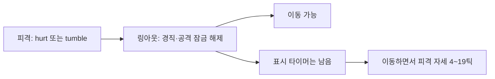

# QA-24 재현 결과 — checkpoint-2026-10-25

## A. 스토리 일시정지와 타이머

| 발견 | 심각도 | 측정값 |
|---|---|---|
| 선딜·여진·하트 레이저는 정지 중 진행하지 않음 | 해당 없음 | 유효 16쌍(무정지/정지), 정지 중 공격 생성 0, 비교 상태 변경 0, 복귀 배율 1.0/0.7 |
| 재개 후 남은 시간 정상 | 해당 없음 | 정지 제외 물리 틱 기준 대조군 대비 최대 1틱 차이 |
| 보호 깜박임·경직 정지 정상 | 해당 없음 | 보호 종료 60→61틱 / 86→87틱, 경직 종료 25→26틱 / 36→37틱(100% / 70%) |

공격 영역 생성 시점을 SceneTree.node_added에서 기록했다. 아래 숫자는 입력 틱을 0으로 둔 물리 틱이며, 정지 실행에서는 실제 정지 구간의 물리 프레임 수를 뺐다. `n/n`은 무정지/정지다.

| 동작 | 100% | 70% | 정지 위치 |
|---|---|---|---|
| Frey J 첫 타격 | 4/4 | 5/6 | 입력 후 2틱 |
| Frey 지상 I 충격파 → 여진 | 13→30 / 13→30 | 18→43 / 18→43 | 선딜 2틱 및 충격파 뒤 18/25틱, 각각 별도 실행 |
| Rio L 흡수 후 반격 | 30/30 | 42/42 | 입력 후 2틱 |
| Brave Luna I 레이저 생성 → 변신 종료 | 8→44 / 8→44 | 12→64 / 12→64 | 선딜 2틱 및 레이저 생성 뒤 14틱, 각각 별도 실행 |

모든 정지는 Esc 입력으로 들어가고 Esc로 나왔다. 각 정지의 실제 벽시계 시간은 2.100~2.158초. `--fixed-fps 60`은 벽시계 속도 제한이 아니므로 정지 중에도 27,903~63,098개의 process frame을 관측한 최초 A 실행이 있다. 게임 시간은 0이며, 이 프레임 수를 게임 진행 시간으로 해석하지 않았다. 보호 재검증의 실제 정지 시간은 2.100/2.107초다.

보호 재검증 정지 직전/직후 값은 100%에서 0.883333초/0.883333초, 알파 1/1; 70%에서 0.918333초/0.918333초, 알파 0.45/0.45. 경직도 각 정지 전후 0.29초/0.29초, 0.328333초/0.328333초다. 공격 생성과 종료의 재개 후 잔여 시간은 표의 정지 제외 타이밍에서 정지 시작 오프셋을 빼면 재현된다. 프레임 경계에 따른 최대 1틱 차이는 카드 허용치 안이다.

**재현:** 아래 `-Mode a` 명령. stage 1, seed 1001. 적은 생성 후 processing을 끄고 하자드를 꺼 외부 피격을 배제했다. 기술은 `Input.parse_input_event`로 J/L/I를 누른다. Luna는 I로 실제 변신 후 남은 변신 시간만 0.6초로 줄인 fixture다. Rio는 L 직후 공개 `apply_hit`로 1회 흡수하게 한다. 보호/경직은 공개 피격·링아웃 fixture를 이용한다. 자연 전투 난이도 검사는 아니다.

**담당/확인 위치:** `characters/common/PlayerBase.gd:1093`의 `_wait_action`, `characters/frey/Frey.gd:398`의 여진, `characters/luna/Luna.gd:574`의 레이저 종료, `scripts/story/StorySession.gd:414` 및 `:427`의 정지·재개. 이번 측정으로 수정할 근거 없음.

## B. 리스폰 뒤 피격 자세 잔류

| 발견 | 심각도 | 측정값 |
|---|---|---|
| 행동 가능하지만 hurt/tumble 자세가 계속 표시됨 | 하 | 8체형 × 약/강 피격 = 16/16 재현. 이동 중 hurt 4~5틱(66.7~83.3ms), tumble 19틱(316.7ms) |
| 다중 프레임 hurt 행 여부 | 해당 없음 | 8체형 모두 실제 로드된 hurt 1장. SYS-06의 선택적 여러 장 hurt는 이 체크포인트에서 사용하지 않음 |

| 체형 | hurt 이동 중 잔류 | tumble 이동 중 잔류 | 강타 관측 hit→respawn→마지막 잔류 틱 |
|---|---:|---:|---|
| Frey 여 | 4틱 | 19틱 | 72→77→96 |
| Luna 여 | 4틱 | 19틱 | 210→215→234 |
| Brave Luna | 4틱 | 19틱 | 348→353→372 |
| Yuki 여 | 5틱 | 19틱 | 486→491→510 |
| Nova 남 | 4틱 | 19틱 | 624→629→648 |
| Nova 여 | 4틱 | 19틱 | 762→767→786 |
| Rio 남 | 4틱 | 19틱 | 900→905→924 |
| Rio 여 | 4틱 | 19틱 | 1038→1043→1062 |

**재현:** `-Mode b`. 외부 적 없는 단일 캐릭터 fixture, 60Hz, 실제 캐릭터/체형을 생성한다. 공개 `apply_hit(null, 1, 100 또는 800, RIGHT)` → 다음 물리 프레임에 y를 `ringout_y+100`으로 변경 → D를 계속 누름 → 실제 링아웃 감지 뒤 61개 샘플(0~60)을 기록. `b.json`은 애니메이션·그림 프레임·sprite_action/timer·hurt_motion_duration·landing_motion_timer·hitstun/attack_lock·좌표 변화·공격 가능 여부를 모두 담는다. 단일 fixture에는 난수에 의존하는 적이 없고 스폰도 1곳이다. 메타 seed는 1001이다.

히트스톱 때문에 경계 밖으로 놓은 즉시가 아니라 피격 후 관측상 5틱에 리스폰한다. 표의 틱은 physics_frame 신호에서 직전 actor 업데이트 결과를 읽은 **관측 틱**으로, 내부 처리 시점과 1틱 경계 차이가 있을 수 있다. 잔류 횟수는 `abs(dx)>0.01`, `hitstun=0`, 실제 animation에 hurt/tumble이 있는 샘플만 센다. 리스폰 최초 샘플은 dx=0이라 제외했다. 최초 샘플의 잔여 sprite_action_timer는 hurt 0.0783~0.0841초, tumble 0.323333초. 해당 구간의 hitstun/attack_lock은 0이다. Brave는 정상 respawn 훅에서 Luna로 돌아간다. 시작 폼과 리스폰 뒤 실제 animation 이름은 원시 자료에 따로 남겼다.

**담당:** 공통 전투/표시 상태 `PlayerBase`.

**유력 수정 위치(제안, 미수정):** `characters/common/PlayerBase.gd:1667` `_respawn()`의 잠금 초기화 블록(`:1687`)에서 표시 상태 초기화도 함께 검토. `sprite_action`, `sprite_action_timer`, `hurt_motion_duration`, `landing_motion_timer`, pose 상태를 정리하고 새 기본 자세를 갱신하는 방향. `:2127`은 남은 action을 이동보다 우선 표시하므로 증상이 발생한다. 기술 타이밍·그림을 바꿀 근거는 없다.

## C. 스토리 전환 HP 바

| 발견 | 심각도 | 측정값 |
|---|---|---|
| pre/mid/post/result 전환의 HP 1프레임 지연 | 해당 없음 | 23개 전환 × 41샘플 = 943샘플, HP/clock 불일치 0, 오버레이 없는 combat에서 HP 누락 0 |
| 일시정지 메뉴 뒤 HP 바와 시계 유지 | 하(의도 확인) | stage 1·8·9 모두 전환 후 31/31샘플 HP=true, clock=true, overlay=true. 총 93샘플 |

**재현:** `-Mode c`, seed 1001, Frey. 각 전환의 앞 10개 process frame, 직후 동기 샘플 1개(offset 0), 뒤 30개 process frame을 기록. process 샘플은 0초 idle timer 뒤에 읽어 Main의 HUD 갱신 뒤를 본다. start→pre→combat, Esc pause/resume, post→exit/result/ending, stage result를 확인했다. stage 9의 mid는 실제 첫 웨이브 적에게 공개 피해 API를 적용해 진입했다. post는 `_objective_done()` 직접 호출로 전환시키고, result도 director의 `_finish()` 호출 fixture를 썼다. 전투로 모든 스테이지를 완주했다는 뜻이 아니다.

**측정:** pre/mid/post 진입은 `_set_match_hud_visible(false)`로 일괄 숨기고, 대화 종료는 같은 함수의 true 경로로 즉시 복원한다. 따라서 의심했던 set_status/update_hud 순서 지연은 이번 실제 전환에서 관측되지 않았다. 시작 카드와 결과/엔딩에도 HP가 남지 않았다. 단, pause는 HP와 시계를 끄지 않고 tree를 정지시킨다. Main의 갱신도 멈추므로 두 표시가 그대로 남는다. 이는 전환 후 한 프레임 지연이 아니라 pause 배경 HUD 유지다. 의도된 메뉴 배경인지 제품 판단이 필요하며, 결과 화면 오류와 동일시하지 않는다.

**담당/유력 수정 위치:** `scripts/story/StorySession.gd:414` pause와 `:427` resume, `:497` clock 가시성. 필요 시 pause 진입 때 HUD 숨김/재개 복원을 소유 컴포넌트에서 맞춘다. 관련 호출 순서는 `scripts/Main.gd:701`→`:722`, HP 판정은 `scripts/ui/MatchHud.gd:471`. 코드 미수정.



그림은 B에서 실제 관측한 게임 상태와 표시 상태의 불일치를 나타낸다. headless 전용 조건에 따라 스크린샷은 만들지 않았다.

## 실행·환경·자료

저장소에 git 작업/커밋 스크립트/제품 코드/기존 테스트 변경은 없다. 새 프로브와 자료만 허용 경로에 작성했다. 최초 `--headless --editor --import --quit` 한 번을 수행했으며 엔진이 만든 import/cache/translation은 별도 목록 `import-generated-files.txt`에 기록했다. `user://` 저장은 `StoryProgress.uses_real_save()`와 `GameSpeed._uses_saved_choice()`가 headless/script 실행에서 차단한다. 명시적인 저장 시험은 이번 카드에 필요하지 않아 실제 세이브 파일을 쓰지 않았다.

import는 exit 0이지만 **인증서 외 엔진 오류 23줄로 실패 판정**: 번역 4종의 최초 로드 실패 16줄, 편집기 캐시·설정 접근 오류 7줄. 인증서 오류 1줄은 별도 소음이다. import 뒤 번역이 생성됐으며, 이후 A/B/C/보호 재검증은 모두 exit 0, 인증서 외 엔진 오류 0. import 오류를 묵인해 전체가 무오류라고 보고하지 않는다.

최초 B 프로브는 setup 인자를 잘못 지정해 실패했고 `logs/b-fixture-error.log`로 보존했다. 이는 **분석기 작성 오류**로 제품 발견에 포함하지 않는다. 최초 A의 protection fixture는 이전 장기 보호 1000초를 남겨 1초 조건을 충족하지 못했다. 그 4행은 보호 판정에서 제외하고, 1초 보호로 수정한 `a_protection.json` 4행으로 대체했다. 나머지 A 28행은 유효하다. 현재 프로브는 처음부터 보정된 fixture로 실행된다.

```powershell
powershell -NoProfile -ExecutionPolicy Bypass -File reports/codex-qa-24/run.ps1 -Mode a
powershell -NoProfile -ExecutionPolicy Bypass -File reports/codex-qa-24/run.ps1 -Mode b
powershell -NoProfile -ExecutionPolicy Bypass -File reports/codex-qa-24/run.ps1 -Mode c
powershell -NoProfile -ExecutionPolicy Bypass -File reports/codex-qa-24/run.ps1 -Mode a_protection
```

한 번에 Godot 1개. A 151.123초, B 14.759초, C 21.360초, 보호 재검증 24.753초(각 엔진 실행 벽시계 시간). 전체 카드 시간에는 문서·코드 조사와 보고 작성도 포함되며 75분 제한 안에 마쳤다. export에 과거 `smash-nine/GAME_DESIGN_DOCUMENT.md`는 없어 열지 못했다. 현재 결정·로드맵·목표·해당 카드·이전 버그 보고와 실제 코드를 근거로 했다.

**남은 작업:** 리드가 B의 표시 초기화 수정 여부 및 C의 pause 배경 HUD 의도를 결정. 이번에는 수정하지 않음. 실제 화면·웹·사람의 조작감 검증은 범위 밖.
