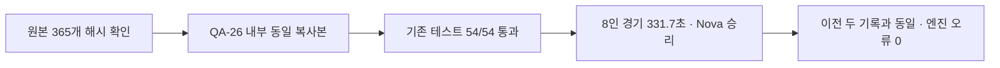

# QA-26 — checkpoint 전체 회귀 1회

| 발견 / 결과 | 심각도 | 측정값 |
|---|---|---|
| 기존 회귀 테스트 전부 통과 | 해당 없음 | 54/54, 실패 0 |
| 기본 전체 봇 경기 통과 | 해당 없음 | 8명, seed 1001, 331.7초, Nova 승리 |
| 이전 동일 시드 기록 대비 변화 없음 | 해당 없음 | 요청된 7개 지표 모두 QA-22 / SYS-09와 동일 |
| 인증서 경고 외 엔진 오류 없음 | 해당 없음 | 0줄; 알려진 인증서 경고 55줄 별도 |

제품 코드와 기존 테스트는 수정하지 않았다. 이 결과는 기존 검사 범위의 통과이며, QA-24의 리스폰 자세 잔류나 QA-25의 합성 지연에서 드러난 테스트 도우미 취약성을 부정하지 않는다. 발견된 새 회귀가 없어 담당 제품 컴포넌트·수정 위치를 지정할 항목도 없다.

## 실행 조건과 재현

- 기준: 사용자 제공 `checkpoint-2026-10-25` (`c51a417f`) export. git 명령은 실행하지 않았다.
- Godot 4.7 console, headless. QA-24 시작 때 요청된 import를 1회 했고, 이번에는 생성된 번역과 import 캐시를 복사해 추가 import 없이 실행했다.
- 실제 전체 실행: 2026-10-25 08:36:59.670~08:49:46.812 UTC (한국 17:36:59~17:49:46), **767.142초 = 12분 47초**, exit 0.
- QA-26 카드 시작은 08:29:53 UTC. 준비·검토·보고까지 40분 제한 안에서 처리했다.
- 기존 `tests/run_all.ps1`을 기본 인수로 **정확히 1회** 실행했다. 실패가 없으므로 개별 재실행은 하지 않았다. `--fixed-fps 60`, seed 1001, 기본 8명 소크 포함.
- QA-25 부하 프로세스를 모두 종료한 후 시작했으며, 이번 작업 중 Godot는 한 번에 하나씩만 실행했다.

카드의 쓰기 범위를 지키기 위해 `reports/codex-qa-26/runtime/smash-nine-prototype/`에 동일 파일을 복사해서 실행했다. 기존 `test_audio.gd:657`이 `res://../reports/codex-sys-08/audio-test.cfg`를 쓰므로 원래 위치에서 실행하면 이번 카드 밖을 쓰게 된다. 복사본의 상대 경로는 이 카드 안에 머문다. 필요한 `design/AUDIO.md`도 복사했다. 제품·테스트 코드는 패치하지 않았다.

코드·설정·장면·기존 테스트 등 **365개 파일의 SHA-256**이 원본과 복사본에서 같은지 확인했고, 완료 후 원본의 해시 변화도 **0개**였다(`source-hashes.json`, `run.json`). headless에 불필요한 `.godot/editor`와 `shader_cache`는 복사 대상에서 제외했다. 번역·가져온 리소스 캐시는 유지했다.

실행 명령(저장된 재현 래퍼):

```powershell
powershell -NoProfile -ExecutionPolicy Bypass -File reports/codex-qa-26/run-suite.ps1
```

래퍼 내부에서는 복사된 프로젝트 폴더에서 다음 기존 명령을 실행한다.

```powershell
powershell -NoProfile -ExecutionPolicy Bypass -File tests/run_all.ps1
```

`GODOT_TEST_LOG_DIR`, `TEMP`, `TMP`, `STORY_FACE_REPORT`는 모두 QA-26 폴더 안을 가리켰다. headless 저장 방지와 기존 테스트용 임시 경로를 사용했고 실제 게임의 `user://` 저장 파일은 사용하지 않았다. 임시 실행 복사본은 검증 후 삭제하며, 생성 경로 기록은 `runtime-files.txt`와 `runtime-cleanup.json`에 남긴다. 재현 래퍼는 필요 시 복사본을 다시 만든다.

## 테스트별 결과

| Test | Result |
|---|---|
| test_character_architecture | PASS |
| test_frey_sprite | PASS |
| test_luna_prototype | PASS |
| test_nova_prototype | PASS |
| test_rio_prototype | PASS |
| test_ultimates | PASS |
| test_match_rules | PASS |
| test_hazards | PASS |
| test_realm_gimmicks | PASS |
| test_soul_crystals | PASS |
| test_art | PASS |
| test_sprite_frames | PASS |
| test_offscreen_markers | PASS |
| test_relocation_active | PASS |
| test_bot_panel | PASS |
| test_skill_bar | PASS |
| test_bot_brain | PASS |
| test_talisman_burst | PASS |
| test_flash_art | PASS |
| test_ultimate_armor | PASS |
| test_sprite_pose | PASS |
| test_motion_speeds | PASS |
| test_game_speed | PASS |
| test_frey_kit | PASS |
| test_luna_kit | PASS |
| test_skill_fx_art | PASS |
| test_effect_layout | PASS |
| test_defeat_motion | PASS |
| test_realm_monsters | PASS |
| test_monster_ecology | PASS |
| test_monster_options | PASS |
| test_moves_sheet | PASS |
| test_hit_sparks | PASS |
| test_hud_frames | PASS |
| test_frontend_flow | PASS |
| test_language | PASS |
| test_font_coverage | PASS |
| test_story_data | PASS |
| test_story_flow | PASS |
| test_story_late_flow | PASS |
| test_story_presentation | PASS |
| test_restart | PASS |
| test_bugfix_review | PASS |
| visual_preview | PASS |
| test_story_rewards | PASS |
| test_story_exit_reload | PASS |
| test_story_text_fit | PASS |
| test_story_atomic_reload | PASS |
| test_fighter_motion | PASS |
| test_monster_motion | PASS |
| test_victory_screens | PASS |
| test_audio | PASS |
| test_projectile_art | PASS |
| test_story_faces | PASS |

위 54개 외 기본 소크 1회도 PASS. `test_story_faces`는 12,022개 assertion, `test_audio`는 613개 검사, 스토리 문구 배치는 520개 양언어 대사/엔딩 줄을 확인했다. 개별 출력은 `logs/`에 모두 있다.

## 동일 시드 소크 비교

| 지표 | QA-22 | SYS-09 | QA-26 | 변화 |
|---|---:|---:|---:|---:|
| 경기 길이(게임 초) | 331.7 | 331.7 | 331.7 | 0 |
| 승자 | Nova | Nova | Nova | 없음 |
| defeats | 7 | 7 | 7 | 0 |
| NaN 위치 | 0 | 0 | 0 | 0 |
| 종료 노드 수 | 1648 | 1648 | 1648 | 0 |
| PvP 피격 | 709 | 709 | 709 | 0 |
| 몬스터 피격 | 111 | 111 | 111 | 0 |

첫 PvP 8.3초, 하자드 피격 11, 링아웃 13, shared_realm_ratio 0.94, 생존 realm 1도 동일하다. 제거 순서·시점 및 다른 결과 필드도 동일하다. 따라서 이 동일 시드 비교에서 변화 경고는 없다. **서로 다른 시드의 분산은 이번 1회 요청에서 측정하지 않았으므로 seed-to-seed 편차 크기를 추정하지 않는다.**

비교 원본은 `reports/codex-qa-22/suite-summary.log`, `reports/codex-sys-09/full-suite.log`, 이번 `suite.log`의 `SOAK_RESULT`. 추출한 전체 JSON은 `summary.json`에 보존했다.

## 엔진 오류와 실행 환경

- 55개 개별 로그(54 테스트 + 소크)를 검사한 결과 `SCRIPT ERROR`, `ERROR`, `Parse Error` 중 인증서 경고를 제외한 줄은 **0**. 전부 `engine-errors.txt`에 기록했다(없음을 명시).
- `ERROR: Failed to read the root certificate store.`는 55줄. 기존 runner의 마지막 NOTE는 테스트만 세어 54줄로 표시하며, 소크의 1줄을 더한 수가 55다.
- QA-24 최초 import에 있었던 23개 비인증서 오류는 QA-24 보고서에 별도 보존되어 있다. 이번 회귀 실행의 오류로 섞거나 무시하지 않았다.
- 요청된 시작/종료 `tasklist /FO CSV`는 sandbox에서 access denied(exit 1). `tasklist-access-check.txt`에 실제 거부 출력을 보존했고 `processes-start.txt`, `processes-end.txt`에는 접근 가능한 .NET 프로세스 이름/PID 목록을 대신 기록했다. 전체 명령줄이나 다른 세션의 작업 내용은 확인하지 못했다. 시작/종료 목록에는 Godot가 없고 여러 Codex 관련 프로세스가 있었다.
- 최초 복사 시 긴 shader cache 경로와 래퍼의 문자 인코딩으로 준비 단계 오류가 있었다. Godot 실행 전에 해결했으며 기존 테스트 실패로 세지 않았다. 상세는 `preparation-notes.txt`.

## 한눈에 보기



위 흐름은 제품 수정 없이 기존 검사를 한 번 실행하고, 결과와 원본 무변경을 확인한 범위다. 화면 QA는 headless 요청에 따라 하지 않았다.

## 남은 작업

QA-26의 요청된 검증은 완료했다. 새 실패가 없어 재실행하거나 수정할 항목은 없다. 리드가 별도로 판단할 사항은 QA-24의 리스폰 표시 상태 초기화와 일시정지 HUD 의도, QA-25의 Nova 테스트 검사 방식이다. 이 보고서는 제품이나 기존 테스트를 고치지 않는다.
