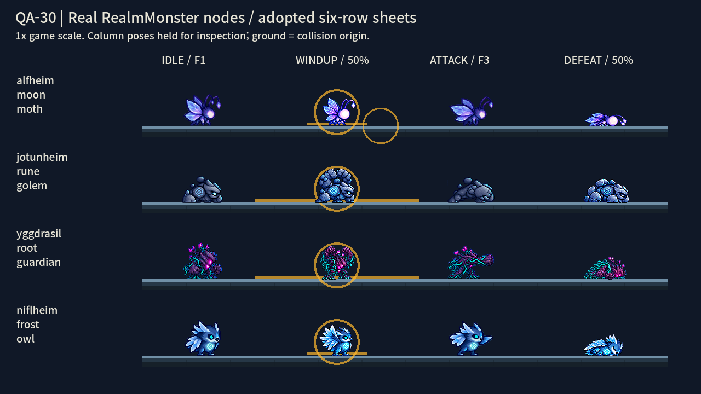
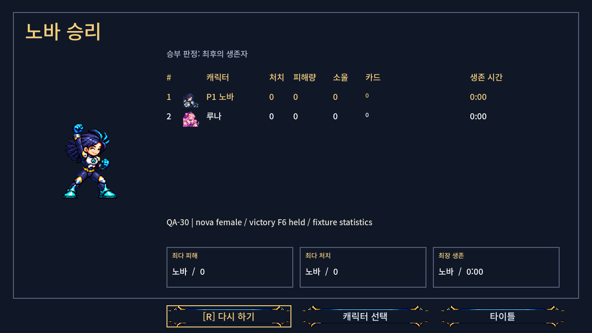
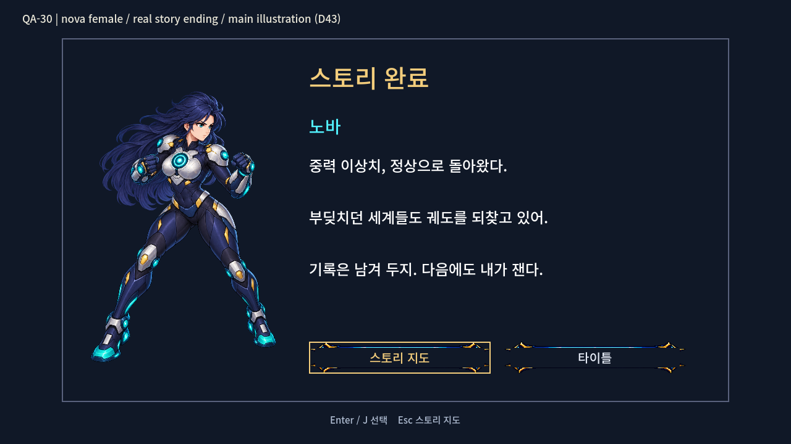

# QA-30 — 222개 선택 적용 독립 감사와 실제 화면 증거

2026-10-29 · Tester · `codex/qa-30` · HEAD `0cb48937` · 비교 체크포인트 `c51a417f`

## 완료 / 현재 상태

**Part A: 222행 검사, 선택 규칙 대비 불일치 0행.** 585개 세부 검사에서 실패 0건이다. 후보 선택 스냅샷, 후보 PNG, 제품 PNG, 체크포인트 파일을 직접 대조했다. 리드의 `apply_picks.py`와 `applied.json`은 설명 자료로만 읽었으며, 그 실행 결과를 정답으로 재사용하지 않았다.

**Part B: 요청한 6종 증거를 11장의 1280×720 PNG로 캡처했고, 최종 PNG 전부를 직접 열어 확인했다.** 최종 창 모드 실행은 종료 코드 0, 61개 검사 통과, 인증서 외 엔진 오류 0건이다. 제품 소스·추적 에셋 수정, 커밋, 소크는 하지 않았다.

## Part A — 픽셀 대조

| 종류 | 검사 행 | 후보 선택 | `none` | 선택 규칙 불일치 |
|---|---:|---:|---:|---:|
| 전투원 동작 | 58 | 36 | 22 | 0 |
| 얼굴 | 32 | 30 | 2 | 0 |
| 몬스터 동작 | 108 | 36 | 72 | 0 |
| 몬스터 기존 4행 복원 시트 | 15 | 15 | 0 | 0 |
| 투사체·충격파 | 9 | 9 | 0 | 0 |
| **합계** | **222** | **126** | **96** | **0** |

- 전투원 스트립은 `PlayerBase.OPTIONAL_MOTION_ROWS`의 프레임 수와 128/192px 규격을 기준으로 비교했다. 후보의 앞 N칸과 게임 스트립의 **RGBA 전체 픽셀**이 같고, 후보의 남은 칸은 투명하다.
- Frey `attack`, Rio 남녀 `walk`, Rio 여성 `mana_combo`는 실제 캐릭터 행 테이블에서 칸 위치를 계산했다. 선택 칸이 후보와 같으며, 변경된 4개 시트에서 **선택 영역 밖의 모든 픽셀은 체크포인트와 동일**하다. 8프레임 walk는 다음 시트 행의 두 칸까지 비교했다.
- 전투원 `none` 22행은 기존 스트립의 부재/존재 및 해당 기본·기술 시트 칸을 대조했다. 얼굴 `none` 2행(Yuki hurt, Rio 남성 hurt)은 표정 파일 상태와 중립 얼굴이 유지됐다.
- 몬스터 18장은 모두 576×576이다. 실제 사용 칸은 idle 4 / walk 6 / windup 4 / attack 4 / hurt 1 / defeat 4이며, 남는 게임 칸은 전부 투명하다. 새 windup·defeat는 선택된 후보의 앞 4칸과 일치한다.
- 기존 몬스터 행은 선택된 QA-23 `fix1` 15장 또는 체크포인트 3장과 비교했다. 골렘의 기존 행은 위로 7px 이동한 기대 그림과 정확히 같고, 위쪽 유색 픽셀 잘림은 없다.
- `git diff --name-status c51a417f HEAD -- smash-nine-prototype/assets`: **예상 PNG 93개 + 대응 `.png.import` 64개 = 157개 경로**뿐이다. 예상 밖 에셋 변경 0개. 실행 후 제품 추적 파일의 `git diff HEAD`도 비어 있다.

### `none`과 체크포인트 보존의 구분

몬스터 `none` 72행 중 **28행은 체크포인트와 RGBA 픽셀이 다르다.** 별도로 선택된 `legacy_sheet=fix1` 복원 그림과 골렘 7px 이동이 적용됐기 때문이다. 작업 카드 3번의 결합 규칙에는 맞지만, “모든 `none`이 체크포인트와 완전히 동일하다”는 설명은 정확하지 않다. **복원 선택까지 합친 의도한 적용과의 불일치는 0건**이다. 나머지 몬스터 `none` 44행은 체크포인트 행과 직접 일치한다.

### 몬스터 행별 가장 아래 유색 픽셀

96px 셀 내부의 **0부터 세는 y좌표**, 해당 동작의 사용 프레임 전체에서 최댓값이다. 프레임별 수치는 [apply-audit.json](apply-audit.json)의 `monsters[].lowest_drawn_pixel_0based`에 있다.

| 몬스터 | idle | walk | windup | attack | hurt | defeat |
|---|---:|---:|---:|---:|---:|---:|
| alfheim_moon_moth | 71 | 71 | 70 | 71 | 71 | 72 |
| alfheim_moon_stag | 71 | 71 | 72 | 71 | 71 | 72 |
| asgard_aegis_ram | 71 | 71 | 72 | 71 | 71 | 72 |
| asgard_runic_raven | 71 | 71 | 74 | 71 | 71 | 72 |
| ember_imp | 72 | 72 | 72 | 72 | 72 | 72 |
| jotunheim_rune_golem | 72 | 72 | 72 | 72 | 72 | 72 |
| jotunheim_storm_wisp | 71 | 71 | 69 | 71 | 71 | 72 |
| midgard_rooftop_slinger | 71 | 71 | 72 | 71 | 71 | 72 |
| mossling | 72 | 72 | 72 | 72 | 72 | 72 |
| muspelheim_magma_boar | 71 | 71 | 72 | 72 | 71 | 72 |
| niflheim_frost_owl | 71 | 71 | 72 | 71 | 71 | 72 |
| niflheim_glacier_wolf | 71 | 71 | 72 | 71 | 71 | 72 |
| svartalfheim_cog_drone | 71 | 71 | 74 | 71 | 71 | 72 |
| svartalfheim_gear_beetle | 71 | 71 | 72 | 71 | 71 | 72 |
| vanaheim_seed_sprite | 71 | 71 | 72 | 71 | 71 | 72 |
| vanaheim_vine_hound | 71 | 71 | 72 | 71 | 71 | 72 |
| yggdrasil_root_guardian | 71 | 71 | 72 | 71 | 71 | 72 |
| yggdrasil_root_oracle | 71 | 71 | **86** | 71 | 71 | 72 |

관찰: root oracle의 선택된 windup v2는 y=86까지 내려오며, 기준 y=72보다 14px 낮다. 후보 원본도 열어 확인했으며 아래로 뻗은 촉수 그림이 있다. **잘못 복사된 결과는 아니다.** 실제 플레이에서의 지면 간섭 여부는 이번 4종 화면 대상에 포함되지 않아 판정하지 않았다. Raven·drone windup의 y=74, moth 70, wisp 69도 수치 차이로만 기록한다.

## Part B — PNG 목록과 직접 확인한 내용

모든 이미지는 창 모드 Godot의 `root.get_texture().get_image()` 결과이며 이미지 편집으로 합성하지 않았다. `RealmMonster`, `RealmWorld`, `StoryDialogue`, `FrontendMenu.show_results`, `StoryScreens.show_story_ending`, 캐릭터 실제 씬과 현재 제품 에셋을 사용했다. QA 제목과 배치는 테스트 스크립트가 제공한다.

| PNG | 열어 확인한 화면 |
|---|---|
| [six-row-monsters.png](six-row-monsters.png) | 위부터 moon moth, rune golem, root guardian, frost owl. 왼쪽부터 idle F1 / windup 50%(F3) / attack F3 / defeat 50%(F3). 바닥선과 게임의 예고 원·선이 보인다. 골렘의 기존 동작과 새 동작이 같은 기준선에 놓인다. |
| [shockwaves.png](shockwaves.png) | 왼쪽 root guardian의 보라·청록 뿌리 파동, 오른쪽 골렘의 돌 파동. 각 몬스터에서 좌우 두 방향으로 나온 실제 충격파가 바닥선을 따라 표시된다. |
| [story-faces.png](story-faces.png) | 3단계 실제 사전 대사. 오른쪽에서 말하는 Luna의 happy 얼굴과 왼쪽의 어두워진 Frey 중립 얼굴. 이 장면의 Luna는 라이벌 역할이다. |
| [story-faces-angry.png](story-faces-angry.png) | Luna 고향 3단계 사전 대사. 왼쪽 Luna가 angry 얼굴로 말하며, 고향 장면이므로 오른쪽 라이벌 얼굴은 없다. |
| [story-faces-hurt.png](story-faces-hurt.png) | Luna 고향 3단계 종료 대사. 왼쪽 Luna의 hurt 얼굴과 실제 한글 대사. |
| [story-faces-yuki-hurt.png](story-faces-yuki-hurt.png) | Yuki 고향 8단계의 hurt 태그 대사. 왼쪽에는 선택되지 않은 hurt 후보 대신 **기존 중립 얼굴**이 표시된다. |
| [shadow-face.png](shadow-face.png) | 9단계 중간 대사. 오른쪽 ‘그림자 루나’의 v2 그림자 얼굴이 말하고, 왼쪽 정상 Luna 얼굴은 어두워진다. 그림자에는 추가 보라색 곱셈 tint가 없다. |
| [results-victory.png](results-victory.png) | Nova 여성 승리 화면. 주먹을 든 승리 F6가 애니메이션 종료 후 멈춰 있고, 실제 결과 표와 버튼이 표시된다. |
| [results-victory-luna.png](results-victory-luna.png) | Luna 승리 화면. 지팡이를 든 승리 F6가 종료 후 유지된다. |
| [story-ending.png](story-ending.png) | Nova 여성 엔딩. 큰 메인 일러스트, 캐릭터별 한글 엔딩, 스토리 지도·타이틀 버튼. 승리 픽셀 동작은 없다. |
| [story-ending-luna.png](story-ending-luna.png) | Luna 엔딩. 큰 메인 일러스트와 Luna의 한글 엔딩. 승리 픽셀 동작은 없다. |



네 열은 같은 게임 시트에서 읽힌 동작이다. 비교를 위해 상태와 프레임을 고정했으며, 몬스터 화면은 1배 게임 크기다. moth의 실제 비행 높이나 전투 이동을 재현한 화면은 아니다.



승리 동작은 강제로 마지막 프레임을 지정하지 않고 재생 종료까지 기다린 뒤 `frame=5`, `is_playing=false`를 확인했다. 표의 0값은 실제 캐릭터 노드의 초기 통계이며, 플레이한 경기 결과를 의미하지 않는다.



같은 영웅의 엔딩은 D43대로 메인 일러스트를 표시한다. 두 영웅 모두 일러스트 노드 1개, VictoryMotion 노드 0개를 검사했다.

### 캡처 범위와 실행 근거

- 화면별 실제 텍스처 경로, 대사 ID·태그, 프레임 번호, 충격파 방향·경과 시간은 [capture-evidence.json](capture-evidence.json)에 기록했다.
- 몬스터는 실제 상태 전환 함수로 선택하고 중간 프레임에서 정지했다. 네 종류 모두 로더가 `[4, 6, 4, 4, 1, 4]` 프레임으로 읽는 것을 확인했다.
- 충격파는 실제 `_execute_action()`에서 생성하고 약 0.18초의 물리·애니메이션 진행 후 정지했다. guardian 전용 파일 2개, 공용 slam 파일 2개를 런타임 텍스처 경로로 확인했다.
- 대사는 수정하지 않은 `StoryCatalog.dialogue_for()`의 실제 행을 사용했다. 고향 장면의 rival 인자도 `StorySession`과 같은 빈 문자열로 전달했다. `happy`는 실제 카탈로그에서 Luna가 오른쪽 라이벌로 말하는 장면을 골랐다.
- 전투·스토리 전체 진행을 재생한 통합 플레이테스트가 아니라 **실제 제품 노드와 씬을 정해진 상태로 배치한 증거 캡처**다. 전투 밸런스·봇·전체 화면 전환 회귀까지 통과했다는 뜻은 아니다.

## import 및 오류 기록

1. 작업 카드 확인 후 다른 검사보다 먼저 기본 경로로 import를 두 번 실행했다. [import-first.log](import-first.log), [import-second.log](import-second.log). 첫 실행의 초기 번역 누락 외에 두 번째에도 `C:/Users/TH/AppData/Local/Godot` 편집기 캐시 생성·저장 오류가 남아, **이 두 실행을 clean으로 판정하지 않았다.**
2. 제품 설정은 변경하지 않고 자식 프로세스의 `LOCALAPPDATA`·`APPDATA`를 이 보고서의 `runtime/`으로 지정해 두 번 재실행했다. [import-redirected-first.log](import-redirected-first.log), [import-redirected-second.log](import-redirected-second.log). 마지막 import의 실제 Godot 종료 코드 0, 인증서 외 오류 0건. 기존 `tests/art_preview/story_70/import_check`의 중첩 프로젝트 무시 경고는 별도로 남아 있다.
3. 최초 창 캡처는 인증서 외 오류가 없었다. 설명 위치·고향 대화 인자를 보정한 2·3차 실행에서는 `ERROR: Condition "err != OK" is true. at initialize (drivers/gles3/shader_gles3.cpp:802)`가 각각 한 번 출력됐다. 출력 이미지·검사는 생성됐지만 프로젝트 규칙에 따라 **그 실행은 실패**로 처리했다. [capture-attempt2.log](capture-attempt2.log), [capture-attempt3.log](capture-attempt3.log).
4. 캡처 사용자 캐시를 `runtime/capture-user/`로 분리한 **최종 실행**은 종료 코드 0, `QA30_CAPTURE_DONE screens=11 failed=false`, 검사 61개 통과다. [capture.log](capture.log). 최종 PNG는 이 실행의 결과이며 모두 다시 열어 확인했다.

**알려진 환경 오류:** 최종 import와 최종 캡처에 각각 `ERROR: Failed to read the root certificate store.` 1건. 합격 판정에서 제외한 오류는 이 문구뿐이다.

**원인 미확정:** 캐시 분리 후 셰이더 오류가 사라진 것은 측정 사실이다. 긴 캐시 경로를 일반 Windows 경로로 열거할 때도 실패하고 확장 경로로는 성공했으므로 경로 길이가 원인일 가능성은 있으나, 엔진 내부 원인을 입증하지 않았다. 같은 캐시를 재사용하는 환경에서 재발할 수 있어 영구 수정으로 보고하지 않는다.

## 재현 및 인계

저장소 루트에서:

```powershell
$env:PYTHONDONTWRITEBYTECODE = '1'
& 'C:/Users/TH/.cache/codex-runtimes/codex-primary-runtime/dependencies/python/python.exe' reports/codex-qa-30/audit_apply.py
powershell -NoProfile -ExecutionPolicy Bypass -File reports/codex-qa-30/run_capture.ps1
```

[감사 스크립트](audit_apply.py)는 제품 파일을 읽기만 한다. [캡처 스크립트](../../smash-nine-prototype/tests/analysis/codex_qa_30/capture_apply.gd)는 제품 씬·스크립트의 메모리 인스턴스를 조작하며 제품 파일이나 사용자 진행 저장을 변경하지 않는다. import가 만든 Godot 캐시·번역 출력은 인계 목록에서 제외한다.

[commit.ps1](commit.ps1)과 [commit-paths.txt](commit-paths.txt)를 준비했으며 **실행하지 않았다**. 리드는 목록 검토 후 실행할 수 있다. 스크립트는 지정 파일만 `git add --pathspec-from-file`로 추가하고, 다른 staged 파일이 있으면 중단한다. `-StageOnly`를 주면 stage까지만 한다. `.godot`, `.uid`, `run.log`, 사용자 캐시는 포함하지 않으며 `git add -f`도 사용하지 않는다. 카드와 전달 프롬프트는 사용자가 제공한 기존 미추적 파일을 그대로 포함한다.

## 남은 작업 / 다음 권장 단계

- 요청된 증거 6종의 미캡처 항목은 없다. 전체 테스트·소크·웹 빌드·커밋·병합은 이 유닛에서 실행하지 않았다. 전체 테스트와 소크는 병행 중인 리드의 결과를 확인해야 한다.
- 리드에게 `none` 28행의 복원 규칙과 root oracle windup의 y=86 관찰을 전달한다. root oracle의 실제 지면 관계와 재사용 캐시의 셰이더 오류 원인은 추가 확인 대상이다.
- 사용자 이미지 검토 후 리드가 채택·병합 여부를 판단한다. 이번 결과는 main 병합을 수행하거나 승인한 기록이 아니다.

디스크: 이번 보고서 폴더는 사용자 캐시 포함 약 **8.2 MB**다. 기존 파일과 `.git`, import 캐시를 포함한 작업 클론 `C:/Users/TH/Documents/AI/GameProject/SmashNine-units/art-b/SmashNine`은 약 **3.90 GB (3.63 GiB)**다. [측정 기록](disk-usage.json). 큰 중간 영상·프레임 시퀀스는 만들지 않았다.
