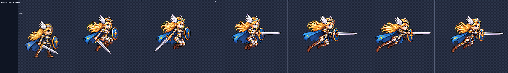
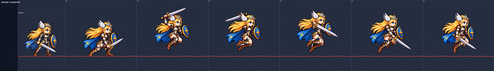

# SKM-01b Frey 재시도

내장 image_gen으로 각 행 한 번 생성했다. 기준 idle을 참조로 전달했으며, 후보 전달은 **0/2행**이다. 두 행 모두 얼굴 허용 범위를 넘어서 검토 자료만 남겼다. 게임 폴더는 변경하지 않았다.

| 행 | 상태 | 공통 배율 | 얼굴 눈 / 폭 | 최소 여백 | 디테일 |
|---|---|---:|---|---:|---:|
| [hover_dash](frey-hover_dash.png) | 미전달 | 0.38 | 0.963–1.063 / 1.000–1.114 | 5px | 111.28–123.89 |
| [launch_chase](frey-launch_chase.png) | 미전달 | 0.31 | 0.873–0.949 / 1.057–1.114 | 21px | 101.89–115.04 |

## 검수 및 남은 문제
- **hover_dash:** 한 번 생성. 모든 프레임에서 은색 검날이 보이며 F2·F3 접힌 다리와 검 방향 변화가 있다. 공통 배율 0.38에서 F4 눈 1.063·얼굴 폭 1.114로 전달 상한 1.06을 넘는다. 0.37·0.378·0.39도 검토했으나 얼굴 전 프레임 조건을 동시에 통과하지 못했다. 긴 검을 위한 행 공통 x 이동 −5px. F2·F3의 망토와 머리카락은 위로 뜨는 힘이 약하고 주로 뒤로 흐른다. 후보 미전달.
- **launch_chase:** 한 번 생성. 공통 배율 0.35에서는 얼굴 폭 1.171–1.286 및 F2 상단 여백 3px로 실패. 0.31에서 여백은 통과하지만 눈 거리 0.873–0.949, 얼굴 폭 1.057–1.114로 전달 범위 밖이다. 자동 머리 중앙값 1.04와 달라 얼굴 지표를 우선했다. F2 검 높이를 낮췄고 F4 어깨에서 대각선으로 베는 검이 보이나, F3의 검 손은 투구 뒤에 가려져 연속성이 불명확하고 허벅지 피부 노출이 기준보다 넓다. 후보 미전달.

## 방법과 검증
- 기존 SKM-01 process_row.py·face_check.py를 경로만 바꿔 재사용. 연결된 자세 덩어리별 추출, 원본 공통 y 좌표 보존. 고정 폭 절단 없음.
- 행 공통 배율 하나. LANCZOS / sharpen 60 / despill auto / palette none / #00ff00. 프레임별 크기 조절과 부분 붙이기 없음.
- 얼굴 수치는 4배 최근접 확대의 눈 중심 거리 / 눈높이 얼굴 폭(머리카락 제외). 자동 표식과 4배 판을 육안 확인. head_scale.py는 보조 검사.
- 전달 범위는 두 얼굴 지표 모두 0.95–1.06. 0.96–1.04 밖의 수치는 후보 note에 명시.
- PNG 규격·이진 알파·빈 테두리·4px 여백·spill 0·detail 79 이상을 검사. 실제 게임과 모션 뷰어 실행 검증은 하지 않았다.
- 원본과 프롬프트는 art/raw/skm-01b/ 및 prompts.txt. 측정 상세와 비교판은 frey/<행>/attempt-1/. 자동 소수 자릿수는 실제 측정 정확도를 뜻하지 않는다.

## 다음 권장 단계
다음 제작에서는 hover_dash의 F4 얼굴 폭과 부유하는 머리카락·망토를, launch_chase의 눈 간격/얼굴 폭 비율과 허벅지 의상을 먼저 고쳐야 한다. 이번 카드의 추가 생성 1회씩을 모두 사용했으므로 더 생성하지 않았다.

commit.ps1은 작성만 했고 실행하지 않았다. 지정한 후보 PNG/JSON, 비교판, README, 작업 카드만 포함한다. attempt 폴더·원본·보조 스크립트는 커밋 목록에서 제외한다.

## 최종 확인

최종 검토 시트 12프레임의 1152×192 규격, 이진 알파, 4px 여백, 빈 테두리, spill 0, detail ≥79와 커밋 경로 제한을 확인했다. 두 행의 얼굴 게이트 실패 및 후보 PNG/JSON 미생성도 확인했다. commit.ps1은 PowerShell 파서 구문 검사만 통과했으며 실행하지 않았다. 파일 검증 통과는 그림 전달 조건 통과를 뜻하지 않는다.

## 시각적 확인

왼쪽은 idle 기준, 오른쪽은 도약·공중 대기·돌진 여섯 자세다. 은색 검날은 남았지만 F4 얼굴 폭과 공중 부유 표현이 미달이다.

왼쪽은 idle 기준, 오른쪽은 올려베기·추가 내려베기·공중 회복이다. 얼굴 눈 간격과 의상 차이로 미전달이다.
