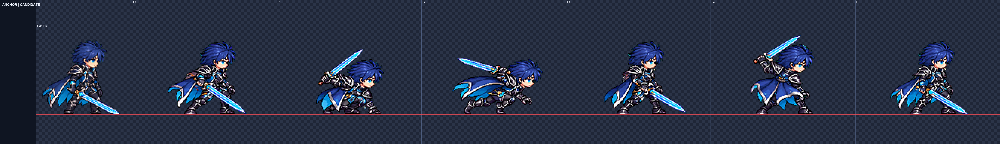
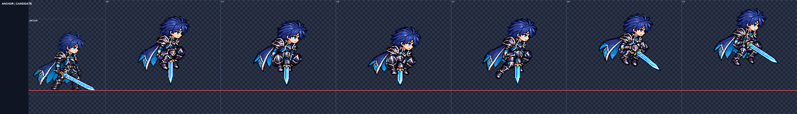
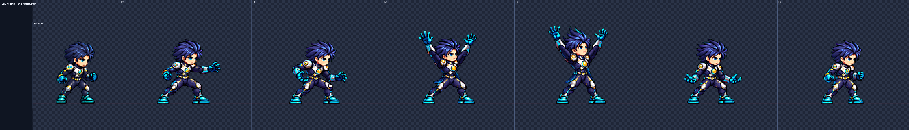
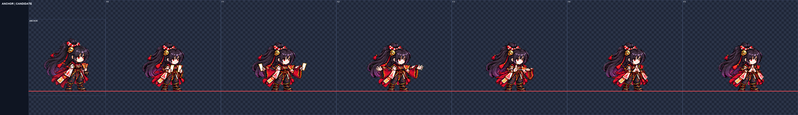
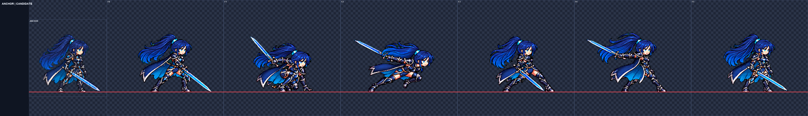
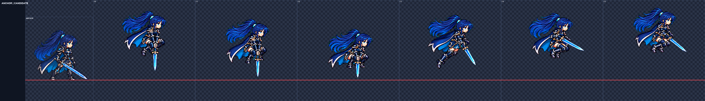
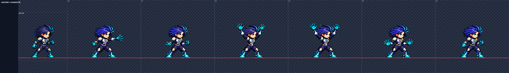

# SKM-02 새 기술 몸 동작 후보

완료 후보 6/7행. 내장 ImageGen 사용. 게임 파일 변경 없음. 커밋 스크립트 작성만 하고 실행하지 않음.

## 행별 결과

| 행 | 상태 | 검사와 판단 |
|---|---|---|
| rio_male dimension_link | 후보 전달 | 시도 2, 배율 0.35, 얼굴 폭 1.0–1.0, 머리 중앙값 1.0; 여백 31px, 테두리 비움, spill 0, 디테일 [125.66, 145.53]. 웅크림→통과→회전 베기→준비 자세의 후보입니다. 노출 얼굴 폭 1.00이며 반대쪽 눈은 기준부터 가려져 눈 간 거리는 측정 불가; 5번 베기의 연결감은 사람이 판단해야 합니다. |
| rio_male pogo_bounce | 후보 전달 | 시도 2, 배율 0.37, 얼굴 폭 1.0–1.0333, 머리 중앙값 1.0; 여백 14px, 테두리 비움, spill 0, 디테일 [118.46, 127.36]. 아래 찌르기→압축→무릎을 접고 상승하는 후보입니다. 노출 얼굴 폭 1.000–1.033, 눈 간 거리 측정 불가; 아래로 향한 검의 원근상 길이와 반동 연결감은 사람이 판단해야 합니다. |
| nova_male zero_gravity | 후보 전달 | 시도 1, 배율 0.3, 얼굴 폭 1.0–1.0, 머리 중앙값 0.96; 여백 37px, 테두리 비움, spill 0, 디테일 [106.74, 115.81]. 양손을 위로 뻗어 유지한 뒤 가드로 돌아오는 후보입니다. 1·2·5·6번 노출 얼굴 폭 1.00, 3·4번은 위를 향한 얼굴이라 제외했고 반대쪽 눈이 가려져 눈 간 거리는 측정 불가입니다. |
| yuki seal_link | 미전달 | 시도 2, 배율 0.262, 얼굴 폭 미확정–미확정, 머리 중앙값 0.92; 여백 39px, 테두리 비움, spill 0, 디테일 [98.74, 101.77]. 2회 생성 종료 후 미전달입니다. 얼굴 폭은 1.00이나 두 눈 간격 검증이 안정적으로 통과하지 않았고, 4번 손 사이에 보이는 가는 선도 무이펙트 조건과 맞지 않아 사람이 확인해야 합니다. |
| rio_female dimension_link | 후보 전달 | 시도 1, 배율 0.35, 얼굴 폭 1.0–1.0, 머리 중앙값 1.01; 여백 19px, 테두리 비움, spill 0, 디테일 [119.1, 131.43]. 포니테일이 뒤따르는 차원 연결 후보입니다. 정립 프레임 얼굴 폭 1.00, 3번 기울어진 얼굴은 제외; 눈 간 거리는 앞머리 가림으로 측정 불가입니다. |
| rio_female pogo_bounce | 후보 전달 | 시도 1, 배율 0.325, 얼굴 폭 1.0–1.0, 머리 중앙값 0.94; 여백 15px, 테두리 비움, spill 0, 디테일 [113.32, 125.33]. 아래 찌르기 뒤 무릎을 접고 상승하는 후보입니다. 노출 얼굴 폭은 전부 1.00이며 자동 머리 중앙값 0.94와 달라 얼굴 검사를 우선했고, 눈 간 거리는 앞머리 가림으로 측정 불가입니다. |
| nova_female zero_gravity | 후보 전달 | 시도 2, 배율 0.28, 얼굴 폭 1.0–1.0, 머리 중앙값 0.96; 여백 39px, 테두리 비움, spill 0, 디테일 [117.89, 121.91]. 양손을 위로 밀어 올리고 자세로 돌아오는 후보입니다. 노출 얼굴 폭은 전부 1.00이며 머리 중앙값은 0.96이고, 반대쪽 눈이 가려져 두 눈 거리는 측정 불가입니다. |

## 방법과 확인 범위

ART-72 스크립트를 복사했으며 process_skm.py는 해당 처리 흐름을 이번 192px·6프레임 작업에 맞게 바꾼 실행 파일이다. extract.py는 실제 8방향 연결 덩어리로 각 포즈를 추출한다. 고정 너비 분할, 확대, 프레임별 배율 변경, 머리 붙이기를 사용하지 않는다. 원본 세로 좌표를 보존하고 행마다 한 축소 배율만 사용한다.

LANCZOS / sharpen 60 / despill auto / palette none / #00ff00. head_scale.py 자동 값과 4배 얼굴·전신 판을 함께 본다. 반대쪽 눈이 기준부터 가려진 경우 눈 사이 거리는 측정 불가로 기록하며 임의로 만들지 않는다.

## 사람이 판단할 점

모션 뷰어에서 공격 연결, 검을 쥔 손의 연속성, 얼굴·의상 일치와 공중 튀어오르는 인상을 판단해야 한다. 실시간 게임 재생은 검사하지 않았다. 후보 채택과 게임 연결은 별도 작업이다.

## 시각적 확인

왼쪽은 기준 idle, 오른쪽은 같은 픽셀 배율의 6프레임이다. 세부 확인은 행 폴더의 page-1~3.png와 faces4x.png를 사용한다.

왼쪽은 기준 idle, 오른쪽은 같은 픽셀 배율의 6프레임이다. 세부 확인은 행 폴더의 page-1~3.png와 faces4x.png를 사용한다.

왼쪽은 기준 idle, 오른쪽은 같은 픽셀 배율의 6프레임이다. 세부 확인은 행 폴더의 page-1~3.png와 faces4x.png를 사용한다.

왼쪽은 기준 idle, 오른쪽은 같은 픽셀 배율의 6프레임이다. 세부 확인은 행 폴더의 page-1~3.png와 faces4x.png를 사용한다.

왼쪽은 기준 idle, 오른쪽은 같은 픽셀 배율의 6프레임이다. 세부 확인은 행 폴더의 page-1~3.png와 faces4x.png를 사용한다.

왼쪽은 기준 idle, 오른쪽은 같은 픽셀 배율의 6프레임이다. 세부 확인은 행 폴더의 page-1~3.png와 faces4x.png를 사용한다.

왼쪽은 기준 idle, 오른쪽은 같은 픽셀 배율의 6프레임이다. 세부 확인은 행 폴더의 page-1~3.png와 faces4x.png를 사용한다.

## 확인 및 남은 작업

미착수 행 없음. 유키 seal_link는 2회 생성 후 미전달이며, 후보 PNG/JSON은 만들지 않았다. 보고서에 남긴 유키 판은 실패 원인 확인용이다.

전달된 6행의 노출 얼굴 폭은 1.000–1.033이다. 기울이거나 위를 본 얼굴은 비교에서 제외했으며, 리오·노바의 반대쪽 눈은 가려져 두 눈 거리 검사를 통과했다고 주장하지 않는다. 의상과 손·무기는 4배 판을 직접 대조했고, 마지막 채택은 사람이 움직임과 원근 표현까지 보고 판단해야 한다.

행별 page-1.png~page-3.png는 2048px 폭으로 나눠 원본의 정확한 4배를 볼 수 있다. 위의 긴 판은 앱에 따라 축소 표시될 수 있다.

파일 검증: 210개 통과, 0개 실패. 실제 PNG의 크기·알파·여백·spill·디테일, 행별 공통 축소 배율, 메타데이터, 원본 추출 기록 및 스테이징 허용 경로를 확인했다. 얼굴·의상 미술 판단을 대신하는 점수는 아니다.

게임 실행 및 게임 연결은 수행하지 않았다. commit.ps1은 구문 검사만 하며 실행하지 않는다. 다음 단계는 모션 뷰어에서 6개 후보의 연결감과 검 길이·손 위치를 검수하고, 유키 행을 별도 재작업하는 것이다.

