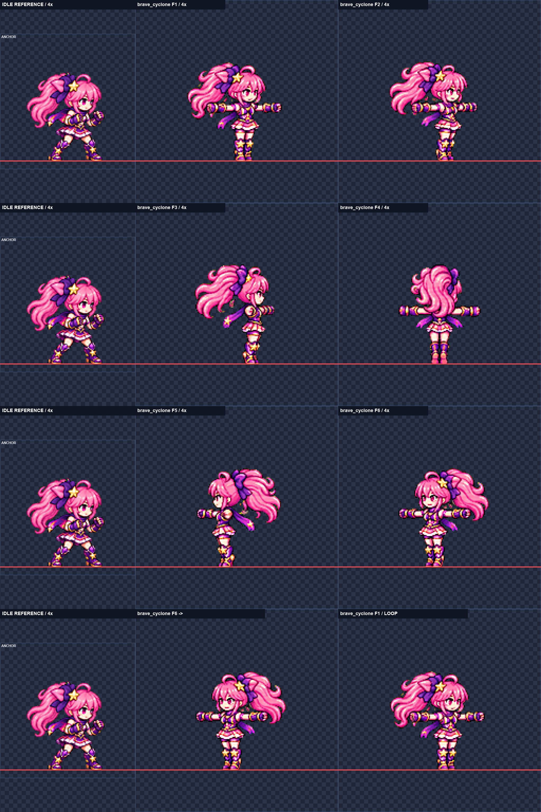
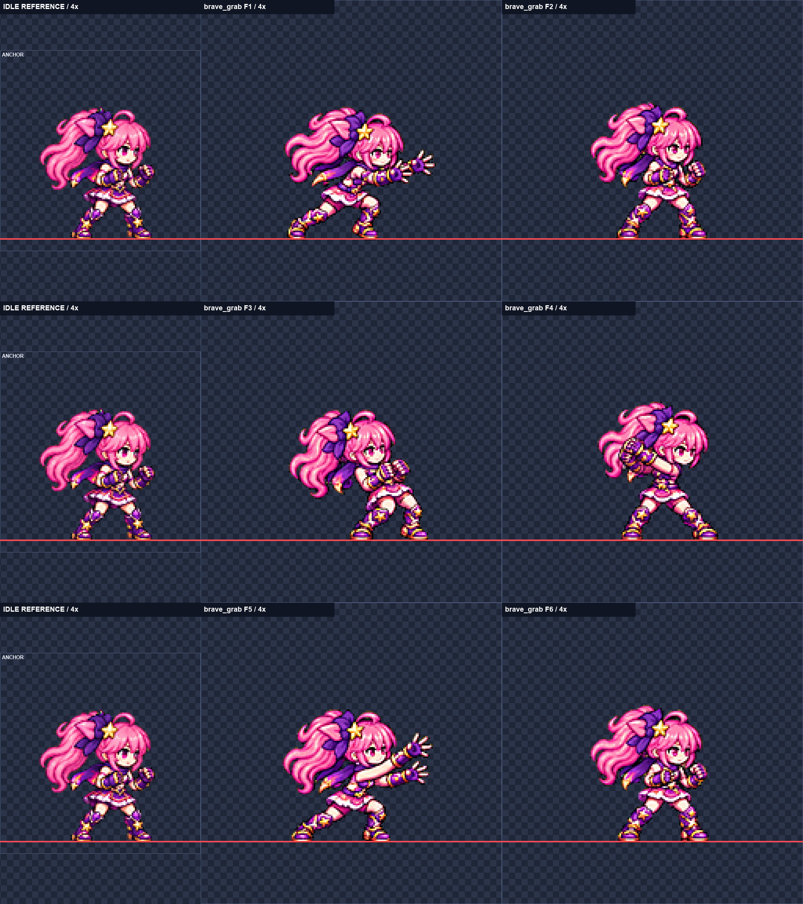
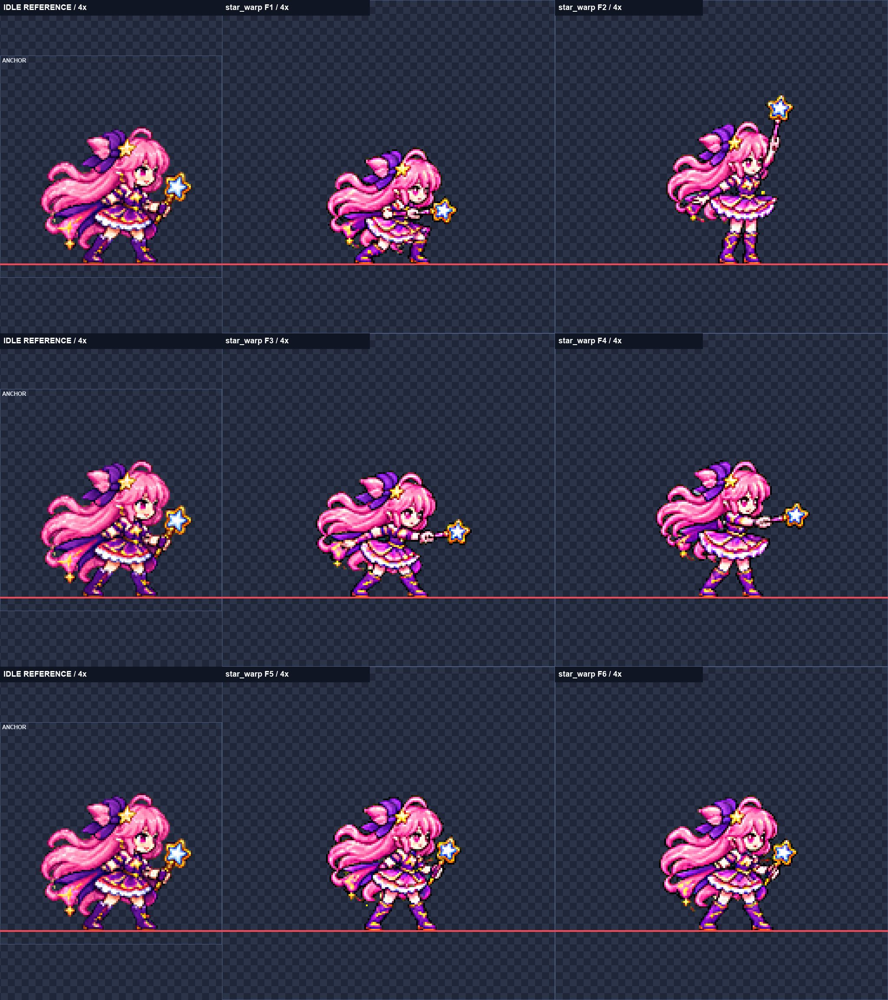

# SKM-04 Luna 신규 기술 몸 동작 후보

**후보 전달 0/3행.** 행별 3회, 총 9회 생성 후 최선 원본을 검수했다. 보류 행은 art/bakeoff에 내보내지 않는다.
내장 image_gen으로 행마다 6자세를 한 줄로 생성했다. 게임 파일 수정·게임 실행·뷰어 채택은 하지 않았다.

## 행별 결과

| 행 | 상태 | fps | 배율 | 눈 거리 / 얼굴 폭 | 최소 여백 | 디테일 |
|---|---|---:|---:|---|---:|---|
| [brave_cyclone](luna_brave-brave_cyclone.png) | 보류 | 20 | 0.36 | 0.867–1.006 / 0.857–0.964 | 39px | 96.74–118.44 |
| [brave_grab](luna_brave-brave_grab.png) | 보류 | 18 | 0.35 | 0.955–1.003 / 1.000–1.071 | 39px | 115.87–125.13 |
| [star_warp](luna-star_warp.png) | 보류 | 20 | 0.36 | 0.953–1.095 / 0.929–1.036 | 39px | 121.34–130.46 |

### brave_cyclone

3회 생성 후 보류. 3차는 회전 방향을 확보했으나 얼굴 제안값 눈 거리 0.867–1.006·폭 0.857–0.964로 하한을 벗어나고, 발뒤꿈치가 들린 회전 자세도 약하다.

- 선정 원본 3차. 자동 머리 중앙값 1.01 (신뢰 2개). 얼굴 측정 F1, F2, F6.
- 측정 제외: {"3": "옆모습: 한 눈만 보여 두 눈 거리 직접 비교 불가", "4": "뒷모습: 얼굴 없음, 자동 표식 무효", "5": "옆모습: 한 눈만 보여 두 눈 거리 직접 비교 불가"}
- 시도 기록: 1차 F6이 다시 오른쪽을 향해 회전 방향이 끊김. 2차는 방향 개선, 얼굴·머리가 작음. 3차는 머리 자동 중앙값 1.01이나 얼굴 차이와 평평한 발 자세가 남음.
- 사람 판단: F6→F1 회전 연결, F1/F2의 비슷한 몸 방향, 얼굴 인상·크기, 발끝 회전 자세. 이 보드는 실패 근거이며 채택 후보가 아님.

### brave_grab

3회 생성 후 보류. 3차 공통 배율 0.35에서 눈 거리 0.955–1.003은 허용 범위지만 F2·4·5·6 얼굴 폭 1.071이 상한 1.06을 넘는다.

- 선정 원본 3차. 자동 머리 중앙값 0.96 (신뢰 4개). 얼굴 측정 F1, F2, F3, F4, F5, F6.
- 측정 제외: {}
- 시도 기록: 1차 배율 조정에도 눈 간격/폭 편차. 2차 F3 눈 거리 0.882와 폭 1.143, F5 폭 0.857. 3차는 동작·얼굴 통일 개선, 폭 1.071 잔존.
- 사람 판단: 잡은 뒤 가슴으로 당기는 느낌, F4→F5의 두 팔 투척, 얼굴 크기·인상. 이 보드는 보류 검토 자료다.

### star_warp

3회 생성 후 보류. 최선 1차·공통 배율 0.36에서 F1 눈 거리 1.074, F3 눈 거리 1.095, F4 얼굴 폭 0.929로 전달 범위를 벗어난다.

- 선정 원본 1차. 자동 머리 중앙값 0.9 (신뢰 3개). 얼굴 측정 F1, F2, F3, F4, F5, F6.
- 측정 제외: {}
- 시도 기록: 1차는 지팡이 유지와 자세가 가장 명료하지만 얼굴 편차가 남음. 2차는 눈 간격 확대와 표식 불안정. 3차는 F2 얼굴이 든 팔에 가려지고 F1 지팡이가 가슴을 가로지르지 않음. 1차 공통 배율 0.35–0.37을 비교했지만 전체 얼굴 기준은 충족하지 못함.
- 사람 판단: F2→F3 순간이동 출발·도착 자세의 구분, 지팡이를 쥔 손 유지, F3→F4 회전과 치마 흐름, F1/F3 눈 간격과 F4 얼굴 폭. 보류 자료이며 채택 후보가 아님.

## 검사 방법과 제한

- SKM-03 Python 스크립트를 복사해 경로·행·앵커를 변경했다. 원본 6개 연결 실루엣과 가까운 분리 픽셀을 추출하며 고정 폭으로 자르지 않는다.
- LANCZOS / sharpen 60 / despill auto / palette none / #00ff00. 행마다 하나의 축소 배율. 192px 셀, 몸 중심 x96, 발끝 y152. 신체 부위 붙이기·프레임별 배율 변경 없음.
- 얼굴 목표 0.96–1.04, 전달 허용 0.95–1.06. 목표 밖은 note에 공개. 여백 4px·spill 0·detail 79 이상을 검사한다.
- 얼굴은 ART-72의 4배 국소 표식 매칭으로 측정하고 직접 검토한다. 상반부 탐색으로 허벅지 오검출을 피한다. 회전 F5/F6은 측정용으로만 반전해 각도를 맞춘다. 보류 행의 숫자는 검증된 실측이 아닌 자동 제안일 수 있다.
- 뒷모습과 한 눈만 보이는 옆모습은 두 눈 거리 측정에서 제외한다. 계산 소수 자릿수는 측정 정확도를 의미하지 않는다.
- 원본 art/raw/skm-04/ 및 시도 폴더는 로컬 보존, 커밋 제외. 전체 생성 프롬프트: [prompts.txt](prompts.txt).
- commit.ps1은 작성만 하고 실행하지 않는다. 후보·검사 보드·기록·스크립트·카드만 명시적으로 추가한다.

## 다음 권장 단계

전달 후보를 사용자가 모션 뷰어에서 판단한 뒤 리드가 연결한다. 보류 행은 원인을 해소한 후속 제작이 필요하다.

## 시각적 확인

각 단 왼쪽은 idle 기준, 오른쪽은 두 프레임. 빨간 선은 y152. 회전 보드 마지막 단은 F6→F1이다.

각 단 왼쪽은 idle 기준, 오른쪽은 두 프레임. 빨간 선은 y152. 회전 보드 마지막 단은 F6→F1이다.

각 단 왼쪽은 idle 기준, 오른쪽은 두 프레임. 빨간 선은 y152. 회전 보드 마지막 단은 F6→F1이다.

## 확인 및 테스트

[audit.json](audit.json): 파일·규격·원본 보존·쓰기 범위·커밋 스크립트 구문 검사 279개 통과. 이는 보류 행의 얼굴·자세를 통과로 바꾸지 않는다.

모든 최선 원본의 18프레임을 4배로 직접 확인했다. 192px 셀·y152·이진 알파·4px 여백·spill 0·detail 79 이상은 통과했다. 게임 실행은 하지 않았으며 commit.ps1도 실행하지 않았다.

