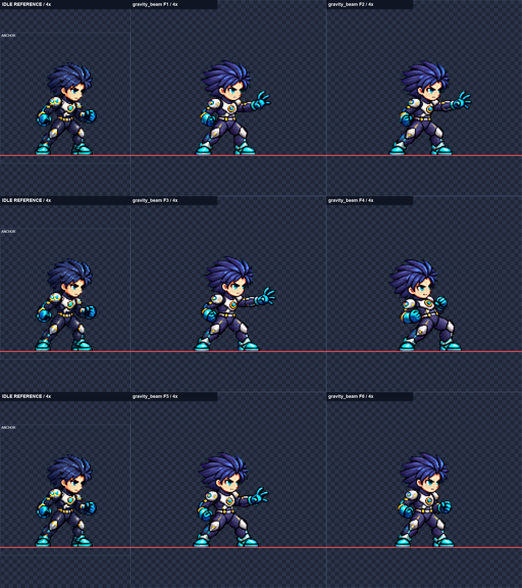
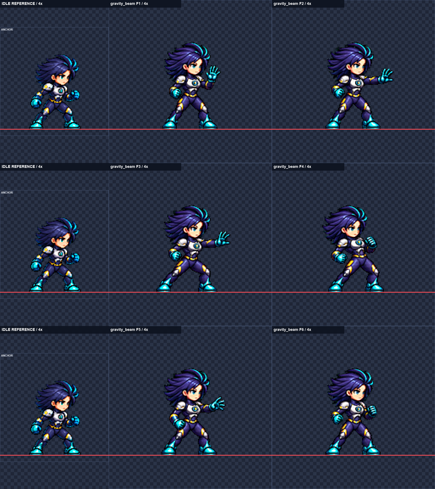
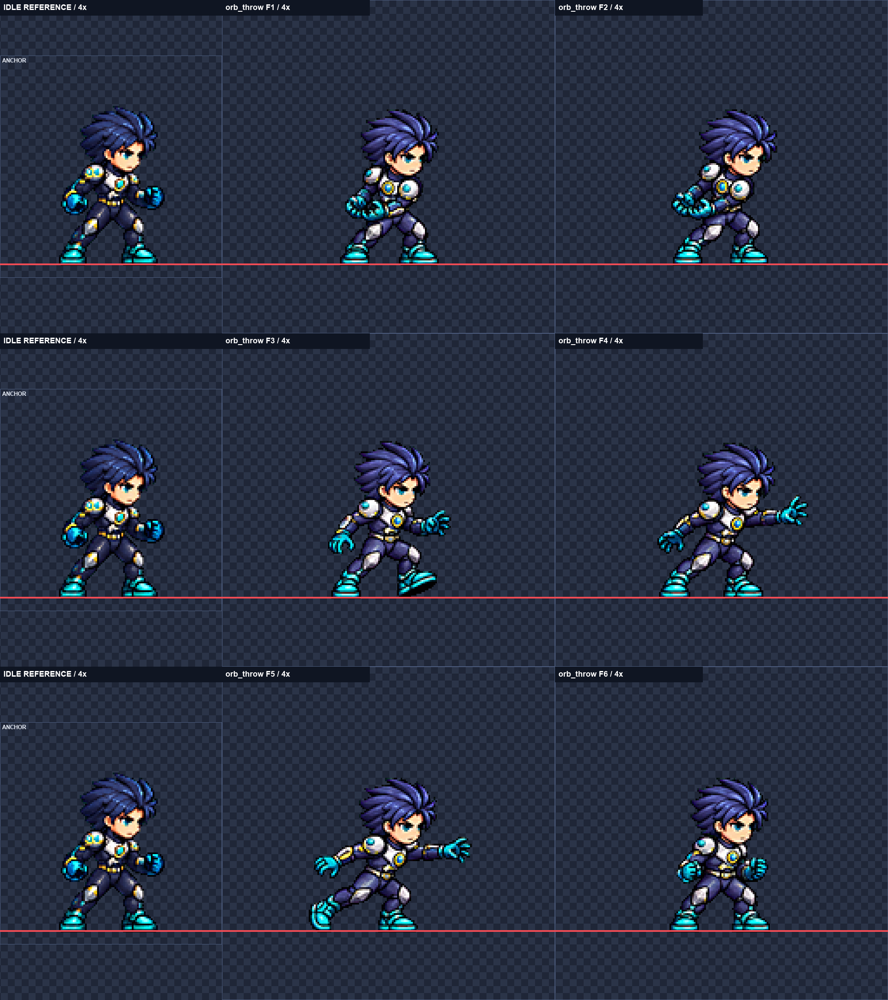
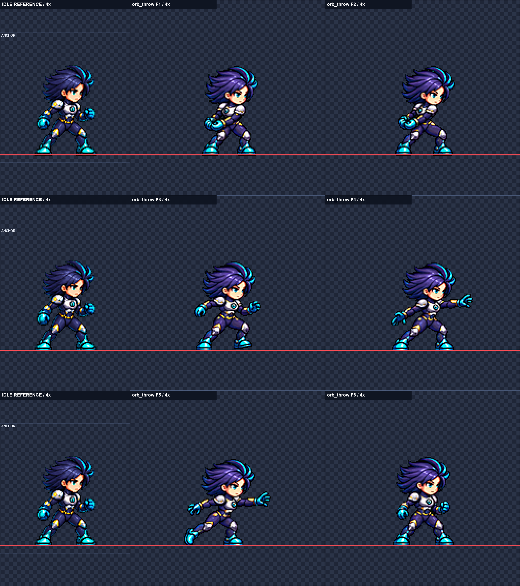
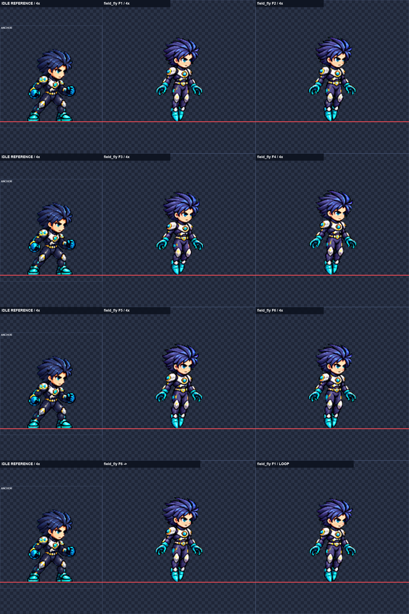
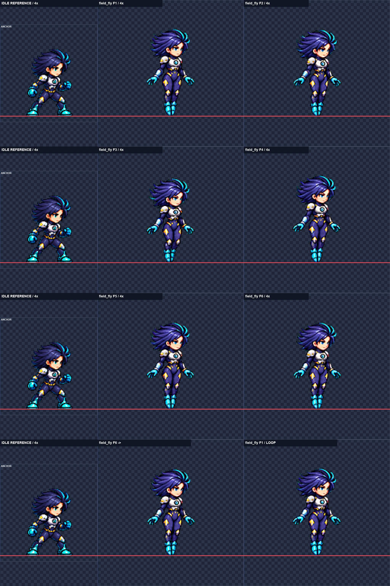

# SKM-05 Nova 신규 기술 몸 동작 후보

**완료: 후보 4/6행, 보류 2행, 미착수 0행.** 내장 image_gen을 사용했다. 게임 파일은 수정하지 않았고, 게임 실행·뷰어 채택·커밋 실행은 하지 않았다.

## 현재 상태

| 행 | 결과 | fps | 공통 축소 배율 | 노출 얼굴 폭 | 자동 머리 중앙값 | 최소 여백 | 디테일 |
|---|---|---:|---:|---|---:|---:|---|
| [nova_male-gravity_beam](nova_male-gravity_beam.png) | 보류 | 18 | 0.35 | 1.069–1.069 (제안값) | 1.02 | 39px | 105.5–110.38 |
| [nova_female-gravity_beam](nova_female-gravity_beam.png) | 보류 | 18 | 0.36 | 1.000–1.000 | 1.02 | 39px | 95.14–98.26 |
| [nova_male-orb_throw](nova_male-orb_throw.png) | 후보 전달 | 16 | 0.34 | 0.966–1.000 | 0.96 | 39px | 119.63–122.91 |
| [nova_female-orb_throw](nova_female-orb_throw.png) | 후보 전달 | 16 | 0.347 | 1.000–1.000 | 1.0 | 39px | 107.42–114.49 |
| [nova_male-field_fly](nova_male-field_fly.png) | 후보 전달 | 10 | 0.373 | 1.000–1.000 | 0.96 | 39px | 113.44–115.86 |
| [nova_female-field_fly](nova_female-field_fly.png) | 후보 전달 | 10 | 0.41 | 1.000–1.000 | 1.01 | 38px | 102.85–105.3 |

### nova_male-gravity_beam

2회 생성 후 보류. 4번에서 당긴 앞손이 5번에서 다시 펴져 반대 손으로 받아내는 흐름이 명확하지 않고, 노출 얼굴 폭 자동 제안값도 1.069로 허용 상한을 넘는다.

- 생성·선정: 1차의 손 연결 문제를 2차 프롬프트에서 강조했으나 반복됨. 2차를 검토 보드로 남겼고 후보 폴더에는 내보내지 않았다.
- 사람 판단: F3→F4 당기기와 F4→F5 손 교대가 요구한 동작인지 확인. 이 보드는 보류 근거이며 채택 후보가 아니다.
- 직접 본 프레임: F1, F2, F3, F4, F5, F6. 얼굴 비교 프레임: F1, F2, F3, F4, F5, F6.

### nova_female-gravity_beam

2회 생성 후 보류. 2차의 노출 얼굴 폭은 1.000이고 의상은 복원됐지만 4번에서 당긴 손이 5번에서 다시 열려 잡아당김 후 반대 손으로 받는 연결이 구현되지 않았다.

- 생성·선정: 1차는 F4 복부 노출과 손 연결 오류. 2차는 전신 슈트로 수정됐으나 손 교대는 실패해 최선 검토 자료로 보존했다.
- 사람 판단: F4→F5 손의 연속성과 뒤로 당기는 힘, 대기보다 길어진 하체 비례. 보류 보드이며 채택 후보가 아니다.
- 직접 본 프레임: F1, F2, F3, F4, F5, F6. 얼굴 비교 프레임: F1, F2, F3, F4, F5, F6.

### nova_male-orb_throw

양손을 모은 뒤 발을 내딛고 한 팔로 던지는 6프레임 후보입니다. 노출 얼굴 폭 0.966–1.000이며 반대쪽 눈은 기준부터 가려져 눈 간 거리는 측정 불가입니다.

- 생성·선정: 2차에서 양손 모으기를 더 명확히 했다. 공통 배율 0.34 선정. F1 자동 얼굴 오른쪽 표식이 눈/앞머리 안쪽 y93을 잡아, 격자 대조 후 같은 눈 아래 y95의 실제 경계로 수정했다(원래 표식과 이유는 checks JSON에 보존). 나머지 표식은 직접 확인해 채택했다.
- 사람 판단: 모으기→한 팔 던지기의 연결, F1·F2 준비 자세의 작은 차이, F5 뒤쪽 팔과 들린 발의 균형을 모션 뷰어에서 판단.
- 직접 본 프레임: F1, F2, F3, F4, F5, F6. 얼굴 비교 프레임: F1, F2, F3, F4, F5, F6.

### nova_female-orb_throw

허리 옆에 양손을 모으고 몸을 틀어 한 팔로 던진 뒤 회복하는 후보입니다. 노출 얼굴 폭 1.000이며 반대쪽 눈은 기준부터 가려져 눈 간 거리는 측정 불가입니다.

- 생성·선정: 1차 생성 사용. 줄 전체 공통 배율을 0.347로 맞춘 뒤 얼굴 표식과 6프레임을 4배로 확인했다. 얼굴 표식 수동 수정 없음.
- 사람 판단: F1→F2 몸 비틀기와 F3→F4 한 팔 던지기, F5→F6 회복 속도와 안정감을 모션 뷰어에서 판단.
- 직접 본 프레임: F1, F2, F3, F4, F5, F6. 얼굴 비교 프레임: F1, F2, F3, F4, F5, F6.

### nova_male-field_fly

양손을 편 채 다리를 모으고 발끝을 아래로 향한 차분한 비행 반복 후보입니다. 노출 얼굴 폭 1.000이며 발끝 y152 고정, 기준에서 가려진 반대쪽 눈 때문에 눈 간 거리는 측정 불가입니다.

- 생성·선정: 1차 생성 사용. 공통 배율 0.373에서 전신·얼굴·F6→F1 보드를 직접 확인했다. 표식 수동 수정 없음. 원본의 전체 상하 이동은 발 기준선에 맞추며, 정규화 뒤 상체·무릎 변화는 작게 남는다.
- 사람 판단: F6→F1 반복 연결, 작은 상체·무릎 움직임이 비행으로 충분히 읽히는지, 대기보다 다리를 편 실루엣을 모션 뷰어에서 판단.
- 직접 본 프레임: F1, F2, F3, F4, F5, F6. 얼굴 비교 프레임: F1, F2, F3, F4, F5, F6.

### nova_female-field_fly

손을 느슨하게 열고 다리를 모아 발끝을 아래로 향한 비행 반복 후보입니다. 노출 얼굴 폭 1.000, 발끝 y152 고정이며 기준에서 가려진 반대쪽 눈 때문에 눈 간 거리는 측정 불가입니다.

- 생성·선정: 1차 생성 사용. 줄 전체 공통 배율을 0.41로 맞춘 뒤 전신·얼굴·F6→F1 보드를 직접 확인했습니다. 표식 수동 수정 없음. 발끝 고정 후 남는 상체·무릎 변화로 작은 움직임을 표현하며, 머리 중앙값은 1.01입니다.
- 사람 판단: F3→F4의 상체 높이 변화와 F6→F1 반복 연결, 다리를 편 비행 실루엣이 대기와 자연스럽게 이어지는지 모션 뷰어에서 판단.
- 직접 본 프레임: F1, F2, F3, F4, F5, F6. 얼굴 비교 프레임: F1, F2, F3, F4, F5, F6.

## 검사 방법과 제한

- SKM-04의 process.py·face_check.py·board.py·face_grid.py를 복사하고 Nova용으로 변경했다. 얼굴 표식과 가려진 눈 처리 기준은 SKM-02의 face_check_ny.py를 따랐다.
- 한 행을 한 번에 6자세로 생성했다. 각 원본 실루엣 덩어리별 추출이며 고정 폭 자르기·확대·머리 붙이기·프레임별 배율 변경은 하지 않았다.
- LANCZOS / sharpen 60 / despill auto / palette none / #00ff00. 192px 셀, 몸 중심 x96, 발끝 y152. 비행도 발 기준선은 같으며 게임이 띄운다.
- 얼굴 목표 0.96–1.04, 전달 허용 0.95–1.06. 양쪽 idle 기준 모두 반대쪽 눈이 앞머리에 가려져 눈 간 거리는 측정 불가이며 통과로 계산하지 않는다. 노출 얼굴 폭을 눈 아래 경계에서 비교한다. 소수점은 계산 출력 정밀도이며 측정 오차를 보증하지 않는다.
- 전신 4배 판에서 한 얼굴·양손·양발·의상·동작 의미를 확인한다. 얼굴 자동 제안은 표식을 직접 확인한 뒤만 채택한다. 보류 행의 제안값은 확정 실측이 아니다.
- 원본은 art/raw/skm-05/에 보존하고 커밋에서 제외한다. 시도 폴더·캐시·실행 로그도 제외한다. 전체 프롬프트는 [prompts.txt](prompts.txt), 원본 해시는 [generation-ledger.json](generation-ledger.json)에 있다.

## 남은 작업

미착수: 없음.

## 다음 권장 단계

사람이 모션 뷰어에서 전달 후보의 동작 연결과 얼굴·의상을 판단한 뒤 리드가 게임에 연결한다. 보류 행은 명시한 원인을 해결하는 후속 제작이 필요하다.

## 시각적 확인

각 단 왼쪽은 idle 기준, 오른쪽은 두 프레임이다. 빨간 선은 발끝 y152이며 비행 보드 마지막 단은 F6→F1 연결이다.

각 단 왼쪽은 idle 기준, 오른쪽은 두 프레임이다. 빨간 선은 발끝 y152이며 비행 보드 마지막 단은 F6→F1 연결이다.

각 단 왼쪽은 idle 기준, 오른쪽은 두 프레임이다. 빨간 선은 발끝 y152이며 비행 보드 마지막 단은 F6→F1 연결이다.

각 단 왼쪽은 idle 기준, 오른쪽은 두 프레임이다. 빨간 선은 발끝 y152이며 비행 보드 마지막 단은 F6→F1 연결이다.

각 단 왼쪽은 idle 기준, 오른쪽은 두 프레임이다. 빨간 선은 발끝 y152이며 비행 보드 마지막 단은 F6→F1 연결이다.

각 단 왼쪽은 idle 기준, 오른쪽은 두 프레임이다. 빨간 선은 발끝 y152이며 비행 보드 마지막 단은 F6→F1 연결이다.

## 확인 및 테스트

파일·규격·쓰기 범위·커밋 스크립트 구문 검사 552개 통과. [audit.json](audit.json). 이는 보류 행의 미술 판정을 통과로 바꾸지 않는다. 게임과 commit.ps1은 실행하지 않았다.

디스크: 이번 보고서·중간 검토 파일·원본 합계 약 29.4 MB. 기존 파일을 포함한 작업 클론 `C:/Users/TH/Documents/AI/GameProject/SmashNine-units/vfx-a/SmashNine`은 약 3.03 GB다.

