# SKM-06 시온 신규 기술 몸 동작 후보

**이번 회차 완료: 추가 전달 8행, 보류 1행, 미도달 0행.** 이미 병합된 shot·shot_alt 2행을 합치면 전체 전달 후보는 10/11행이다. 내장 image_gen을 사용했다. 이번 재개의 모든 생성은 idle-b2와 전달된 shot-v1 두 이미지를 실제 참조 인수로 사용한다. 이전 생성은 idle와 일러스트를 참조했다. 게임 파일은 수정하지 않았고, 게임 실행·뷰어 채택·커밋 실행은 하지 않았다.

**시간 제한:** 이번 재개 2026-11-24T14:46:59.0499269+09:00, 마감 2026-11-24T17:46:59.0499269+09:00 (180분). 매 행 시작 전과 image_gen 반환 직후 Get-Date를 기록한다. 이전 중단은 사용자 설명에 따른 PC 절전 및 image_gen 대기이며 이번 회차와 별도다. [시각 기록](time-limit.json). 이번 실행에서 반환된 호출 중 20분 초과 없음. **이번 작업 종료: 2026-11-24T15:31:11.9406870+09:00, 경과 44.2분.**

커밋 스크립트는 이번 브랜치에서 실제 추가·수정된 명시 경로만 포함한다. 이미 병합된 두 사격 행과 원본·시도 폴더는 포함하지 않는다. 위 사격 첫 요청의 필터 거절(이미지 없음)은 [generation-failures.json](generation-failures.json)에 기록했다.

## 현재 상태

| 행 | 결과 | fps | 공통 축소 배율 | 노출 얼굴 폭 | 자동 머리 중앙값 | 최소 여백 | 디테일 |
|---|---|---:|---:|---|---:|---:|---|
| [xion-shot](xion-shot.png) | 이전 병합 | 18 | 0.3 | 1.000–1.000 | 1.0 | 39px | 111.71–117.99 |
| [xion-shot_alt](xion-shot_alt.png) | 이전 병합 | 16 | 0.373 | 1.000–1.000 | 1.0 | 39px | 122.09–129.79 |
| [xion-double_float](xion-double_float.png) | 후보 전달 | 10 | 0.36 | 1.000–1.000 | 0.96 | 39px | 127.27–131.89 |
| [xion-tumble](xion-tumble.png) | 후보 전달 | 21 | 0.34 | 1.000–1.000 | 유효값 없음 | 39px | 97.11–103.24 |
| [xion-recoil_jump](xion-recoil_jump.png) | 후보 전달 | 33 | 0.373 | 1.000–1.000 | 0.96 | 28px | 121.19–131.92 |
| [xion-barrage](xion-barrage.png) | 후보 전달 | 14 | 0.36 | 1.000–1.000 | 0.86 | 36px | 107.69–133.63 |
| [xion-dive](xion-dive.png) | 후보 전달 | 27 | 0.42 | 1.000–1.000 | 0.96 | 36px | 116.18–127.53 |
| [xion-double_cast](xion-double_cast.png) | 후보 전달 | 14 | 0.336 | 1.000–1.000 | 0.94 | 39px | 112.0–124.54 |
| [xion-shot_up](xion-shot_up.png) | 후보 전달 | 13 | 0.415 | 1.000–1.000 | 0.96 | 27px | 137.62–146.26 |
| [xion-shot_down](xion-shot_down.png) | 후보 전달 | 26 | 0.36 | 1.000–1.000 | 1.0 | 39px | 108.6–119.62 |
| [xion-shot_air_down](xion-shot_air_down.png) | 보류 | 30 | 0.38 | 1.000–1.000 | 0.9 | 39px | 116.9–118.11 |

### xion-shot

오른손 사격 준비·반동·회복 6프레임 후보. 눈 아래 노출 얼굴 폭은 기준의 1.000이며 먼 눈이 앞머리에 가려져 눈 사이 거리는 측정하지 못했다.

- 생성·선정: 1차 생성, 행 전체 배율 0.31에서 0.30으로 조정. 얼굴 표식과 양손의 산탄총·두 스카프 꼬리를 4배 판에서 확인했다.
- 사람 판단: F3 반동의 힘, F4 반 걸음과 F5 한 손 펌프 동작이 재생 중 충분히 읽히는지, 기존 대기와 총 크기가 자연스럽게 이어지는지 판단.
- 직접 본 프레임: F1, F2, F3, F4, F5, F6. 얼굴 비교 프레임: F1, F2, F3, F4, F5, F6.

### xion-shot_alt

왼팔을 가슴 앞으로 교차해 사격하고 반대 총은 허리 옆으로 낮춘 6프레임 후보. 노출 얼굴 폭 1.000, 몸 높이 전 프레임 97px이며 가려진 먼 눈 때문에 눈 간 거리는 측정 불가다.

- 생성·선정: 재개 1차(전체 3차) 생성. 이전 111–112px 몸을 다시 그려 공통 배율 0.373에서 97px로 맞췄다. F5 자동 왼쪽 얼굴 표식이 구레나룻을 잡아 픽셀 격자로 볼 경계에 보정했고 나머지 표식은 채택했다. 양손 총·스카프 두 꼬리 확인.
- 사람 판단: 기존 shot과 번갈아 볼 때 왼손 교차 사격이 분명한지, F3 반동과 F5 펌프 표현, 발은 고정된 상태의 작은 전진 체중 이동이 충분히 읽히는지 판단.
- 직접 본 프레임: F1, F2, F3, F4, F5, F6. 얼굴 비교 프레임: F1, F2, F3, F4, F5, F6.

### xion-double_float

도플갱어 부유 6프레임 후보. F2 구레나룻을 제외해 수동 재측정한 노출 얼굴 폭은 전 프레임 1.000이며 눈 간 거리는 가림으로 측정 불가다.

- 생성·선정: 기존 1차 원본·공통 배율 0.36 유지. F2 왼쪽 얼굴 표식 x93.5→94.5(같은 y79)로 보정하여 1.100→1.000. 원래 자동 표식과 수정 근거를 보존했다. 새 생성이나 픽셀 수정 없음.
- 사람 판단: 작은 무릎·스카프 변화가 부유로 읽히는지, 발끝 방향과 F6→F1 연결을 판단. 게임이 위치를 띄우므로 모든 발끝은 y152에 맞췄다.
- 직접 본 프레임: F1, F2, F3, F4, F5, F6. 얼굴 비교 프레임: F1, F2, F3, F4, F5, F6.

### xion-tumble

전방 구르기 6프레임 후보. 시작·복귀 F1·5·6의 노출 얼굴 폭은 1.000이며 회전 F2–4와 가려진 먼 눈은 수치 비교에서 제외했다.

- 생성·선정: 1회 생성, 공통 배율 0.36→0.34. F1·5·6의 표식과 픽셀 격자, 여섯 전신을 확인했다. 머리 자동 정합은 전부 신뢰도 0.6 미만으로 중앙값 없음; 얼굴 경계 직접 검토를 우선했다.
- 사람 판단: F2→F3→F4의 회전 방향, 접지 높이를 고정한 구르기의 궤적, F6→F1 반복의 속도와 두 총이 겹쳐 보이는 정도를 재생으로 판단.
- 직접 본 프레임: F1, F2, F3, F4, F5, F6. 얼굴 비교 프레임: F1, F5, F6.

### xion-recoil_jump

양손 하향 사격에서 압축·상승·낙하로 이어지는 반동 도약 후보. 여섯 얼굴 폭은 1.000이며 눈 간 거리는 가림으로 측정 불가다.

- 생성·선정: 1회 생성, 공통 배율 0.373 선정. 공통 상승 배율 0.48로 F3–6의 높이를 최대 24px로 제한했다. 자동 머리 중앙값 0.96, 표식과 여섯 전신을 직접 확인했다.
- 사람 판단: 33fps에서 F1→F2 압축과 F3 상승이 읽히는지, 펴진 몸 높이 최대 116px(기준 97px)의 늘어남과 총을 앞으로 돌리는 F5 연결이 자연스러운지 판단.
- 직접 본 프레임: F1, F2, F3, F4, F5, F6. 얼굴 비교 프레임: F1, F2, F3, F4, F5, F6.

### xion-barrage

양팔을 반대 방향으로 펴고 한 바퀴 도는 난사 후보. 앞얼굴 F1·6의 폭은 1.000이며 F2–5의 옆·뒷모습과 눈 간 거리는 비교에서 제외했다.

- 생성·선정: 1회 생성, 공통 배율 0.42→0.36으로 얼굴 폭을 맞췄다. F6는 왼쪽 방향 볼 경계를 수동 측정. 자동 머리 중앙값 0.86은 F1 한 장만 유효하므로 얼굴 직접 측정을 우선했다. 몸 높이 89–90px.
- 사람 판단: F6→F1의 정면 회전 연결, 두 총의 방향과 반복 난사의 느낌, 기준보다 낮은 자세와 머리 윤곽 차이를 재생으로 판단.
- 직접 본 프레임: F1, F2, F3, F4, F5, F6. 얼굴 비교 프레임: F1, F6.

### xion-dive

도플갱어를 향한 수평 비행·착지 6프레임 후보. 눈 아래 같은 높이의 볼 경계로 재측정한 얼굴 폭은 모두 1.000이며 눈 간 거리는 측정 불가다.

- 생성·선정: 총 2회 생성. 1차는 얼굴에 맞춘 배율 0.49에서 셀 왼쪽을 넘어 탈락. 2차는 팔다리·스카프를 짧게 모아 공통 배율 0.42, 상승 배율 0.8로 정규화했다. F2–4 자동 얼굴 표식의 높이·경계를 격자로 보정, 자동 머리 중앙값 0.96.
- 사람 판단: 수평 F2–4의 작은 옷자락 변화, 두 발의 겹침, F5 무릎 접기에서 F6 착지로 이어지는 속도, 0.2초 돌진에서의 가독성을 판단.
- 직접 본 프레임: F1, F2, F3, F4, F5, F6. 얼굴 비교 프레임: F1, F2, F3, F4, F5, F6.

### xion-double_cast

뒤를 돌아 손짓한 뒤 두 총을 가슴에서 교차하고 대기로 복귀하는 후보. 정면 쪽 F1·4·5·6 얼굴 폭은 1.000, 옆얼굴 F2·3 및 눈 간 거리는 비교 제외다.

- 생성·선정: 총 2회 생성. 1차 F3의 세 번째 팔·총 때문에 재생성했다. 2차는 팔·총 각 2개와 뒤돌아보기를 확인했으며 공통 배율 0.336, 몸 높이 96–97px. F1·6 얼굴 경계를 격자로 수정했다. 자동 머리 중앙값 0.94.
- 사람 판단: F2·3의 손바닥을 펴면서 총을 유지하는 손잡이 접촉이 설득력 있는지, 뒤돌아보기→가슴 교차→복귀가 호출로 읽히는지 판단. 완전히 빈 손바닥 대신 총을 유지한 손짓이다.
- 직접 본 프레임: F1, F2, F3, F4, F5, F6. 얼굴 비교 프레임: F1, F4, F5, F6.

### xion-shot_up

두 총을 머리 위로 올린 뒤 무릎을 굽혀 반동을 받고 내리는 후보. 수동 경계 확인 후 얼굴 폭은 모두 1.000이며 눈 간 거리는 가림으로 측정 불가다.

- 생성·선정: 첫 요청은 violence 필터에서 이미지 없이 거절. 두 번째 요청으로 첫 원본 생성, 공통 배율 0.415 선정. 자동 머리 중앙값 0.96, F3 볼 경계 보정. F5 원본에서 두 총을 각각 잡은 손을 별도 확인했다.
- 사람 판단: 13fps에서 팔 올림·무릎 반동·회복이 충분한지, F5의 수평으로 나란한 두 총이 한 긴 총처럼 읽히지 않는지 판단.
- 직접 본 프레임: F1, F2, F3, F4, F5, F6. 얼굴 비교 프레임: F1, F2, F3, F4, F5, F6.

### xion-shot_down

낮게 앉아 전방 아래로 두 총을 조준하고 일어나는 후보. 볼 경계 수동 확인 후 얼굴 폭은 모두 1.000이며 눈 간 거리는 가림으로 측정 불가다.

- 생성·선정: 1회 생성, 공통 배율 0.36. 자동 머리 중앙값 1.00. F2·4·5의 구레나룻 포함/서로 다른 높이 표식을 격자로 보정했다. 두 총·두 부츠·스카프를 전 프레임 확인.
- 사람 판단: 26fps에서 F2→F3 낮아지는 동작과 F3→F4 유지가 읽히는지, 약 30도 하향 총구와 복귀의 체중 이동을 판단.
- 직접 본 프레임: F1, F2, F3, F4, F5, F6. 얼굴 비교 프레임: F1, F2, F3, F4, F5, F6.

### xion-shot_air_down

공중 아래 사격은 2회 생성 후 보류. 얼굴 폭은 수동 확인 후 1.000이지만 F2→F3 머리·몸통 상승이 약 15px로 요청한 약 4px보다 크며 공중 반동보다 일어서기로 보인다.

- 생성·선정: 1차는 정렬 후 F2–4가 거의 같아 반동이 사라짐. 2차는 부츠가 총구보다 아래에 오도록 복원했으나 상승 폭이 과해졌다. 공통 배율 0.38, 자동 머리 중앙값 0.90. F1·2·6 눈 안쪽 표식을 볼 경계로 보정. F2/F3 얼굴 경계 y86/y71 및 bbox top65/50으로 15px 차이를 확인.
- 사람 판단: 보류 근거 확인용 보드다. 재작업 시 발 기준은 유지하면서 F3 상체 상승을 약 4px로 줄이고 공중에서 다리를 벌리는 느낌을 살릴 것. 후보 폴더에 내보내지 않았다.
- 직접 본 프레임: F1, F2, F3, F4, F5, F6. 얼굴 비교 프레임: F1, F2, F3, F4, F5, F6.

## 검사 방법과 제한

- SKM-05의 Python 스크립트를 복사해 시온용으로 변경했다. 원본 생성, 덩어리별 추출, 정규화, 얼굴 표식, 검토 보드, 전달 기록 순서다.
- 실측·계산: 얼굴 경계 좌표와 비율, 자동 머리 정합, 여백, 번짐, 디테일을 checks JSON에 기록한다. 얼굴 폭은 기준 좌표 (62.5,46)–(72.5,46), 폭 10px의 눈 아래 노출 얼굴 경계를 사용한다.
- 육안 판단·불확실성: 전신·얼굴을 4배 판에서 확인했다. 동작의 자연스러움, 펌프 조작의 설득력, 실제 재생 속도의 느낌은 사람 판단 대상으로 남긴다. 작은 얼굴에서 1px는 비율 0.1이므로 소수 자릿수는 측정 정확도 보증이 아니다.
- 한 행을 한 번에 6자세로 생성했다. 각 원본 실루엣 덩어리별 추출이며 고정 폭 자르기·머리 붙이기·프레임별 배율 변경은 하지 않았다.
- LANCZOS / sharpen 60 / despill auto / palette none / #00ff00. 192px 셀, 몸 중심 x96, 발끝 y152. 행 전체 배율 하나를 적용했다.
- 얼굴 목표 0.96–1.04, 전달 허용 0.95–1.06. 기준의 먼 눈은 검은 앞머리와 겹쳐 독립된 눈 중심을 확정하지 못했으므로 눈 사이 거리는 측정 불가로 기록했다. 이것을 통과로 계산하지 않는다.
- 얼굴 표식은 검토 판에서 확인한 값만 확정한다. 돌아서거나 뒤집힌 얼굴은 측정 제외로 기록하고 직립 프레임을 기준으로 배율을 확인한다.
- 디테일은 파이프라인의 내부 색 대비 지표이며 미술 품질 점수가 아니다. 기준 프레임 대비 각 프레임 90% 이상을 검사한다.
- 원본은 art/raw/skm-06/에 보존하고 커밋에서 제외한다. 시도 폴더·캐시·실행 로그도 제외한다. 전체 프롬프트는 [prompts.txt](prompts.txt), 원본 해시는 [generation-ledger.json](generation-ledger.json)에 있다.

## 남은 작업

미도달: 없음.

## 다음 권장 단계

리드가 전달 후보 8행을 검토하고 시안 월드컵에서 사람이 동작 연결과 얼굴·의상을 판단한 뒤 리드가 게임에 연결한다. shot_air_down은 F3 상승량 약 15px를 약 4px로 줄이는 별도 재작업이 필요하다. 이번 회차의 해당 행 생성 2회는 소진했다.

사람이 특히 볼 것: tumble·barrage의 F6→F1 연결, recoil_jump에서 펴진 몸의 길이, double_cast의 열린 손과 총 손잡이 접촉, shot_up F5에서 두 총이 한 긴 총처럼 보이는지. 재생 검증은 하지 않았으며 모두 후보 단계다.

## 시각적 확인

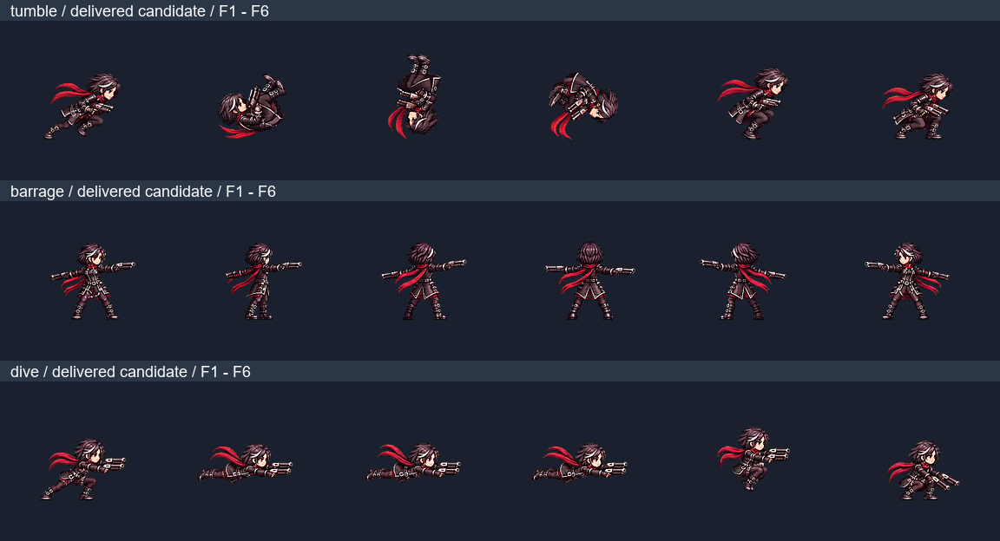

위에서부터 구르기·난사·수평 비행의 실제 전달 시트다. 원본 후보는 변경하지 않고 보고서용 빈 셀 여백만 줄였다.

각 단 왼쪽은 idle 기준, 오른쪽은 두 프레임이다. 빨간 선은 발끝 y152이며 반복 동작 보드 마지막 단은 F6→F1 연결이다.

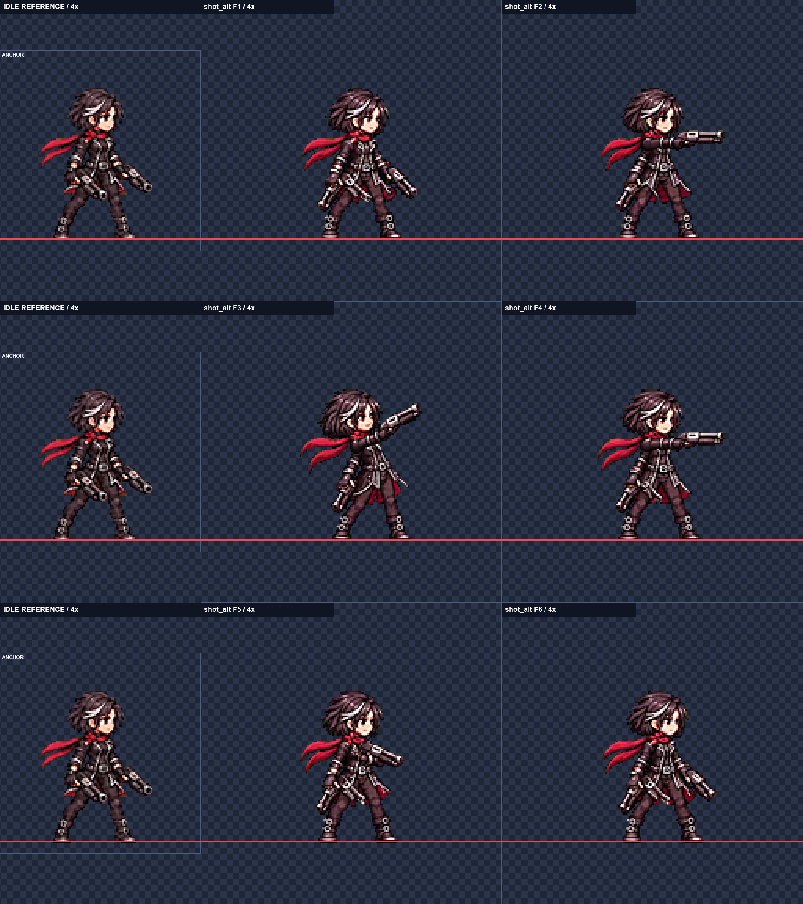

각 단 왼쪽은 idle 기준, 오른쪽은 두 프레임이다. 빨간 선은 발끝 y152이며 반복 동작 보드 마지막 단은 F6→F1 연결이다.

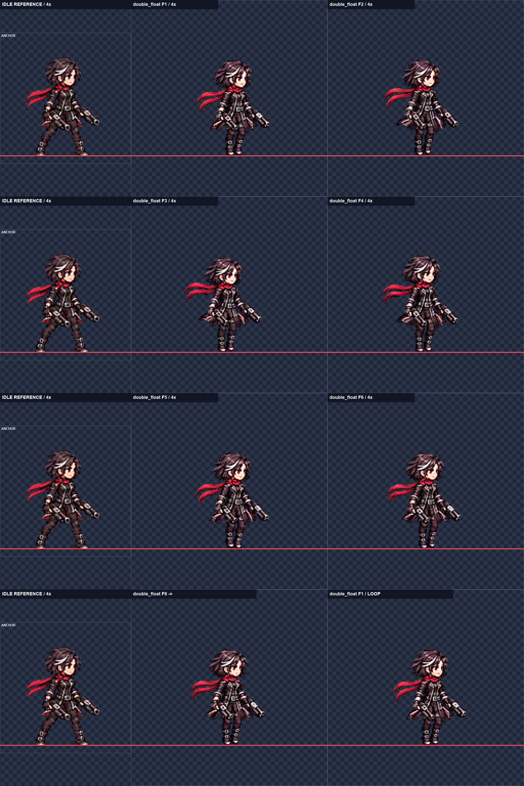

각 단 왼쪽은 idle 기준, 오른쪽은 두 프레임이다. 빨간 선은 발끝 y152이며 반복 동작 보드 마지막 단은 F6→F1 연결이다.

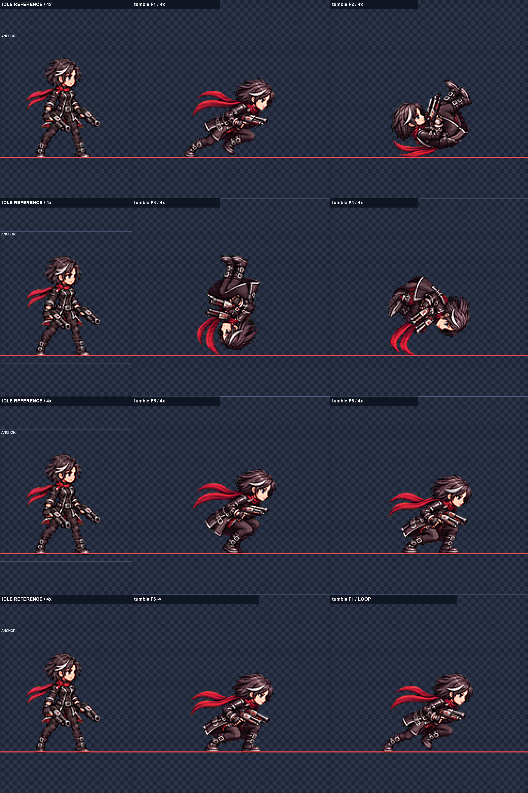

각 단 왼쪽은 idle 기준, 오른쪽은 두 프레임이다. 빨간 선은 발끝 y152이며 반복 동작 보드 마지막 단은 F6→F1 연결이다.

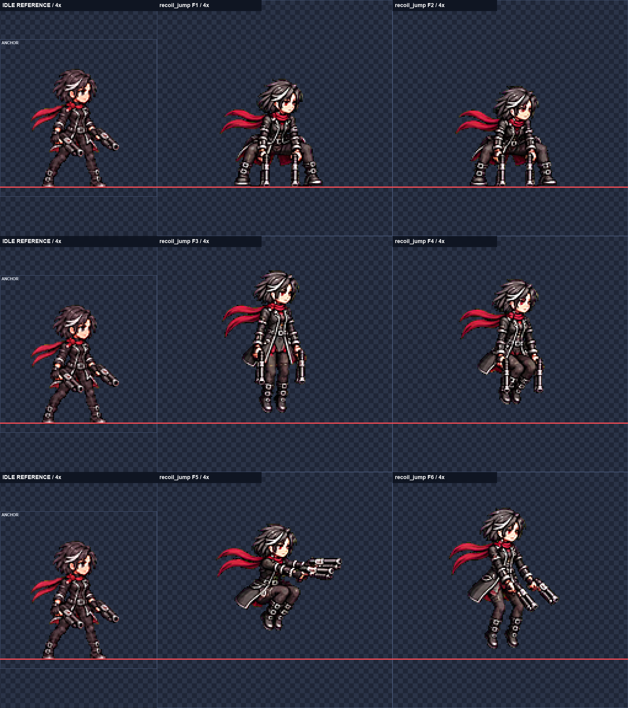

각 단 왼쪽은 idle 기준, 오른쪽은 두 프레임이다. 빨간 선은 발끝 y152이며 반복 동작 보드 마지막 단은 F6→F1 연결이다.

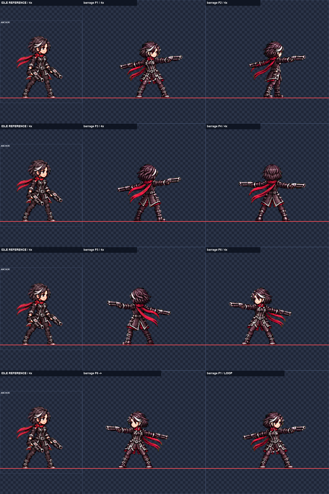

각 단 왼쪽은 idle 기준, 오른쪽은 두 프레임이다. 빨간 선은 발끝 y152이며 반복 동작 보드 마지막 단은 F6→F1 연결이다.

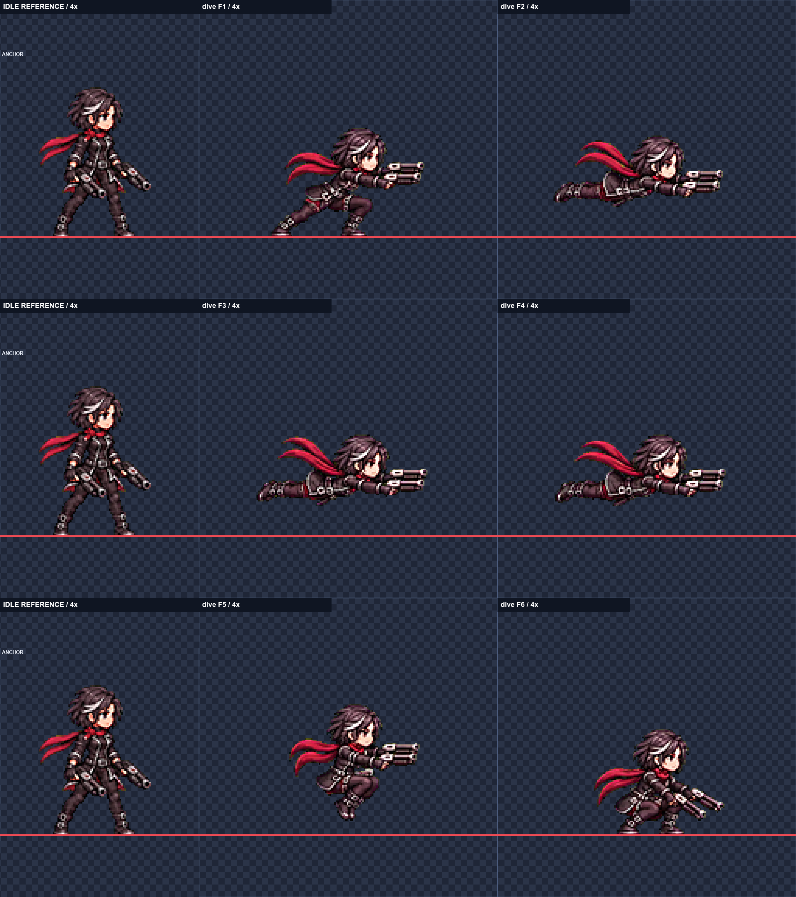

각 단 왼쪽은 idle 기준, 오른쪽은 두 프레임이다. 빨간 선은 발끝 y152이며 반복 동작 보드 마지막 단은 F6→F1 연결이다.

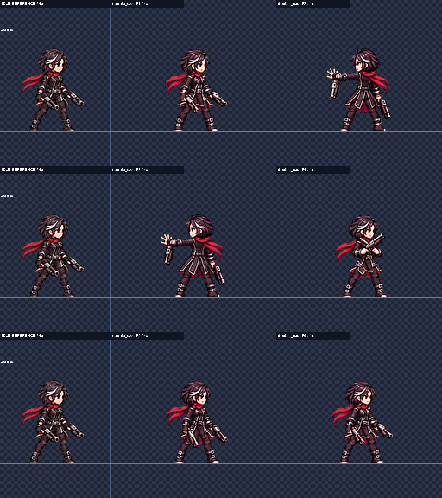

각 단 왼쪽은 idle 기준, 오른쪽은 두 프레임이다. 빨간 선은 발끝 y152이며 반복 동작 보드 마지막 단은 F6→F1 연결이다.

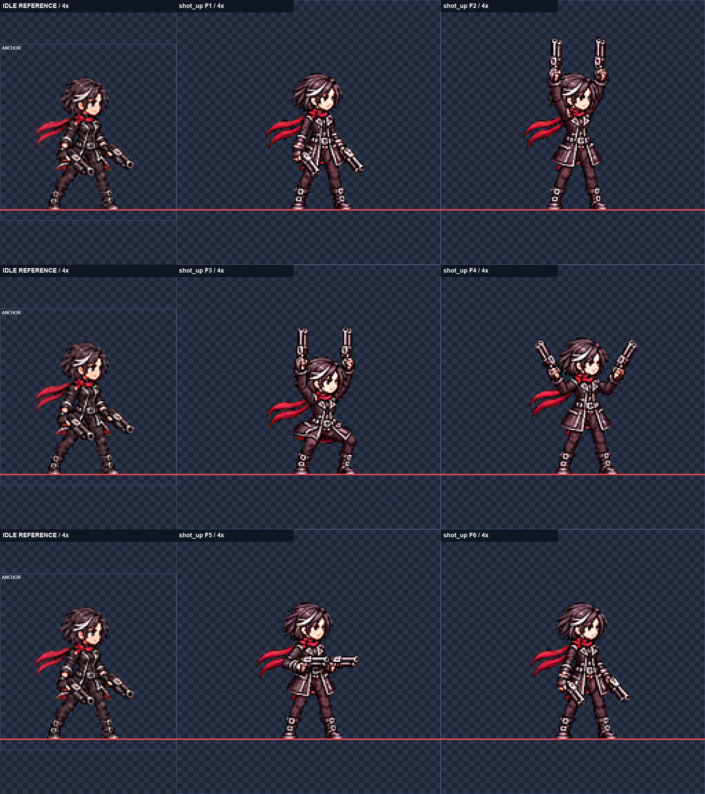

각 단 왼쪽은 idle 기준, 오른쪽은 두 프레임이다. 빨간 선은 발끝 y152이며 반복 동작 보드 마지막 단은 F6→F1 연결이다.

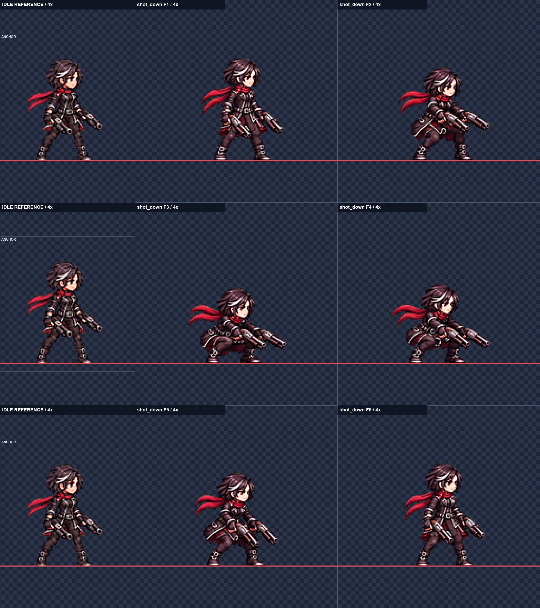

각 단 왼쪽은 idle 기준, 오른쪽은 두 프레임이다. 빨간 선은 발끝 y152이며 반복 동작 보드 마지막 단은 F6→F1 연결이다.

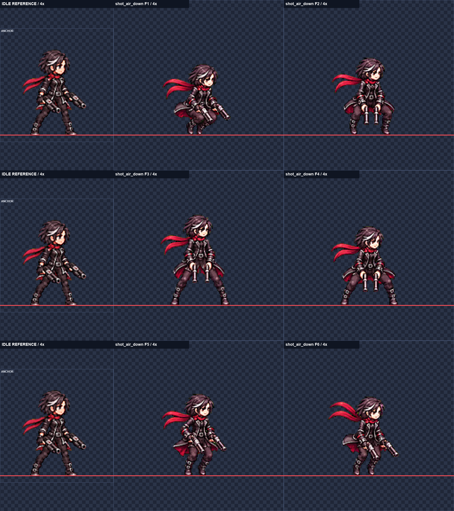

각 단 왼쪽은 idle 기준, 오른쪽은 두 프레임이다. 빨간 선은 발끝 y152이며 반복 동작 보드 마지막 단은 F6→F1 연결이다.

## 확인 및 테스트

파일·규격·쓰기 범위·커밋 스크립트 구문 검사 913개 통과. [audit.json](audit.json). 이는 보류 행의 미술 판정을 통과로 바꾸지 않는다. 게임과 commit.ps1은 실행하지 않았다.

디스크: 이번 보고서·중간 검토 파일·원본 합계 약 50.6 MB. 기존 파일을 포함한 작업 클론 `C:/Users/TH/Documents/AI/GameProject/SmashNine-units/vfx-a/SmashNine`은 약 3.39 GB다.

