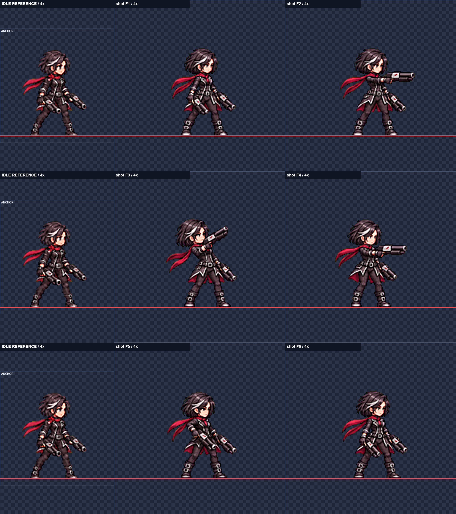

# SKM-06 시온 신규 기술 몸 동작 후보

**완료: 후보 2/11행, 보류 1행, 미착수 8행.** 내장 image_gen을 사용했다. 이번 재개의 모든 생성은 idle-b2와 전달된 shot-v1 두 이미지를 실제 참조 인수로 사용한다. 이전 생성은 idle와 일러스트를 참조했다. 게임 파일은 수정하지 않았고, 게임 실행·뷰어 채택·커밋 실행은 하지 않았다.

**시간 제한:** 이번 재개 2026-11-24T07:18:45.3937835+09:00, 마감 2026-11-24T10:18:45.3937835+09:00 (180분). 매 행 시작 전과 image_gen 반환 직후 Get-Date를 기록한다. 이전 실행의 약 6시간 지연은 사용자 확인에 따른 이미지 생성 서비스 지연이다. [시각 기록](time-limit.json). 이번 실행에서 반환된 호출 중 20분 초과 없음. **마감 초과 확인: 2026-11-24T14:34:22.5579923+09:00.** 마지막 image_gen 반환 직후 시각은 07:25:42 KST였고, 정규화·검토 중 다음 명시적 Get-Date는 14:34:22 KST였다. 이 시각 간격의 원인은 확인하지 못했으므로 이미지 생성 지연으로 단정하지 않는다. 확인 즉시 새 행 제작을 중단하고 기존 결과 보고와 커밋 스크립트만 마무리했다. 180분 안에 종료했다고 주장하지 않는다.

## 현재 상태

| 행 | 결과 | fps | 공통 축소 배율 | 노출 얼굴 폭 | 자동 머리 중앙값 | 최소 여백 | 디테일 |
|---|---|---:|---:|---|---:|---:|---|
| [xion-shot](xion-shot.png) | 후보 전달 | 18 | 0.3 | 1.000–1.000 | 1.0 | 39px | 111.71–117.99 |
| [xion-shot_alt](xion-shot_alt.png) | 후보 전달 | 16 | 0.373 | 1.000–1.000 | 1.0 | 39px | 122.09–129.79 |
| [xion-double_float](xion-double_float.png) | 보류 | 10 | 0.36 | 1.000–1.100 (제안값) | 0.96 | 39px | 127.27–131.89 |

### xion-shot

오른손 사격 준비·반동·회복 6프레임 후보. 눈 아래 노출 얼굴 폭은 기준의 1.000이며 먼 눈이 앞머리에 가려져 눈 사이 거리는 측정하지 못했다.

- 생성·선정: 1차 생성, 행 전체 배율 0.31에서 0.30으로 조정. 얼굴 표식과 양손의 산탄총·두 스카프 꼬리를 4배 판에서 확인했다.
- 사람 판단: F3 반동의 힘, F4 반 걸음과 F5 한 손 펌프 동작이 재생 중 충분히 읽히는지, 기존 대기와 총 크기가 자연스럽게 이어지는지 판단.
- 직접 본 프레임: F1, F2, F3, F4, F5, F6. 얼굴 비교 프레임: F1, F2, F3, F4, F5, F6.

### xion-shot_alt

왼팔을 가슴 앞으로 교차해 사격하고 반대 총은 허리 옆으로 낮춘 6프레임 후보. 노출 얼굴 폭 1.000, 몸 높이 전 프레임 97px이며 가려진 먼 눈 때문에 눈 간 거리는 측정 불가다.

- 생성·선정: 재개 1차(전체 3차) 생성. 이전 111–112px 몸을 다시 그려 공통 배율 0.373에서 97px로 맞췄다. F5 자동 왼쪽 얼굴 표식이 구레나룻을 잡아 픽셀 격자로 볼 경계에 보정했고 나머지 표식은 채택했다. 양손 총·스카프 두 꼬리 확인.
- 사람 판단: 기존 shot과 번갈아 볼 때 왼손 교차 사격이 분명한지, F3 반동과 F5 펌프 표현, 발은 고정된 상태의 작은 전진 체중 이동이 충분히 읽히는지 판단.
- 직접 본 프레임: F1, F2, F3, F4, F5, F6. 얼굴 비교 프레임: F1, F2, F3, F4, F5, F6.

### xion-double_float

도플갱어 부유 6프레임 검토본으로 보류. 노출 얼굴 폭 자동 제안값 1.000–1.100(F2 1.100)으로 허용 상한을 넘으며, 최종 얼굴 경계 실측을 확정하기 전에 마감 초과를 확인했다.

- 생성·선정: 1회 생성. 행 전체 배율 0.38→0.366→0.36으로 비교했고 마지막 검토본은 몸 높이 94–96px, 머리 자동 중앙값 0.96이다. 전신 6장·얼굴 제안 표식·F6→F1 판을 확인했다. 마감 초과 확인 후 새 생성이나 배율 조정 없이 기존 검토본만 정리했다.
- 사람 판단: F2 얼굴 경계와 크기를 먼저 재측정할 것. 이후 작은 무릎·스카프 변화가 부유로 읽히는지, 발끝 방향과 F6→F1 연결을 판단. 보류 보드이며 채택 후보 폴더에는 내보내지 않았다.
- 직접 본 프레임: F1, F2, F3, F4, F5, F6. 얼굴 비교 프레임: F1, F2, F3, F4, F5, F6.

## 검사 방법과 제한

- SKM-05의 Python 스크립트를 복사해 시온용으로 변경했다. 원본 생성, 덩어리별 추출, 정규화, 얼굴 표식, 검토 보드, 전달 기록 순서다.
- 실측·계산: 얼굴 경계 좌표와 비율, 자동 머리 정합, 여백, 번짐, 디테일을 checks JSON에 기록한다. 얼굴 폭은 기준 좌표 (62.5,46)–(72.5,46), 폭 10px의 눈 아래 노출 얼굴 경계를 사용한다.
- 육안 판단·불확실성: 전신·얼굴을 4배 판에서 확인했다. 동작의 자연스러움, 펌프 조작의 설득력, 실제 재생 속도의 느낌은 사람 판단 대상으로 남긴다. 작은 얼굴에서 1px는 비율 0.1이므로 소수 자릿수는 측정 정확도 보증이 아니다.
- 한 행을 한 번에 6자세로 생성했다. 각 원본 실루엣 덩어리별 추출이며 고정 폭 자르기·머리 붙이기·프레임별 배율 변경은 하지 않았다.
- LANCZOS / sharpen 60 / despill auto / palette none / #00ff00. 192px 셀, 몸 중심 x96, 발끝 y152. 행 전체 배율 하나를 적용했다.
- 얼굴 목표 0.96–1.04, 전달 허용 0.95–1.06. 기준의 먼 눈은 검은 앞머리와 겹쳐 독립된 눈 중심을 확정하지 못했으므로 눈 사이 거리는 측정 불가로 기록했다. 이것을 통과로 계산하지 않는다.
- 얼굴 표식은 검토 판에서 확인한 값만 확정한다. 돌아서거나 뒤집힌 얼굴은 측정 제외로 기록하고 직립 프레임을 기준으로 배율을 확인한다.
- 디테일은 파이프라인의 내부 색 대비 지표이며 미술 품질 점수가 아니다. 기준 프레임 대비 각 프레임 90% 이상을 검사한다.
- 원본은 art/raw/skm-06/에 보존하고 커밋에서 제외한다. 시도 폴더·캐시·실행 로그도 제외한다. 전체 프롬프트는 [prompts.txt](prompts.txt), 원본 해시는 [generation-ledger.json](generation-ledger.json)에 있다.

## 남은 작업

미착수: xion-tumble, xion-recoil_jump, xion-barrage, xion-dive, xion-double_cast, xion-shot_up, xion-shot_down, xion-shot_air_down.

## 다음 권장 단계

리드가 전달 후보를 검토하고 시안 월드컵에서 사람이 동작 연결과 얼굴·의상을 판단한 뒤 리드가 게임에 연결한다. 보류 행은 얼굴 재측정·배율 선정을 마친 후 재검토가 필요하다. 미도달 행은 별도 후속 작업이다.

## 시각적 확인

각 단 왼쪽은 idle 기준, 오른쪽은 두 프레임이다. 빨간 선은 발끝 y152이며 반복 동작 보드 마지막 단은 F6→F1 연결이다.

각 단 왼쪽은 idle 기준, 오른쪽은 두 프레임이다. 빨간 선은 발끝 y152이며 반복 동작 보드 마지막 단은 F6→F1 연결이다.

각 단 왼쪽은 idle 기준, 오른쪽은 두 프레임이다. 빨간 선은 발끝 y152이며 반복 동작 보드 마지막 단은 F6→F1 연결이다.

## 확인 및 테스트

파일·규격·쓰기 범위·커밋 스크립트 구문 검사 327개 통과. [audit.json](audit.json). 이는 보류 행의 미술 판정을 통과로 바꾸지 않는다. 게임과 commit.ps1은 실행하지 않았다.

디스크: 이번 보고서·중간 검토 파일·원본 합계 약 15.7 MB. 기존 파일을 포함한 작업 클론 `C:/Users/TH/Documents/AI/GameProject/SmashNine-units/vfx-a/SmashNine`은 약 3.35 GB다.

