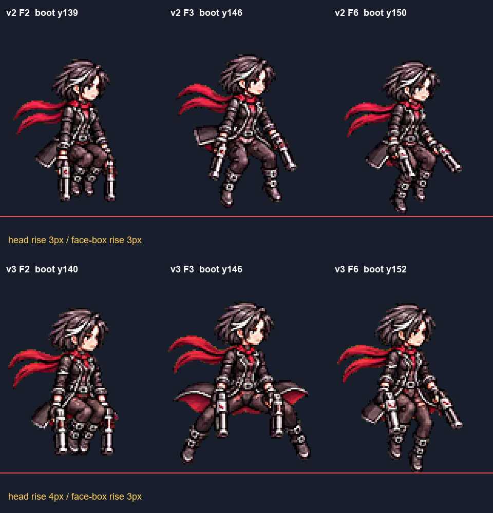

# SKM-07 · 시온 공중 아래 J 몸 동작 후보

**완료: 3회 생성 중 2개 후보(v2·v3) 전달, 1차 보류.** 내장 `image_gen`으로 각 take의 여섯 자세를 한 장씩 생성했고, 세 번 모두 사용자 첨부 3장을 실제 `referenced_image_paths`로 전달했다. 후보만 만들었으며 게임 파일·게임 속도·뷰어·git index는 변경하지 않았다. 패키지를 설치하지 않았다.

## 현재 상태와 측정 결과

| 생성 | 판정 | 얼굴 폭 / 기준 | 자동 머리 중앙값 | 2→3 머리 상승 | 2→3 얼굴 상자 상승 | 최저 부츠 y, F1→F6 | 공통 배율 |
|---|---|---|---|---|---|---|---|
| 1차 | 보류 | 0.900–1.100 자동 제안, 수동 확정 안 함 | 0.960 | 7px | 3px | 128, 128, 141, 140, 145, 150 | 0.36 |
| 2차 → **v2** | 전달 · 작게 모으기 | **1.000 × 6** | **0.960** | **3px** | **3px** | **138, 139, 146, 142, 146, 150** | **0.36** |
| 3차 → **v3** | 전달 · 넓게 벌리기 | **1.000 × 6** | **0.990** | **4px** | **3px** | **139, 140, 146, 145, 145, 152** | **0.38** |

1차는 무릎을 너무 높이 당겼고 사격에서 다리가 길게 펴져, F1·2 부츠가 목표 138–144보다 높다. F2→F3 머리 상승도 7px다. 공중 자세 자체는 보이지만 전체를 위아래로 옮기는 것만으로 원하는 부츠 높이와 작은 반동을 동시에 만들기 어려워 전달하지 않았다. 얼굴 자동 제안을 통과 수치로 간주하지 않았다.

- v2: F2→F3 머리 y50→47, 밝은 피부 얼굴 상자 위쪽 y61→58. 얼굴 폭 표식의 y는 72→68(4px)이며 **얼굴 상자 측정과 별개**다. F4 머리는 y46으로 F3에서 1px 차이다.
- v3: F2→F3 머리 y45→41, 밝은 피부 얼굴 상자 위쪽 y57→54. 얼굴 폭 표식 y68→65(3px). F4 머리는 y41로 F3와 같다.
- 두 후보의 12프레임을 전신 4배·얼굴 격자로 직접 확인했다. 양손에 총 하나씩, 붉은 스카프 두 꼬리, 은색 머리 줄과 코트 테두리를 확인했다. 지면·그림자·발사 이펙트는 없다.
- v3 F6는 **발끝 한쪽이 y152**에 닿지만, 양발이 비대칭으로 매달리고 발바닥이 아래로 기울어진 낙하 자세다. 좌표만으로 공중 자세를 증명한 것은 아니다.

## 시각적 확인



위는 v2, 아래는 v3의 실제 전달 PNG에서 뽑은 F2·F3·F6이다. 빨간 선은 게임의 발 기준 y152이며 지면이 아니다. v3는 사격 때 양 무릎·부츠가 좌우로 더 넓게 벌어진다.

- [v2 전체 4배 비교판](xion-shot_air_down-v2.png)
- [v3 전체 4배 비교판](xion-shot_air_down-v3.png)

각 판은 왼쪽부터 idle 기준, 현재 게임 `recoil_jump`의 공중 프레임 두 장, 후보 두 프레임을 나란히 놓았다. 세 단에 걸쳐 F1–6과 게임 공중 F3–6을 모두 포함한다. 모든 그림의 1px는 똑같이 4px로 표시하며, 노란 선은 후보 부츠 최저점이다. 판에서만 셀의 좌우 빈 여백을 잘랐고 실제 후보는 192px 셀 그대로다.

## 측정한 것과 판단한 것

**측정·계산**

- 얼굴 폭: 기존 SKM-06과 같은 기준 프레임의 눈 아래 노출 얼굴 경계 `(62.5,46)–(72.5,46)`, 폭 10px를 사용한다. 후보의 같은 부위 경계를 4배·16배 픽셀 격자로 검토했다. 두 후보 모두 10px다. **1px가 10%인 작은 측정**이므로 `1.000`은 해부학적 정밀도나 오차 ±0을 뜻하지 않는다.
- v2는 자동 얼굴 폭 표식을 그대로 채택했다. v3는 F1–3의 양쪽 표식을 같은 높이로 맞추고, F4의 바깥 붉은 윤곽 포함, F5의 구레나룻/눈 포함, F6의 피부 픽셀 내부 표식을 바로잡았다. 원래 제안과 수정 이유는 로컬 checks JSON에 보존했고, 수정 좌표는 `finalize.py`의 `CORRECTIONS`에 들어 있다. **그림 픽셀은 수정하지 않았다.**
- `head_scale.py`는 여섯 프레임 모두 신뢰도 0.6 이상이다. v2 개별 머리 정합 배율은 0.92–0.96, 중앙값 0.96; v3는 0.96–1.02, 중앙값 0.99다. 이는 위의 노출 얼굴 폭과 서로 다른 지표다.
- 머리 위쪽은 불투명 실루엣의 최상단이며, 이 행에서는 머리카락임을 눈으로 확인했다. 얼굴 상자는 검토한 얼굴 영역 안에서 `head_scale.skin_mask`가 잡은 **밝은 피부 픽셀의 경계상자**다. 귀·스카프를 제외했다. 이 방식은 어두운 피부 음영 전체의 윤곽을 재는 방법은 아니다.
- 부츠는 최하단 불투명 픽셀을 잰다. F2는 총구가 부츠보다 낮으므로 부츠만 포함하는 x 영역을 별도로 지정했다(v2 정렬 전 x104–119, v3 x106–123). 총구 최저점을 부츠로 잘못 기록하지 않았다.
- 기준 대비 내부 색 대비 지표: v2 **123.36–133.10%**, v3 **113.56–128.95%**로 모든 프레임이 90% 이상이다. 이 숫자는 미술 품질이나 자연스러움의 점수가 아니다.
- 두 후보 모두 초록 번짐 **0px**, 이진 알파, 비어 있는 테두리, 최소 여백 **v2 41px / v3 39px**. 6프레임, 30fps, 192px 셀, 발 기준 `[96,152]`, 반복 없음.
- 먼 눈은 기준 앞머리에 가려 독립 중심을 정할 수 없어 눈 간 거리 측정에서 제외했다.

**육안 판단·아직 확인하지 않은 것**

- 여섯 프레임이 모두 발이 떠 있거나 발끝이 늘어진 공중 자세로 읽힌다는 것은 확대판에서 한 판단이다.
- 실제 30fps 재생, D38의 타격 프레임 유지, 게임 낙하 속도와 합쳐졌을 때의 자연스러움은 검사하지 않았다. 게임 실행이나 시안 월드컵에 게시한 것으로 보고하지 않는다.
- v2는 작은 반동, v3는 큰 좌우 다리 벌림을 의도했다. 어느 쪽이 시온의 전투감에 맞는지는 사람 판단이 필요하다.

## 배치와 재현

원본에서 가장 큰 캐릭터 연결 덩어리 6개를 찾아 각각 추출했다. 고정 폭으로 자르지 않았고 원본의 y 좌표를 보존했다. SKM-06 Python 스크립트를 복사한 뒤 이 행만 처리하도록 수정해 재사용했다.

`tools/sprite_pipeline/normalize.py`를 `--resample lanczos --sharpen 60 --despill auto --palette none --bg '#00ff00' --cell 192 --feet-y 152`로 실행했다. `--ground-all`은 쓰지 않았다. 전체 행 배율 하나와 초기 공통 `--lift-all 2`를 사용했다. 프레임별 확대·축소, 머리 붙이기, 팔다리 변형, 수동 채색은 없다.

스카프가 자동 가로 중심을 끌어당기는 프레임이 있어, 최종 배치는 **허리 버클 중심을 몸통 기준점 x96**으로 삼았다. 이 기준점 선택은 육안으로 한 것이며 약 1px의 선택 오차가 있을 수 있다. 아래는 정규화 결과에서 최종 후보로 옮긴 **전체 프레임** 이동량이다(+, 오른쪽/아래).

| 후보 | F1 | F2 | F3 | F4 | F5 | F6 |
|---|---|---|---|---|---|---|
| v2 Δx | -12 | -14 | -2 | -4 | -3 | -1 |
| v2 Δy | +1 | 0 | 0 | 0 | 0 | 0 |
| v3 Δx | -15 | -15 | -2 | -7 | -2 | -1 |
| v3 Δy | +5 | +5 | +5 | +4 | +1 | +2 |

F2와 F3의 Δy가 서로 같아 반동 상승량을 인위적으로 줄이거나 늘리지 않았다. 부츠를 모두 y152에 놓지 않았으며 각 자세의 높이를 유지했다. 이동 전후 잘라낸 실루엣의 바이트가 같음을 검증한다.

로컬 원본이 있는 이 클론에서 다시 만드는 순서:

```powershell
python -B reports/codex-skm-07/process.py shot_air_down 2 0.36
python -B reports/codex-skm-07/face_check.py xion shot_air_down 2
python -B reports/codex-skm-07/process.py shot_air_down 3 0.38
python -B reports/codex-skm-07/face_check.py xion shot_air_down 3
python -B reports/codex-skm-07/finalize.py
python -B reports/codex-skm-07/prepare_handoff.py
python -B reports/codex-skm-07/verify_skm.py
```

원본은 `art/raw/skm-07/`, 정확한 생성 프롬프트는 [prompts.txt](prompts.txt)에 있다. 원본 해시·도구 참조 경로·전후 시간은 로컬 `generation-ledger.json`, 자세별 측정은 `xion-shot_air_down-v2-checks.json`·`v3-checks.json`에 있다. 중간 데이터는 커밋에서 제외하며 재현 스크립트와 이 보고서가 측정 정의·판정·좌표를 보존한다.

## 시간 제한

시작을 첫 작업 분의 시작으로 보수적으로 기록했다: **2026-11-24 22:43:00 KST**, 90분 마감 **2026-11-25 00:13:00 KST**. 생성 전후에 UTC 시계를 읽었고 아래 표는 KST 변환값이다.

| 호출 | 생성 전 | 도구 반환 직후 | 결과 |
|---|---|---|---|
| 1 | 11-24 22:46:03 | 11-24 22:46:23 | 보류 |
| 2 | 11-24 22:49:18 | 11-24 22:49:45 | v2 |
| 3 | 11-24 22:52:02 | 11-24 22:52:30 | v3 |

이후 추가 생성 없음. 세 호출 모두 idle, 일러스트, 사용자 제공 공중 참조의 실제 파일 경로를 전달했다. 일러스트의 홀로그램은 제외하라고 명시했다.

산출물 완성 기록: **2026-11-24 23:08:46 KST**, 보수적 시작부터 약 **25.8분**. 90분 마감 이내다.

## 확인 및 테스트

`python -B reports/codex-skm-07/verify_skm.py`의 **260개 파일·픽셀·메타데이터·쓰기 범위 검사 통과**. 최종 이미지 해시, 얼굴/부츠 좌표 재계산, 전체 프레임 이동 전후 픽셀 동일성, 생성 횟수와 전후 시각, 세 참조 이미지 기록, 명시된 21개 커밋 경로, UTF-8 텍스트와 행 끝 공백, PowerShell 구문을 확인했다. `commit.ps1`은 파싱만 했으며 실행하지 않았다. 게임 테스트는 하지 않았다.

로컬 상세 검증 결과는 `audit.json`에 있다. 이 자동 검사는 미술 판단이나 실제 재생 검증을 대신하지 않는다.

디스크: 이번 보고서·QA·생성 원본 약 **11.5 MB**. 기존 파일까지 포함한 작업 클론 `C:/Users/TH/Documents/AI/GameProject/SmashNine-units/vfx-a/SmashNine`은 약 **3.424 GB**다. 원본과 QA 중간 결과는 커밋에서 제외한다.

## 전달 파일과 남은 작업

- [v2 PNG](../../art/bakeoff/xion/b/xion-shot_air_down-v2.png) · [v2 JSON](../../art/bakeoff/xion/b/xion-shot_air_down-v2.json)
- [v3 PNG](../../art/bakeoff/xion/b/xion-shot_air_down-v3.png) · [v3 JSON](../../art/bakeoff/xion/b/xion-shot_air_down-v3.json)
- [commit.ps1](commit.ps1): 명시한 후보·비교판·README·프롬프트·재현/검사 스크립트·작업 카드만 stage한다. 시도 폴더·원본·캐시·로그는 제외하며 JSON 배열을 PowerShell에 넘기지 않는다. 커밋은 실행하지 않았다.

**사람이 판단할 것:** F2→F3가 지상에서 일어나는 동작이 아니라 공중의 작은 반동으로 읽히는가, v3의 넓은 벌림이 과하지 않은가, F4→F6에서 무릎을 다시 모으고 낙하하는 연결과 양손 총의 방향·길이가 자연스러운가. v3 F6의 한쪽 발끝 y152가 게임에서 접지처럼 보이지 않는지도 확인해야 한다.

**다음 권장 단계:** 리드가 두 후보를 실제 게임의 임시 행과 시안 월드컵에서 비교하고, 사람 선택 후 채택본만 게임에 연결한다. 후보 생성·정규화는 완료했고 사람 판단·게임 적용은 남아 있다.
