# SKM-08 리오 키트 v3 몸 동작 후보

전달 8행 · 보류 2행 · 미도달 0행. 내장 image_gen으로 제작했다. 게임 파일·재생 속도 설정·Git 커밋은 변경하지 않았다.

시작 2026-11-27 00:08:25 KST, 마감 02:38:25 KST(150분). 각 생성 직전·직후 시각과 실제 참조 이미지 경로는 generation-ledger.json에 기록했다.

## 실측·계산 결과

| 행 | 상태 | 얼굴 폭/기준 | 머리 자동 중앙값 | 배율 | 여백 | 디테일/기준 |
|---|---|---:|---:|---:|---:|---:|
| [rio_male-sword_throw](rio_male-sword_throw.png) | 후보 전달 | 1.000–1.000 | 1.0 | 0.39 | 20px | 1.154 |
| [rio_female-sword_throw](rio_female-sword_throw.png) | 보류 | 1.000–1.200 (자동 제안) | 1.06 | 0.38 | 23px | 1.244 |
| [rio_male-counter_stance](rio_male-counter_stance.png) | 후보 전달 | 1.000–1.000 | 0.98 | 0.39 | 34px | 1.081 |
| [rio_female-counter_stance](rio_female-counter_stance.png) | 후보 전달 | 1.000–1.000 | 1.0 | 0.337 | 36px | 1.188 |
| [rio_male-pierce](rio_male-pierce.png) | 보류 | 0.812–0.875 (자동 제안) | 0.82 | 0.32 | 5px | 1.144 |
| [rio_female-pierce](rio_female-pierce.png) | 후보 전달 | 1.000–1.000 | 1.02 | 0.35 | 8px | 1.187 |
| [rio_male-decoy_step](rio_male-decoy_step.png) | 후보 전달 | 1.000–1.000 | 1.02 | 0.38 | 37px | 1.098 |
| [rio_female-decoy_step](rio_female-decoy_step.png) | 후보 전달 | 1.000–1.000 | 1.0 | 0.33 | 37px | 1.246 |
| [rio_male-flurry_cut](rio_male-flurry_cut.png) | 후보 전달 | 1.000–1.000 | 1.04 | 0.405 | 20px | 1.020 |
| [rio_female-flurry_cut](rio_female-flurry_cut.png) | 후보 전달 | 1.000–1.000 | 1.06 | 0.36 | 25px | 1.249 |

### rio_male-sword_throw

오른손 검을 유지하고 빈 왼손으로 던지는 6프레임 후보. 같은 눈 아래 높이로 경계를 보정한 얼굴 폭은 전 프레임 1.000이며 눈 사이 거리는 가림으로 측정 불가다.

- 관찰: 총 2회 생성. 1차 F2의 허리 옆 추가 손처럼 보이는 형태를 제거한 2차 선택. 공통 배율 0.39, 자동 머리 중앙값 1.00. 얼굴 자동 표식은 서로 다른 높이와 빠진 피부 경계를 격자에서 확인해 수정했다.
- 사람 판단: 왼손 준비→던지기의 팔 연결, F3–4의 비슷한 자세, 대기보다 5–9px 높은 전신 실루엣과 검 길이가 재생 중 자연스러운지 판단.
- 직접 본 프레임: F1–F6. 얼굴 수치에 사용한 프레임: F1, F2, F3, F4, F5, F6.

### rio_female-sword_throw

2회 생성 후 보류. F2에 귀 옆 손·검을 쥔 손과 별도로 내려간 손이 남아 세 손으로 읽힌다. 얼굴 폭 자동 제안은 1.000–1.200이며 확정 실측으로 채택하지 않았다.

- 관찰: 1차 F2·F5 손 연결 오류를 강조해 재생성했으나 2차 F2의 추가 손이 남음. 배율 0.38, 머리 자동 중앙값 1.06. 정규화·여섯 전신·얼굴 제안 보드를 확인했으며 후보 PNG는 내보내지 않았다.
- 사람 판단: 보류 근거인 F2의 팔·손 개수와 기준보다 커진 얼굴·몸 높이 확인. 이 보드는 채택 후보가 아니다.
- 직접 본 프레임: F1–F6. 얼굴 수치에 사용한 프레임: F1, F2, F3, F4, F5, F6.

### rio_male-counter_stance

오른팔을 따라 검을 거꾸로 잡고 왼손바닥을 편 받아치기 자세 후보. 얼굴 폭은 같은 눈 아래 높이로 보정 후 1.000이며 눈 사이 거리는 가림으로 측정하지 못했다.

- 관찰: 1회 생성, 공통 배율 0.39. 자동 머리 중앙값 0.98, 발 기준선 접지 유지. 여섯 전신·얼굴·검 손잡이를 확인했고 얼굴 표식의 높이 불일치와 피부 한 픽셀 누락을 수정했다.
- 사람 판단: 낮게 버티는 자세가 공용 방어와 구분되는지, F3–6 호흡 변화가 충분한지, 대기보다 큰 전신 실루엣과 짧게 보이는 역수 검의 길이를 재생에서 판단.
- 직접 본 프레임: F1–F6. 얼굴 수치에 사용한 프레임: F1, F2, F3, F4, F5, F6.

### rio_female-counter_stance

검을 오른팔을 따라 뒤집어 잡고 왼손을 앞으로 편 낮은 받아치기 후보. 얼굴 폭은 F2 구레나룻 표식을 보정 후 전 프레임 1.000이며 눈 사이 거리는 가림으로 측정 불가다.

- 관찰: 1회 생성, 공통 배율을 0.37에서 0.337로 조정. 머리 자동 중앙값 1.00, 전신 높이 94–97px. 여섯 자세와 얼굴 제안을 확인하고 F2 볼 경계를 격자·픽셀에서 분리했다.
- 사람 판단: F2–6의 작은 호흡과 머리카락 변화, 역수 검을 쥔 손목의 설득력, 공용 방어와의 구분을 재생해서 판단.
- 직접 본 프레임: F1–F6. 얼굴 수치에 사용한 프레임: F1, F2, F3, F4, F5, F6.

### rio_male-pierce

2회 생성 후 보류. 2차는 공통 배율 0.40에서 돌진 검 끝이 셀을 벗어나며, 검토용 0.32 축소에서는 직립 얼굴 폭 자동 제안이 0.812–0.875로 작아진다.

- 관찰: 1차 F2의 검을 든 팔 방향이 바뀌어 2차 재생성. 2차는 오른팔 연결을 확인했으나 정규화가 placement x42 + width168 = 210px로 192px 셀 초과를 거부했다. 0.32 검토판은 여백을 확보하지만 자동 머리 중앙값 0.82라 후보로 내보내지 않음. F2 저자세·F5 뒤돌아본 얼굴은 직립 비교에서 제외.
- 사람 판단: 보류 근거 확인용. 긴 찌르기에서 검과 팔을 더 압축해 얼굴 크기를 유지하는 재작업이 필요하다.
- 직접 본 프레임: F1–F6. 얼굴 수치에 사용한 프레임: F1, F3, F4, F6.

### rio_female-pierce

낮은 돌진 후 검을 뒤로 보내고 어깨 너머를 돌아보는 관통 베기 후보. 직립 비교 F1·3·4·6의 얼굴 폭은 1.000이며 저자세 F2·뒤돌아본 F5는 비교에서 제외했다.

- 관찰: 1회 생성, 공통 배율 0.35. 머리 자동 중앙값 1.02, 전신 높이 81–92px. 여섯 자세의 손·검·머리카락을 확인했으며 얼굴 자동 표식은 비교 가능한 프레임에서 채택했다. 눈 사이 거리는 기준부터 가려져 측정 불가.
- 사람 판단: F2→F3의 앞으로 찌르기에서 뒤로 베는 연결, F5의 돌아보기와 높아 보이는 목깃, 실제 150px 이동에서의 가독성을 판단.
- 직접 본 프레임: F1–F6. 얼굴 수치에 사용한 프레임: F1, F3, F4, F6.

### rio_male-decoy_step

검을 몸 앞에 두고 뒤로 밀어내듯 물러난 뒤 착지하는 후보. F3 귀 표식을 볼 경계로 보정한 얼굴 폭은 1.000이며 F4 발 들림은 8px다.

- 관찰: 1회 생성, 공통 배율 0.38. 머리 자동 중앙값 1.02. 공통 원본 y를 보존해 F4만 8px 떠 있고 나머지 발은 기준선에 닿는다. 여섯 전신·양손·검 연결과 얼굴을 확인했다.
- 사람 판단: 후퇴로 체중이 실리는지, F3→F4에서 검을 몸 앞에 고정한 자세와 F4→F5 착지 속도가 자연스러운지, 실제 게임의 뒤로 150px 이동과 함께 판단.
- 직접 본 프레임: F1–F6. 얼굴 수치에 사용한 프레임: F1, F2, F3, F4, F5, F6.

### rio_female-decoy_step

뒤로 체중을 보내고 검을 가로로 유지한 채 짧게 뛰어 착지하는 후보. F2의 고립된 머리카락 경계 표식을 보정한 얼굴 폭은 1.000이며 F4 발 들림은 11px다.

- 관찰: 2회 생성. 1차는 공통 배율에서 얼굴 폭이 들쭉날쭉해 재생성했고, 2차 배율 0.33·머리 자동 중앙값 1.00을 채택했다. 원본 F4의 높이는 lift-scale 0.75로 줄여 12px 한도 안에 두었다. 여섯 전신과 얼굴을 직접 확인했으며 눈 사이 거리는 측정 불가다.
- 사람 판단: F3에서 뒤로 미는 체중, F4의 접힌 무릎과 11px 뜬 발, 착지 전후 머리카락 연결을 실제 150px 후퇴와 함께 판단. 검이 오른팔에 가로로 붙는 자세의 자연스러움도 확인.
- 직접 본 프레임: F1–F6. 얼굴 수치에 사용한 프레임: F1, F2, F3, F4, F5, F6.

### rio_male-flurry_cut

오른어깨 위 양손 준비에서 대각선으로 내려친 뒤 검을 뒤로 보내는 마무리 베기 후보. 윤곽·피부 경계를 확인한 얼굴 폭은 전 프레임 1.000이며 눈 사이 거리는 가림으로 측정 불가다.

- 관찰: 1회 생성, 공통 배율 0.405. 자동 머리 중앙값 1.04. F1 표식 높이와 F2·4·5·6의 피부/검은 윤곽 경계를 격자·RGB로 확인해 수정했다. 여섯 자세에서 검 한 자루와 양손 연결, 접지를 확인했다.
- 사람 판단: F2 양손 준비→F3 내려치기→F4 뒤로 빠지는 검의 방향 변화가 24fps에서 충분히 읽히는지, F5–6 복귀가 너무 비슷한지, 대기 기준과의 몸 비율을 판단.
- 직접 본 프레임: F1–F6. 얼굴 수치에 사용한 프레임: F1, F2, F3, F4, F5, F6.

### rio_female-flurry_cut

양손으로 검을 높이 준비해 내려치고 낮게 마무리하는 후보. 직립 비교 F2·3·5·6의 얼굴 폭은 1.000이며 낮게 숙인 F1·4는 제외했다(자동 제안 1.100).

- 관찰: 2회 생성. 1차는 좁아진 볼을 맞추면 머리 자동 중앙값 1.16으로 커져 다시 그렸고, 2차 공통 배율 0.36·머리 자동 중앙값 1.06을 채택했다. 여섯 전신·얼굴·양손 검 연결을 확인했다. 눈 사이 거리는 기준 앞머리 가림으로 측정 불가. 낮은 F1·4를 통과한 직립 실측으로 계산하지 않는다.
- 사람 판단: F1·4의 숙인 얼굴 폭 변화(자동 제안 1.100), F2 양손 준비에서 F3 내려치기로 이어지는 손목, F4 검을 뒤로 보내는 방향, 머리카락 흔들림과 기준 대비 몸 비율을 24fps 재생에서 판단.
- 직접 본 프레임: F1–F6. 얼굴 수치에 사용한 프레임: F2, F3, F5, F6.

## 측정 방법과 한계

- SKM-06 Python 도구를 복사하고 리오용으로 변경했다. 고정 폭 자르기 없이 원본의 여섯 실루엣 덩어리별 추출을 사용한다.
- 행별 공통 배율 하나, 192px 셀, 몸 중심 x96, 접지 y152. LANCZOS / sharpen 60 / despill auto / palette none / #00ff00.
- 얼굴 폭은 눈 아래 부근의 좌우 볼 표식 사이 수평 간격이다. 자동 제안을 격자와 4배 확대에서 검토하고, 잘못 잡힌 표식은 근거를 남겨 수정했다. 기준과 각 프레임의 좌표·수정 이유는 checks JSON에 남긴다. 1.000은 선택한 좌표로 계산한 비율이며 정확도 보증이 아니다. 기준 폭은 남성 16px·여성 10px여서 한 픽셀 차이만으로 각각 약 6%·10%가 변한다. 얼굴 가림·회전과 경계 선택 오차가 있으므로 사람 검수가 필요하다.
- 반대쪽 눈은 앞머리와 겹쳐 독립된 중심을 확정하지 못했다. 눈 사이 거리는 측정 불가로 기록하며 통과로 세지 않는다. 돌아선 얼굴은 명시적으로 제외한다.
- 디테일 수치는 내부 색 대비이며 미술 품질 점수가 아니다. 각 프레임이 기준의 90% 이상인지 검사한다.
- 전신 4배 판에서 손·검·의상·실루엣을 관찰했다. 동작의 자연스러움과 실제 게임 재생의 느낌은 아직 검증하지 않았다.

## 남은 작업

미도달: 없음.

## 다음 권장 단계

리드가 검토한 뒤 시안 월드컵에서 사람이 얼굴·의상 일치와 동작 연결을 판단한다. 게임 연결은 리드의 후속 작업이다.

## 시각적 확인

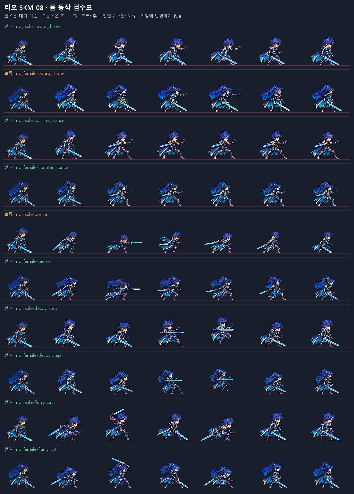

초록은 전달 후보, 주황은 보류다. 각 행 왼쪽은 대기 기준이고 오른쪽 여섯 장은 순서대로 F1–F6다.

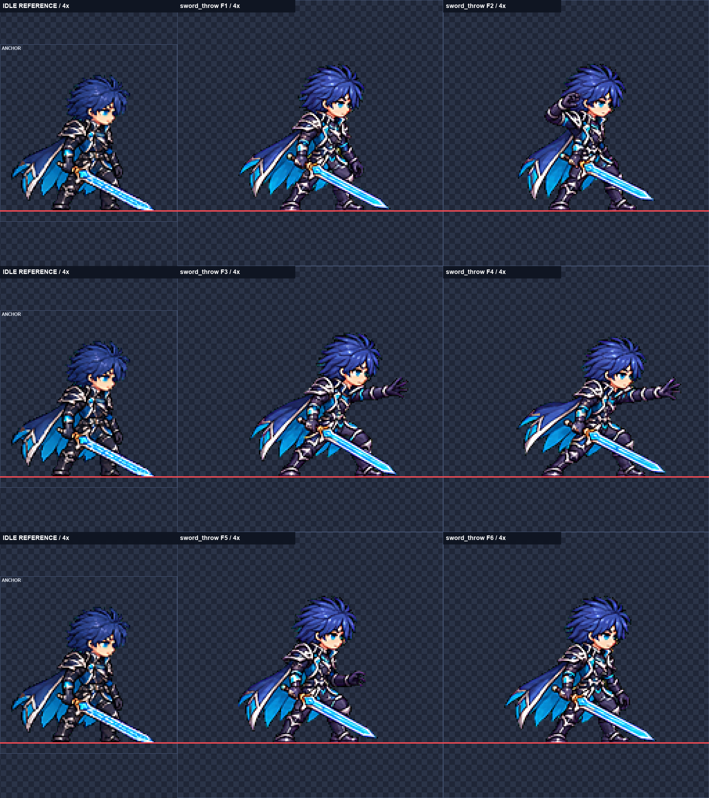

각 단 왼쪽은 대기 기준, 오른쪽은 두 프레임이다. 빨간 선은 발 기준 y152다.

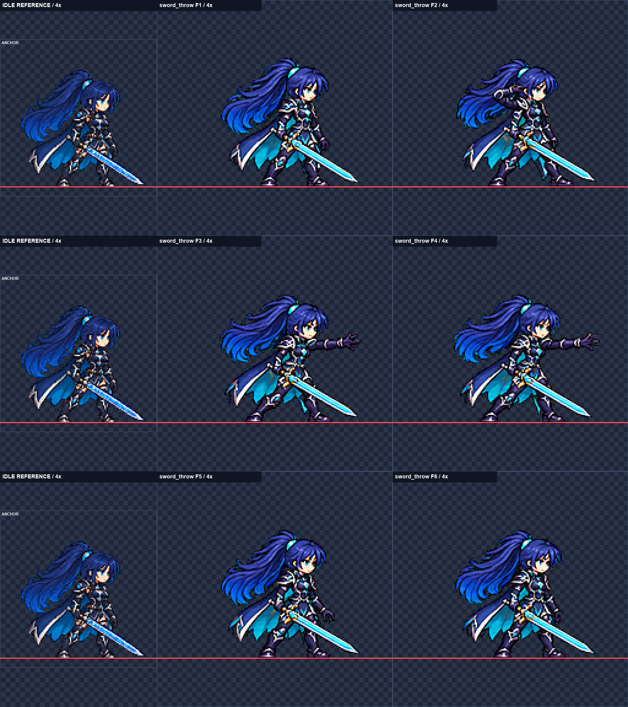

각 단 왼쪽은 대기 기준, 오른쪽은 두 프레임이다. 빨간 선은 발 기준 y152다.

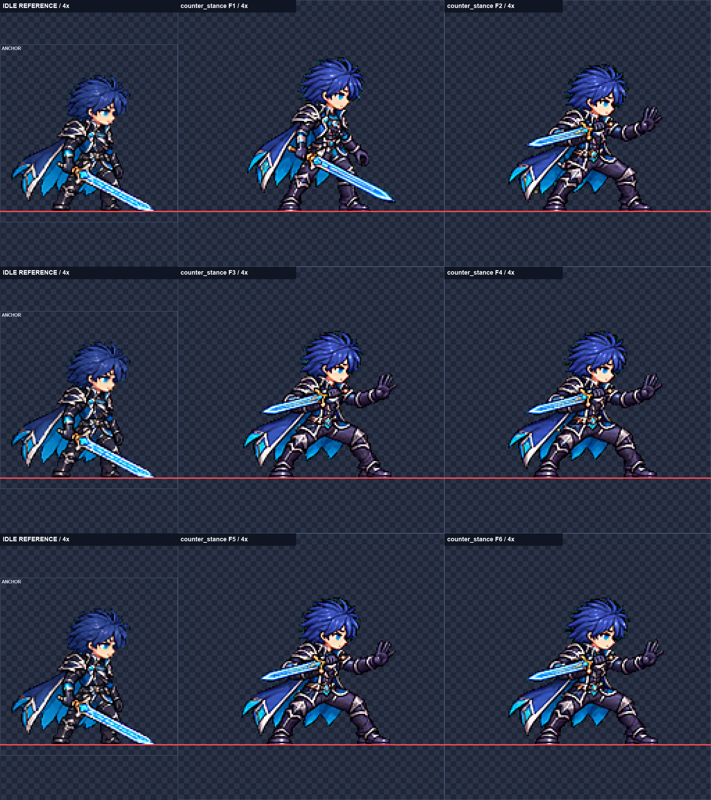

각 단 왼쪽은 대기 기준, 오른쪽은 두 프레임이다. 빨간 선은 발 기준 y152다.

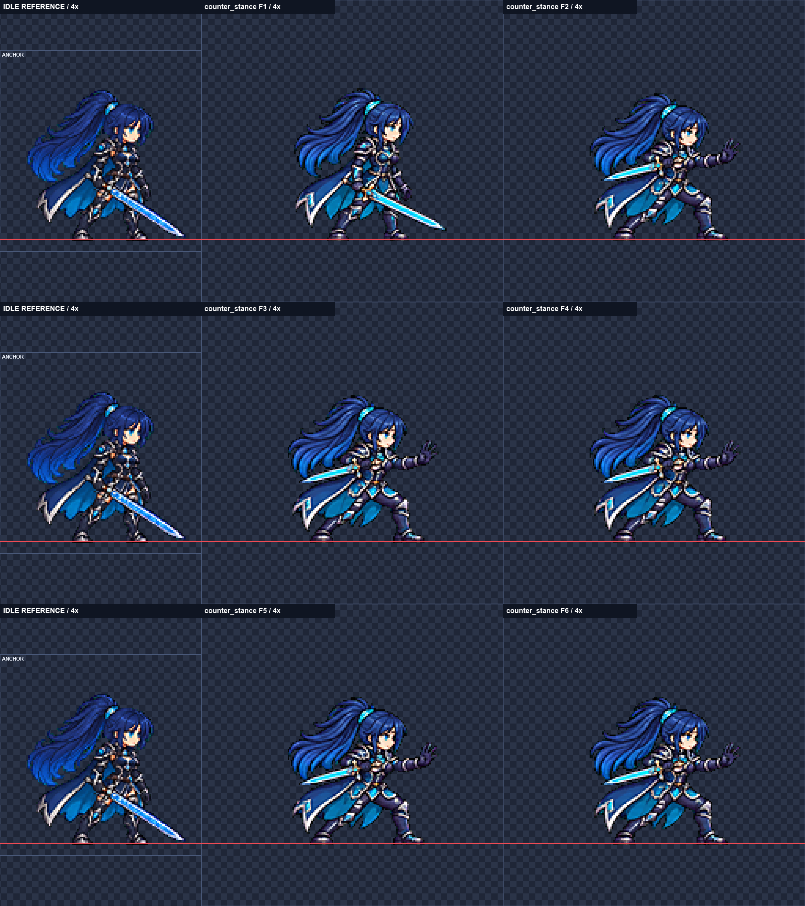

각 단 왼쪽은 대기 기준, 오른쪽은 두 프레임이다. 빨간 선은 발 기준 y152다.

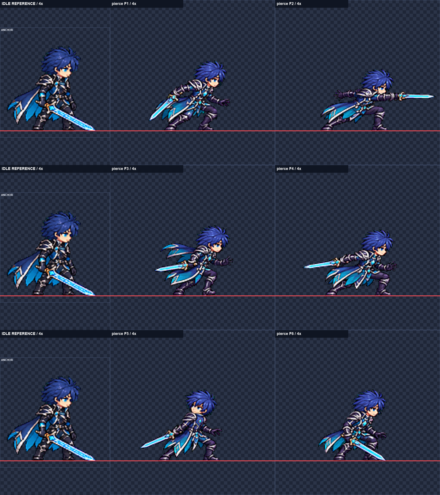

각 단 왼쪽은 대기 기준, 오른쪽은 두 프레임이다. 빨간 선은 발 기준 y152다.

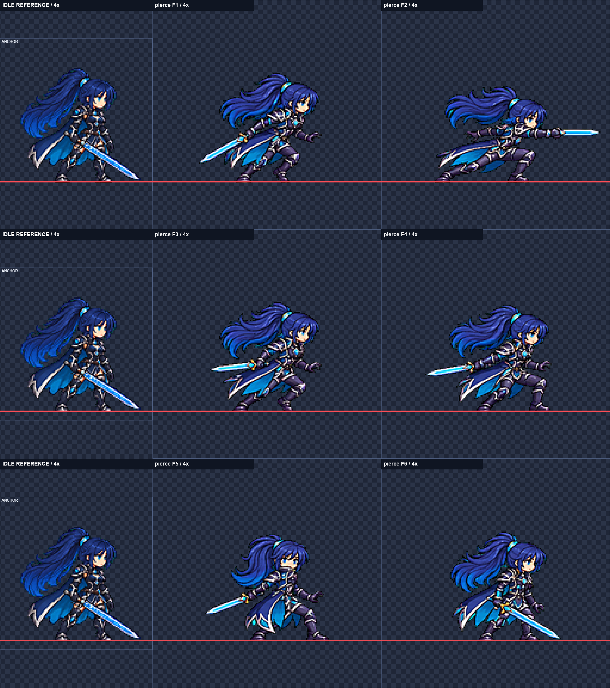

각 단 왼쪽은 대기 기준, 오른쪽은 두 프레임이다. 빨간 선은 발 기준 y152다.

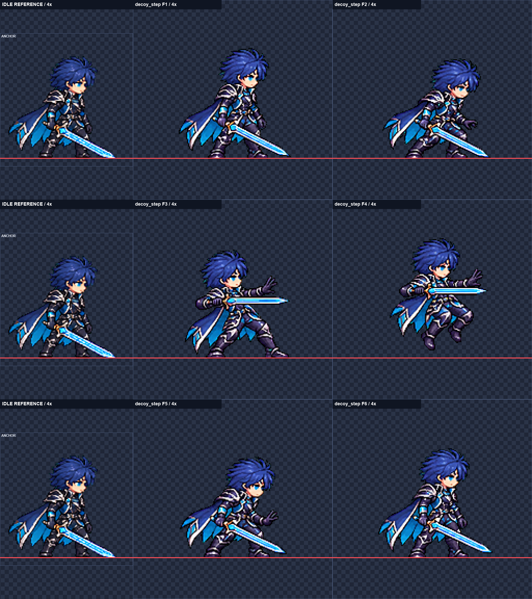

각 단 왼쪽은 대기 기준, 오른쪽은 두 프레임이다. 빨간 선은 발 기준 y152다.

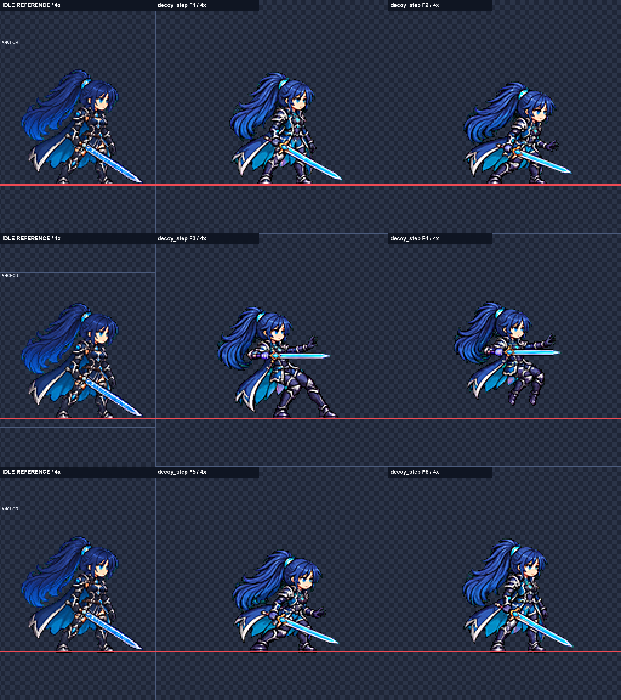

각 단 왼쪽은 대기 기준, 오른쪽은 두 프레임이다. 빨간 선은 발 기준 y152다.

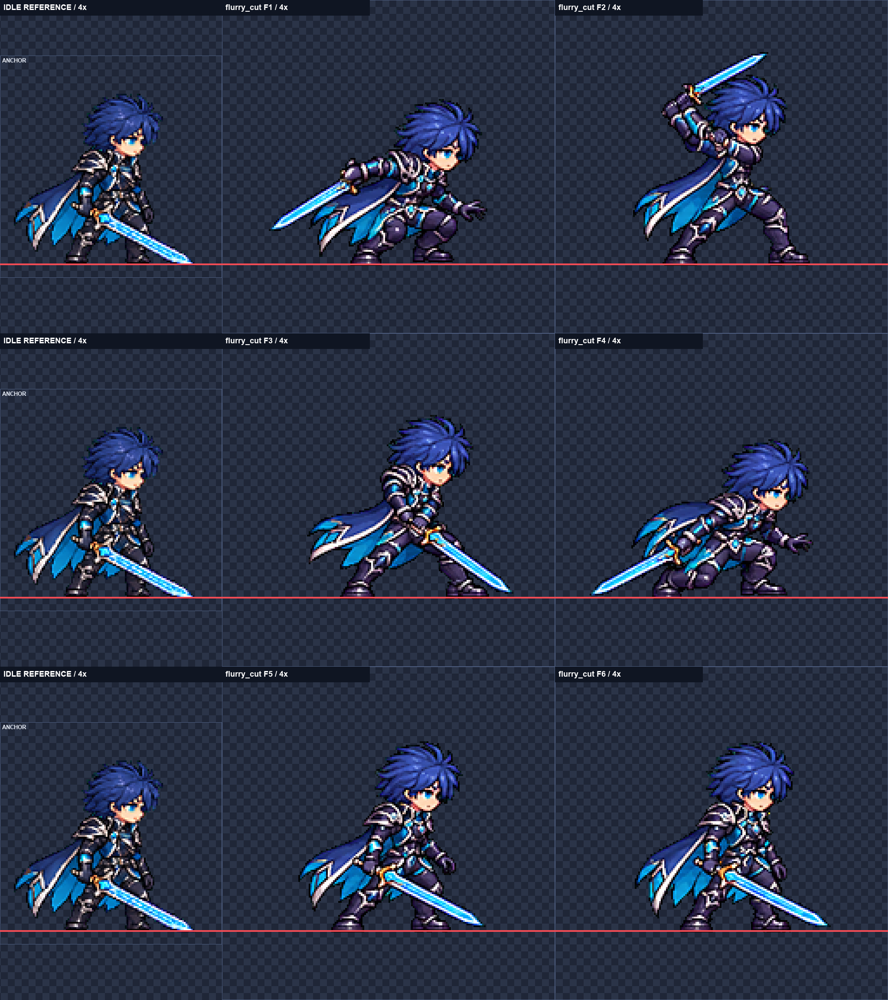

각 단 왼쪽은 대기 기준, 오른쪽은 두 프레임이다. 빨간 선은 발 기준 y152다.

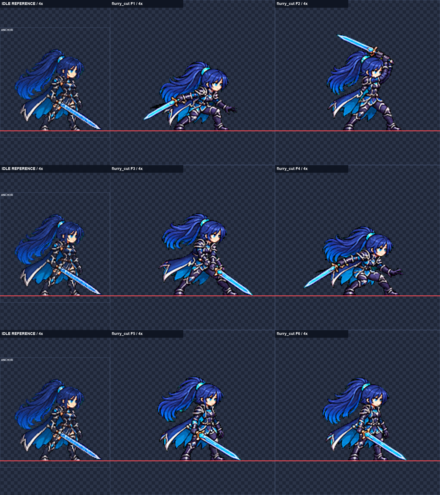

각 단 왼쪽은 대기 기준, 오른쪽은 두 프레임이다. 빨간 선은 발 기준 y152다.

## 확인 및 테스트

파일·규격·경로 검증: PASS. 게임 실행 및 commit.ps1 실행은 하지 않았다.
작업 클론 전체 크기: 3.558 GB. 이번 작업 파일: 60.809 MB.
검증 시각(UTC): 2026-11-26T16:28:15.271460+00:00. 시작 후 79.84분, 생성 15회. 작업 폴더: `C:\Users\TH\Documents\AI\GameProject\SmashNine-units\vfx-a\SmashNine`.
