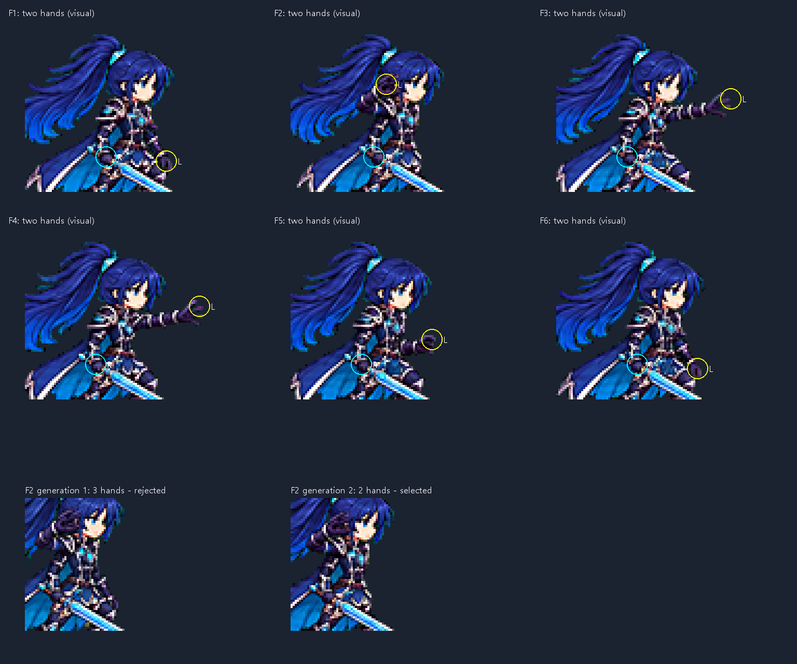
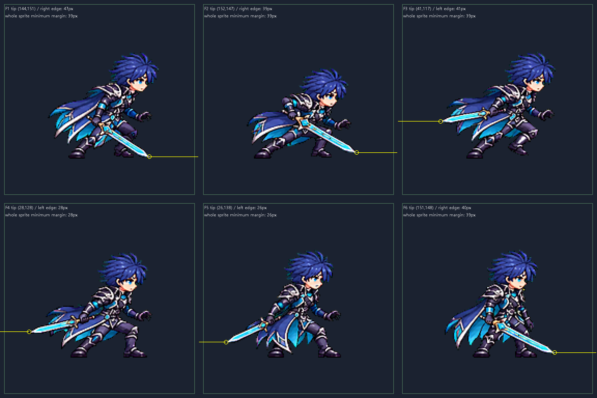
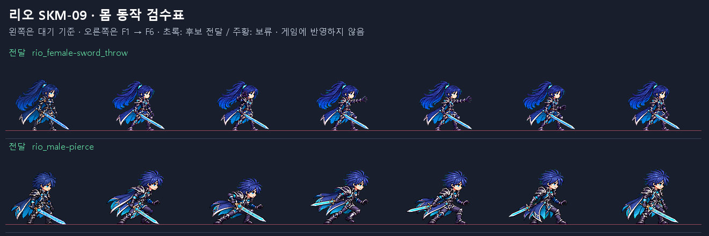

# SKM-09 리오 두 행 재작업

완료: 후보 전달 2행 · 보류 0행 · 미도달 0행. 내장 image_gen으로 만들었다. 게임 파일·재생 속도 설정·Git 인덱스·커밋은 변경하지 않았다.

시작은 보수적으로 2026-11-27 12:03 KST, 마감은 13:03 KST(60분)로 잡았다. 각 생성 전후 시각·실제 참조 이미지 인수·원본 해시는 `generation-ledger.json`, 프롬프트 전문은 `prompts.txt`에 있다.

## 실측·계산

| 행 | 결과 | 얼굴 폭/기준 | 자동 머리 중앙값 | 공통 배율 | 최소 여백 | 최소 디테일/기준 |
|---|---|---:|---:|---:|---:|---:|
| rio_female-sword_throw | 전달 | 1.000–1.000 | 1.0 | 0.38 | 35px | 1.107 |
| rio_male-pierce | 전달 | 1.000–1.000 | 1.01 | 0.463 | 26px | 1.096 |

### rio_female-sword_throw

여성 K 마검 투척 후보. 얼굴 폭은 기준의 1.000이며 F2의 허리 옆 추가 팔·손을 제거했고 전 프레임에서 두 손과 오른손 검을 확인했다.

- 관찰: 총 2회 생성. 1차 F2의 추가 손을 원본 확대에서 확인하고 2차에서 제거했다. 공통 배율 0.38. 얼굴 표식의 y만 눈 아래 같은 높이로 맞췄으며 x는 유지했다. 접지 y152·번짐 0.
- 사람 판단: F2 귀 옆 팔에서 F3 앞으로 던지는 연결, 비슷한 F3–4의 타이밍, 좁은 어깨·포니테일·대기 얼굴의 일치, 오른손 검 길이와 동작의 힘을 20fps에서 판단.
- 얼굴 비교 프레임: F1, F2, F3, F4, F5, F6. 전신은 F1–F6를 직접 확인했다.

손 개수 육안 관찰: F1–F6 모두 2개. R은 오른손 검 손잡이, L은 빈 왼손이며, F2에는 귀 옆 손과 검을 쥔 손만 남았다. 원본·정규화 4배 판을 확인했다. 손 인식 자동 검사는 아니다.

표식은 이번 수정 지점을 가리킨다. 여성 손 중심 표식은 대략적인 위치이며, 남성 검 끝 좌표는 픽셀 계산값이다.

### rio_male-pierce

남성 J 3타 관통 베기 후보. 직립 비교 F1·3·4·6 얼굴 폭은 기준의 1.000이며 낮춘 검 각도와 굽힌 팔로 전 프레임 몸·검의 4px 여백을 확보했다.

- 관찰: 1회 생성. 공통 배율 0.44/0.46/0.47/0.465/0.463 비교 후 0.463 선택; 프레임별 크기 조정은 하지 않았다. 오른손 검 연결과 여섯 자세를 4배로 확인했다. F2의 낮은 자세와 F5의 고개 방향은 직립 얼굴 비교에서 제외.
- 사람 판단: F2의 아래로 향한 짧은 찌르기가 150px 이동과 함께 관통 베기로 읽히는지, F2→F3 검의 앞뒤 전환, F5의 돌아보기가 약한 점, 대기보다 높은 실루엣과 검 길이 변화를 20fps에서 판단.
- 얼굴 비교 프레임: F1, F3, F4, F6. 전신은 F1–F6를 직접 확인했다.

| 프레임 | 검 끝 픽셀 (x,y) | 검 끝에서 바깥 셀 경계 | 전신 최소 여백 |
|---|---|---:|---:|
| F1 | [144, 151] | 47px | 39px |
| F2 | [152, 147] | 39px | 39px |
| F3 | [41, 117] | 41px | 39px |
| F4 | [28, 128] | 28px | 28px |
| F5 | [26, 138] | 26px | 26px |
| F6 | [151, 148] | 40px | 39px |

검 끝 주변 영역은 육안으로 골랐고, 그 안의 가장 바깥 불투명 픽셀과 x0 또는 x191의 거리를 계산했다. 전신 알파 경계 상자도 따로 검사해 검 전체가 셀 안임을 확인했다.

표식은 이번 수정 지점을 가리킨다. 여성 손 중심 표식은 대략적인 위치이며, 남성 검 끝 좌표는 픽셀 계산값이다.

## 측정 방법과 한계

- SKM-08 Python 도구를 복사해 재사용했다. 실루엣 연결 덩어리별 추출이며 고정 폭으로 자르지 않았다. 행 전체 공통 배율 하나, 192px 셀, 발 y152, 기준 x96, LANCZOS / sharpen 60 / despill auto / palette none / #00ff00.
- 얼굴 폭은 눈 아래 부근의 좌우 경계 표식 사이 수평 간격이다. 자동 제안을 4배 보드와 픽셀 격자에서 검토했다. 좌표·원래 제안·보정 이유는 checks JSON에 남겼다. 여성 기준 10px·남성 16px여서 한 픽셀 차이는 각각 10%·6.25%다. 1.000은 지정한 표식의 비율이지 얼굴 전체가 완전히 같다는 뜻이 아니다.
- 반대쪽 눈은 앞머리와 겹쳐 눈 사이 거리를 확정하지 못했다. 측정 불가이며 통과 수치로 세지 않는다. 자동 머리 정합은 보조 지표다.
- 디테일은 내부 색 대비 계산값이며 미술 품질 점수가 아니다. 손 개수·검 연결·의상 일치는 확대판의 육안 관찰이다. 실제 게임 재생은 하지 않았다.

## 시각적 확인

왼쪽은 해당 체형 대기 기준이고 오른쪽은 새 후보 F1–F6다. 빨간 선은 발 기준이다.

상세 4배 판은 각 프레임마다 왼쪽부터 같은 체형 대기 기준, 전달된 반대 체형 동작, 이번 후보를 비교한다. 후보 PNG는 192px 셀 그대로다.

- [rio_female-sword_throw 4배 비교판](rio_female-sword_throw.png)

- [rio_male-pierce 4배 비교판](rio_male-pierce.png)

## 확인 및 테스트

파일·알파·여백·번짐·디테일·메타데이터·경로 검증: PASS. commit.ps1은 문법만 검사했고 실행하지 않았다.
검증 시각: 2026-11-27T03:54:15.799211+00:00, 경과 51.26분. 생성 3회.
작업 클론 `C:\Users\TH\Documents\AI\GameProject\SmashNine-units\vfx-a\SmashNine`: 3.611GB. 이번 작업 파일: 13.054MB.

## 남은 작업과 다음 권장 단계

리드가 비교판과 측정 근거를 검토하고 시안 월드컵에서 사람이 20fps 동작 연결과 외형 일치를 판단한다. 채택·게임 연결은 하지 않았다. 기존 웹 예산 결정 #223 뒤 게임에 넣는 절차는 리드의 후속 작업이다. 새 할 일 위젯 항목은 만들지 않았다.

커밋 준비: `powershell -ExecutionPolicy Bypass -File reports/codex-skm-09/commit.ps1`. 원본·attempt 폴더는 포함하지 않는다.
