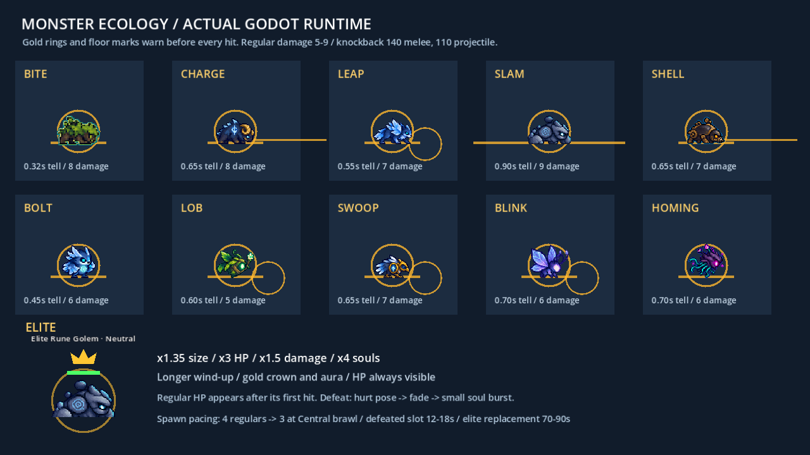
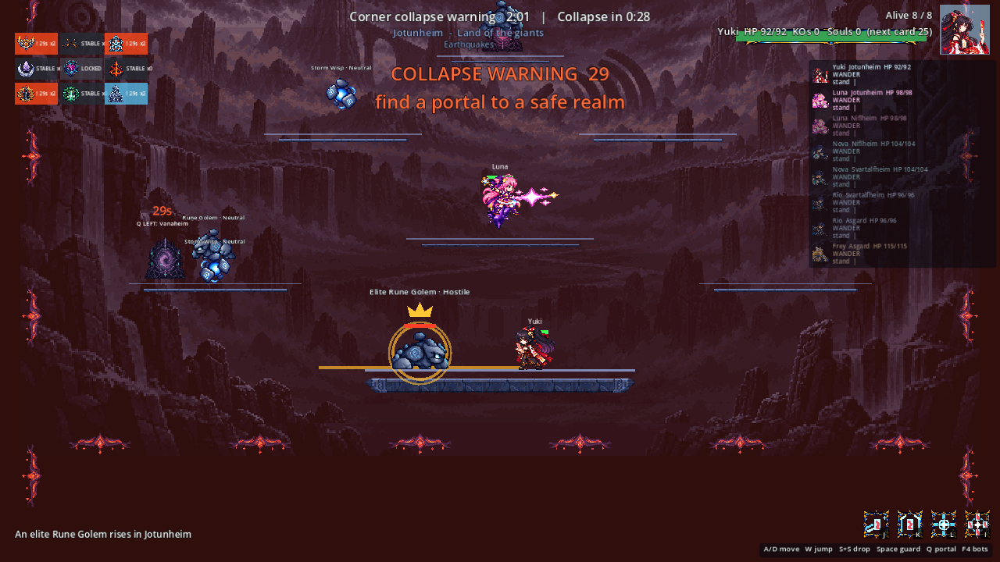
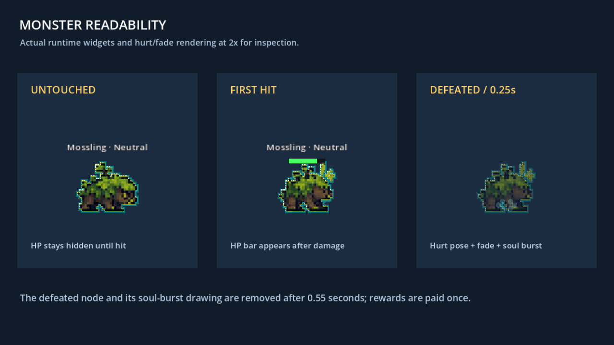

# CODEX-SYS-01 — 몬스터 생태 구현 결과

기준 커밋 `5dc0917`, 작업 브랜치 `codex/sys-01`. 작업 범위는 카드의 허용 경로만 사용했다. 아래 수치는 설정값과 실측값을 구분한다.

**현재 상태:** 요청 기능 구현 완료. 전체 34개 테스트 스크립트와 기본 soak가 `ALL PASSED`이며, 새 생태 검사 250개가 통과했다. 최종 8명 3시드 비교는 적중 980→389회, 몬스터 공격자 기록의 탈락 3→1명, 평균 경기 길이 272.1→293.2초다. 마지막 1명은 정예이며 일반 몬스터 탈락은 0명이다. `.git` 쓰기 제한으로 커밋 대신 `commit.ps1`을 인계한다.

## 완료

18개 스킨을 10개 행동에 연결하고 모든 공격에 피해가 없는 준비 동작을 넣었다. 렐름 정예, 경기 단계별 일반 몬스터 수, 슬롯별 리필 대기, 피격 후 체력바와 사망 연출을 구현했다. `EnemyAI.gd`, 캐릭터 코드, `RealmHazards.gd`, UI 스크립트는 수정하지 않았다.

### 구현된 행동 표

피해는 경기 공통 배율 적용 전 기본값이다. 준비 시간도 일반 개체 기준이며, 정예는 이 시간의 1.4배다.

| 행동 | 적용 스킨 | 실제 동작 | 준비 시간 | 피해/회 |
| --- | --- | --- | ---: | ---: |
| bite | `mossling` | 준비 원형 표시 후 앞쪽 물기 | 0.32초 | 8 |
| charge | `asgard_aegis_ram`, `muspelheim_magma_boar` | 방향을 고정하고 직선 돌진. 바닥·벽·낭떠러지를 확인해 정지 | 0.65초 | 8 |
| leap | `niflheim_glacier_wolf`, `alfheim_moon_stag`, `vanaheim_vine_hound` | 목표 위치를 미리 표시하고 포물선 도약. Hound 적중은 0.45초 `control_slow` | 0.55초 | 7 |
| slam | `jotunheim_rune_golem`, `yggdrasil_root_guardian` | 넓은 지면 경고 후 양쪽으로 짧은 충격파. 벽·발판 끝에서 사라짐 | 0.90초 | 9 |
| shell | `svartalfheim_gear_beetle` | 지면 돌진 중 앞에서 받는 피해만 절반. 뒤쪽·비구르기 상태는 정상 피해 | 0.65초 | 7 |
| bolt | `ember_imp`, `niflheim_frost_owl`, `jotunheim_storm_wisp` | 직선 투사체. Owl 적중은 0.55초 `control_slow` | 0.45초 | 6 |
| lob | `midgard_rooftop_slinger`, `vanaheim_seed_sprite` | 중력이 적용되는 곡사. Seed Sprite는 3발 부채꼴, 한 행동에서 같은 선수를 중복 타격하지 않음 | 0.60초 | 5 |
| swoop | `asgard_runic_raven`, `svartalfheim_cog_drone` | 공중 대기. Raven은 목표로 급강하 후 원래 높이 복귀. Drone은 작은 범위 폭발 폭탄 투하 | 0.65초 | 7 |
| blink | `alfheim_moon_moth` | 바닥을 확인한 짧은 순간이동 후 0.25초 도착 경고를 더 주고 작은 범위 타격 | 0.70초 + 0.25초 | 6 |
| homing | `yggdrasil_root_oracle` | 느리고 회전 속도가 제한된 유도 구체 | 0.70초 | 6 |

일반 개체는 **근접 140 / 모든 투사체 110**의 기본 넉백 상한을 지킨다. 지면 충격파도 투사체 상한 110을 사용한다. 일반 피해는 모두 5–9다. 이는 기존과 같은 `configure()` 입력값 기준이며, 선수에게 적용되는 기존 체중·저체력·월드 배율 공식은 바꾸지 않았다.

공격 시작 때 목표 위치·방향을 고정하므로 준비 동작을 본 뒤 피할 여지가 있다. 준비 중에는 공격 행의 첫 포즈를 고정하고, 실제 타격 판정을 만들 때 공격 모션을 재생한다. 피격 경직, 목표 사망·다른 렐름 이동, 렐름 비활성화는 진행 중 행동을 취소한다. 스킨 파일이 없을 때 기존 기본 스킨으로 돌아가는 동작도 유지했다.

### 정예 규칙

- 플레이 가능한 렐름마다 **동시에 최대 1마리**, 일반 슬롯과 별도다.
- 첫 등장은 두 번째 단계 `Corner collapse warning`부터다. 현재 매치 타임라인에서는 약 120초이며, 새로 열린 중앙에도 생성된다.
- 처치 후 해당 렐름이 계속 플레이 가능하면 **70–90초 뒤** 다른 정예가 등장한다. 생존 중에는 추가 생성하지 않는다.
- 크기 ×1.35, HP ×3, 피해 ×1.5, 소울 ×4, 기본 준비 시간 ×1.4. Moth의 추가 도착 경고 0.25초는 별도 고정이다. 근접 넉백 320, 투사체 280으로 상한 320 이하다.
- 금색 왕관·오라, `Elite Rune Golem` 같은 이름, 항상 보이는 체력바를 사용한다.
- 기존 경기 메시지에 `An elite Rune Golem rises in Jotunheim` 형식으로 알린다. 동시 생성 알림은 2.8초 간격으로 순서대로 표시한다. 대기 중 이미 죽었거나 붕괴한 렐름의 정예 알림은 폐기해 오래된 경고를 남기지 않는다.
- 일반 몬스터와 같은 그룹·HP·상태·처치 신호를 사용한다. 기존 봇이 정예를 표적으로 인식하고 피격 기록을 읽는 것을 테스트했다.

### 스폰 속도와 가독성

- 탐색·경고·수렴은 렐름당 **일반 4마리**. `Central brawl`과 `Sudden death`는 **일반 3마리**다. 정예가 있으면 각각 총 5/4마리까지 존재할 수 있다.
- 처치한 일반 슬롯 하나마다 독립적으로 **12–18초**를 기다린다. 다른 슬롯 처치나 렐름 동기화가 기존 대기를 건너뛰지 않는다.
- 시작 화면에서는 개체나 생태 타이머가 진행되지 않는다. 경기 시작 시 첫 동기화 후 작동한다. 경기 종료 후 추가 생성은 멈춘다.
- 가능한 스폰 지점 중 기존 몬스터와 120px 이상 떨어진 곳을 우선하고, 부족하면 가장 덜 겹치는 곳을 고른다.
- 일반 체력바는 첫 피격 뒤부터 보인다. 정예 체력바는 처음부터 보인다.
- 처치 시 hurt 프레임 → 0.55초 페이드와 발밑의 작은 소울 버스트 → 노드 제거 순서다. 소울 버스트는 시각 효과이며, 실제 보상은 기존처럼 처치자에게 즉시 한 번 지급한다.
- 죽거나 비활성화된 몬스터의 공격·투사체는 더 이상 피해를 주지 않는다. 폭탄 직격과 폭발, 씨앗 3발, 좌우 충격파는 같은 대상 목록을 공유해 한 행동의 중복 타격을 막는다.

## 시각적 확인



실제 몬스터 스크립트와 기존 스프라이트를 사용한 통제 장면이다. 금색 원·지면 선·목표 원이 공격 전에 나타난다. 아래 정예는 왕관·오라·항상 보이는 체력바를 보여준다.



실제 Main 장면을 두 번째 단계로 이동시켜 고정한 확인 장면이다. Jotunheim 정예와 기존 경기 알림을 확인할 수 있다. 자연 발생 순간을 촬영한 플레이 영상은 아니다.



같은 몬스터의 미피격·첫 피격·처치 0.25초 후 상태를 실제 런타임에서 2배 크기로 비교했다.

## 변경 전후 soak 실측

기본 `tests/soak_match.gd`는 수정하지 않았다. 같은 Godot 바이너리, 8명, 60 fixed FPS, 480초 상한, 시드 1001–1003을 변경 전과 최종 변경 후에 각각 실행했다. 기준 로그는 `before-*.log`, 최종 로그는 `after-*.log`다. 중간 시도는 `iterations/`에 따로 보존했다.

```powershell
& 'C:/Users/TH/Downloads/Godot_v4.7-stable_win64.exe/Godot_v4.7-stable_win64_console.exe' --headless --path smash-nine-prototype --fixed-fps 60 -s tests/soak_match.gd -- --seconds=480 --seed=1001 --players=8
# 동일 명령에서 --seed=1002, --seed=1003으로 반복
```

<!-- SOAK_TABLE_START -->
| 시드 | 몬스터 적중 전 → 후 | 몬스터 탈락 전 → 후 | 경기 길이(초) 전 → 후 |
| --- | ---: | ---: | ---: |
| 1001 | 332 → 125 | 1 → 0 | 260.3 → 288.9 |
| 1002 | 332 → 147 | 2 → 0 | 267.7 → 291.0 |
| 1003 | 316 → 117 | 0 → 1 | 288.2 → 299.6 |
| 합계 / 경기 길이 평균 | 980 → 389 | 3 → 1 | 272.1 → 293.2 |

측정치이며 인과관계 추정이 아니다. 일반/정예 적중과 간접 링아웃은 기존 soak가 따로 분류하지 않는다.
<!-- SOAK_TABLE_END -->

**측정의 한계:** 세 시드의 관측 결과다. 행동·스폰 간격·위치·난수 소비가 함께 달라졌으므로 특정 행동이나 정예 하나의 인과 효과를 분리할 수 없다. 기본 soak의 몬스터 탈락 수는 기록된 공격자 분류이며, 간접 링아웃 전체를 몬스터 원인으로 재분류한 값이 아니다. 피해·넉백 상한 준수와 실제 경기에서 절대 링아웃이 발생하지 않는다는 주장은 구분해야 한다.

추가 실경기 관측은 `ecology_probe.gd`와 `probe-*-p8.json`에 있다. 준비 동작 선행, 첫 정예 단계, 정예 중복, 실제 리필 간격, 일반/정예 적중을 별도로 관찰한다. 이 프로브는 기본 soak 표를 대체하지 않는다.

<!-- PROBE_TABLE_START -->
| 시드 | 일반 적중 | 정예 적중 | 일반 리필 실측(초) | 정예 리필 실측(초) | 위반 |
| --- | ---: | ---: | --- | --- | ---: |
| 1001 | 113 | 12 | 12.100–17.933 | 76.650–83.417 | 0 |
| 1002 | 138 | 9 | 12.117–17.983 | 86.717–86.717 | 0 |
| 1003 | 102 | 15 | 12.050–17.867 | 72.017–76.117 | 0 |

각 프로브의 경기 길이와 몬스터 적중 합계는 같은 시드의 기본 soak를 정확히 재현했다. 첫 정예는 세 판 모두 두 번째 단계에서 관측됐다.

세 판을 합쳐 18개 스킨 모두 실제 준비 동작과 행동 발동이 관측됐다. 상세 횟수는 `integration-summary.json`의 `skins`에 있다.
<!-- PROBE_TABLE_END -->

### 추가 16명 실행 검사

<!-- STRESS_TABLE_START -->
| 시드 | 종료(초) | 일반/정예 적중 | 일반/정예 탈락 | 관측 위반 |
| --- | ---: | ---: | ---: | ---: |
| 1001 | 278.5 | 179 / 8 | 0 / 0 | 0 |
| 1002 | 291.5 | 171 / 12 | 0 / 0 | 0 |
| 1003 | 259.3 | 175 / 8 | 0 / 0 | 0 |

16명으로 외곽 전체에서 교전하는 추가 실행 검사다. 세 판 모두 종료했고 인증서 소음 외 엔진 오류는 없었다. 프레임 시간이나 사람 플레이 밸런스를 측정한 결과는 아니다.
<!-- STRESS_TABLE_END -->

## 확인 및 테스트

**현재 상태: 생태 검사 250개 통과, 전체 34개 테스트 스크립트와 기본 soak가 `ALL PASSED`.** 별도 8명 관측은 기본 soak의 적중 수·경기 길이를 재현했다. 기록된 몬스터 탈락 1건은 정예이며, 일반 몬스터 탈락은 세 판 모두 0건이다.

- 새 `test_monster_ecology.gd`: 18개 스킨과 10개 행동, 준비 동작 선행, 실제 이동·도약·낭떠러지 정지, 투사체 종류·곡사·유도, 순간이동 후 경고, 구르기 정면 방어를 검사한다.
- 실제 물리 충돌로 폭탄 직격/폭발 중복 방지와 범위 폭발을 검사한다. 폭발 위치가 높아 주변 선수를 빗나가던 구현을 이 테스트로 재현하고 수정했다.
- 실제 Frey/PlayerBase에 Owl/Hound 슬로우가 도달하고, 수정하지 않은 EnemyAI가 정예를 표적으로 인정하며 죽은 정예를 제외하는 것을 검사한다.
- 목표가 사라져 중립으로 복귀했는데 이름에 `Hostile`이 남던 표시 오류를 재현하고 수정했다. `iterations/neutral-label-before-fix.log`는 수정 전 실패 기록이며, 복귀 시 이름·체력바 색을 갱신하는 회귀 검사를 추가했다.
- 준비 표시 동안 공격 모션이 먼저 끝나버리던 문제를 `iterations/anticipation-before-fix.log`에서 18개 스킨 모두 재현했다. 준비 포즈 고정과 실제 타격 시 모션 재생을 각각 검사한다.
- 비행형이 목표를 잃을 때 순찰 기준점을 현재 위치로 바꿔 원래 높이로 복귀하지 못하던 문제를 `iterations/flyer-home-before-fix.log`에서 재현했다. Raven/Drone은 원래 기준점을 유지하며, 밀려난 뒤 수평 복귀와 원래 비행 높이 안정을 검사한다.
- 정예 HP·소울·피해·크기·준비 시간, 렐름당 1마리, 재등장 대기, 일반 슬롯 리필 대기, 중앙전 인구 감소, 붕괴 후 재생성 방지를 검사한다.
- 체력바 노출, hurt/페이드/정리, 처치 보상 1회, 죽거나 비활성화된 발사체의 피해 차단을 검사한다.
- 기존 `test_realm_monsters.gd`와 전체 테스트·기본 soak 결과는 `realm-monsters.log`, `run-all-final.log`에 있다. 전체 실행의 최종 성공 표시는 **`ALL PASSED`**다.
- `validation-manifest.json`에 최종 코드·로그·화면의 SHA-256과 실행 파일 일치 검사를 기록했다. portable 모드의 실제 Godot 엔진은 제공된 원본과 바이트 단위로 같았다. `scope-audit.json`은 허용 경로·Main 지정 함수·실행 목록 1개·LF 검사를 기록한다.
- `Main.gd` 변경은 `_create_realm_monster_spawner()` 안의 단계 제공자·메시지 연결뿐이다. `tests/run_all.ps1` 변경은 `test_realm_monsters` 바로 다음에 테스트 이름 1개를 추가한 것뿐이다.

### 샌드박스 실행 방법

첫 import에서 실제 AppData의 편집기 캐시 쓰기가 막혔다. 제공된 Godot 실행 파일 두 개를 임시 폴더에 **로컬 복사**하고 `_sc_` portable 모드를 켜 다시 import했다. 다운로드나 패키지 설치는 하지 않았다. 성공한 import 로그는 `import-portable.log`다.

샌드박스의 알려진 `ERROR: Failed to read the root certificate store.`만 계속 발생한다. `verify.ps1`은 이 정확한 오류 한 줄과 해당 스택 줄만 제외하는 임시 실행 어댑터를 만들어 `GODOT_BIN`으로 지정한 후, 원래 `tests/run_all.ps1`을 실행한다. 다른 오류와 실제 종료 코드는 그대로 통과시키므로 전체 테스트의 실패 판정은 유지한다. 필터의 소스는 `verify.ps1`에 전부 있다.

```powershell
powershell -ExecutionPolicy Bypass -File reports/codex-sys-01/verify.ps1
node reports/codex-sys-01/measure.js
```

샌드박스 밖에서 인증서 소음이 없다면 카드에 적힌 원래 `powershell -ExecutionPolicy Bypass -File smash-nine-prototype/tests/run_all.ps1`을 그대로 실행하면 된다. Godot 엔진은 이 유닛에서 한 번에 하나만 실행해 다른 유닛과 합쳐 최대 두 엔진 제한을 지켰다.

## 변경 파일과 인계

| 경로 | 역할 |
| --- | --- |
| `scripts/RealmMonster.gd` | 준비/행동 상태, 정예 배율, 기존 전투 API, 체력바·사망 표시 |
| `scripts/monsters/MonsterArchetypes.gd` | 18개 스킨 매핑과 10개 행동 수치 |
| `scripts/monsters/MonsterAttack.gd` | 이동 타격·슬로우·중복 타격 및 렐름 검증 |
| `scripts/monsters/MonsterProjectile.gd` | 직선·곡사·유도·지면 충격파·폭탄과 정리 |
| `scripts/RealmMonsterSpawner.gd` | 슬롯별 리필, 단계별 수, 정예·메시지 대기열 |
| `scripts/Main.gd` | 지정된 함수 안에서 제공자와 알림 연결 |
| `tests/test_monster_ecology.gd`, `tests/run_all.ps1` | 회귀 검사와 실행 목록 1개 추가 |

위 `scripts/`·`tests/` 경로의 기준 폴더는 `smash-nine-prototype/`다. 카탈로그의 기존 스킨 자료 형식은 유지했다.

**커밋은 하지 못했다.** `git add`가 `.git/index.lock: Permission denied`로 종료 코드 128을 반환했다(`git-write-check.log`). stage된 파일은 없다. 대신 허용 경로만 stage하고 관계없는 기존 stage가 있으면 멈추는 `commit.ps1`을 준비했다. 커밋 메시지는 요청된 `Co-Authored-By: Codex <noreply@openai.com>`으로 끝난다.

```powershell
powershell -ExecutionPolicy Bypass -File reports/codex-sys-01/commit.ps1
```

## 남은 작업 / 다음 권장 단계

- 사람 플레이로 준비 표시가 충분한지, 비행·순간이동·슬로우의 회피감이 적절한지 확인하지 않았다.
- 3시드 비교만으로 장기 밸런스나 일반 몬스터의 간접 링아웃 기여까지 확정할 수 없다.
- 원래 봇의 표적/전투 인터페이스는 유지했다. 새 몬스터 준비 동작에 대응하는 별도 봇 회피·방어 학습은 이번 범위에서 구현하지 않았다.
- 리드는 최종 soak와 화면을 검수하고 병합한 뒤, 사람 플레이에서 문제가 확인될 때만 행동별 수치를 조절하는 것을 권장한다.
