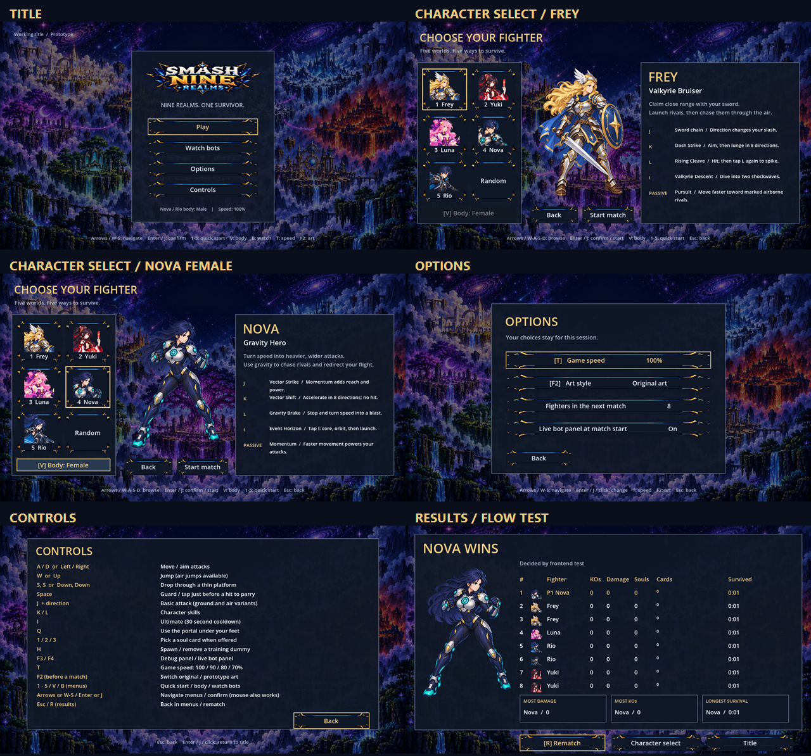
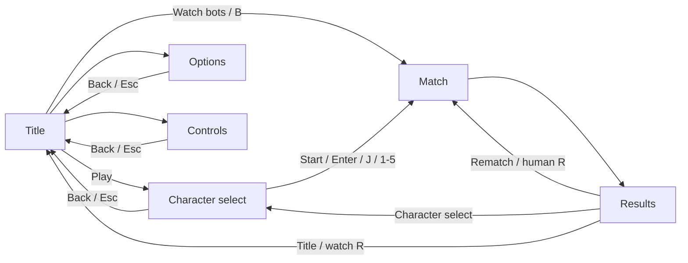

# CODEX-SYS-02 — 메뉴와 결과 화면

2026-10-22 · builder-ui · `codex/sys-02`

## 완료

기존 시작 화면의 텍스트 목록을 타이틀 메뉴, 캐릭터 선택, 옵션, 조작법 화면으로 확장했다. 결과 화면에는 우승자 일러스트, 초상화가 있는 순위표, 세 가지 시상과 이동 버튼을 추가했다. 화면 문구는 영어이며 기존 아트만 사용했다.

| 화면 | 구현한 내용 |
|---|---|
| Title | 기존 배경·로고, Play / Watch bots / Options / Controls, 체형·속도 표시 |
| Character select | 5인 초상화 그리드, 선택 테두리, 체형별 메인 아트, 이름·역할·2줄 설명, J/K/L/I와 패시브 설명, Random / Body / Back / Start match |
| Options | 속도 100/90/80/70%, 원본/프로토타입 아트, 다음 경기 4/6/8인, 시작 시 봇 패널 표시 |
| Controls | 이동·전투·카드·개발용 단축키와 메뉴 조작 안내 |
| Results | 우승자 메인 아트와 WINS / DRAW, 순위·초상화·KOs·피해·소울·카드 수와 이름·생존 시간, 최다 피해 / 최다 KO / 최장 생존, Rematch / Character select / Title |

캐릭터 설명은 `design/SKILLS.md`의 현재 동작을 짧은 영어로 옮겼다. 기존 `GameSpeed.cycle()`과 `ArtSettings.toggle()`을 호출하며 캐릭터 수치나 기술을 변경하지 않았다. 결과의 카드 칸에는 수와 이름을 함께 표시하고, 긴 이름은 말줄임하며 마우스를 올리면 전체 이름을 볼 수 있다.

## 변경한 파일과 책임

- `scripts/ui/FrontendMenu.gd`: 새 화면 표시, 포커스, 마우스·키보드 탐색, 아트 배치, 결과 통계·시상.
- `scripts/ui/MatchHud.gd`: 시작/결과 화면을 새 모듈에 연결. HP 바와 소울 카드 제안 패널 구현은 그대로 유지했다. 기존 HUD 프레임 노드와 테스트 계약도 유지했다.
- `scripts/Main.gd`: 메뉴 액션 연결, 시작·재대결·메뉴 복귀, 세션 설정과 기존 단축키 처리만 수정했다.
- `tests/test_frontend_flow.gd`: 실제 키·마우스 이벤트를 넣는 흐름 및 반복 검사. `-- --capture`로 실행 화면도 저장한다.
- `tests/run_all.ps1`: `test_restart` 바로 앞에 새 테스트 한 항목만 추가했다.
- `README.md`: 메뉴 조작과 결과 화면, 옵션 유지 범위를 설명했다.

몬스터, 하자드, 캐릭터, 전투 규칙 코드는 수정하지 않았다. 새 아트 생성, 패키지 설치, 파일 다운로드는 하지 않았다.

## 입력 맵

| 위치 | 입력 | 동작 |
|---|---|---|
| 메뉴 | 방향키 / W-S, Enter / J | 이동, 포커스가 있는 동작 실행 |
| 캐릭터 선택 | 방향키 / W-A-S-D / Tab | 그리드와 버튼 탐색, 캐릭터 미리보기 갱신 |
| 캐릭터 선택 | Enter / J | 초상화에 포커스가 있으면 선택한 캐릭터로 시작. 다른 버튼에서는 그 버튼 실행 |
| 메뉴 | 마우스 이동·클릭 | 포커스·미리보기 변경, 버튼 실행 |
| 타이틀·선택 | 1 / 2 / 3 / 4 / 5 | Frey / Yuki / Luna / Nova / Rio 즉시 선택·시작 |
| 경기 전 | V / Body 버튼 | Nova·Rio 남/여 체형 전환. 단일 체형 캐릭터의 버튼은 비활성 |
| 경기 전 | B / Watch bots | 봇 관전 시작 |
| 경기 전 | F2 / Art style 버튼 | 아트 변경 후 현재 메뉴로 복귀 |
| 모든 화면·경기 | T | 속도 선택 순환. 메뉴·결과는 정상 속도, 다음/현재 경기에 선택값 적용 |
| 경기 | F3 / F4 / H | 기존 디버그 / 봇 패널 / 연습 더미 기능 유지 |
| 메뉴 | Esc | 타이틀로 복귀 |
| 사람 경기 결과 | R / Rematch | 같은 캐릭터·체형으로 즉시 재대결 |
| 봇 관전 결과 | Rematch 버튼 | 봇 관전 즉시 재시작 |
| 봇 관전 결과 | R | 기존 `test_restart` 계약대로 깨끗한 타이틀로 재로딩 |
| 경기 중 | A/D, W, S-S, Space, J/K/L/I, Q, 1–3 | 기존 전투·이동·카드 입력 유지 |

봇 관전의 R은 기존 동작과 노드 기준선을 보존하는 호환 예외다. 관전을 바로 다시 보려면 기본 포커스인 Rematch에 Enter/J를 누르거나 클릭하면 된다. 사람 경기의 R은 같은 캐릭터·체형을 유지한다.

아트, 인원, 봇 패널, 체형은 장면을 다시 불러와도 현재 세션에 유지된다. 속도는 기존 저장 방식을 계속 사용한다. 경기 중 F4로 바꾼 봇 패널 상태도 다음 경기 옵션에 반영된다.

## 시각적 확인

위 그림은 실제 Godot 창에서 저장한 6장의 실행 화면이다. 결과 화면은 UI 흐름 테스트가 경기를 강제 종료한 화면이며, 긴 경기의 성적을 만들어 넣은 화면이 아니다.

원본 캡처: [타이틀](01-title.png), [Frey 선택](02-select-frey.png), [Nova 여성체 선택](03-select-nova-female.png), [옵션](04-options.png), [조작법](05-controls.png), [결과](06-results.png).

캡처 검수 중 로고·초상화가 원본 이미지 크기에 맞춰 커지던 문제를 수정하고, 슬롯 크기를 넘지 않는 회귀 검사를 추가했다. 선택 테두리와 키보드 포커스를 별도로 표시하며, 메인 아트가 하단 버튼과 겹치지 않도록 배치했다.

위 흐름에서 경기 이후의 전환은 새 장면을 불러와 이전 경기 노드를 정리한다. 세션 설정과 마지막 사람 캐릭터·체형은 별도로 보관한다.

## 확인 및 테스트

- `--headless --path smash-nine-prototype --import` 실행. 첫 시도에서 AppData 에디터 캐시 쓰기가 막혀 임시 APPDATA/LOCALAPPDATA로 재실행했다. 최종 import 로그는 [import.log](import.log).
- 전체 실행: `powershell -NoProfile -ExecutionPolicy Bypass -File reports/codex-sys-02/run_checks.ps1`. 내부에서 요청된 `tests/run_all.ps1` 전체 테스트와 기본 봇 경기 소크를 실행한다.
- `test_frontend_flow`: 타이틀→선택→확정, 5개 숫자키, Nova·Rio 체형별 아트, Random, 키보드/마우스, 옵션 순환·유지, F3/F4/H, 사람 R, 결과의 세 버튼, 봇 관전, 반복 후 노드·고아 노드 기준선, 창 크기 변경을 검사한다. 별도의 임시 통계 값으로 시상 대상, KO·피해·소울·카드 이름과 DRAW 표시를 확인한 뒤 실제 값을 복원하고 캡처한다.
- `test_restart`: 기존 테스트를 수정하지 않고 10회 재시작 기준선 검사를 유지했다.
- 실행 캡처: `powershell -NoProfile -ExecutionPolicy Bypass -File reports/codex-sys-02/run_checks.ps1 -Capture`. 창 한 개로 잠깐 실행 후 종료한다.
- 접촉 시트 재생성: `powershell -NoProfile -ExecutionPolicy Bypass -File reports/codex-sys-02/make_contact_sheet.ps1`.

테스트 판정에서 제외하는 것은 지시된 `ERROR: Failed to read the root certificate store.`와 해당 호출 위치 한 줄뿐이다. `GodotNoiseFilter.cs`는 이 두 줄 외의 모든 오류와 원래 종료 코드를 그대로 전달한다. [raw-logs/](raw-logs/)에는 인증서 오류를 포함한 원본 출력이 보존된다. 테스트 실행기의 오류 판정 코드는 바꾸지 않았다.

최종 결과는 [all-tests.log](all-tests.log), 창 실행 결과는 [capture-run.log](capture-run.log)에서 확인한다.

## 현재 상태 — 최종 검증

2026-10-22 01:53 KST에 마지막 전체 실행이 종료되었다.

| 확인 항목 | 결과 |
|---|---|
| 전체 실행기 | 34개 검사 + 봇 소크 1회, PASS 35개, 마지막 줄 `ALL PASSED`, 종료 코드 0 |
| 새 메뉴 흐름 | 키보드·마우스, 그리드 상하/좌우/Tab, 두 체형, 옵션, 결과 통계·시상·DRAW, 3개 복귀 경로 통과 |
| 반복 후 기준선 | 시작 화면 노드 1,193개, 고아 노드 0개, 2회 순환 후 증가 없음 |
| 기존 `test_restart` | 10회 모두 시작 화면 노드 1,193개로 복귀, 결과 뒤 전투 정지 검사 통과 |
| 봇 소크 | seed 1001, 260.3 게임 초에 Luna 우승, 탈락 7명, NaN 위치 0개 |
| 창 실행 | Intel OpenGL Compatibility 렌더러에서 흐름 검사 통과, 캡처 6장과 접촉 시트 생성 |
| 원본 로그 감사 | 로그 35개, 알려진 인증서 오류 35줄, 그 밖의 엔진 오류 0개 |
| 변경 범위 | 제품·테스트 변경은 카드 허용 경로 안에만 존재. import가 이번에 만든 범위 밖 UID만 정리했고 기존 미추적 파일은 보존 |
| 형식 | `git diff --check` 통과 |

스테이징을 실제로 시도했으나 `.git/index.lock: Permission denied`로 실패했다. 커밋은 생성되지 않았으며, 허용 경로만 스테이징·커밋하는 [commit.ps1](commit.ps1)과 [커밋 메시지](commit-message.txt)를 준비했다.

## 남은 작업 / 다음 권장 단계

- 필수 화면과 메뉴 흐름은 구현했다. 봇 관전 R의 호환 예외는 위 입력 표와 프로젝트 README에 명시했다.
- 웹 export와 실제 브라우저 조작 검수는 이 유닛에서 수행하지 않았다. 리드가 병합 후 웹 빌드에서 화면 크기와 입력을 확인하면 된다.
- 사람의 전투 조작감이나 캐릭터 밸런스를 평가한 작업은 아니다.
- 다음 권장 단계는 리드의 코드·캡처 검수, 쓰기 가능한 환경에서 `commit.ps1` 실행, 병합 후 웹 빌드 확인이다. 커밋 메시지 마지막에는 요청된 Codex 공동 작성자 표기가 있다.
