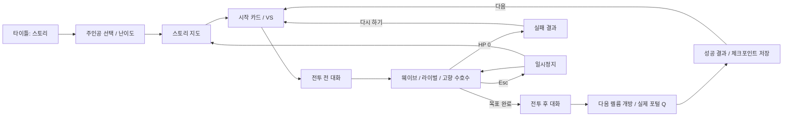
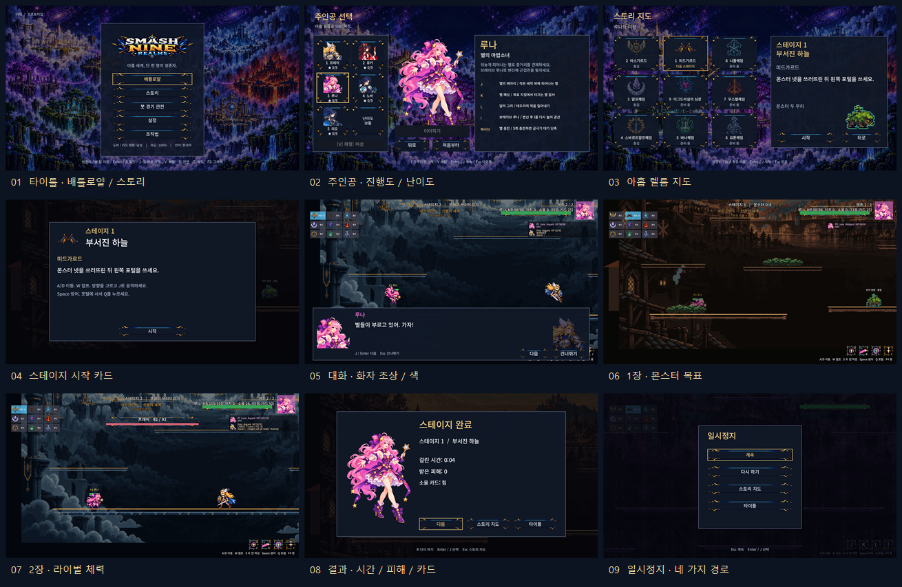

# CODEX-SYS-03 — 스토리 모드 뼈대

완료 범위: D43 / `design/tasks/CODEX-SYS-03.md`. 타이틀에서 다섯 주인공을 골라 1~4장, 대화, 실제 출구 포털, 결과까지 진행한다. 고향에서는 라이벌 대신 정예 수호수와 일반 몬스터 둘이 나온다. 이어하기·처음부터·완료한 장 재도전·체크포인트·쉬움/보통·일시정지를 연결했다.

5~9장은 데이터와 지도 표시만 준비했다. 실제 스테이지 실행은 막혀 있다. 대사는 교체를 전제로 한 짧은 임시 문장이다.

## 실행 흐름과 변경 경계



위 흐름에서 다음 장에 넘기는 값은 소울 정수와 카드 ID 목록이다. 각 장의 시작은 그 장의 체크포인트와 최대 HP로 복원한다. 소울은 직접 대입하고 카드만 `SoulCards.find()` → `apply_upgrade()`로 다시 적용하므로 지난 임계치 보상이 재발생하지 않는다. 이미 완료한 장을 다시 깨도 뒤쪽 체크포인트를 덮어쓰지 않는다.

| 파일 | 역할 |
|---|---|
| `scripts/story/StoryCatalog.gd` | 아홉 장의 순서, 규칙, 웨이브, 대사 ID, 고향 분기 데이터 |
| `scripts/story/StoryDirector.gd` | `MatchDirector.gd` 상속. 배틀로얄 타임라인·최후 생존자 판정을 실행하지 않고 HP 0 / 출구 사용으로 종료 |
| `scripts/story/StorySession.gd` | 주인공·적 생성, 체크포인트 적용, 웨이브 집계, 대화 동결, 보상, 출구, 일시정지, 라이벌 HP, 결과 |
| `scripts/story/StoryProgress.gd` | 캐릭터별 진행과 `user://story.cfg` 입출력 |
| `scripts/ui/StoryScreens.gd` | 기존 `FrontendMenu`의 그림·도우미·선택 배치를 재사용한 스토리 선택/지도/시작/일시정지/결과 |
| `scripts/ui/StoryDialogue.gd` | 화자별 초상·색·좌우 배치, 약 45자/실시간 1초, 빠르게 표시/다음/건너뛰기 |
| `scripts/Main.gd` | 모드·화면 전환과 스토리 연결 지점. 스토리에서 자동 몬스터/소울 수정 스포너를 동기화하지 않음 |

표의 경로는 `smash-nine-prototype/` 기준이다. `MatchHud.gd` 변경은 프런트엔드 스크립트를 `StoryScreens`로 연결하는 한 줄뿐이다. 기존 HP 막대와 소울 카드 패널은 수정하지 않고 호출한다. 새 라이벌 막대는 별도 노드이며 위험 알림은 스토리에서만 그 아래에 놓았다.

캐릭터, 봇, 몬스터, 렐름, `MatchDirector.gd`, `design/`는 수정하지 않았다. 타이틀의 첫 버튼은 배틀로얄로 유지하고 이름만 바꿨으며, 스토리는 두 번째다. 스토리 선택은 배틀로얄의 마지막 캐릭터 선택을 덮어쓰지 않는다.

## 현재 플레이 가능한 장

| 장 | 렐름 인덱스 | 일반 진행 | 같은 캐릭터가 주인공일 때 | 출구 |
|---|---:|---|---|---|
| 1 | 1, Midgard | 근접+원거리 두 무리를 차례로 처치, 총 4마리 | 동일 | 왼쪽 → Asgard |
| 2 | 0, Asgard | 프레이, HP ×0.8 | 정예 방패 숫양 + 일반 2마리 | 아래 → Alfheim |
| 3 | 3, Alfheim | 루나, HP ×1.0 | 정예 달 사슴 + 일반 2마리 | 아래 → Svartalfheim |
| 4 | 5, Svartalfheim | 리오, HP ×1.0 | 정예 톱니 딱정벌레 + 일반 2마리 | 오른쪽 → Vanaheim |

1장은 피해 배율 0.3, 링아웃 15, 비전투 회복 3이다. 2~4장은 피해 배율 0.4, 링아웃 20이다. 쉬움은 주인공의 받는 전투 피해 ×0.7, 적의 최대 HP ×0.8이다. 라이벌이 쓰러지면 소울 15를 추가한다. 카드 제안이 남으면 출구에서 먼저 카드를 고르게 한다.

라이벌 체형은 첫 번째 등록 체형으로 고정했다. 프레이·루나는 여성, 리오는 남성이며 지도·대화·VS의 얼굴과 실제 전투 체형이 일치한다. 노바·리오 **주인공**의 체형은 V 선택을 따른다.

## 데이터 형식

`StoryCatalog.stages()`는 `Array[Dictionary]`, `stage(n)`은 1부터 시작하는 장 번호를 받는다.

| 필드 | 형식 / 의미 |
|---|---|
| `id`, `realm`, `exit` | 장 번호 `int`, `RealmCatalog` 인덱스 `int`, 다음 렐름 방향 `Vector2i`. 8·9장은 `Vector2i.ZERO` |
| `title`, `goal`, `tips` | `story.csv` ID, ID, ID 배열 |
| `rival`, `home_elite` | 캐릭터 ID 또는 빈 문자열, 해당 렐름 근접 몬스터 스킨 ID |
| `waves` | 웨이브 배열의 배열. 준비된 장은 `{kind: melee/ranged, skin, elite?}` 또는 `{kind: rival, id}` |
| `rules` | `damage_scale`, `ringout_damage`, `recovery`, `aggression`, `hazards`. 후속 장용 `escape_seconds`, `shrink`, `intermission_heal`도 기록 |
| `rival_mods` | `{hp: 배율, cards: 카드 ID 배열}` |
| `souls_reward` | 라이벌 처치 추가 소울 정수 |
| `dialogue` | `pre`, `post`, `home_pre`, `home_post` 각각 `[speaker, id]` 행 배열 |
| `ready` | 실행 허용 여부. 현재 1~4만 `true` |

렌더링/저장 데이터와 화면용 문자열은 분리했다.

* 화면 단어: `assets/i18n/strings.csv`, `keys,en,ko`, 영어 원문 키. 총 362개(47개 추가).
* 스토리: `assets/i18n/story.csv`, 같은 열 구조, 총 82개 ID. 예: `story.s01.title`, `story.s02.pre.1`, `story.s03.home_post.1`, `story.voice.frey.challenge`, `story.voice.frey.victory`.
* 화자: `narrator`, `hero`, `rival`, 또는 `frey`/`yuki`/`luna`/`nova`/`rio`. 해설은 초상 없이 가운데, 주인공은 왼쪽, 다른 화자는 오른쪽이다. 말하지 않는 얼굴은 어둡게 한다.
* ID의 `{hero}` / `{rival}`은 캐릭터 ID로 치환한 뒤 `tr()`에 넣는다. **문장 안** `%s`는 번역된 주인공 이름이다. 두 언어의 `%s` 개수는 같아야 한다.
* `project.godot`에는 `story.en.translation` / `story.ko.translation` 두 항목만 추가했다. 부분 글꼴 도구의 입력 목록과 글꼴 검사에 `story.csv`를 추가했다. 글꼴 재생성이나 패키지 설치는 하지 않았다.

저장 구조는 ConfigFile의 `meta/version=1`, `runs/<캐릭터 ID>`이다.

```gdscript
{
    "cleared": 2,
    "difficulty": "normal", # 또는 easy
    "done": false,
    "checkpoints": {
        "1": {"souls": 0, "cards": []},
        "2": {"souls": 28, "cards": ["power"]},
        "3": {"souls": 62, "cards": ["power", "power"]}
    }
}
```

같은 능력치 카드를 여러 번 고른 경우도 보존한다. 유효한 카드 ID만 최대 3장 읽는다. 저장한 캐릭터의 난이도를 선택 화면에서 바꾸면 진행도는 유지하고 그 난이도로 이어간다. 헤드리스나 `-s`/`--script` 실행은 실제 저장 내용을 읽거나 쓰지 않는다. 테스트는 명시한 임시 경로로만 ConfigFile 왕복 입출력을 검사하고, 실제 파일은 존재 여부·수정 시각만 확인한다.

F2용 임시 상태는 영구 저장과 별개다. 화면/대화 줄/웨이브/처치 수/소울/카드/HP/카드 제안/시간을 이어서 복원한다. 아트 재로드는 현재 공격과 일시적인 캐릭터 상태를 새 노드에서 다시 시작하는 개발용 동작이며 전투 리플레이를 저장하는 기능은 아니다.

## 입력표

| 화면 | 키보드 / 마우스 |
|---|---|
| 타이틀 | Enter/J 첫 버튼 → 배틀로얄 선택. 1~5 빠른 배틀로얄 시작, B 봇 관전, V 체형, T 속도, F2 아트 유지 |
| 스토리 선택 | 1~5는 **선택만**. 방향키/WASD/Tab 또는 초상 클릭, V/체형 버튼, Enter/J 이어하기(저장이 없으면 처음부터), 이어하기/처음부터/난이도 버튼, Esc 타이틀 |
| 스토리 지도 | 방향키/WASD/Tab 또는 칸 클릭. Enter/J/시작 버튼으로 열린 장 시작. Esc 주인공 선택. 완료한 장 재도전 가능 |
| 시작 카드 | Enter/J/시작 버튼 또는 실시간 2.5초 → 대화 |
| 대화 | J/Enter: 전체 문장 표시 → 다음 줄. Esc/건너뛰기: 장면 생략. 다음 버튼도 사용 가능 |
| 전투 | 기존 A/D·W·S+S·Space·J/K/L/I. 1~3 소울 카드. Q 실제 출구. Esc 일시정지. T 속도, F3 디버그, F4 봇 패널, H 더미 유지 |
| 일시정지 | 계속 / 다시 하기 / 스토리 지도 / 타이틀. Esc 계속. 트리와 게임 시간을 함께 정지해 지연 공격 준비 시간도 보존 |
| 결과 | 다음 / 지도 / 타이틀, 실패 시 다시 하기. R 해당 장 체크포인트 재시도, Esc 지도 |
| 스토리의 F2 | 선택·지도·시작·대화·전투·일시정지·결과의 해당 화면으로 재로드. 일시정지 상태와 열린 출구도 복원 |

## 실제 캡처



타이틀 입구부터 선택·지도·대화·전투·라이벌 HP·결과·일시정지까지 실제 Godot 창에서 캡처했다. 이미지 속 처치는 흐름 검사에서 공개 `apply_hit`로 진행한 것이며, 표시된 짧은 클리어 시간은 실전 난이도 측정값이 아니다.

추가 화면: [출구 개방](10-exit-open-ko.png), [VS 시작 카드](11-stage-two-start-ko.png), [프레이의 고향 수호수](12-home-guardian-ko.png), [4장 후 준비 중](13-coming-soon-ko.png), [라이벌 HP 아래 위험 알림](14-rival-warning-ko.png), [주인공 대화](15-dialogue-hero-ko.png), [라이벌 대화](16-dialogue-rival-ko.png). 기본 흐름 14장에 화자 초상 확인 2장을 더했다. 말하지 않는 쪽의 얼굴이 어두워지는 것을 실제 화면과 상태 값으로 확인했다. 창 실행은 한 번에 하나씩 닫았고 실제 엔진 실행은 최대 둘만 병행했다.

## 확인 및 테스트

* 전체 게이트: `powershell -ExecutionPolicy Bypass -File smash-nine-prototype/tests/run_all.ps1` → **41개 검사 + 봇 소크 1회, ALL PASSED**. [최종 로그](tests-final.log), 각 테스트의 표준 출력/오류 원문은 `raw-logs/`.
* `test_story_data`: 1,187항목. 9장 순서·렐름·출구, 모든 화자/ID 확장, 82개 양언어 ID, ConfigFile 임시 경로 왕복, 중첩 카드 보존, 캐릭터별 격리, 쉬움 배율, 배틀로얄 타임라인 없음.
* `test_story_flow`: 헤드리스 257항목. 실제 키/마우스 입구, 5명 × 4장 클리어, 세 고향 분기, 카드/소울 체크포인트, 실패/R/일시정지 재시도, 이어하기, 완료한 장 재도전, 4장 이후 지도, F2 각 화면, 열린 출구 Q, 일시정지 중 지연 공격, 라이벌 성장 후 HP 배율, 실제 파일 무변경. 노드 1,235·고아 노드 0으로 타이틀 복귀.
* `test_frontend_flow`: 기존 1~5·V·B·F2·T·F3·F4·H·R과 결과 경로 유지. 타이틀 순서에 필요한 키/버튼 인덱스만 조정.
* `test_restart`: 기존 파일 변경 없이 10회 재시작 통과, 기준 노드 1,235 유지.
* 창 실행 `--capture`: 285항목 통과, 한국어 14장. 별도 화자 캡처 2장과 좌우 초상/어두움 처리 확인. [흐름 캡처 로그](capture-verified.log), `dialogue-capture.log`.
* `test_language` / `test_font_coverage`: 362개 화면 키, 78개 `tr` 리터럴, 한국어 스토리 화면 상자 검사, 두 번역표의 24,198자 글꼴 검사 통과.
* 배틀로얄 봇 소크 seed 1001: 331.7초, 승자 Nova, `match_over=true`, NaN 0. 캐릭터/봇/매치 규칙 변경 없음.

변경 경계와 LF/공백 검사 결과는 `scope-check.log`에 남겼다. 중간 시행 로그는 `diagnostics/`, 의도한 수정 전 실패 기록은 이름에 `before`가 붙은 로그에 보존했다.

발견하고 고친 회귀도 남겼다.

| 재현 | 수정 / 증거 |
|---|---|
| 해제된 투사체를 `Node` 타입 루프 변수로 받는 순간 오류 | `Variant`로 받은 뒤 유효성 확인. `regression-before-freed-fix.log`는 의도한 수정 전 실패 기록. 시간차 처치·투사체 정리·대화 후 실제 이동을 흐름 검사에 추가 |
| 라이벌 HP와 위험 알림 사각형 겹침 | 스토리 위험 알림만 y=158. `warning-before.log`: true, `warning-after.log`: false. 배틀로얄 위치는 그대로 |
| 트리만 멈추면 지연 공격 타이머가 진행 | 수정 전 `pause-before.log`: 멈춤 중 공격 영역 1개 생성. 게임 시간도 정지하면 0개, 재개 후 1개(`pause-zero-scale.log`). 흐름 검사에서 같은 준비 시간 보존 확인 |
| 라이벌 카드 획득으로 스테이지 HP 배율이 사라짐 | 쉬움 프레이, 수정 전 127 / 기대 81.28(`rival-growth-before.log`), 수정 후 81.28(`rival-growth-after.log`). 카드 획득 뒤 배율과 회복량을 보정하고 F2에도 라이벌 카드·소울·제안을 보존 |
| 빠른 헤드리스 렌더 프레임이 착지/물리 입력보다 먼저 진행 | 흐름 검사는 물리 프레임도 기다림. 공개 Q 입력으로 실제 포털 진입 확인 |
| 번역 출력이 없는 체크아웃에서 가져오기 전에 누락 경로 오류 발생 | 생성된 `story.en.translation`을 임시 보관해 재현. 가져오는 동안 번역 목록만 비우고 `finally`로 프로젝트 원문 바이트를 복원. `fresh-import-tests.log`의 `PASS translation import`로 자동 가져오기 경로 확인 |

인증서 오류는 알려진 샌드박스 소음 **한 줄만** 제외한다. 모든 다른 `SCRIPT ERROR` / `ERROR` / `Parse Error`와 비정상 종료는 실패다. 처음 기본 엔진의 편집기 설정 저장이 실패해, 임시 폴더의 self-contained 엔진 복사로 다시 가져왔다. `import-verified.log`에는 편집기 저장 오류가 없다. 실제 엔진은 같은 4.7 바이너리이고 설치·다운로드는 하지 않았다.

루트에서 재현:

```powershell
node reports/codex-sys-03/check.mjs import
$env:GODOT_TEST_LOG_DIR = Join-Path (Get-Location) 'reports/codex-sys-03/raw-logs'
powershell -ExecutionPolicy Bypass -File smash-nine-prototype/tests/run_all.ps1
node reports/codex-sys-03/check.mjs capture
& 'C:/Users/TH/Downloads/Godot_v4.7-stable_win64.exe/Godot_v4.7-stable_win64_console.exe' --path smash-nine-prototype -s ../reports/codex-sys-03/capture-dialogue.gd
powershell -ExecutionPolicy Bypass -File reports/codex-sys-03/contact-sheet.ps1
```

`check.mjs import`는 기본 AppData 쓰기를 피하도록 `%TEMP%/smashnine-sys03-godot`에 엔진 두 파일과 `_sc_` 마커를 준비한다. 다른 환경에서 기본 가져오기가 잘 되면 카드의 일반 `--headless --path smash-nine-prototype --import` 명령을 사용해도 된다. CSV를 고친 뒤에는 반드시 다시 가져와야 한다.

`run_all.ps1`의 누락 파일 자동 가져오기는 시작 시 번역 목록의 누락 경로 오류를 피하기 위해 해당 목록만 잠깐 비운다. 성공·실패와 관계없이 원문을 복원한 뒤 테스트를 시작한다. 일반 테스트 실행에서는 이 분기로 들어가지 않는다.

## 남은 작업 / 다음 카드

* SYS-03 밖: 5장 붕괴 시간제한·수정 3개, 7장 보스·증원, 9장 그림자 두 단계·축소 띠·엔딩. 6·8장도 현재 잠겨 있다. **`ready`만 켜면 되는 상태는 아니다.** 후속 특수 웨이브/목표 처리부터 구현해야 한다.
* 리드의 정식 대본 교체와 그때의 부분 글꼴 재생성. 현재 ID는 그대로 문장만 교체할 수 있다.
* 자동 전투 클리어 검사는 강제 피격을 사용한다. 실제 손 조작의 난이도·전투 길이·튜토리얼 전달력은 사람 검토와 후속 QA가 필요하다.
* 실제 사용자 저장 파일을 대상으로 하는 수동 저장/재실행 검사는 하지 않았다. 입출력 자체는 임시 파일로 왕복 검증했다.
* 웹 export/게시/병합은 수행하지 않았다(리드 담당).

이 샌드박스에서는 `git add`가 `.git/index.lock: Permission denied`(종료 128)로 실패해 **실제 커밋은 만들지 못했다**. `git-stage.log`에 원문을 남겼고 인덱스는 변경되지 않았다.

`commit.ps1`에 카드 허용 경로만 명시했다. 일반 쓰기 권한이 있는 환경에서 아래 명령으로 같은 브랜치에 커밋할 수 있다. 기존 인덱스에 다른 작업이 들어 있으면 멈추며, 병합·푸시는 하지 않는다. 메시지 마지막 줄은 요청한 `Co-Authored-By: Codex <noreply@openai.com>`이다.

```powershell
powershell -ExecutionPolicy Bypass -File reports/codex-sys-03/commit.ps1
```
