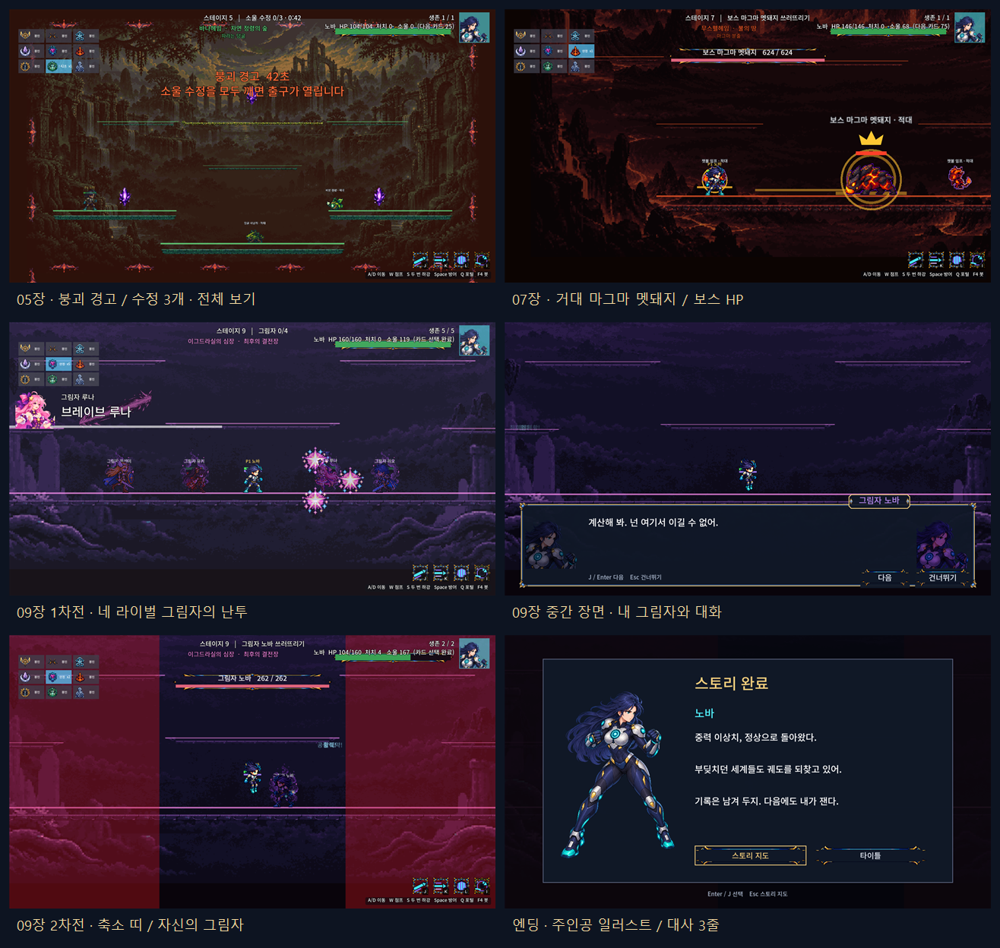

# CODEX-SYS-04 — 스토리 5–9장과 엔딩

완료: 5장 붕괴 탈출, 6·8장 결투와 고향 분기, 7장 보스와 증원, 9장 그림자 두 차례 전투·중간 장면·주인공 전용 축소 띠, 캐릭터별 엔딩과 CLEAR 저장을 연결했다. 아홉 장 모두 지도에서 준비된 상태이며, 앞 장을 완료해야 다음 장이 열린다.

현재 전체 게이트는 **48개 검사 + 배틀로얄 소크 1회, `ALL PASSED`**다. 별도로 모든 등록 체형 × 보통/쉬움의 14개 연속 여정을 타이틀부터 엔딩까지 확인했다. 아래 진행 검사는 강제 처치를 사용하므로 사람의 전투 난이도를 검증했다는 뜻은 아니다.

## 구현한 진행

| 장 | 실제 동작 | 다음으로 가는 방법 |
|---|---|---|
| 5 · 바나헤임 | 전투 시작 시 60초 붕괴 경고. 소울 수정 3개, 먼저 덤비는 사냥개·씨앗 정령. 수정마다 기존 보상 10 소울. 세 개를 깨면 경고 중지, 시간 초과면 실패 | 전투 후 대화 → 오른쪽 실제 포털에서 Q → 요툰헤임 |
| 6 · 요툰헤임 | 노바 HP ×1.2, Power 1장, 지진. 노바 주인공이면 정예 수호수 + 일반 둘 | 전투 후 대화 → 위쪽 실제 포털에서 Q |
| 7 · 무스펠헤임 | 거대 마그마 멧돼지, 위쪽 보스 이름·HP 막대, 분출 유지. 생존 중 20초마다 잿불 임프 둘, 살아 있는 증원 최대 넷. 보스만 처치하면 목표 완료 | 전투 후 대화 → 남은 증원 정지 → 위쪽 실제 포털에서 Q |
| 8 · 니플헤임 | 유키 HP ×1.3, Power·Sky Step, 빙판. 유키 주인공이면 고향 수호수 분기 | 기존 뿌리 그림과 후속 대화 → 새 카드 제안이 있으면 기존 패널에서 먼저 선택 → 결과 → 9장 |
| 9 · 심장 | 나머지 네 캐릭터의 그림자 난투, HP ×0.6. 모두 쓰러지면 최대 HP의 30% 회복(상한 적용), 중간 대화. 이어 같은 캐릭터·체형의 내 그림자, 카드 셋을 적용한 HP ×1.5 | 내 그림자 처치 → 기존 에필로그 그림·후속 대화 → 주인공 일러스트와 엔딩 3줄 → 지도 / 타이틀 |

9장 2차전의 안전 띠는 전체 너비에서 시작해 60초 동안 20%까지 줄어든다. 밖에서는 **주인공만 8 HP/초**를 받으며, HP 0이면 실패한다. 링아웃은 30이다. 네 라이벌과 주인공은 기존 난투 표적 목록을 공유하므로 그림자끼리도 싸운다.

5장의 세 번째 수정은 기존 높은 덩굴 다리 위에 있다. 그 장의 **현재 hazard 인스턴스 데이터만 복제**해 다리 후보를 해당 다리 하나로 한정했고, 첫 경고를 전투 시작에 발동한다. 필요한 다리가 한 번도 선택되지 않는 시드가 생기지 않게 했다. 렐름 레이아웃과 배틀로얄의 덩굴 선택은 그대로다.

## 새 옵션과 데이터

### 몬스터 옵션

`scripts/RealmMonster.gd`에 추가했다. 기본값은 `hostile=false`, `is_boss=false`다.

| 항목 | 의미 |
|---|---|
| `hostile` | 맞기 전에도 같은 렐름의 살아 있고 활성화된 가장 가까운 플레이어를 찾는다. 기존 추적 범위인 가로 `720 × WORLD`, 세로 `360 × WORLD` 안에서 찾는다 |
| `make_boss()` | 중복 호출해도 한 번만 적용. 정예로 만든 뒤 HP ×4, 피해 ×2, 준비 시간 ×1.2. 몸 크기는 최종 ×2, 공격 거리·근접 몸 판정도 몸에 맞춰 ×2 |
| 보스 넉백 | 근접·투사체 모두 기본 넉백 420 상한 |
| 보스 생성 | 스토리 세션이 직접 생성하며 배틀로얄 스포너의 재생성 슬롯에 등록하지 않는다. 죽으면 재생성하지 않는다 |

마그마 멧돼지의 현재 보통 HP는 **624**(기본 52 → 정예 156 → 보스 624), 쉬움은 499.2다. 피해와 준비 시간의 추가 배율은 **정예 기준**이다. `make_boss()` 자체가 `hostile`을 켜지는 않으며, 스토리 7장의 생성 데이터가 함께 켠다.

### 스토리 데이터와 저장

`StoryCatalog.gd`의 추가 필드는 `objective`, `crystals`, `reinforcements={interval,count,limit,skin}`, `shadow_band={seconds,fraction,damage}`다. 그림자 HP·카드 수는 기존 `waves` 값을 주인공별 실제 웨이브로 풀어서 사용한다. 첫 증원 시점도 `reinforcements.interval`을 읽는다. 다음 난이도 작업에서 값을 바꿨는데 실행은 다른 상수를 쓰는 일이 없도록 회귀 검사했다.

`StoryDirector.gd`가 경고 마감과 축소 띠 시간을 소유하고, `StorySession.gd`가 수정·증원·웨이브·대화·보상 전환을 소유한다. 전투 중 F2는 수정의 남은 타격 수, 증원, 보스 HP, 그림자 카드, 경고 마감, 띠 시작 시간도 복원한다. 열린 출구에서는 남아 있는 적을 F2 뒤에도 정지시킨다.

그림자는 보라색 몸 색조, 번역된 `Shadow %s`, 기존 ART-70 오라를 사용한다. 이름 글자는 몸 색조를 상쇄해 보라색 연무 위에서도 읽히게 했다([보정 전](diagnostics/shadow-labels-before.png)). `Vfx.gd`에는 `shadow_aura` 한 항목(6칸, 10fps, 발 기준점 64/160, 일반 알파 혼합)만 추가했다. 대화의 새 `shadow` 화자는 주인공과 같은 체형의 얼굴을 보라색으로 칠해 오른쪽에 놓는다.

기존 `StoryProgress.complete_stage()`의 `done` 플래그를 엔딩에 연결했다. 저장 형식은 바꾸지 않았다. `story.csv`의 기존 138개 양언어 ID를 그대로 사용했고, 화면 단어 12개만 `strings.csv`에 추가해 다시 가져왔다. 화면 키는 총 374개다.

## 실제 화면



위 합본은 실제 Godot 창에서 찍은 한국어 화면 여섯 장이다. 위쪽부터 수정 탈출·보스·그림자 난투·그림자 대화·축소 띠·엔딩 순서다. 그림자 대화에서도 기존 9-slice 상자와 이름판을 사용한다.

| 파일 | 확인하는 내용 |
|---|---|
| [00 · 수정 전체 보기](00-stage-five-overview-ko.png) | 수정 세 개의 실제 배치와 붕괴 목표. **검사용 화면에서만** 카메라를 0.62로 넓혔다. 게임 카메라 코드는 바꾸지 않았다 |
| [01 · 덩굴 다리 위 수정](01-stage-five-crystals-ko.png) | 기본 게임 카메라, 수정 1/3·42초, 수정이 출구를 연다는 경고 문구 |
| [02 · 보스전](02-stage-seven-boss-ko.png) | 두 배 크기 멧돼지, 보스 이름·624 HP, 잿불 임프 |
| [03 · 라이벌 그림자 넷](03-stage-nine-rivals-ko.png) | 네 몸 색조와 오라, 기존 기술 사용. 판독을 위해 검사용 배치에서 같은 바닥에 모았다 |
| [04 · 그림자 화자](04-stage-nine-shadow-dialogue-ko.png) | 오른쪽의 같은 체형 초상·보라색·이름판, 경기 HUD 숨김 |
| [05 · 축소 띠](05-stage-nine-band-ko.png) | 20% 안전 구간과 내 그림자의 오라·HP 막대 |
| [06 · 엔딩](06-story-ending-ko.png) | 주인공 메인 일러스트, 기존 엔딩 3줄, 지도 / 타이틀 |
| [07 · 보스 후속 장면](07-boss-post-warning-hidden-ko.png) | 밑에서는 분출 경고가 정지한 상태지만, 대화 위에 경고나 HP·미니맵이 나타나지 않음 |
| [08 · 아홉 장 지도](08-story-map-all-ready-ko.png) | 완료된 메모리 진행으로 아홉 장 모두 선택 가능, 9장의 그림자 초상·목표 표시 |
| [09 · CLEAR 선택 화면](09-story-clear-select-ko.png) | 노바의 완료 표시와 다른 캐릭터의 별도 진행 상태 |
| [10 · 시간 초과 결과](10-stage-five-time-up-ko.png) | 실제 경고 시간을 60초 진행한 실패 결과, 한국어 사유와 재시도 버튼 |

캡처는 한 번에 창 하나만 열어 짧게 실행했다. 진행 캡처와 연속 여정은 보호된 주인공과 공개 피격 API로 목표를 완료했다. 사진의 전투 시간·HP를 사람의 실전 기록으로 해석하면 안 된다. 별도로 아래 5장 이동 경로와 실제 봇 전투를 검사했다.

한국어 원본은 총 **11장**이다. 마지막 지도·CLEAR 화면은 완료된 진행을 메모리에 구성한 표현 검사이며 실제 사용자 저장 파일의 기록이 아니다. 시간 초과 화면은 실제 디렉터의 마감 판정으로 만들었다. [보완 캡처 로그](completion.log)에 검사를 남겼다.

## 확인 및 테스트

* **전체 게이트:** `powershell -ExecutionPolicy Bypass -File smash-nine-prototype/tests/run_all.ps1` → **48개 검사 + 소크 1회, ALL PASSED**. [최종 로그](all.log), [테스트별 원문](raw-logs/), [검증 요약 JSON](validation-summary.json).
* **배틀로얄 소크:** seed 1001, 331.7초, 노바 승리, `match_over=true`, NaN 위치 0. 기본 몬스터·기믹·매치 규칙 검사도 통과했다.
* **기존 몬스터 생태:** 파일 변경 없이 250항목 통과. 새 옵션 16항목은 기본 중립 유지, 선제 표적 선택과 실제 충돌 공격, 보스 수치·판정·사망을 확인한다.
* **스토리 데이터:** 1,672항목. 아홉 장 준비, 모든 화자·ID, 다섯 주인공의 중간 대화·엔딩, 튜닝 데이터 반영, 임시 ConfigFile의 `done` 저장 왕복을 확인했다.
* **기존 흐름:** 259항목. 5명 × 1–4장, 세 고향 분기, 키·마우스, 카드·Q, 실패·일시정지·이어하기·F2·노드 정리 검사를 유지했다.
* **후반 흐름:** 기본 노바·유키 194항목, 별도 [다섯 주인공 확장](matrix.log) 458항목. 5–9장, 6·8장 두 고향, 시간 초과, 수정 성공, 보스 증원 상한, 중간 장면, 내 그림자, 주인공 전용 띠, 엔딩을 확인했다.
* **연속 여정:** [1,051항목 / 14회](journey.log), [결과 JSON](continuous-journeys.json). 등록된 7체형 × 보통/쉬움 모두 실제 타이틀·선택·지도·9개 장·Q 출구·엔딩을 이어서 진행했다. 각 장의 소울·카드가 다음 체크포인트와 일치했고, 모두 9장 CLEAR·288 소울·카드 3장으로 끝났다.
* **확장 F2 여정:** [4,859항목 / 추가 14회](journey_reload.log), [결과 JSON](continuous-journeys-reload.json). 시작 카드·전/후 대화·전투·중간 장면·출구·결과·엔딩에서 재로드를 반복해 모든 체형과 두 난이도의 진행·소울·카드·체형·화면·웨이브·고정 화면 HP가 유지됨을 확인했다.
* **보상·실패 경계:** 24항목. 8장 카드 대기/F2/다음 체크포인트, 쉬움 그림자 성장 배율, 회복 상한, 주인공이 띠 피해로 실제 실패하는 경우와 9장 재시도.
* **표현·재로드:** 열린 5·7장 출구의 남은 몬스터 정지 8항목. 기존 장면 그림·9-slice·이름판과 위험 예고 중 대화의 HUD 숨김도 확인했다.
* **문장 크기:** 한국어·영어 520개 대화/엔딩 문장. 최대 실제 높이는 대화 **58/120px**, 엔딩 **58/80px**다. 번역·글꼴 검사도 통과했다.
* **같은 프레임 재로드:** 13항목. 마지막 수정, 1·9장 치명타, 보스 처치 직후의 예약된 완료/실패를 F2가 보존하고, 실패 결과의 재로드도 사망 상태를 유지한다.

테스트와 캡처는 `-s`로 실행해 실제 `user://story.cfg`를 읽거나 쓰지 않았다. 입출력 검사는 명시한 임시 파일에서만 했다. 실제 파일 존재 여부·수정 시각이 바뀌지 않는 검사도 포함한다.

이 환경의 기본 편집기 설정 저장은 AppData 쓰기 문제로 실패했다. `check.mjs import`는 **이미 있는 동일한 4.7 실행 파일을 TEMP에 복사**하고 self-contained 설정으로 가져온다. 설치·다운로드는 하지 않았다. [성공한 가져오기](import.log), [최초 환경 오류](diagnostics/import-initial.log)를 구분해 남겼다.

알려진 `ERROR: Failed to read the root certificate store.`만 별도로 제외했다. 다른 `SCRIPT ERROR` / `ERROR` / `Parse Error`나 비정상 종료는 실패로 처리했다. 실제 엔진 실행은 최대 둘만 병행했다.

마지막 전체 재검사 중 기존 `test_luna_kit`의 이동 중 별빛 잔상 검사가 4회 중 1회 명중을 놓쳐 실패한 실행이 있었다. [해당 전체 로그](diagnostics/final-gate-luna-intermittent.log)와 [엔진 원문](diagnostics/luna-intermittent-engine.log)을 보존했다. 같은 소스의 [단독 재실행](test_luna_kit.log)은 통과했다. 캐릭터와 해당 검사 파일은 수정하지 않았으며, 이 간헐 실패를 인증서 잡음처럼 제외하지 않았다. 위의 최종 전체 로그와 별도로 리드가 확인할 항목이다.

### 재현한 뒤 고친 경계 문제

| 재현 | 수정 / 수정 전 증거 |
|---|---|
| 8장에서 마지막 처치로 카드 제안이 열리면, 포털 없는 전환이 먼저 저장되어 보상을 잃음 | 기존 카드 패널을 고른 뒤 체크포인트 9 저장. [수정 전 실패](regression-before-root-reward.log) |
| 5·7장 출구가 열린 뒤 F2하면 살아 남은 적이 다시 움직임 | 출구 복원 뒤에도 남은 적 정지. [수정 전 실패](regression-before-exit-reload.log) |
| 주인공별 그림자 웨이브를 풀 때 카탈로그의 HP·카드 값을 무시함 | 실제 `waves` 데이터에서 읽음. [수정 전 실패](regression-before-shadow-data.log) |
| 목표 완료 때 켜진 렐름 위험 예고가 대화 다음 프레임에 다시 나타남(2·7장 재현) | 장면의 매 프레임에 기존 전체 HUD 숨김 유지. [수정 전 실패](regression-before-scene-warning.log) |
| 마지막 수정이나 치명타의 예약된 콜백보다 F2 스냅샷이 앞서면 3/3에서 멈추거나 HP 0이 살아 있는 상태로 복원됨 | 복원 뒤 완료된 수정 목표를 다시 판정하고, HP 0은 기존 사망 API로 복원. [수정 전 실패](regression-before-atomic-reload.log) |

`diagnostics/first-gate-language-fixture.log`는 엔딩 검사 뒤 선택 캐릭터를 복원하지 않았던 **검사 코드**의 초기 실패다. 선택을 프레이로 복원한 뒤 전체 검사를 통과했다. 수정 전/초기 로그는 최종 통과 로그와 구분했다.

## 다음 난이도 작업에 넘길 자료

### 5장의 물리 경로

[이동 경로 스크립트](escape-route-probe.gd)는 순간이동·수정 직접 피격 없이 실제 이동, 점프, J, S+S 하강, 카드 선택, Q만 사용한다. 피해를 막는 보호는 켰으므로 **지형과 공격 도달 가능성 검사**다.

| 주인공 | 3개 파괴 + 실제 출구 완료 |
|---|---:|
| 프레이 | 14.6초 |
| 루나 | 11.8초 |
| 유키 | 13.4초 |
| 노바 | 12.3초 |
| 리오 | 13.2초 |

각 `route-<id>.log`에 좌표와 수정별 시간이 있다. 유키는 수정과 겹쳐 서기보다 조금 떨어져 쏘는 경로, 노바는 더 가까운 주먹 거리로 검사했다. 처음 하는 사람이 높은 덩굴 다리와 S+S 하강을 찾는 데 드는 시간은 별도 확인해야 한다.

### 변경하지 않은 봇으로 실제 전투 20회

[원문](combat.log), [전체 20회 JSON](combat-probe.json), [8장 대치 재검사](combat-probe-stalls.json). seed 20261022, 보통, 이전 장에서 75 소울과 Power·Vitality·Sky Step을 가진 고정 조건이다. 주인공 자리도 기존 봇으로 조작했고 검사용 강제 처치·추가 무적은 켜지 않았다. 엔진 오류 없이 끝났지만 **사람 난이도나 승률을 확정하는 표본이 아니다**.

| 장 | 관찰 |
|---|---|
| 6 | 4/5 목표 처치, 유키는 132.3초에 패배 |
| 7 | 5/5 보스 처치. 45.6–205초, 중앙값 67.3초. 유키는 205초·잔여 HP 10.7로 편차가 큼. 증원 생존 최대 넷 확인 |
| 8 | 프레이·루나는 67.7/83.9초에 처치. 유키·노바·리오는 240초까지 목표가 남음 |
| 9 | 다섯 명 모두 1차전은 14.3–65.3초에 완료하고 2차전에서 패배. 주인공 봇도 띠를 모르므로, 공격 피해와 띠 밖 체류(1.9–19.9초)가 섞인 결과를 사람 난이도로 쓰면 안 됨 |

8장 재검사의 마지막 위치·표적·행동 이유도 기록했다. 유키 고향에서는 높은 곳의 Frost Owl이 남았고 주인공은 `no target: wandering`이었다. 노바·리오 경우에도 복귀/다른 층 상태와 유키의 대기가 관찰되었다. **체력 수치만의 문제라고 단정하지 말고**, 여러 시드·실제 사람 입력으로 먼저 재현할 자료다. `EnemyAI.gd`와 캐릭터 코드는 손대지 않았다.

다음 권장 단계는 5장 첫 플레이의 길 찾기, 7장 캐릭터별 처치 시간 편차, 8장의 대치 원인, 9장 내 그림자 HP ×1.5와 띠 압박을 측정하는 것이다. 쉬움은 기존의 받는 전투 피해 ×0.7·적 HP ×0.8을 따른다. 보스도 기존 몬스터의 낙사 처리를 사용하므로 밀어 떨어뜨리는 공략도 사람 QA에서 함께 확인하면 된다.

이번 전투 비교의 75 소울·고정 카드 조건은 비교용이다. 실제 난이도 판정에서는 연속 진행으로 만들어진 장별 체크포인트의 소울·카드도 사용하고, 특히 9장은 띠를 의식해 조작하는 사람 입력으로 측정해야 한다. 비교용 봇 기록만 보고 HP나 띠 피해를 낮추는 판단은 보류하는 편이 좋다.

## 변경 경계 / 남은 작업

[범위 검사](scope-check.log): 캐릭터, `EnemyAI.gd`, 렐름 코드, `MatchDirector.gd`, 몬스터·수정 스포너, 아트, `story.csv`, `project.godot`, `design/` 변경 없음. `MatchHud.gd`도 수정하지 않았으며 기존 HP 막대·소울 카드 패널을 그대로 호출한다. LF와 `git diff --check`를 확인했고, 원래 있던 다른 미추적 파일은 건드리지 않았다.

최종 검증 요약은 소스·테스트 20개와 전체 로그의 SHA-256을 보관한다. 범위 검사는 현재 파일과 그 해시가 같은지, 보고서의 40개 링크가 유효한지, 원본 11장이 모두 1280×720 PNG인지도 확인한다. 소스를 수정하면 전체 검사를 마친 뒤 요약을 다시 생성해야 한다.

SYS-04의 요청 기능은 완료했다. 남은 것은 다음 카드의 난이도 조정·사람 플레이, 실제 사용자 저장 파일로 하는 수동 재실행 확인, 리드의 웹 빌드·병합·배포다. 이번 자동 검사는 사용자 저장 파일을 대상으로 하지 않았다.

이 샌드박스에서는 `.git/index.lock` 생성이 `Permission denied`로 거부되어 **실제 커밋을 만들지 못했다**. [오류 원문](git-stage.log)에 남겼다. [commit.ps1](commit.ps1)은 이번 카드의 파일만 스테이징하고 기존 인덱스에 다른 변경이 있으면 멈춘다. Git 쓰기가 가능한 환경에서 같은 `codex/sys-04` 분기에 실행하면 된다. [커밋 메시지](commit-message.txt)의 마지막 줄은 `Co-Authored-By: Codex <noreply@openai.com>`이다. 병합·푸시는 하지 않았다.

## 재실행

CSV를 수정했거나 새 체크아웃이면 먼저 가져온다. 정상 AppData 환경에서는 카드의 기본 Godot `--headless --path smash-nine-prototype --import` 명령으로 충분하다.

```powershell
node reports/codex-sys-04/check.mjs import
node reports/codex-sys-04/check.mjs all
node reports/codex-sys-04/check.mjs matrix
node reports/codex-sys-04/check.mjs journey
node reports/codex-sys-04/check.mjs journey_reload
node reports/codex-sys-04/check.mjs route yuki
node reports/codex-sys-04/check.mjs combat
node reports/codex-sys-04/check.mjs combat_stalls
node reports/codex-sys-04/check.mjs capture
node reports/codex-sys-04/check.mjs overview
node reports/codex-sys-04/check.mjs scene_warning
node reports/codex-sys-04/check.mjs completion
powershell -ExecutionPolicy Bypass -File reports/codex-sys-04/contact-sheet.ps1
node reports/codex-sys-04/summarize.mjs
node reports/codex-sys-04/scope-check.mjs
powershell -ExecutionPolicy Bypass -File reports/codex-sys-04/commit.ps1
```
