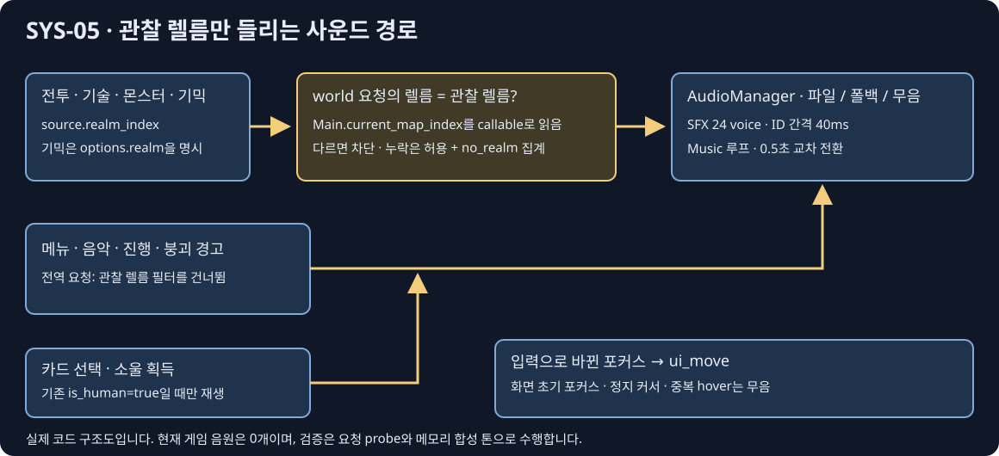

# SYS-05 · 사운드 연결 및 리드 검수 반영

브랜치 `codex/sys-05`의 기존 미커밋 작업을 유지하고 다섯 검수 항목을 반영했다. 음원 파일은 추가하지 않았으며 후보 음원도 게임으로 복사하지 않았다. [사운드 계약](../../design/AUDIO.md), [probe 원본](probe.json), [검증 결과](verification.json), [검수 지시 원문](fix-1.prompt.md)을 함께 남긴다. 커밋 스크립트는 작성만 했고 실행하지 않았다.

## 이번 검수 반영

1. **관찰 렐름만 재생:** 카탈로그의 전투·기술·몬스터·렐름 및 월드 폴백에 `world: true`를 명시했다. Main은 `AUDIO.install(self).watch(self)` 한 줄로 자신의 `get.bind("current_map_index")` callable을 넘긴다. 재생 직전에 카메라의 현재 렐름을 읽으므로 사람 이동·관전 전환·스토리 장면 재시작 때 별도 상태 복사나 스토리 코드 변경이 필요 없다. Main 재생성 시 callable도 새 Main으로 교체한다.
   - 전투원·몬스터는 `source.realm_index`, RealmHazards의 예고·활성화·문 통과는 명시적 `{"realm": realm_index}`를 쓴다. 정예 등장음의 source는 생성된 elite다. 포털음은 이동 직전에 전투원의 출발 렐름으로 판정해, 카메라가 목적지로 바뀌기 전에도 사람의 포털음을 놓치지 않는다.
   - 다른 렐름의 요청도 probe에 기록하지만 파일 로드·폴백·재생 제한 처리 전에 차단한다. 렐름을 찾지 못하면 재생을 허용하고 `no_realm`에 센다.
   - 메뉴·음악·진행은 전역이다. `collapse_warning`도 전역이며, 월드 ID인 `hazard_warning`으로 폴백하더라도 요청 ID의 정책을 유지한다.
2. **사람의 성장음:** PlayerBase의 기존 `is_human`을 `enabled` 옵션으로 넘겨 `card_pick`·`soul_pickup`을 사람에게만 재생한다. 봇의 소울 증가·카드 적용은 그대로이며, 관전 중에도 사람의 진행음은 렐름 필터를 받지 않는다. 비활성 요청 자체는 probe에 남을 수 있다.
3. **사용자 탐색음:** 초기 `_finish().grab_focus()`에서 소리가 나던 `focus_entered` 훅을 제거했다. 기존 방향키/WASD 탐색에서 실제 포커스가 바뀔 때만 요청한다. 마우스 hover는 실제 이동 입력과 같은 프레임인지 입력 처리 후 확인한다. 화면이 정지된 커서 아래 나타나거나 같은 버튼에 다시 hover해도 소리를 요청하지 않는다. hover 일련번호로 오래된 지연 호출도 무효화한다. 기존 포커스 이동/선택 동작은 유지했다.
4. **클래스 설명 복구:** Main, RealmHazards, MatchHud, RealmMonsterSpawner, FrontendMenu의 AUDIO preload를 `##` 클래스 설명 아래 기존 상수 영역으로 옮겼다. 전용 테스트에서도 다섯 파일을 검사한다.
5. **전체 테스트 재실행:** 제품 코드와 테스트 변경을 마친 뒤 `tests/run_all.ps1`을 이 패스에서 한 번 실행했다. 결과: **통과 — 52/52 테스트 + 기본 봇 소크 1회, 종료 코드 0, 494.9초**.

## probe 및 회귀 검사

음원 없는 실제 이벤트 구간은 71/71개 이벤트 ID를 요청했고, 폴백 전용 4개 ID도 조회했다. 실제 재생은 전부 0회다. 아래 수치는 테스트 톤을 넣기 전 스냅샷이다.

| 월드 요청 분류 | 횟수 |
|---|---:|
| 관찰 렐름 허용 watched | 108 |
| 다른 렐름 차단 filtered | 2 |
| 렐름 누락 no_realm | **0** |

별도 합성 AudioStreamWAV 회귀 검사는 총 **552개 검사 통과**다. 그중 렐름·사람 성장·스토리 검사 43개는 서로 다른 렐름의 두 전투원, 몬스터 공격, 실제 기믹 예고를 호출해 요청 증가와 SFX voice 생성 유무를 비교한다. 관찰 렐름을 바꾸어 반대 결과도 검사한다. 스토리 3단계의 0이 아닌 렐름에서도 새 Main의 실제 점프 훅이 재생되는지 확인했다.

전역 붕괴 경고의 월드 폴백, 봇/사람 양쪽의 실제 소울·카드 증가 보존, 초기 포커스·키 탐색·정지 커서·중복 hover·실제 viewport 마우스 입력도 검사했다. 렐름 미지정 요청의 허용/집계는 의도적인 오류 주입으로 별도 검사했으며 위 실제 훅의 `no_realm=0`에 섞지 않았다. 기존 voice 풀 24개·40ms 간격·개별/폴백 동시 제한·피치 ±4%·게임 난수 보존·음악 루프/0.5초 교차 전환·첫 입력 잠금·옵션 저장/복원·한/영 글자 폭 검사도 유지했다.

| 그룹 | 요청된 ID / 목록 ID | 직접 요청 횟수 |
|---|---:|---:|
| Fighters | 14/14 | 25 |
| Skills | 18/18 | 18 |
| Monsters | 14/14 | 51 |
| Realms | 11/11 | 17 |
| Progress | 6/6 | 8 |
| Menus/story | 3/5 | 3 |
| Music | 5/5 | 7 |
| Fallback | 0/4 | 0 |

## 전체 실행 결과

통과 — 52/52 테스트 + 기본 봇 소크 1회, 종료 코드 0, 494.9초. 소크 seed 1001: 331.7초, 우승 Nova, match_over=true, NaN 좌표 0, PvP 709회, 링아웃 13회. 밸런스 평가는 아니다.

runner의 마지막 네 줄 원문:

```text
PASS soak run 1 seed 1001  SOAK_RESULT {"defeats":7,"defeats_by_cause":{"player":7},"defeats_by_player":{"Frey":1,"Luna":2,"Nova":1,"Rio":2,"Yuki":1},"eliminations":["Yuki t=195 by player ringouts=2 dmg_dealt=88","Frey t=216 by player ringouts=2 dmg_dealt=138","Luna t=247 by player ringouts=2 dmg_dealt=187","Rio t=253 by player ringouts=1 dmg_dealt=274","Rio t=261 by player ringouts=2 dmg_dealt=193","Nova t=284 by player ringouts=1 dmg_dealt=355","Luna t=332 by player ringouts=0 dmg_dealt=215"],"first_pvp_hit":8.3,"hazard_hits":11,"match_over":true,"monster_hits":111,"nan_positions":0,"node_count":1648,"playable_realms":1,"players":8,"pvp_hits":709,"ringouts":13,"seconds_simulated":331.7,"shared_realm_ratio":0.94,"souls":["Yuki:89/3","Luna:171/3","Luna:105/3","Nova:186/3","Nova:257/3","Rio:154/3","Rio:210/3","Frey:143/3"],"winner":"Nova"}

NOTE: ignored 52 known sandbox certificate-store errors; every other engine error still fails.
ALL PASSED
```

샌드박스의 알려진 인증서 저장소 오류는 runner가 52회로 별도 집계했다. 전체 개별 로그에서는 소크를 포함해 53회다(runner의 기존 합계는 소크를 제외한다). 나머지 엔진 오류는 종료 코드가 0이어도 실패다. 사전 `--import`는 종료 코드 0으로 번역/리소스를 생성했지만, 쓰기 불가인 AppData/Godot 편집기 캐시·설정 저장 오류가 있었으므로 깨끗한 import로 보고하지 않는다. 전체 런타임 결과와 구분한다.

이전 패스의 전체 실행은 51/52였고 test_hud_frames가 초기 루트 추가 충돌로 실패했다. Frontend가 매니저를 설치하지 않고 Main만 설치하게 한 수정과 초기화 회귀 검사는 유지했다. 위 결과는 그 이후 다섯 검수 항목까지 반영한 새 전체 실행이다.

## 구현 범위와 변경 보존

매니저는 SceneTree 루트에 하나이며 autoload/project.godot 변경 없이 장면 재시작을 넘어 유지된다. Music/SFX 버스는 코드로 생성한다. `assets/audio/sfx/<id>.ogg|wav`와 음악 폴더를 지연 로드/캐시하고 누락은 폴백 또는 무음이다. 기본 누락 로그는 0회다. 음량 기본값은 전체 80·음악 60·효과 80, 10 단위 0–100과 음소거다. 일반 실행은 `user://audio.cfg`, 헤드리스는 개인 설정을 읽거나 쓰지 않는다. 한/영 옵션 4개와 기존 항목을 두 열에 배치했다.

[소스 대조](source-audit.json)는 다음 파일에서 AUDIO preload/호출 줄만 제거하면 기존 소스와 동일함을 검사한다. 캐릭터별 스크립트와 scripts/story 변경은 0/0개, 허용 경로 밖 추적 파일 변경은 0개다. hit box·피해·타이밍·AI·기존 저장 로직을 변경하지 않았다.

| 소유 파일 | 한 줄 오디오 호출 | 오디오 줄 제거 후 기존 소스 |
|---|---:|---|
| `characters/common/PlayerBase.gd` | 20 | 동일 |
| `scripts/Main.gd` | 6 | 동일 |
| `scripts/RealmMonster.gd` | 4 | 동일 |
| `scripts/RealmMonsterSpawner.gd` | 1 | 동일 |
| `scripts/realms/RealmHazards.gd` | 3 | 동일 |
| `scripts/ui/MatchHud.gd` | 2 | 동일 |

## 시각적 확인



노란 경로는 이번에 추가한 관찰 렐름 판정이다. 메뉴·음악·전역 경고는 이 판정을 건너뛰며, 성장음은 기존 is_human으로 재생을 제한한다. 실제 코드 구조도이며 청음 결과나 실행 화면은 아니다.

## ID별 실제 훅 요청 수

직접 요청은 게임 훅 호출이고 조회는 필터를 통과한 뒤의 폴백 탐색이다. 따라서 차단·비활성 요청의 조회 수는 직접 요청 수보다 작을 수 있다.

| 그룹 | ID | 직접 요청 | 폴백 포함 조회 |
|---|---|---:|---:|
| Fighters | `swing_light` | 1 | 1 |
| Fighters | `swing_heavy` | 1 | 1 |
| Fighters | `hit_light` | 2 | 5 |
| Fighters | `hit_heavy` | 1 | 3 |
| Fighters | `hit_launch` | 2 | 2 |
| Fighters | `hurt` | 7 | 28 |
| Fighters | `guard` | 1 | 2 |
| Fighters | `parry` | 1 | 1 |
| Fighters | `jump` | 1 | 1 |
| Fighters | `land` | 1 | 1 |
| Fighters | `dash` | 3 | 3 |
| Fighters | `tumble` | 2 | 2 |
| Fighters | `ko` | 1 | 10 |
| Fighters | `respawn` | 1 | 1 |
| Skills | `skill_frey_1` | 1 | 1 |
| Skills | `skill_frey_2` | 1 | 1 |
| Skills | `ult_frey` | 1 | 1 |
| Skills | `skill_luna_1` | 1 | 1 |
| Skills | `skill_luna_2` | 1 | 1 |
| Skills | `ult_luna` | 1 | 1 |
| Skills | `skill_luna_brave_1` | 1 | 1 |
| Skills | `skill_luna_brave_2` | 1 | 1 |
| Skills | `ult_luna_brave` | 1 | 1 |
| Skills | `skill_yuki_1` | 1 | 1 |
| Skills | `skill_yuki_2` | 1 | 1 |
| Skills | `ult_yuki` | 1 | 1 |
| Skills | `skill_nova_1` | 1 | 1 |
| Skills | `skill_nova_2` | 1 | 1 |
| Skills | `ult_nova` | 1 | 1 |
| Skills | `skill_rio_1` | 1 | 1 |
| Skills | `skill_rio_2` | 1 | 1 |
| Skills | `ult_rio` | 1 | 1 |
| Monsters | `monster_windup` | 10 | 10 |
| Monsters | `monster_bite` | 1 | 1 |
| Monsters | `monster_charge` | 1 | 1 |
| Monsters | `monster_leap` | 1 | 1 |
| Monsters | `monster_slam` | 1 | 1 |
| Monsters | `monster_shell` | 1 | 1 |
| Monsters | `monster_bolt` | 1 | 1 |
| Monsters | `monster_lob` | 1 | 1 |
| Monsters | `monster_swoop` | 1 | 1 |
| Monsters | `monster_blink` | 1 | 1 |
| Monsters | `monster_homing` | 1 | 1 |
| Monsters | `monster_hurt` | 20 | 20 |
| Monsters | `monster_defeat` | 10 | 10 |
| Monsters | `elite_appear` | 1 | 1 |
| Realms | `hazard_warning` | 6 | 7 |
| Realms | `eruption` | 1 | 1 |
| Realms | `quake` | 1 | 1 |
| Realms | `beam` | 1 | 1 |
| Realms | `vines` | 1 | 1 |
| Realms | `belt_reverse` | 1 | 1 |
| Realms | `gate_open` | 1 | 1 |
| Realms | `gate_travel` | 1 | 1 |
| Realms | `bush_rustle` | 2 | 2 |
| Realms | `collapse_warning` | 1 | 1 |
| Realms | `portal` | 1 | 4 |
| Progress | `soul_pickup` | 2 | 1 |
| Progress | `card_offer` | 1 | 1 |
| Progress | `card_pick` | 1 | 1 |
| Progress | `match_start` | 2 | 2 |
| Progress | `results` | 1 | 1 |
| Progress | `victory` | 1 | 1 |
| Menus/story | `ui_move` | 1 | 1 |
| Menus/story | `ui_select` | 1 | 2 |
| Menus/story | `ui_cancel` | 1 | 1 |
| Menus/story | `story_text` | 0 | 0 |
| Menus/story | `story_advance` | 0 | 0 |
| Music | `music_title` | 3 | 3 |
| Music | `music_select` | 1 | 1 |
| Music | `music_battle` | 1 | 4 |
| Music | `music_story` | 1 | 1 |
| Music | `music_results` | 1 | 1 |
| Fallback | `swing` | 0 | 43 |
| Fallback | `skill_cast` | 0 | 18 |
| Fallback | `ult_start` | 0 | 6 |
| Fallback | `monster_attack` | 0 | 20 |

## 남은 작업·다음 권장 단계

- 리드가 diff와 [commit.ps1](commit.ps1)을 검토해 커밋/병합한다. 이 패스에서는 스크립트를 실행하지 않았고 stage/commit도 하지 않았다. 명시한 SYS-05 파일과 검수 prompt만 포함하며 로그·__pycache__·후보 음원은 제외한다.
- 사용자가 음원을 채택한 뒤 계약의 경로/ID로 배치하고 실제 청음·웹 첫 입력을 확인한다. 현재 결과는 헤드리스 요청/합성 톤 검사다.
- story_text/story_advance, 스토리 전용 결과·엔딩·출구·직접 정예, 부모의 공통 활성화 경로를 거치지 않는 스토리 전용 확정/뒤로는 스토리 담당자의 훅이 필요하다. 권한 밖의 story/캐릭터 파일을 수정하지 않았다. 공통 대시음은 Frey/Nova/Rio K 기술 시작에서 요청하며 준비 동작을 포함한다.
