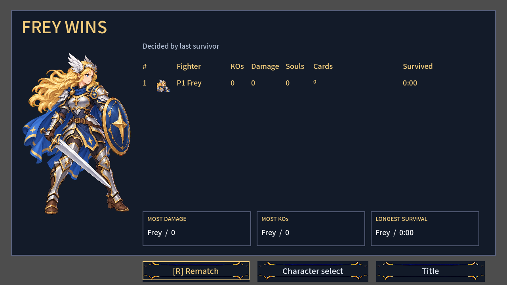
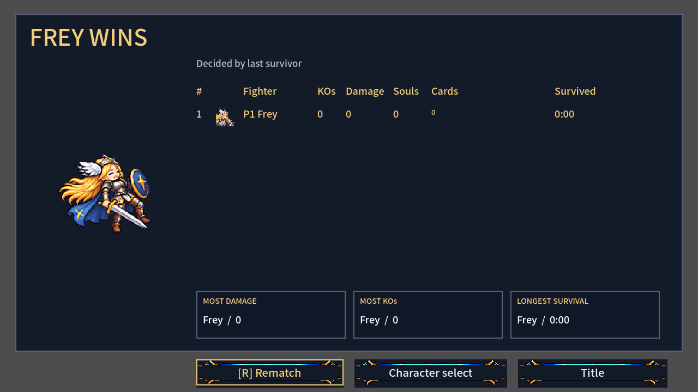
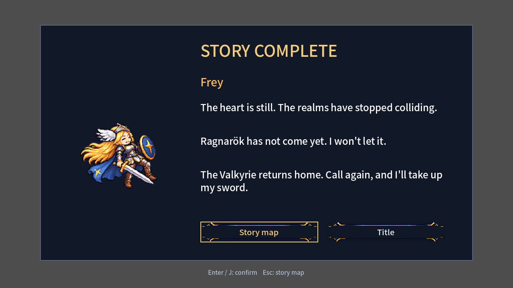

# SYS-06 — 새 모션의 게임 연결

작업 브랜치: `codex/sys-06`. 아트 후보는 채택하거나 복사하지 않았다. 게임 수치·공격 판정·선후딜·이동 규칙은 변경하지 않았다.

## 완료한 변경

### 캐릭터 — PlayerBase.gd

| 행 | 새 경로 | 행이 없을 때 |
|---|---|---|
| jump | 여러 그림이면 1회 재생 후 마지막 그림 유지. 공중 재점프 때 처음부터 | 기존 한 그림 그대로 |
| fall | 여러 그림이면 반복 | 기존 한 그림 그대로 |
| hurt | 히트스톱 뒤 경직 시간 전체에 걸쳐 1회 재생. 추가 피격은 처음부터, 긴 기절은 재생 길이만 연장 | 기존 한 그림과 기존 표시 시간 유지 |
| land | 공중→바닥 접촉 때 2그림, 12fps. 이동·점프·공격·방어 즉시 취소 | 기존 대기/이동/공격 선택 그대로 |
| victory | `play_victory()`로 1회 재생 후 마지막 그림 유지 | idle |

D38 공격 포즈 시계와 캐릭터 패배 모션 함수는 변경하지 않았다. 강한 넉백의 기존 tumble 경로도 유지한다.

**아트를 넣는 규약:** 새 캐릭터 클래스 수정 없이, 채택한 가로 스트립을 아래 이름으로 둘 수 있다. 기존 통합 시트의 행 표에 여러 프레임을 넣는 방식도 재생 로직에서 지원한다.

- `assets/art/frey/frey_<row>.png`
- `assets/art/luna/luna_<row>.png`
- `assets/art/luna/luna_brave_<row>.png`
- 체형별은 `<prefix>_<body>_<row>.png` 우선, 없으면 `<prefix>_<row>.png`.
- jump 384×128, fall 256×128, hurt 384×128, land 256×128, victory 1152×192.
- victory의 192칸은 기존 기술 시트와 같은 중심/발선 규약(y=152)을 쓴다. 다른 행은 128칸/발선 y=120.
- 없는 파일이나 규격이 틀린 스트립은 기존 행을 교체하지 않는다. `art/bakeoff/`는 읽지 않는다.
- fps는 기존 D39 조회를 거친다. `MotionSpeeds.gd`와 채택 기록은 수정하지 않았다. hurt는 요청대로 경직 길이에 맞추며 전투 시간을 바꾸지 않는다.

### 몬스터 — RealmMonster.gd

`sheet.height == 6 × (sheet.width / 6)`이면 새 레이아웃을 선택한다. 파일 이름과 96화면px 크기·발 위치·정예 ×1.35·왕관/오라는 유지한다.

골렘의 기존 y=80 발선 예외는 4행 시트에만 적용한다. 새 6행 시트는 ART-71 규약대로 다른 지상 몬스터와 같은 y=72 발선을 사용하며, 충돌 상자는 그대로다.

| 행 | 그림 수 | 재생 |
|---|---:|---|
| idle | 6 | 6fps 반복 |
| walk | 6 | 10fps 반복 |
| windup | 4 | MonsterArchetypes의 실제 준비 시간에 분배, 마지막 그림 유지. 정예/보스 배율 포함 |
| attack | 6 | 12fps, charge/swoop 반복·나머지 1회 |
| hurt | 2 | 8fps, 피격마다 처음부터 |
| defeat | 4 | 8fps 후 0.3초 페이드·해제 |

4행 시트는 기존 표와 표시 분기를 유지한다. 공격 준비는 attack 첫 그림을 정지해 보여주고, 패배는 hurt에서 0.55초 페이드한다. 새 패배 모션에서도 충돌 해제·소울 보상·defeated 신호는 죽는 순간 발생한다. 늦어지는 것은 그림 노드의 해제뿐이다.

### 화면 — FrontendMenu.gd / StoryScreens.gd

결과 화면의 우승자와 스토리 엔딩의 주인공에게 victory 행이 있으면 기존 일러스트 자리에서 별도 `AnimatedSprite2D`를 재생한다. 없으면 기존 일러스트를 그대로 그린다. 실제 승자의 공격 포즈를 건드리지 않으며, 엔딩 리소스 조회용 캐릭터는 트리에 넣지 않아 플레이어 그룹·물리·입력에 참여하지 않는다. 화면을 나가면 미리보기 노드도 해제된다.

```text
채택 아트 있음 → 새 행/6행 시트 → 해당 모션 재생
채택 아트 없음 → 기존 행/4행 시트 → 기존 표시 유지
```

위 흐름은 게임에서 새 아트의 유무를 판단하는 분기다. 아직 완성되지 않은 후보를 자동 채택하지 않는다.

## 확인 및 테스트

새 테스트는 모두 기존 게임 그림을 복사해 메모리 안에서 시험용 행/시트를 만든다. 없는 행/옛 4행 시트도 시험 안에서 구성하므로, 나중에 실제 아트가 채택되어도 fallback 검사가 새 파일의 유무에 의존하지 않는다. 아트 파일이나 CSV를 생성하지 않는다.

- `test_fighter_motion.gd`: 모든 체형의 기존 단일 그림·없는 행 fallback, Frey/Luna/Brave의 여러 그림 jump/fall/hurt/victory, 실제 바닥 접촉과 land 취소, 거부된 스트립의 원본 보존, 히트스톱·기절, 체력바 갱신 뒤 마지막 그림 유지, 전투 수치·D38 동일성.
- `test_monster_motion.gd`: 기존 4행과 새 6행, 10개 행동 원형, 정예 크기와 준비 시간, 반복/1회 재생, 추가 피격, 행동 취소, 사망·보상·페이드, 새/옛 시트의 실제 행동 실행·피해·넉백·공격 개수·판정 상자 동일성, 골렘의 옛/새 발선.
- `test_victory_screens.gd`: 모든 체형의 결과/엔딩 fallback와 시험용 victory, 승자 포즈 보존, 마지막 그림 유지, 원본 노드 제거 뒤 재생, 화면 전환 정리, 무승부.
- 세 테스트를 `tests/run_all.ps1`에 등록했다.

### 최종 결과 — 2026-10-23 KST

| 검증 | 측정 결과 |
|---|---|
| 캐릭터 새 테스트 | 132개 검사 통과 |
| 몬스터 새 테스트 | 293개 검사 통과 |
| 화면 새 테스트 | 헤드리스 68개 검사 통과 |
| 창 모드 화면 실행/캡처 | 71개 검사 통과, PNG 3장 생성·확인 |
| 전체 실행기 | 51개 테스트 전부 통과, 종료 코드 0, `ALL PASSED` |
| 기본 봇 소크 | 8명, seed 1001, 최대 480초 중 331.7초에 정상 종료, 승자 Nova, NaN 위치 0 |
| 환경 오류 | 실행기가 알려진 인증서 저장소 오류 51건을 별도 집계. 그 밖의 엔진 오류로 실패한 테스트 없음 |
| 변경 검수 | `git diff --check` 통과, `commit.ps1` 문법 검사 통과·미실행 |

신규 테스트는 총 493개 검사다. 소크 수치는 봇 한 판의 안정성 측정이며 사람의 난이도·손맛 측정이 아니다. 최종 전체 실행 출력은 [validation.txt](validation.txt)에 기록했다. 실행별 원본 출력은 이 폴더의 `tests/`에 보관한다(커밋 대상 제외).

개발 중 새 여러 그림 행에서만 재현한 문제 두 가지를 회귀 검사에 포함해 수정했다. 피격 직후 `_update_visuals()`가 모션을 재개해 히트스톱 동안 재생하던 경우, 체력바 갱신이 끝난 jump/hurt를 처음부터 재생하던 경우다. 각 검사는 수정 전 실패를 확인했고, 수정 후 캐릭터 테스트 132개 검사가 통과했다.

초기 요청대로 `--headless --path smash-nine-prototype --import`를 먼저 실행했다. 첫 import는 없던 번역/폰트 리소스를 생성하면서 초기 부재 오류와 샌드박스의 Godot 사용자 캐시 접근 오류를 출력했다. 이후 실행은 프로세스의 APPDATA/LOCALAPPDATA를 임시 폴더로 지정했다. 프로젝트 설정은 변경하지 않았다. 알려진 루트 인증서 저장소 오류만 기존 테스트 실행기가 별도 집계한다.

## 시각적 확인

`test_victory_screens.gd -- --capture`를 창 모드에서 실행해 아래 PNG를 만들고 직접 확인했다. 화면 단독 실행이라 통계는 시험값이다. 새 아트가 아닌 기존 hurt 그림을 6번 복사한 **연결 검사용** victory다. 그림의 자연스러움이나 최종 모션 품질을 보여주는 자료는 아니다.



victory가 없으면 지금의 우승 일러스트를 유지한다.



시험용 victory가 있으면 같은 자리에 픽셀 모션 스프라이트를 표시한다.



스토리 엔딩도 같은 선택 규칙을 사용한다.

## 남은 작업 / 가정

- ART-71/72의 실제 아트는 이 클론에 반영하지 않았다. 사용자 채택 후 리드가 위 파일 규약으로 넣고 최종 외형·속도·발 위치를 확인해야 한다.
- 시험용 그림으로 검증한 것은 연결·프레임 선택·시간·기존 동작 보존이다. 완성 아트의 손맛·가독성은 아직 측정하지 않았다.
- `commit.ps1`은 명시한 파일만 stage하고 커밋한다. 스크립트는 작성만 했으며 실행하지 않는다. 기존 타 작업의 미추적 로그와 Godot이 자동 생성한 UID는 포함하지 않는다.
