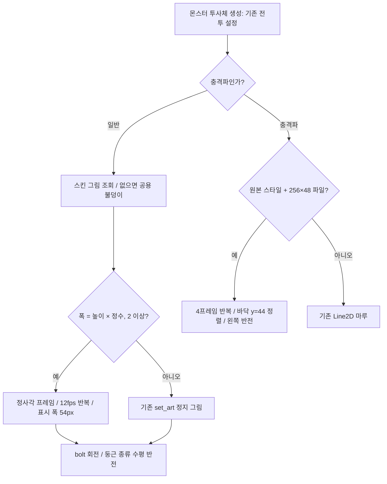

# SYS-07 — 몬스터 투사체·충격파 연결

## 완료

`codex/sys-07`에서 몬스터 전용 스트립 재생과 선택적 충격파 스프라이트를 연결했습니다. 후보 PNG는 복사하지 않았습니다. 사용자가 고른 뒤 [몬스터 README](../../smash-nine-prototype/assets/art/monsters/README.md)의 표대로 파일을 복사하고 임포트하면 적용됩니다.

- `Projectile.gd`: `set_art_strip(Texture2D, frames, fps, aimed, art_scale)`를 추가했습니다. `AnimatedSprite2D`/`AtlasTexture`로 반복 재생하고, 몬스터가 명시적으로 켠 방향 추적만 처리합니다. 기존 `set_art()` 본문은 변경하지 않았습니다.
- `RealmMonster.gd`: 투사체 그림 선택 부분을 전용 함수로 분리했습니다. 폭/높이가 정수 배(2 이상)인 일반 몬스터 그림은 12fps 스트립, 나머지는 기존 정지 그림입니다. `bolt`는 방향 회전, 둥근 종류는 수평 반전만 합니다.
- `slam_shockwave.png`: 256×48/4프레임 규격이면 기존 선 마루를 대체합니다. 각 64×48 셀의 y=44를 파동 원점 아래 18px에 맞춥니다. 실제 slam 호출은 원점을 몬스터 지면 위 18px에 놓으므로 바닥선이 일치합니다. 파일 부재·규격 불일치·Prototype 스타일은 기존 마루입니다.
- `test_projectile_art.gd`와 `run_all.ps1`: 실제 생성 경로를 이용하는 회귀 검사를 전체 실행기에 등록했습니다.

전투 설정과 물리 이동 코드는 수정하지 않았습니다. 캐릭터 폴더, 스토리 코드, AI, 아트 PNG도 수정하지 않았습니다. `ArtSettings.gd`는 기존 기능만 사용합니다.

## 연결 흐름 — 실제 코드 구조



그림은 구현의 선택 경로를 설명합니다. 헤드리스 전용 작업이므로 실제 렌더 화면이나 후보 아트의 품질을 확인한 그림은 아닙니다.

## 검증 방법

테스트는 `Image.create` → 색이 다른 프레임 채우기 → `ImageTexture.create_from_image` → `take_over_path`로 ResourceLoader 메모리 캐시에 등록합니다. 생산 코드의 파일 조회/생성 경로가 이 메모리 텍스처를 읽습니다. PNG를 디스크에 쓰거나 후보를 가져오지 않으며 원래 캐시 항목은 종료 전 복원합니다. 충격파 조회 함수는 시험용 하위 클래스에서 null 반환도 가능하게 하여, 실제 아트 채택 후에도 파일 부재 검사가 독립적으로 실행됩니다.

확인 항목: 4프레임·12fps 반복·시간 경과 프레임 변경, 기존 표시 폭, 정사각형 및 비정수 비율의 정지 그림, 종류별 방향, 충격파 대체/바닥/좌우/재생/폴백, 전투 수치, 두 파동의 공유 피격 목록, 캐릭터 비정사각형 그림의 기존 `set_art()`·색·배율·방향 고정, 공용 불덩이 폴백, Prototype 표시.

## 현재 상태 / 측정 결과

2026-10-23 KST, Godot 4.7 헤드리스로 확인했습니다. 전체 실행기는 기본 옵션으로 **한 번만** 실행했습니다. 전체 요약 출력은 [validation.txt](validation.txt)에 보관합니다.

| 검증 | 실제 결과 |
|---|---|
| 재임포트 | 종료 코드 0, 인증서 환경 오류 외 엔진 오류 0 |
| 신규 단독 검사 | 59개 검사 통과, 종료 코드 0 |
| 전체 실행기 | 기능/미리보기 테스트 53개 전부 통과, 종료 코드 0, `ALL PASSED` |
| 기본 봇 소크 | 8명, seed 1001, 최대 480초 중 331.7초에 정상 종료, 승자 Nova |
| 소크 안정성 | `match_over=true`, `nan_positions=0`, 링아웃 13회, 최초 PvP 적중 8.3초 |
| 전체 엔진 오류 검사 | 테스트+소크 원본 로그 54개에서 인증서 메시지를 제외한 오류 0 |
| 인증서 환경 메시지 | 원본 로그 총 54건. 실행기는 테스트의 53건만 집계하며 소크 1건은 집계에 더하지 않음 |
| 변경 검수 | `git diff --check` 통과, `commit.ps1` 파싱 오류 0, 스크립트 미실행 |

전체 실행기의 마지막 두 줄은 다음과 같습니다. 그 직전에는 seed 1001의 `PASS soak run 1` 및 전체 `SOAK_RESULT`가 출력됐습니다([원문](validation.txt)).

```text
NOTE: ignored 53 known sandbox certificate-store errors; every other engine error still fails.
ALL PASSED
```

소크 수치는 봇 한 판의 실행 안정성 측정입니다. 사람의 난이도·손맛 또는 실제 새 아트의 시각 품질 측정이 아닙니다.

첫 임포트는 샌드박스 밖 Godot 사용자 캐시 쓰기 오류를 냈습니다. 이후에는 프로세스의 `APPDATA`와 `LOCALAPPDATA`를 `%TEMP%/smashnine-sys07-profile`로 지정했습니다. 재임포트 종료 코드는 0이고, 알려진 인증서 저장소 오류 외 오류는 없었습니다. 프로젝트 설정 파일은 바꾸지 않았습니다.

개발 중 첫 단독 테스트에서는 두 번째 충격파가 첫 파동의 애니메이션 대기 중 이동·소멸하는 시험 구성 오류를 발견했습니다. 두 파동의 물리 처리를 대기 전에 모두 정지하도록 테스트만 수정했습니다. 이 초기 실행은 출력에 PASSED가 있어도 SCRIPT ERROR가 있어 실패로 기록합니다.

## 남은 작업 / 다음 권장 단계

- 사용자 채택 후 리드가 표에 있는 PNG를 복사하고 임포트합니다. 코드 연결을 다시 고칠 필요는 없습니다.
- 실제 후보의 혼전 가독성·부드러움은 측정하지 않았습니다. 화면 폭 54px은 투명 여백을 포함한 셀 폭입니다. 충격파의 셀 표시 크기 54×40.5px은 이번 연결에서 선택한 크기이며, 전투 판정 크기가 아닙니다.
- `commit.ps1`은 명시된 파일만 stage합니다. 다른 작업이 이미 stage되어 있으면 중단합니다. 로그·UID·캐시·`__pycache__`를 포함하지 않으며, 작성만 하고 실행하지 않습니다.
