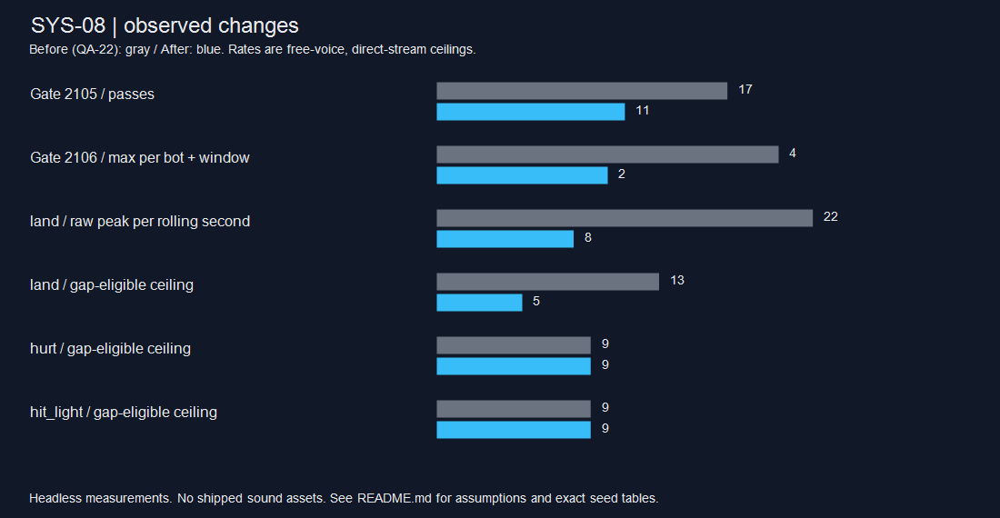

# CODEX-SYS-08 — QA-22 후속 수정

완료: 문 재통과 제한, 사운드 요청 억제, 스토리 사운드 훅을 카드 순서로 구현·검증했다. 브랜치 `codex/sys-08`, 시작 HEAD `b9fd8125aa5ff87bb30d113c178d5e024e4c5f97`의 정확한 전체 값은 verification.json에 기록한다. 제품 변경은 카드의 9개 파일이며 PlayerBase·AI·피해·히트박스·저장 코드는 수정하지 않았다. 음원 파일은 추가하지 않았다.

## 1. 달빛 문

선수별 쿨다운 1.0→2.5초. 출구에서 한 번 벗어나야 다시 탈 수 있다는 기존 규칙은 유지한다. 기존 QA-22 관측기에서 출력 경로만 바꿔 16봇·480초 제한·시드 2105/2106을 순차 재실행했다.

| 시드 | 활성 구간 전→후 | 총 통과 전→후 | 같은 봇·구간 최대 전→후 | 같은 봇·구간 최단 간격 전→후 | 경기 종료 초 전→후 | NaN 전→후 |
|---|---:|---:|---:|---:|---:|---:|
| 2105 | 13→13 | 17→11 | 2→2 | 3.550→4.817초 | 330.1→336.4 | 0→0 |
| 2106 | 13→13 | 25→10 | 4→2 | 1.000→2.517초 | 288.9→260.1 | 0→0 |

[전체 선수×활성 구간 표](gate-windows.md), [2105 원본](gate-soak-2105.json), [2106 원본](gate-soak-2106.json). 재통과가 0회가 된 것은 아니다. 2.5초 이내 재진입 차단, 이탈 후 2.5초 경과 시 재통과, 출구 안에 계속 있으면 만료 뒤에도 이동하지 않음을 회귀 검사했다.

## 2. 사운드 요청률

카탈로그에 gap_ms를 추가했다. 지정값은 그대로 land 150, hurt 70, hit_light 50, hit_heavy 60, swing_light 60, swing_heavy 60, tumble 120, monster_hurt 70ms다. 나머지는 기본 40ms이며 추가 조정값은 없다. 요청 ID와 최종 폴백 ID의 간격·동시 제한을 모두 적용한다. 착지 훅 위치는 그대로 두고 AudioManager가 선수별 공중 시간을 물리 delta로 누적한다. 0.12초 미만의 홉·접지 이탈은 land를 요청하지 않으며 선수 퇴장 시 추적 상태를 제거한다.

### 실측과 가정의 구분

- **실측 요청:** QA-22 audio_recorder.gd를 수정 없이 재사용했다. 8봇·시드 1001/2105/2106, 480초 제한, 관전 렐름·원요청 순서·실제 훅을 기록했다. before는 QA-22의 보존된 원본이다.
- **재생 가능 상한 재현:** 앞뒤 원요청을 같은 순서로 production play에 넣었다. 코드로 만든 약 10ms 사인파를 모든 ID에 직접 등록하고, 직전 시작 시각을 경기 시계에 맞춰 실제 monotonic clock으로 변환했다. 수락된 voice는 즉시 stop한다. before는 gap_usec만 40ms로 재정의한 정책이다.
- **가정:** ID마다 독립 음원이 있고 매번 빈 voice가 있다. 따라서 아래 ‘통과 상한’은 간격 제한을 통과하는 요청 수이며 실제 채택 음원의 재생량·voice 중첩·청감이 아니다. 폴백 음원을 공유하거나 음원이 길면 기존 24 voice/ID 제한이 더 줄일 수 있다. 테스트 톤은 메모리에만 만들었고 파일로 저장하지 않았다.
- **시간:** 피크는 이동 1초 창 [t,t+1)의 경기 시간 기준이다. 실제 간격 제한은 Time.get_ticks_usec 기준이다. 고정 FPS로 빨리 실행된 소크의 벽시계 초당 실제 재생량이라고 해석하지 않는다. 정수 1초 피크와 모든 초별·ID별 값도 [전체 표](sound-tables.md), [JSON](rate-comparison.json)에 보존했다.
- 원래 음원 없는 6개 BR 캡처(before/after 각 3회)의 실제 SFX 재생·voice 피크는 모두 0이다. 경기 기록과 테스트 톤 재현을 분리했다.

| 8봇 시드 | 경기 초 전→후 | 관찰 렐름 원요청 전→후 | 간격 통과 상한 합계 전→후 |
|---|---:|---:|---:|
| 1001 | 331.7→331.7 | 3026→2590 | 2601→2197 |
| 2105 | 240→240 | 2012→1797 | 1801→1580 |
| 2106 | 307.1→311.2 | 2549→2168 | 2393→1997 |

| ID | 3시드 중 원요청 1초 피크 전→후 | 간격 통과 상한 1초 피크 전→후 | 통과 상한 누계 전→후 |
|---|---:|---:|---:|
| land | 22→8 | 13→5 | 1683→839 |
| hurt | 22→22 | 9→9 | 862→806 |
| hit_light | 19→19 | 9→9 | 692→681 |
| hit_heavy | 0→0 | 0→0 | 0→0 |
| swing_light | 6→6 | 6→5 | 726→708 |
| swing_heavy | 4→4 | 4→4 | 260→255 |
| tumble | 9→9 | 7→4 | 196→174 |
| monster_hurt | 8→8 | 7→6 | 437→402 |

피크가 그대로인 ID도 있다. hurt/hit_light가 무조건 줄었다고 보고하지 않는다. 시드 2106은 경기 종료도 307.1→311.2초로 달라졌으며 문 쿨다운까지 함께 바뀐 전체 경기 비교다. 이 표만으로 요청 변화 전부를 오디오 정책의 단독 인과로 확정하지 않는다. 시드 1001·2105의 경기 종료 및 전투 지표는 QA-22와 일치했다.

## 3. 스토리 한 줄 훅

StoryDialogue에 2줄(대사 표시·Next/Skip), StoryScreens에 2줄(결과·엔딩), StorySession에 1줄(수락된 출구 Q)을 추가했다. 조건별 사운드 묶음은 AudioManager helper에 둔다. 세 스토리 파일에서는 기존 줄을 삭제·수정하지 않았다. AUDIO.md에서 예약·미연결 표기를 실제 소유 함수로 바꿨다.

QA-22와 같은 보호된 Frey, 시드 2101, 공개 적 처치·수정 타격 API, 파동 간 3프레임, 실제 Q 출구를 사용했다. 자연 전투 밀도나 사람 난이도의 표본이 아니다.

| 장 | story_text 전→후 | story_advance 전→후 | portal 전→후 | results 전→후 | victory 전→후 | music_results 전→후 | 결과 음악 전→후 |
|---|---:|---:|---:|---:|---:|---:|---|
| 1 | 0→2 | 0→2 | 0→1 | 0→1 | 0→1 | 0→1 | music_story→music_results |
| 5 | 0→2 | 0→2 | 0→1 | 0→1 | 0→1 | 0→1 | music_story→music_results |
| 9 | 0→3 | 0→3 | 0→0 | 0→0 | 0→1 | 0→1 | music_story→music_results |

1·5장: portal → results → victory → music_results. 9장 엔딩: victory → music_results(출구·일반 결과는 없는 경로). pre/post 및 9장의 mid에서 대사·진행음을 검증했다. 별도 UI 검사는 타이핑 즉시 표시, 다음 줄, Skip 각각 1회 요청 및 실패 결과에서 victory가 없음을 확인했다. 이벤트 시점·phase·순서는 [comparison.json](comparison.json)의 stories.moments와 각 sound-story 캡처에 있다.

## 시각적 확인



회색은 QA-22, 파랑은 이번 측정이다. 문 통과와 이동 1초 창 사운드 수치이며 게임 화면 스크린샷이 아니다. headless 실행만 허용되어 실제 UI 화면은 캡처하지 않았다. [벡터 원본](comparison.svg).

## 확인 및 테스트

- 사전 headless --import: exit 0, 인증서 소음 외 엔진 오류 0. 기존 중첩 story_70/import_check 프로젝트 무시 경고는 별도로 남아 있다.
- 문 회귀 검사 통과, 문 소크 2시드 통과.
- 오디오 집중 검사 55항목 통과: 8개 지정 ID+기본값, 독립 ID, 요청·폴백 간격, 1μs 경계, 실제 짧은 홉 무음·점프 1회 착지음, 선수 간 독립 상태·퇴장 정리.
- 전체 test_audio: 613항목 통과, 실제 훅 73/73 ID 요청, 폴백 전용 4개. QA-22 본문의 75개 표기와 달리 보존된 카탈로그/현재 카탈로그 실데이터는 모두 77개다.
- BR 기록 3회 및 before/after 톤 재현 6회, 기록·ID별 합계 대조 모두 통과.
- 스토리 1·5·9장 통과(각 hook_failures=0).
- 수정 제거 대조: 문·오디오·스토리 검사 모두 exit 1로 실패. 직후 최종 소스를 복원했다. [대조 요약](regression-checks.json), logs/*-no-fix.log.
- 전체 스위트는 최종 코드에서 **1회** 실행: **53개 검사 스크립트 + 기본 소크 1회**, exit **0**, 벽시계 **471.71초**. [전체 요약](suite-summary.log), [메타](suite-meta.json), 개별 원문 suite/.

전체 스위트 마지막 줄:

```text
PASS test_projectile_art  Projectile art tests: 59 checks, PASSED
PASS soak run 1 seed 1001  SOAK_RESULT {"defeats":7,"defeats_by_cause":{"player":7},"defeats_by_player":{"Frey":1,"Luna":2,"Nova":1,"Rio":2,"Yuki":1},"eliminations":["Yuki t=195 by player ringouts=2 dmg_dealt=88","Frey t=216 by player ringouts=2 dmg_dealt=138","Luna t=247 by player ringouts=2 dmg_dealt=187","Rio t=253 by player ringouts=1 dmg_dealt=274","Rio t=261 by player ringouts=2 dmg_dealt=193","Nova t=284 by player ringouts=1 dmg_dealt=355","Luna t=332 by player ringouts=0 dmg_dealt=215"],"first_pvp_hit":8.3,"hazard_hits":11,"match_over":true,"monster_hits":111,"nan_positions":0,"node_count":1648,"playable_realms":1,"players":8,"pvp_hits":709,"ringouts":13,"seconds_simulated":331.7,"shared_realm_ratio":0.94,"souls":["Yuki:89/3","Luna:171/3","Luna:105/3","Nova:186/3","Nova:257/3","Rio:154/3","Rio:210/3","Frey:143/3"],"winner":"Nova"}
NOTE: ignored 53 known sandbox certificate-store errors; every other engine error still fails.
ALL PASSED
```

### 실행 중 발견·수정한 검사 환경 문제

첫 두 문 소크는 외부 PowerShell -File 배열 전달 때문에 seed=-1이었다. 비교에서 전부 제외하고, Seed/Players/Seconds를 개별 인자로 받도록 래퍼를 바꾼 뒤 2105·2106으로 재실행했다. 초기 audio-all은 50ms 대기의 정수 ms 절삭 오차와 고정 FPS의 가상 시간 타임아웃에 걸렸다. 기존 일반 재생 검사는 70ms 여유를 두고 실시간 실행하며 새 1μs 경계 검사는 따로 유지했다. 재실행 613항목 및 최종 전체 스위트 결과가 최종 판정이다. 의도적인 no-fix 실패·초기 검사 실패와 최종 성공 로그를 구분했다.

정확히 ERROR: Failed to read the root certificate store.인 줄만 알려진 샌드박스 소음으로 분리한다. 최종 로그의 나머지 SCRIPT ERROR/ERROR/Parse Error 판정과 파일 범위·훅 줄 수·해시는 [verification.json](verification.json)에 있다.

## 재실행·인계

저장소 루트에서 아래를 순차 실행한다. Godot은 한 번에 하나다.

```powershell
powershell -ExecutionPolicy Bypass -File reports/codex-sys-08/run.ps1 -Import
powershell -ExecutionPolicy Bypass -File reports/codex-sys-08/run.ps1 -Script tests/test_audio.gd -Name audio-all-fixed -Realtime
powershell -ExecutionPolicy Bypass -File reports/codex-sys-08/run.ps1 -Script tests/test_realm_gimmicks.gd -Name gate-after
# 문: -Script tests/analysis/codex_sys_08/gate_soak.gd -Seed 2105 -Players 16
# 같은 방식으로 2106. 사운드: sound_soak.gd, -Players 8, 시드 1001/2105/2106
# 스토리: sound_story.gd -Extra --stage=1 (5, 9도 각각 실행)
node reports/codex-sys-08/prepare.mjs
powershell -ExecutionPolicy Bypass -File reports/codex-sys-08/run.ps1 -Script tests/analysis/codex_sys_08/rate_replay.gd -Name rate-replay
node reports/codex-sys-08/analyze.mjs
powershell -ExecutionPolicy Bypass -File reports/codex-sys-08/render-chart.ps1
# 전체 스위트를 재검증할 경우에만 suite.ps1을 1회 실행
node reports/codex-sys-08/build-report.mjs
node reports/codex-sys-08/verify.mjs
```

**완료:** 카드의 세 부분과 회귀·전체 스위트 검증. **현재 상태:** 리드 검토 가능한 코드·검사·측정 원본·안전한 커밋 스크립트 준비. **남은 작업:** 카드 안의 미완료 항목 없음. **다음 권장 단계:** 리드 코드 검토·병합 후 사용자가 채택한 실제 음원으로 중첩·청감을 확인한다. 실제 음원, 웹 첫 입력·오디오 청음은 이번에 검증하지 않았다.

commit.ps1은 작성만 했고 실행하지 않았다. files.txt에 명시한 이 작업 파일만 stage하며, 다른 stage·허용 범위 이탈·__pycache__·1MB 초과 로그·다른 브랜치를 거부한다. git add -f를 사용하지 않고 커밋 메시지 마지막은 지정된 Co-Authored-By다. 기존 무관한 미추적 파일은 건드리지 않는다.
