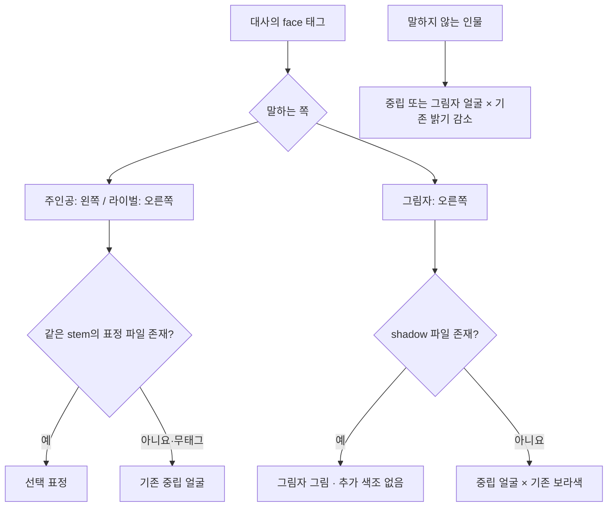

# SYS-09 작업 완료 — 스토리 표정과 그림자 얼굴 연결

선택한 후보를 정해진 제품 경로에 복사하고 임포트하면 대화에 반영된다. 현재 후보는 한 장도 복사하지 않았으며, 기존 얼굴과 색조를 유지한다. 작업 브랜치는 `codex/sys-09`다. 커밋 스크립트는 작성·구문 검사만 했고 실행하지 않았다.

## 변경된 내용

- `ArtSettings.character_portrait(id, body, expression := "")`: 표정 파일 우선, 없으면 기존 중립 얼굴·픽셀 초상화·idle 칸으로 폴백한다. 기존 두 인자 호출은 그대로다. 중립 얼굴이 결정한 stem을 따라 남녀 표정이 섞이지 않는다.
- `StoryDialogue`: 말하는 쪽에만 태그 표정을 적용하고, 매 줄 양쪽 얼굴을 다시 선택한다. 무태그·비발화자는 중립, 비발화자 밝기 감소는 기존과 같다. 그림자 파일이 있으면 추가 보라색 없이 표시하고, 없으면 기존 중립에 보라색을 곱한다. 그림자는 감정 태그보다 shadow 정체성을 우선한다.
- `StoryCatalog`: 대사 목록의 얼굴 메타데이터만 추가했다. 기존 장면 그림 테스트가 세 번째 사전의 cg 키를 읽으므로 빈 cg도 명시했다. 태그를 제거한 카탈로그가 HEAD와 완전히 같음을 별도 검사했다. 대본·번역·진행·저장 코드는 바꾸지 않았다.
- `tests/test_story_faces.gd`와 전체 테스트 목록을 추가하고, [아트 채택 경로](../../smash-nine-prototype/assets/art/README.md)에 복사 표를 적었다.

## 태그 수와 판단 범위

실제 카탈로그를 다섯 주인공으로 해석한 **고유 대사 ID 87개** 중 angry **15줄**, happy **2줄**, hurt **2줄**이다. 나머지는 무태그 68줄(그림자 10줄은 shadow를 자동 선택, 중립·해설 58줄)이다. 동일한 도전 대사가 여러 라이벌 스테이지에서 재생되어도 ID는 한 번 센다. 별도 엔딩 화면의 15줄은 이 대화 목록 밖이므로 바꾸지 않았다.

한국어·영어 CSV의 전 문장과 STORY.md를 읽고 선택했다. 표정의 감정 적합성은 **문맥에 대한 판단**이며 수치로 측정한 사실이 아니다. angry는 격한 분노뿐 아니라 도전·수호·결의, happy는 루나의 싸움에 대한 호기와 리오의 여유, hurt는 루나의 자기 그림자에 대한 충격과 유키의 수호수에 대한 애도로 해석했다. 마지막 맞서기 줄들은 모두 적극적인 결의여서 hurt 대신 angry다.

주인공 공용 도전 템플릿은 다섯 주인공에 같은 angry 태그를 쓴다. 공용 승리 템플릿은 유키의 사과·프레이와 노바의 차분한 판단까지 포함하므로 happy를 일괄 지정하지 않았다. 이 때문에 루나의 환희가 분명한 승리 줄도 현재는 중립이다. 주인공별로 태그를 달리하는 새 메타데이터 형식은 추가하지 않았다. 전체 국·영문과 실제 태그는 [face-results.json](face-results.json)에 있다.

## 시각적 확인



위 흐름은 실제 코드의 선택 순서다. headless만 사용하라는 지시에 따라 실행 화면은 촬영하지 않았다. 새 후보의 시각 품질·작은 화면 가독성은 이번 테스트로 판단하지 않았다.

## 확인 및 테스트

- 최종 얼굴 테스트: **12,022개 검사 통과**. 5명·7체형 × 한/영 × 원본/프로토타입 설정에서 스테이지 1–9와 고향 분기, 중간 그림자 대사까지 **1,372회 표시**의 텍스처·색조·표시 여부를 이전 코드의 선택 결과와 비교했다. 태그와 CG 공존도 검사했다.
- 테스트 이미지는 코드의 ImageTexture와 Resource.take_over_path로 메모리에만 주입했다. 후보 PNG나 임시 텍스처 파일을 제품 경로에 쓰지 않았다. 세 표정의 주인공·라이벌 선택, 무태그 복귀, 비발화자 어둡게 표시, 그림자 그림 유무, 체형 일부만 채택, 얼굴 없는 시트 폴백, 중립 얼굴보다 먼저 표정이 있는 경우를 검사했다.
- 실제 표정이 채택된 미래에는 “표정 파일이 전혀 없는 실제 에셋 상태” 비교만 명시적으로 건너뛴다. 합성 텍스처를 쓰는 표정 선택 검사는 유지되며, 합성 ID로 그림자 부재·시트 폴백도 계속 검사한다. 이번 실행에서는 파일이 없어 1,372회 비교를 모두 수행했다.
- 기존 `test_story_*` 8개 + 신규 얼굴 테스트 = **9개 모두 통과**. 그 뒤 마지막 테스트 보완본을 단독 재실행해 통과했다.
- 전체 `tests/run_all.ps1`은 기본 설정으로 **1회** 실행: 검사 스크립트 **54개 통과**(test_* 53개 + visual_preview 1개), 봇 소크 1회 포함, 종료 코드 **0**. [전체 출력](full-suite.log), [실행 시각·종료 코드](full-suite-result.json), [얼굴 테스트 원문](test_story_faces.log).
- 소크 측정: seed 1001, 8명, 시뮬레이션 331.7초에 Nova 승리, match_over=true, NaN 위치 0개. 알려진 인증서 저장소 오류를 제외한 전체 스위트 원문 엔진 오류 0개. 이 한 판은 실행 안정성 측정이며 사람의 난이도나 표정 가독성 측정이 아니다.

전체 스위트 마지막 두 줄:

```text
NOTE: ignored 54 known sandbox certificate-store errors; every other engine error still fails.
ALL PASSED
```

첫 임포트는 샌드박스 밖 Godot 사용자 캐시 쓰기 오류로 실패로 판정했다(프로세스 종료 코드만 0). APPDATA와 LOCALAPPDATA를 TEMP의 전용 프로필로 격리한 재임포트는 종료 0, 알려진 인증서 저장소 오류 외 엔진 오류 0이었다. 두 임포트의 로그를 모두 남겼다. 프로젝트 설정은 바꾸지 않았다. 인증서 오류는 환경 소음으로 따로 기록하며 그 외 오류를 무시하지 않았다.

## 전체 대사 검토표

태그 없음은 중립이며, shadow는 얼굴 태그를 추가하지 않고 화자 종류로 자동 선택한다. 한 단어 이유는 감정 판단 근거다.

| 대사 ID | 화자 | 한국어 대사 | face | 이유 |
|---|---|---|---|---|
| `story.s01.post.1` | narrator | 짐승들의 소울이 %s에게 스며든다. | 없음 | 서술 |
| `story.s01.post.2` | narrator | 부서진 하늘 너머로, 아스가르드로 가는 문이 열렸다. | 없음 | 서술 |
| `story.s01.pre.1` | narrator | 세계수 이그드라실의 심장이 비틀리며 터졌다. | 없음 | 서술 |
| `story.s01.pre.2` | narrator | 아홉 세계를 가르던 벽이 무너지고, 세계들은 서로 부딪치며 부서지기 시작했다. | 없음 | 서술 |
| `story.s01.pre.3` | narrator | 흘러나온 소울은 강한 자에게 모여든다. 그리고 심장은, 가장 강한 소울 하나를 부르고 있다. | 없음 | 서술 |
| `story.s01.pre.4` | narrator | 미드가르드. 흩어진 소울에 뒤틀린 짐승들이 다가온다. | 없음 | 서술 |
| `story.s02.home.post.1` | hero | 우르드의 샘이 흐려졌다. 뿌리 곳곳이 병들었어. | 없음 | 정보 |
| `story.s02.home.post.2` | hero | 심장으로 가는 길은 니플헤임의 뿌리 하나뿐. 바깥 세계를 돌아 북쪽으로 간다. | 없음 | 정보 |
| `story.s02.home.pre.1` | hero | 발키리의 문이… 수호수까지 뒤틀렸나. | 없음 | 침착 |
| `story.s02.home.pre.2` | hero | 아스가르드의 문은 내가 지킨다. 물러서라! | angry | 수호 |
| `story.s02.post.1` | rival | …네 싸움에는 거짓이 없군. 범인은 따로 있다. | 없음 | 정보 |
| `story.s02.post.2` | rival | 심장으로 가는 길은 니플헤임의 뿌리 하나뿐이다. 바깥 세계를 돌아 북쪽으로 가라. | 없음 | 정보 |
| `story.s02.pre.1` | rival | 멈춰라, %s! 아스가르드를 흔든 게 너인가? | angry | 추궁 |
| `story.s02.pre.2` | rival | 말은 검으로 듣겠다. | angry | 도전 |
| `story.s03.home.post.1` | hero | 별들 사이로 검은 그림자를 봤어. | 없음 | 정보 |
| `story.s03.home.post.2` | hero | 그런데 그 그림자… 꼭 나를 닮았어. | hurt | 충격 |
| `story.s03.home.pre.1` | hero | 내 달빛 다리가… 달 사슴이 이상해졌어! | 없음 | 침착 |
| `story.s03.home.pre.2` | hero | 정신 차려! 내가 별빛으로 깨워 줄게! | angry | 수호 |
| `story.s03.post.1` | rival | 미안! 넌 진짜였구나. | 없음 | 사과 |
| `story.s03.post.2` | rival | 별들 사이에서 검은 그림자를 봤어. 꼭 누군가를 닮은 그림자였어. | 없음 | 정보 |
| `story.s03.pre.1` | rival | 찾았다, 그림자! …어? 그림자치고는 너무 선명한데? | 없음 | 침착 |
| `story.s03.pre.2` | rival | 에잇, 일단 붙어 보면 알겠지! | happy | 호기 |
| `story.s04.home.post.1` | hero | 대장간 기록에 이런 구절이 있어. 심장은 강한 소울을 베낀다. | 없음 | 정보 |
| `story.s04.home.post.2` | hero | 베낀 소울은 그림자가 된다… 이길수록 내 그림자도 강해진다는 거군. | 없음 | 정보 |
| `story.s04.home.pre.1` | hero | 드워프의 대장간까지… 톱니 딱정벌레가 날뛰고 있네. | 없음 | 침착 |
| `story.s04.home.pre.2` | hero | 보석 검을 벼린 곳이야. 함부로 부수게 둘 순 없지. | angry | 수호 |
| `story.s04.post.1` | rival | 약속은 지키지. 드워프 대장간 기록에 이렇게 적혀 있어. | 없음 | 정보 |
| `story.s04.post.2` | rival | 심장은 강한 소울을 베껴 그림자를 만든다. 네가 이길수록, 네 그림자도 강해질 거야. | 없음 | 정보 |
| `story.s04.pre.1` | rival | %s, 소문은 들었어. 여기까지 온 실력, 직접 시험해 보지. | happy | 여유 |
| `story.s04.pre.2` | rival | 아카데미식으로 하자. 진 쪽이 정보를 넘기는 걸로. | 없음 | 침착 |
| `story.s05.post.1` | narrator | 무너지는 숲을 뒤로하고, %s는 거인들의 땅으로 뛰어들었다. | 없음 | 서술 |
| `story.s05.pre.1` | narrator | 숲의 세계 바나헤임이 무너지기 시작했다. | 없음 | 서술 |
| `story.s05.pre.2` | narrator | 소울 수정을 깨면 끊어진 길이 이어진다. 서둘러야 한다. | 없음 | 서술 |
| `story.s06.home.post.1` | hero | 모든 중력선이 심장 쪽으로 기울어 있다. | 없음 | 정보 |
| `story.s06.home.post.2` | hero | 심장이 소울을 빨아들이고 있어. 서둘러야 한다. | 없음 | 정보 |
| `story.s06.home.pre.1` | hero | 중력의 우물이 끓고 있다. 룬 골렘까지 폭주했군. | 없음 | 침착 |
| `story.s06.home.pre.2` | hero | 멈추게 해 주지. 계산은 끝났다. | 없음 | 침착 |
| `story.s06.post.1` | rival | 측정 끝. 모든 중력선이 심장 쪽으로 기울어 있다. | 없음 | 정보 |
| `story.s06.post.2` | rival | 심장이 소울을 빨아들이고 있어. 서둘러, %s. | 없음 | 정보 |
| `story.s06.pre.1` | rival | 중력 반응이 하나 더 다가온다. %s, 너였군. | 없음 | 침착 |
| `story.s06.pre.2` | rival | 네 힘을 재 봐야겠어. 심장 앞에 데려갈 가치가 있는지. | 없음 | 침착 |
| `story.s07.post.1` | narrator | 짐승이 쓰러지고, 북쪽 얼음의 땅으로 가는 문이 열렸다. | 없음 | 서술 |
| `story.s07.pre.1` | narrator | 불의 땅 무스펠헤임. 심장에서 흘러나온 소울을 삼킨 짐승이 길을 막는다. | 없음 | 서술 |
| `story.s07.pre.2` | narrator | 거대한 마그마 멧돼지가 땅을 긁는다. 돌진이 온다! | 없음 | 서술 |
| `story.s08.home.post.1` | hero | 봉인 너머로 심장의 맥박이 느껴져요. | 없음 | 정보 |
| `story.s08.home.post.2` | hero | 제가 직접 봉인을 열겠어요. 그 너머에서… 저는 저 자신과 싸워야 하겠죠. | 없음 | 정보 |
| `story.s08.home.pre.1` | hero | 뿌리의 봉인 앞에… 얼음 늑대가 뒤틀려 있어요. | 없음 | 침착 |
| `story.s08.home.pre.2` | hero | 봉인을 지키던 아이였는데. 제가 잠재울게요. | hurt | 애도 |
| `story.s08.post.1` | rival | 당신이라면 괜찮겠어요. 뿌리의 봉인을 열게요. | 없음 | 정보 |
| `story.s08.post.2` | rival | 하지만 기억해요. 그 너머에서 당신은 당신 자신과 싸워야 해요. | 없음 | 정보 |
| `story.s08.pre.1` | rival | 이 앞은 세계수의 뿌리예요. 봉인을 풀어 드릴 수는 없어요. | 없음 | 침착 |
| `story.s08.pre.2` | rival | …당신이 심장 앞에 설 수 있는 사람인지, 확인하겠어요. | 없음 | 침착 |
| `story.s09.mid.1` | narrator | 남은 그림자는 하나. %s와 똑같은 모습이다. | 없음 | 서술 |
| `story.s09.post.1` | narrator | 그림자가 흩어지고, 비틀린 심장이 천천히 고요해졌다. | 없음 | 서술 |
| `story.s09.post.2` | narrator | 부딪치던 세계들이 멈춰 섰다. 적어도, 지금은. | 없음 | 서술 |
| `story.s09.pre.1` | narrator | 이그드라실의 심장. 쓰러뜨린 이들의 소울이 그림자가 되어 일어선다. | 없음 | 서술 |
| `story.s09.pre.2` | narrator | 그림자들은 서로를 노리고, %s를 노린다. 마지막까지 서 있어야 한다. | 없음 | 서술 |
| `story.shadow.frey.1` | shadow | 라그나로크는 막을 수 없다. 너도 알고 있잖아. | 없음 · shadow 자동 | 위협 |
| `story.shadow.frey.2` | shadow | 검을 내려놔. 여기서 끝내자. | 없음 · shadow 자동 | 위협 |
| `story.shadow.luna.1` | shadow | 별은 결국 다 떨어져. 너도 마찬가지야. | 없음 · shadow 자동 | 위협 |
| `story.shadow.luna.2` | shadow | 변신해 봐. 어차피 나도 똑같이 할 테니까. | 없음 · shadow 자동 | 위협 |
| `story.shadow.nova.1` | shadow | 계산해 봐. 넌 여기서 이길 수 없어. | 없음 · shadow 자동 | 위협 |
| `story.shadow.nova.2` | shadow | 중력은 결국 모든 걸 끌어내린다. | 없음 · shadow 자동 | 위협 |
| `story.shadow.rio.1` | shadow | 조사는 끝났어. 결론은 네 패배야. | 없음 · shadow 자동 | 위협 |
| `story.shadow.rio.2` | shadow | 룬 방패를 펼쳐 봐. 내가 먼저 깨 줄게. | 없음 · shadow 자동 | 위협 |
| `story.shadow.yuki.1` | shadow | 봉인 따위로 무엇을 지킬 수 있죠? | 없음 · shadow 자동 | 위협 |
| `story.shadow.yuki.2` | shadow | 흐트러진 기운은 바로 당신이었어요. | 없음 · shadow 자동 | 위협 |
| `story.voice.frey.arrive` | hero | 하늘이 갈라지고 아스가르드까지 흔들렸다. 이게 라그나로크라면, 이 검으로 막는다. | 없음 | 침착 |
| `story.voice.frey.challenge` | hero | 오해다. 하지만 검을 겨눈다면, 받아 주지. | angry | 결의 |
| `story.voice.frey.echo` | hero | 내 검을 흉내 내도, 내 맹세까지 베낄 수는 없다. | angry | 결의 |
| `story.voice.frey.victory` | hero | 검을 거둬라. 우리가 싸울 상대는 따로 있다. | 없음 | 침착 |
| `story.voice.luna.arrive` | hero | 별들이 부딪친 자리를 따라왔는데… 여긴 어디야? | 없음 | 침착 |
| `story.voice.luna.challenge` | hero | 좋아, 오해는 별빛으로 풀자! | angry | 결의 |
| `story.voice.luna.echo` | hero | 넌 별빛이 없는 나야. 그럼 내가 더 밝게 빛나면 되지! | angry | 결의 |
| `story.voice.luna.victory` | hero | 헤헤, 내가 이겼다! 그럼 이제 친구지? | 없음 | 환희 |
| `story.voice.nova.arrive` | hero | 중력 이상치가 계속 오른다. 진원지는… 저 나무의 한가운데. | 없음 | 침착 |
| `story.voice.nova.challenge` | hero | 좋아. 네 힘이 몇 뉴턴인지 재 보지. | angry | 결의 |
| `story.voice.nova.echo` | hero | 질량도 속도도 같다면, 남는 건 의지의 차이다. | angry | 결의 |
| `story.voice.nova.victory` | hero | 측정 끝. 넌 적이 아니라는 결과다. | 없음 | 침착 |
| `story.voice.rio.arrive` | hero | 아카데미 명령은 조사뿐이었지만… 이 정도면 벨 게 있겠는데. | 없음 | 침착 |
| `story.voice.rio.challenge` | hero | 시험이라면 환영이야. 낙제는 네 몫이지만. | angry | 결의 |
| `story.voice.rio.echo` | hero | 베낀 건 칼솜씨뿐이겠지. 판단까지는 못 베꼈을걸. | angry | 결의 |
| `story.voice.rio.victory` | hero | 합격. 이제 서로 칼끝을 돌릴 때야. | 없음 | 침착 |
| `story.voice.yuki.arrive` | hero | 동쪽의 기운이 흐트러진 까닭이 여기 있었군요. 부적이 떨고 있어요. | 없음 | 침착 |
| `story.voice.yuki.challenge` | hero | 싸우고 싶진 않지만… 길을 막는다면 봉인하겠어요. | angry | 결의 |
| `story.voice.yuki.echo` | hero | 당신이 제 그림자라면, 제가 먼저 당신을 봉인할게요. | angry | 결의 |
| `story.voice.yuki.victory` | hero | 다치게 해서 미안해요. 이제 이야기를 들어 주세요. | 없음 | 사과 |

## 현재 상태 / 남은 작업 / 다음 권장 단계

연결·태그·자동 검증은 완료했다. 후보 채택과 실제 아트의 감정 전달 판단은 남아 있다. 리드가 위 표와 후보를 검토한 뒤 선택 파일만 채택 표의 경로로 복사하고 임포트하면 된다. [commit.ps1](commit.ps1)은 이 카드의 명시적 파일만 포함하며 실행하지 않았다. 기존 다른 카드의 미추적 파일은 포함하지 않는다.
