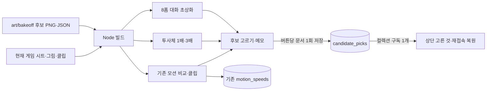

# TOOL-03 작업 완료

기준 `1048ec7`, 브랜치 `codex/tool-03`. 2026-10-23 KST에 모션 뷰어의 후보 선택·메모·전체 선택 목록, 몬스터 투사체, 대화 초상화 비교를 구현했다. **로컬 빌드와 Node 검증 완료**, 외부 Artifact 게시·실제 DB 기록 작성·게임 적용은 하지 않았다. 120분 제한 내 종료했다.

## 변경된 내용

| 파일 | 역할 |
|---|---|
| `tools/motion_viewer/index.html` | 모든 후보의 고르기·취소·메모, 상단 고른 것 목록, DB 연결/저장 오류 안내, 투사체 1×·3× 재생, 초상화 비교·원본 확대 |
| `tools/motion_viewer/build.mjs` | 선택 문서 식별자와 저장소 파일 경로, 투사체·초상화 자동 발견, 현재 비교 그림 복사, 게시 파일 목록 생성 |
| `tools/motion_viewer/publish-files.mjs` | 게시 파일 존재 확인·중복 제거, 250파일/60MB 단위 분할, 전체 버전 한도 판정 |
| `tools/motion_viewer/verify.mjs` | 패키지 없는 Node 모의 DOM·Image·캔버스·DB 검증과 원본 바이트 비교 |
| `tools/motion_viewer/README.md` | `candidate_picks` 형식, `ArtifactData list candidate_picks`, 빌드·분할 게시·검증 한계 안내 |

`candidate_picks/<kind>~<id>~<row>~<version>` 문서에 `kind`, `id`, `row`, `version`, `file`, `picked`, `note`, `picked_at`을 저장한다. 메모는 최대 300자다. 버튼 한 번에 문서 하나를 쓰고, 컬렉션 구독은 하나다. DB가 없으면 버튼·메모가 비활성화되며 비교 재생은 유지된다. 선택은 게임 반영을 의미하지 않는다.

투사체는 **불덩이·얼음 파편·번개·투석·씨앗·폭탄·유도 구체와 공용 지면 충격파**다. 충격파의 64×48 셀을 별도로 지원한다. 기존 충격파는 PNG가 없어 게임의 Line2D 좌표를 재현했고 화면에 이를 명시했다. 나머지는 실제 기존 단일 PNG와 비교한다. 모두 원본 픽셀 기준 1×·3×이며 실제 게임 표시 배율을 검증한 것은 아니다.

초상화는 **8폼의 현재 무표정 8장 + 기쁨·분노·고통 후보 24장**이다. 142×164 대화 영역에 비율을 유지해 표시하고 클릭하면 원본을 연다. 후보 JSON의 `adopted`와 `retired/` 제외는 유지한다. 같은 이름 규칙의 후속 버전도 다음 빌드에 자동으로 포함한다.

이전 빌드는 투사체 7개를 몬스터의 신규 `projectile` 동작 행으로도 분류했다. 이번에는 전용 섹션으로 옮겼다. 따라서 이전 후보 64개에서 투사체 7개가 행 목록을 떠나고, 전용 투사체 8개와 초상화 24개가 더해져 **전체 후보 89개**다. 기존 동작 후보 57개는 보존했다. 원래 빌더가 출력 단계에서 덧붙이던 후보 `loop` 처리는 HTML 템플릿 자체로 옮겼다.

## 시각적 확인 — 실제 구현 구조



그림의 `candidate_picks` 경로가 이번에 추가된 선택 기록 흐름이다. 속도 채택의 `motion_speeds`는 별도로 유지한다. **실행 화면 스크린샷은 아니다.**

## 확인 및 테스트 — 측정한 것

```powershell
node tools/motion_viewer/build.mjs
node tools/motion_viewer/verify.mjs
git diff --check
```

모두 성공했다. 상세 결과는 [viewer-checks.json](viewer-checks.json), 변경 전 비교 기준은 [baseline.json](baseline.json)이다.

- **19개 검사 통과**, 전체 **221개 동작 행**을 모든 캐릭터 폼·몬스터에서 선택했다.
- 후보 **89개 = 캐릭터 21 + 몬스터 동작 36 + 투사체/충격파 8 + 초상화 24**. 원본 폴더를 독립적으로 검색해 누락·이미 채택된 후보 노출이 없는지 비교했다.
- 선택/취소/메모/상단 목록/새 VM 재접속 복원, 저장 실패·재시도·중복 클릭 차단, DB 없음·연결 거절·구독 오류, 예전 게시의 선택 취소를 검사했다. 실제 Artifact DB 대신 명시적인 모의 DB를 사용했다.
- 기존 행 데이터·후보 fps/frames/cell/loop, 최다 프레임 기준 넘김, 속도 슬라이더·채택·기록 삭제·변경값 복사·반영된 배율 중복 곱셈 방지를 검사했다.
- 기존 55개 클립의 이펙트 끔/지금 **110회 경로 전환**을 검사했다. 이 클론에는 `clips-new`가 없어 해당 모드는 합성 매니페스트로 경로 선택과 후보 없는 클립의 현재 그림 복귀만 검사했다. 가짜 클립 파일을 납품하지 않았다.
- 투사체 16개 캔버스가 각 fps와 1×·3× 크기로 올바른 직사각 셀을 자르는지, 멈춤·줄어든 모션 설정을 검사했다. 초상화 32장 배치와 확대·닫기는 모의 DOM 검사다.
- sidecar **248개 전부 원본과 바이트 일치**, 목록 중복 없음. 존재하지 않는 게시 파일은 오류로 실패한다. 분할 검사는 임시 모의 파일로 251개 → 250+1, 큰 파일의 용량 분할과 HTML 용량 포함을 확인했다. 임시 파일은 카드의 보고서 경로 안에서만 만들고 검사 후 제거한다.
- `commit.ps1`은 PowerShell 파서로 문법 오류 0을 확인했고, **실행하지 않았다**. 명시한 납품 파일 10개만 stage하고 `git commit --only`로 다른 스테이징 파일을 제외하도록 작성했다. 메시지 마지막 줄은 요청된 Codex 공동 작성자 표기다.
- `git diff --name-only -- smash-nine-prototype art` 출력은 비어 있다. 제품·그림 수정과 Godot 실행, 패키지 설치·다운로드, 실제 스테이징·커밋은 하지 않았다. 기존 다른 유닛의 미추적 보고서·로그는 건드리지 않았다.

## dist 측정과 게시 인계

| 구분 | 파일 수 | 바이트 | 십진 MB |
|---|---:|---:|---:|
| 실제 `dist/` 전체 (`files.json` 포함) | **250** | **54,751,243** | **54.75** |
| 실제 게시 대상 (HTML + sidecar) | **249** | **54,739,729** | **54.74** |
| `files.json`에 나열한 sidecar | **248** | HTML 제외 | — |

게시 대상은 시트 34 + 후보 89 + 현재 비교 그림 15 + 클립 110 + HTML 1이다. `files.json` 자체는 게시 첨부 목록에 포함하지 않는다. **현재는 250파일·60MB 임계값 아래여서 `files-N.json`이 생성되지 않는다.** 이후 후보가 늘어 임계값을 넘으면 자동 분할한다. 각 배치에 HTML을 포함해도 카드의 한 요청 255파일/64MB 아래며, 현재 전체는 한 버전 511파일/256MB 아래다. 실제 서버의 한도 집계 방식은 게시하지 않아 확인하지 않았다.

리드는 같은 모션 Artifact에 `dist/index.html`, `root=tools/motion_viewer/dist`, `files=dist/files.json`으로 게시하고 **`capabilities`를 생략**한다. 배치 목록이 생기면 번호순으로 같은 버전에 추가한다. 도구의 같은 버전 파일 누적 동작과 기존 DB 기록 유지는 실제 게시 시 확인해야 한다. `dist/`는 생성물이며 커밋 대상에서 제외했다.

## 현재 상태·남은 작업·다음 권장 단계

**완료:** 코드·로컬 빌드·19개 Node 검사·문서·실행하지 않은 커밋 스크립트.

**미검증:** 실제 브라우저 배치·이미지 디코딩·재생 감상, 호스팅된 `claude.use("db")`의 저장·복원, 외부 게시. 모의 검사 통과가 이 부분의 정상 작동을 증명하지는 않는다.

**다음 권장 단계:** 리드가 병합 후 다른 이미지 유닛의 후보까지 다시 빌드해 수량·용량을 확인하고 같은 Artifact에 재게시한다. 실제 DB에서 후보 하나의 선택·메모 변경·새로고침·취소와 기존 속도 채택을 확인한 뒤 사용자가 후보를 고르면 된다. 후속 실행을 예약하지 않았다.

브라우저 자동 승인 검토가 `http://localhost:8073` 열기를 거부했다. 사유는 로컬 주소의 네트워크 접근 권한 미승인이며, 우회하지 않았다. 따라서 실제 화면 검증과 스크린샷은 제공하지 못한다.
