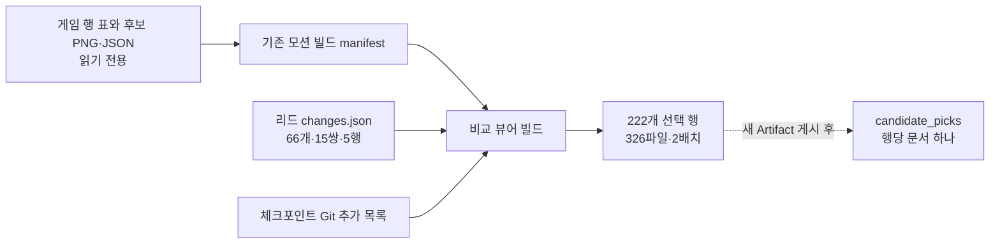

# CODEX-TOOL-04 결과

별도 비교 뷰어를 `tools/compare_viewer/`에 구현했다. 지금 게임과 옛·새 후보를 행 단위로 비교하고, 하나의 선택과 메모를 `candidate_picks`에 저장한다. **오프라인 검사 완료, 실제 브라우저·Artifact 게시/DB 확인은 리드에게 남아 있다.**

기준 브랜치 `codex/tool-04`, 입력 HEAD `3449a1dbe8a02814f1415bd9def735fc16b40a33`, Node `v24.17.0`. 커밋이나 스테이징은 실행하지 않았다.

## 완료한 내용

- `build.mjs`: 기존 모션 manifest를 읽고 새 대응표를 붙인다. Git 체크포인트 이후 추가 후보를 대조하고, 필요한 PNG만 복사한 HTML과 게시 목록을 만든다.
- `index.html`: 한국어 비교 화면, 한 행당 라디오 선택, 저장 상태·재시도, 300자 메모, 선택 지우기, 고른 것 목록과 이동 링크, 섹션/필터, 재생·속도·배경·크기 조절.
- 한 공통 시계로 행별 동일 fps, 각 타일의 프레임 수, 끝 자세 0.6초 유지, 발 기준선 정렬. 화면 근처 행만 이미지 로딩·재생. DB가 없는 상태와 모션 감소 설정을 처리한다.
- 옛 몬스터 수리본 15쌍에는 게임의 4개 동작을 모두 표시한다. 수호자 충격파는 투사체 독립 행이고 공용 v1은 참고 전용이다.
- `verify.mjs`, [검사 원본](checks.json), [사용·게시·DB 설명](../../tools/compare_viewer/README.md), [커밋 준비 스크립트](commit.ps1), [정확한 파일 목록](commit-paths.txt)을 준비했다.

## 측정한 빌드 수치

| 출력 항목 | 결과 |
|---|---:|
| 전체 선택 행 | 222 |
| 새 버전 있는 행 / 옛·새 나란히 | 64 |
| 게임 시트 수리본 비교 | 21 = ART-86 6행 + 옛 시트 15쌍 |
| 새 버전 없음 안내 | 5행 |
| 선택 후보 PNG | 267개, 이 중 새 후보 66개 |
| 옛 몬스터 시트 수리본 | 별도 15쌍 |
| 게시 파일, HTML 포함 | 326개 |
| 게시 바이트, HTML 한 번 포함 | 23,831,088 |
| 게시 배치 | 2개 |
| 한 Artifact 버전 한도 적합 | true (511파일·256MB 이하) |

| 구역 | 선택 행 | 새 버전 있는 행 |
|---|---:|---:|
| 캐릭터 8폼 | 58 | 16 |
| 몬스터 | 108 | 35 |
| 투사체 | 9 | 3 |
| 대화 초상화 | 32 | 10 |
| 옛 몬스터 시트 수리본 | 15 | 0 |

배치 1은 HTML 포함 250파일·16,388,797바이트, 배치 2는 77파일·7,712,869바이트다. HTML을 양쪽 요청에 포함하므로 배치 합계는 전체 버전 합계보다 HTML 하나만큼 크다. 재빌드 시 HTML 내용이 달라지면 바이트 수가 변할 수 있으며 최신 값은 빌드 출력과 `checks.json`을 따른다.

`새 버전 없음` 5행과 새 버전 64행은 배타적인 집합이 아니다. 리오 남성 승리·걷기는 일부만 고친 버전이 있으면서 전체 재시도 실패 안내도 남는다. 이 때문에 리드 문구와 두 배지를 그대로 함께 보여 준다.

## 구조 확인



실선은 이번에 오프라인으로 검증한 데이터 생성 흐름이다. 점선의 실제 게시·DB 연결은 모의 호출만 검사했으며 리드의 확인이 필요하다.

## 확인 및 테스트

다음 두 명령을 실행했고 **14개 검사 묶음이 통과**했다.

```powershell
node tools/compare_viewer/build.mjs
node tools/compare_viewer/verify.mjs
```

**실제 파일·Git에서 확인한 사실:**

- 선택 가능한 미채택 후보 267개가 정확히 한 행씩 수록된다. `adopted`·`retired/`는 제외한다.
- 체크포인트 이후 새 후보 PNG 66개가 `changes.json`의 `new`와 정확히 일치한다. 조립 시트 16개와 옛 시트 수리본 15개는 별도로 집계했다. 잘못된 대응 경로는 발견하지 않았다.
- 새 후보는 대체 대상 옆에, 대체 대상이 채택되었으면 지금 게임 타일 옆에 있다. 설명·QA·5개 실패 안내 문구가 원문과 일치한다.
- 수리본 15쌍 × 4행의 프레임·fps·반복 여부가 `RealmMonster.ART_ROWS`와 일치한다.
- 게시 PNG 325개는 원본과 SHA-256이 같고, 중복·누락이 없다. 배치마다 HTML까지 포함해 250파일·60MB 이하이며 전체 버전 한도도 만족한다.
- `changes.json`은 수정하지 않았다. SHA-256: `201cf28e73f267e63b13cec9fb78d1a7d7299e221e0507009eb431f71cf031c5`.

**모의 환경에서만 확인한 동작:**

- DB 없이 222행 렌더 구성, 저장 컨트롤 비활성화, 안내와 배지 표시.
- 가시 영역 진입 전 이미지 요청 0개, 진입한 행만 로딩, 이미지 재사용, 화면 밖 행 그리기 중지.
- 모든 애니메이션의 여섯 시점에서 캔버스 자르기 좌표·프레임 수·공통 fps·그림 경계를 검사했다. PNG 픽셀을 실제 디코딩하거나 화면을 그려 본 검사는 아니다.
- 한 RAF 시계, 속도·멈춤·재개, 모션 감소 시 멈춤, 배경 탭 정지.
- 다섯 종류의 행에서 클릭당 12필드 문서 하나 저장. 로드·입력 중 쓰기 없음. 단일 선택·`none`·메모·지우기·새 VM 복원.
- 저장 오류 후 재시도, 저장 중 중복 클릭 방지, 잘못된 DB 기록 거르기, 필터와 선택 목록 이동, null/거절된 DB 및 구독 오류 처리.
- Artifact fragment, safe-area, 색상 토큰, 모바일 2열 CSS, 고유 컨트롤 id와 포커스 규칙은 소스/모의 DOM에서 검사했다.

추가로 두 `.mjs`의 `node --check`, PowerShell 파서의 `commit.ps1` 구문 검사, 12개 경로의 존재·허용 범위·`dist/` 제외·새 파일 LF 검사를 통과했다. `commit.ps1`은 파싱만 했으며 실행하지 않았다. Git 스테이징 영역도 비어 있는 상태로 확인했다.

**현재 한계 / 남은 작업:** 실제 브라우저 화면, 375px 가로 넘침·타일 두 열·컨트롤 줄바꿈, 키보드 동작, PNG 디코딩·실제 재생 성능, Google Fonts·테마·노치, 실제 Artifact DB 저장 및 새로고침 복원, 분할 게시 파일 유지 여부는 검사하지 않았다. 실제 실행 화면 스크린샷도 없다. 눈에 보이는 품질과 성능이 적절하다는 추측을 통과 결과로 기록하지 않았다.

## 범위와 다음 권장 단계

- 작성한 파일은 카드의 허용 경로 안에 있다. 기존 모션 뷰어는 허용된 빌드를 통해 무시된 `dist/`만 갱신했다. 기존 소스, `art/`, `smash-nine-prototype/`는 수정하지 않았다. `git diff --name-only`는 비어 있었다.
- Godot·네트워크·패키지 설치·커밋은 실행하지 않았다. 저장소에 원래 있던 다른 미추적 파일은 추가 목록에 넣지 않았다.
- 리드는 **새 Artifact**에 `root=tools/compare_viewer/dist`, `dist/index.html`과 두 배치 목록을 게시하고 `db`를 활성화한다. 기존 모션 뷰어 주소는 유지한다.
- 브라우저에서 옛/새 나란히 재생, 선택 교체·메모·지우기 후 새로고침, 375px 화면을 확인한다. 새 비교 Artifact에서 `ArtifactData list candidate_picks`로 읽는다.
- `powershell -ExecutionPolicy Bypass -File reports/codex-tool-04/commit.ps1`은 정확한 12개 파일만 스테이징한다. 리드가 검토 후 같은 명령에 `-Commit`을 붙이면 커밋한다. 스크립트 자체는 이번 작업에서 실행하지 않았다.
