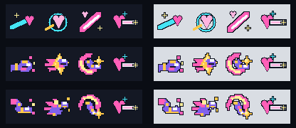

# CODEX-VFX-02 결과

완료: Brave Luna J·K·L의 a/b 후보 PNG 6개와 JSON 6개. 게임에는 미적용이며 I는 원본 그대로다. Python/Pillow로 직접 그렸다. 이미지 생성 도구·새 패키지는 사용하지 않았다.

## 후보

| 기술 | a | b |
|---|---|---|
| J | 금색 손목띠와 닫힌 건틀릿 주먹, 짧은 연타광 | 굽힌 무릎에서 뻗는 보디 킥, 짧은 타격광 |
| K | 건틀릿이 앞장선 압축 별 + 짧고 넓은 잔상 | 다리를 접고 주먹을 내민 작은 몸 + 짧은 잔상 |
| L | 전방 부츠 + 큰 반원 궤적 + 금색 충격별 | 대각선 아래 부츠 + 위에서 감기는 궤적 + 아래 충격별 |

파일: `art/bakeoff/skill_icons/luna_brave/luna_brave_<j|k|l>-<a|b>-v1.png`와 같은 이름의 JSON. 후보끼리 섞어 고를 수 있다.

## 카드의 모든 규격 판정

PASS는 수치 검사 또는 아래 명시한 제작자 육안 판정이다. 의미·가독성의 PASS는 사용자 채택을 뜻하지 않는다. —는 다른 기술에만 해당하는 항목이다.

| 카드 항목 | J-a | J-b | K-a | K-b | L-a | L-b |
|---|---|---|---|---|---|---|
| Canvas: 40×40 RGBA8, 정적 1프레임·투명 | PASS | PASS | PASS | PASS | PASS | PASS |
| Placement: 중앙 (20,20), 슬롯/배지/음영 없음 | PASS | PASS | PASS | PASS | PASS | PASS |
| Style: 2px 이상 색 면, 1px 남색 외곽선, AA·그라데이션 없음 | PASS | PASS | PASS | PASS | PASS | PASS |
| Colours: 보라·금·분홍·밝은 강조, 기존 I와 조화¹ | PASS | PASS | PASS | PASS | PASS | PASS |
| J: 건틀릿/발차기 + 짧은 근접 타격광¹ | PASS | PASS | — | — | — | — |
| K: 주먹/몸 + 압축 혜성 잔상, 몸 돌진¹ | — | — | PASS | PASS | — | — |
| L: 큰 회전 킥 궤적 + 무거운 충격별¹ | — | — | — | — | PASS | PASS |
| Distinct: 세 기술 및 Frey/Rio/Nova와 다른 실루엣¹ | PASS | PASS | PASS | PASS | PASS | PASS |
| Read: 슬롯색·밝은 회색에서 1배 식별¹ | PASS | PASS | PASS | PASS | PASS | PASS |
| Variants: 기술마다 다른 a/b 구상¹ | PASS | PASS | PASS | PASS | PASS | PASS |

¹ 전체 6×4 세트를 1배·4배에서 직접 확인한 시각 판정. K-a는 별 안의 주먹을, K-b는 작은 전신을 읽어야 하므로 사람의 최종 의미 판정이 특히 중요하다.

## 측정

전부 **40×40 RGBA8 / 가시색 6개(투명 제외) / alpha 0·255만 / 외곽선 #101522 1px / 경계상자 중심 (20,20)**이다. 실제 파일을 다시 여는 독립 검사 54/54 PASS, 보드 슬롯 144개 원본/후보 일치, 4배 보드 3개 nearest 일치. 빌드 검사 42/42 PASS.

색: `#101522`, `#8062ec`, `#ff5fb8`, `#ffc84a`, `#fff09a`, `#f7fbff`. 기존 아이콘 제작기의 팔레트를 그대로 사용했다. 비외곽선 색 픽셀은 모두 같은 색 2×2 덩어리에 속한다. 외곽선은 색 면의 8방향 1px 확장으로 생성했고, 저장 파일의 투명 경계가 모두 남색인지 별도 검사했다. 슬롯·키·쿨다운 그림은 PNG에 없다.

| ?? | ??? ?? / ?? | ?? ??? ??? | ??? ???? |
|---|---:|---:|---|
| luna_brave_j-a-v1.png | 156 / 0 | 8px | (21.43, 22.91) |
| luna_brave_j-b-v1.png | 168 / 0 | 4px | (20.29, 19.95) |
| luna_brave_k-a-v1.png | 168 / 0 | 4px | (20.16, 20.3) |
| luna_brave_k-b-v1.png | 208 / 0 | 4px | (19.88, 20.45) |
| luna_brave_l-a-v1.png | 236 / 0 | 8px | (17.93, 20.28) |
| luna_brave_l-b-v1.png | 240 / 0 | 4px | (20.7, 17.8) |

중앙은 픽셀의 모서리 좌표로 계산한 경계상자 중심이다. 불투명 픽셀의 무게중심은 비대칭 동작 때문에 약간 다르며 위 표에 별도로 기록했다. 세부값과 파일 해시는 [measurements.json](measurements.json), [verification.json](verification.json).

## 시각적 확인

[전체 비교 board.png](board.png): 위에서 현재 → A → B. 각 구간은 **24개 전체 / 1배 + 4배 / 왼쪽 #141824 + 오른쪽 #d9dde3**다. 행은 Frey, Yuki, Luna, Brave Luna, Nova, Rio이고 열은 J/K/L/I다. 1배 판단 때는 이미지 뷰어를 100%로 연다.

위에서 현재·A·B. 각 줄의 I는 그대로이며, 교체 후보는 첫 세 칸뿐이다. 개별 큰 보드는 `set_current_4x.png`, `set_a_4x.png`, `set_b_4x.png`; 1배본도 같은 이름의 `_1x.png`로 있다.

## 사람이 판단할 부분 / 남은 작업

- 설명 없이도 **J 근접 연타 / K 몸 돌진 / L 강한 회전 킥**으로 읽히는지. 특히 K가 일반 Luna K의 발사체로 보이지 않는지.
- J-a의 건틀릿과 J-b의 굽힌 다리 중 어느 쪽이 즉시 인식되는지. L이 J보다 강한 마무리로 느껴지는지.
- 새 보라·금색 비중이 기존 I의 분홍·청록과 어울리는지, 1배에서 선호하는 후보를 고를 것.
- 선택 후 게임 HUD 적용·실경기 가독성 확인은 리드 작업. 이번에는 게임 실행·통합을 하지 않았다.

## 재현과 인계

`PYTHONDONTWRITEBYTECODE=1`로 지정된 Python에서 `build_icons.py`, 이어 `verify_icons.py` 실행. 추가 설치 없음. `commit.ps1`은 정확한 파일 목록과 카드만 스테이징하도록 작성했으며 **실행하지 않았다**. 제품 폴더 변경 없음. 카드의 `tests/art_preview/skill_icons_18/`은 실제 위치인 `smash-nine-prototype/tests/art_preview/skill_icons_18/`에서 읽었다.
