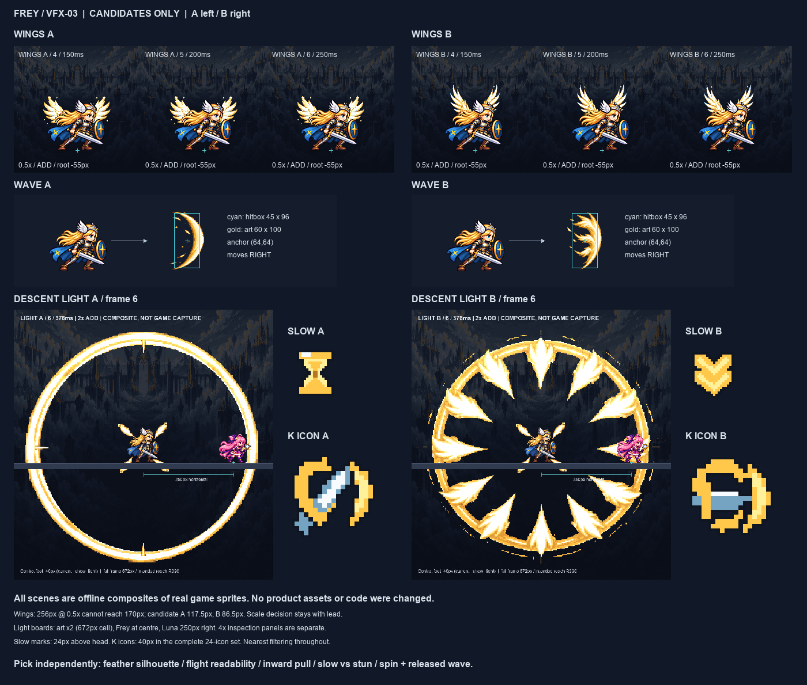

# CODEX-VFX-03 — Frey 후보

완료: **5항목 × A/B = PNG 10개 + JSON 10개**. 효과 6종은 내장 `image_gen`에 첨부 참고 이미지 3장을 매번 전달해 생성했고, 작은 표시·아이콘 4종은 Pillow로 직접 그렸다. 게임에는 미적용이다.

## 후보와 사람이 판단할 부분

| 카드 순서 | A | B | 사람이 고를 것 |
|---|---|---|---|
| 날개 | 넓은 부채형 깃 | 위로 솟는 긴 매의 깃 | 펼침이 날개로 읽히는지, 작은 표시 폭으로 충분한지 |
| 검기 | 매끈한 단일 초승달 | 뒤쪽이 세 깃으로 갈라지는 초승달 | 오른쪽 비행·45×96 판정의 느낌, 4→1 반복 연결 |
| 강림 빛 | 이중 고리·얇은 광선·안쪽으로 모이는 깃 | 깃 화관·안쪽으로 모이는 깃 | 0.45초 동안 흡인으로 읽히는지, B의 밝은 가장자리가 상대를 방해하는지 |
| 슬로우 표시 | 금색 모래시계 | 아래로 향하는 이중 갈매기표 | 기절·아머와 구별되고 ‘이동 느림’으로 읽히는지 |
| K 아이콘 | 대각선 검·회전 고리·분리된 검기 | 수평 검·넓은 회전 고리·큰 검기 | 40px에서 회전 후 발사 의미, J/L과 구별되는지 |

파일은 `art/bakeoff/effects/frey/frey_{wings,wave,ult_light}-{a,b}-v1.png`, `art/bakeoff/ui/status/slow-{a,b}-v1.png`, `art/bakeoff/skill_icons/frey/frey_k-{a,b}-v1.png`이다. 같은 이름의 JSON에 한국어 설명·교체 대상·프레임·fps·앵커를 기록했다. 기존 후보 파일은 수정하지 않았다.

## 규격과 검사

| 항목 | 전체 PNG | 프레임 | fps | 앵커 | 표시 |
|---|---:|---:|---:|---:|---|
| 날개 A/B | 1536×256 | 6 × 256² | 20 | (128,240) | 0.5배, 뿌리 (128,130): 발 위 55 화면 px |
| 검기 A/B | 512×128 | 4 × 128² | 16 | (64,64) | 1배, 가시 영역 A 58~60×100 / B 60×100 |
| 강림 빛 A/B | 2016×336 | 6 × 336² | 13.3 | (168,168) | 2배, 최대 가시 반경 A 329.56 / B 329.01 화면 px |
| 슬로우 A/B | 24×24 | 1 | 0(정적) | (12,12) | 1배 |
| K 아이콘 A/B | 40×40 | 1 | 0(정적) | (20,20) | 48px HUD 슬롯에 4px 여백 |

저장 파일 독립 검사 **222/222 PASS**: RGBA, 이진 알파 `{0,255}`, 모든 프레임 1px 투명 테두리, 메타데이터, 생성 그림 확대 없음, 날개 4~6 실루엣 고정, 빛 반경 증가·마지막 테두리 최대 밝기, 아이콘 2px 색 덩어리·1px 남청 외곽선, 보드 확대의 nearest 일치, 아이콘 48칸의 원본/후보 일치. 상세값은 [measurements.json](measurements.json), 검사 범위는 [verification.json](verification.json).

**카드 내부 충돌은 미해결:** 256px 프레임·양쪽 1px 여백·0.5배 표시는 최대 127px 폭이다. 따라서 ‘약 170px 날개 폭’은 동시에 달성할 수 없다. 파일 크기·발 앵커·0.5배·뿌리 높이를 우선했으며 실제 펼침 폭은 **A 117.5px / B 86.5px**다. 170px가 필수이면 리드가 프레임 또는 표시 배율·앵커의 계약을 먼저 조정해야 한다. 수치 검사 통과는 이 충돌의 해결이나 사용자 채택을 뜻하지 않는다.

## 보드와 직접 검수

왼쪽 A, 오른쪽 B. 실제 게임 스프라이트를 지정 위치에 합성한 정적 보드이며 **게임 실행 캡처가 아니다**. 이 종합판은 축소되어 있으므로 실제 크기 판단에는 아래 원본 보드를 사용한다.

- 날개: [A 2배](wings_a_2x.png) / [B 2배](wings_b_2x.png). `dash_strike` 1프레임을 사용하며 전체 6프레임을 몸 뒤에 배치. 실제 표시 크기 `_1x`와 직접 검수한 `_4x`도 있다. 청록 십자는 발, 분홍 십자는 뿌리 기준점이다.
- 검기: [A 1배](wave_a_1x.png) / [B 1배](wave_b_1x.png). 전 프레임과 Frey 옆 검기, 청록 45×96 판정. 같은 이름의 `_4x`에서 전부 직접 확인했다.
- 빛: [A 표시 2배](light_a_display_2x.png) / [B 표시 2배](light_b_display_2x.png). 전 프레임 672px 셀, 어두운 Asgard 배경, Frey 중심·오른쪽 250px Luna. `light_{a,b}_f1_4x.png` ~ `f6_4x.png` 12개 전체를 직접 확인했다.
- 슬로우: [1배](slow_1x.png) / [직접 검수한 4배](slow_4x.png). 기존 `stun`·`super_armor`와 나란히 머리 위, 현재 상태 아이콘 위치인 발 위 121px에 배치했다.
- 아이콘: [A 전체 4배](icons_a_4x.png) / [B 전체 4배](icons_b_4x.png). 6행×4열의 24개 세트를 모두 확인했다. 각 `_1x`도 제공한다. Frey K만 노란 테두리로 표시했다.

날개·빛은 기존 코드의 가산 합성(ADD)을 RGB 더하기로 재현했고, 검기·UI는 일반 합성이다. 날개가 얼굴·검 앞에 덮이지 않는 것, 빛 안의 두 캐릭터가 식별되는 것은 보드에서 확인했다. B 빛은 A보다 가장자리 시각 밀도가 높다. 실제 Godot의 색 처리·카메라·전투 중 가독성·정속 재생은 이번 작업에서 시험하지 않았다.

빛의 보드 중심은 현재 `_show_light`처럼 발 위 40px다. 현재 끌어당김 판정 중심은 발 위 8px여서 32px 차이가 이미 있다. 이 카드에서는 제품 코드를 바꾸지 않았으며 통합 때 리드가 확인해야 한다. 6/13.3=약 0.451초로 카드의 0.45초는 반올림값이다.

## 제작·인계

원본 6장은 `art/raw/vfx-03/`에 보존했다(git 제외). [prompts.txt](prompts.txt)에 여섯 생성 프롬프트가 있다. 참고 순서는 Frey idle → adopted ultimate charge → slash다. 이미지 생성 도구 외 API·패키지 설치는 사용하지 않았다.

후처리: 알파 200 이상만 남김 → 제한 팔레트 → 최근접 축소·빈 캔버스 배치. 검기는 60×100 범위로 가로·세로를 각각 축소했다. 날개는 생성 원화의 앞 4포즈를 사용하고 완전 펼침 포즈를 4~6에 유지하면서 깃 끝 명도만 바꿨다. 빛은 생성 원화의 마지막 고리를 단계별로 축소하고, 원화에서 자른 광선·깃을 합성했다. 작은 깃의 중심 거리는 3~6프레임에서 80→64→48→32 art px로 감소한다. 좌표·배율은 [processing.json](processing.json)에 있다.

재현: 지정 Python과 `PYTHONDONTWRITEBYTECODE=1`로 `build_assets.py` → `build_boards.py` → `verify_assets.py`. `prepare.py`는 작업 시작 당시 제품 파일 해시를 기록하는 초기 준비용이며, 기존 검증 기준을 덮어쓰려고 재실행하지 않는다.

**현재 상태:** 제품 폴더 2,158개 파일의 SHA-256 및 파일 집합 불변. 게임 실행·적용·커밋은 하지 않았다. [commit.ps1](commit.ps1)은 이 작업 파일과 카드만 지정한 실행 대기 스크립트다. `art/raw/`, 다른 작업 파일, 제품 파일, `__pycache__`는 커밋 목록에 없다.

**남은 작업 / 다음 권장 단계:** 사람이 항목별 A/B 선택 → 날개 표시 폭 계약 확정 → 리드가 VFX·슬로우 표시·HUD 연결 후 실제 속도와 경기 화면에서 확인. 이 카드의 후보·메타데이터·보드 중 미납 항목은 없다.
