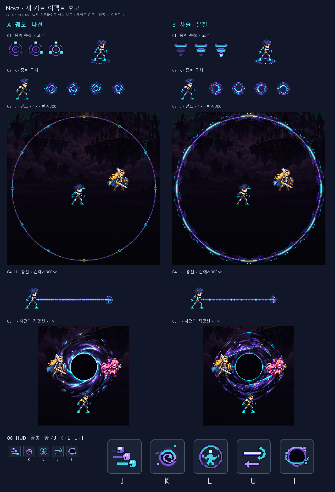

# CODEX-VFX-05 · Nova 새 키트 이펙트 후보

완료: **23 PNG / 65프레임 / 23 JSON**. 주요 이펙트 원화 12장은 내장 `image_gen`으로 생성했고, 매 호출에 사용자가 준 Nova idle·중력 폭발·궁극기 핵·궁극기 폭발 네 이미지를 모두 참조로 전달했다. 상태 표시 6개와 아이콘 5개는 Pillow로 직접 픽셀을 배치했다. 게임에는 적용하지 않았다.

왼쪽 A, 오른쪽 B. 실제 채택된 idle 시트와 배경을 넣은 합성 보드이며 엔진 캡처가 아니다. 큰 필드와 궁극기는 실제 1× 크기다. 작은 상태 표시와 마지막 HUD 행은 비교를 위해 확대했다.

| 카드 순서 | 납품 후보 | 프레임 규격 / fps / 앵커 | 보드 | 사람이 판단할 것 |
| --- | --- | --- | --- | --- |
| 1. 중력 중첩·고정 | A: 밝아지는 위성 1→3 + 궤도 고리. B: 채워지는 중력 우물 1→3 + 사슬 고리 | 표시 24×24, 1장, (12,12). 고리 96×32, 6장, 10fps, (48,16) | [표시](stacks.png), [머리 위 4×](stacks-4x.png), [고리 전 프레임 1×·4×](roots.png) | 1배에서 단계가 구별되는지, B의 사슬과 A의 가는 고리 중 고정 상태가 잘 읽히는 쪽 |
| 2. 중력 구체 | A: 세 갈래 나선. B: 분절 궤도·각진 파편 | 64×64, 4장, 16fps, (32,32) | [전 프레임 1×·4× + Nova/45×45 판정](orbs.png) | 구체 크기, 나선의 복잡도와 회전 속도 |
| 3. 중력 필드 | A: 가는 궤도 눈금. B: 밝은 분절 괄호. 경계 장식이 초당40도로 공전 | 640×640, 6장, 8fps, (320,320), 반경300 | [실제 크기 + 경계 4×](fields.png), [6위상 4×](field-phases-4x.png), `field-{a,b}-4x-q1…q4.png` | A의 경계가 너무 약하지 않은지, B의 장식 밀도와 공전 속도 |
| 4. 중력 광선 | A: 세 갈고리 촉 + 꼬인 줄. B: 긴 별 촉 + 마디 줄 | 머리 48×48, 4장, 16fps, (24,24). 줄 64×16, 1장, (32,8) | [손→300px / 머리 전 프레임 4× / 타일 3회 4×](beams.png) | 갈고리가 잡는 기술로 읽히는지, 줄의 두께와 반복 간격 |
| 5. 사건의 지평선 | A: 나선 강착 원반. B: 분절 강착 고리 | 320×320, 6장, 12fps, (160,160), 검은 핵 지름110·외곽 반경150 | [A 전 프레임](spheres-a.png), [B 전 프레임](spheres-b.png), [A 겹침 4×](sphere-a-4x.png), [B 겹침 4×](sphere-b-4x.png), `sphere-{a,b}-full-4x.png` | 반경112에서 앞에 그린 적이 잘 보이는지, 궁극기의 무게감과 회전 속도 |
| 6. 스킬 아이콘 | J 세 주먹 / K 안쪽 나선 / L 떠 있는 사람 / U 갈고리·되당김 / I 검은 구체·공전점 | 각 40×40, 1장, (20,20) | [48×48 슬롯, J·K·L·U·I, 1×·4×](icons.png) | 작은 HUD에서 기술 의미가 바로 읽히는지 |

## 확인 결과

- [verify.py](verify.py) 실행 **통과**: 23개 파일 이름·크기·프레임·fps·JSON 앵커·루프·대체 경로, RGBA, 알파 0/255, 투명 픽셀 RGB 0, 각 프레임 1px 빈 테두리. 타일 좌우만 예외다.
- 타일 A/B 양끝 RGBA 최대 차이 **0**. 심선이 가로 전체에 이어진다. 세 번 반복한 그림도 4배로 직접 확인했다.
- 필드 경계의 광도 최대점(P05 / 중앙 / P95): A **298.5 / 299.5 / 300.5px**, B **299 / 300 / 302.5px**, 360방향 모두 경계 검출. 내부 반경280 미만의 최대 RGB는 16 이하로 제한해 additive 합성에서도 캐릭터를 덮지 않는다.
- 궁극기는 반경55 안을 불투명 검정으로 유지하고, 반경150 밖의 알파는 0. 구체 뒤 → Frey/Luna 앞 → Nova 아래 순서로 합성했다.
- 반복 10개 스트립의 마지막→첫 프레임 RGB 변화량은 전체 프레임 간 변화량 평균의 **0.894~1.007배**. 닫히는 구간만 튀는 수치 이상은 없다. 이는 자연스러운 움직임에 대한 사람 평가를 대신하지 않는다.
- 모든 종류의 실제 배치 1× 보드와 4× 확대를 직접 열어 보았다. 필드는 네 사분면·6위상, 궁극기는 모든 프레임의 캐릭터 겹침과 전체 4×도 확인했다.
- Python 구문·텍스트 후행 공백 검사 통과. 미리보기 JavaScript 구문 검사 통과. `smash-nine-prototype/`의 변경 상태는 시작 때와 같다(원래 있던 untracked `.uid` 포함). 제품 파일 변경 없음.
- 상세 수치·각 프레임 bbox·해시는 [measurements.json](measurements.json), 처리 방법과 축소 배율은 [processing.json](processing.json).

## 제작 방식과 제한

각 이펙트의 생성 원화 한 장에서 주기적인 이미지 샘플링으로 프레임을 만들었다. 고리·구체·궁극기는 중심을 고정해 회전하고, 광선 머리는 오른쪽 방향을 유지하며 크기·밝기가 호흡한다. 필드는 원화 상단15도 구간을 거울 접합해 30도 주기로 배치하고, 미세한 원형 오차를 반경300에 정렬했다. **장식이 매 프레임5도, 초당40도로 실제 공전**하며 여섯 장 뒤 같은 무늬로 이어진다. 타일은 짧은 원화 구간을 축소한 뒤 거울 주기로 이어 양끝을 맞췄다. 모든 원화 샘플링 배율은 1 이상(축소)이며, 확대는 검토 보드에만 썼다.

합성은 고리·구체·필드·광선에 additive, 궁극기에 normal을 썼다. 따라서 작은 K 구체의 어두운 핵은 배경을 검게 덮지 않는다. 이는 카드의 additive 계약을 따른다. 궁극기 검은 핵은 실제로 배경을 가린다.

[preview.html](preview.html)에 정속/¼속도·일시정지·4배 보기를 넣었다. 브라우저 도구가 두 번 모두 `The browser access host is unavailable`을 반환하여 **브라우저 실시간 표시·조작은 검증하지 못했다**. 게임 실행·Godot 통합 검증도 수행하지 않았다. 정지 프레임·수치 검증과 구분한다.

원화: `art/raw/vfx-05/`(git 제외). 프롬프트: [prompts.txt](prompts.txt). 원화가 보관된 이 클론에서 재생성하는 순서: `build_ui.py` → `build_effects.py` → `build_boards.py` → `verify.py`. 지정 Python과 `PYTHONDONTWRITEBYTECODE=1`을 사용한다. 별도 패키지는 설치하지 않았다.

## 현재 상태 / 남은 작업

카드의 후보 파일과 보드는 모두 납품했다. [commit.ps1](commit.ps1)은 이 작업 파일과 카드만 스테이징하도록 작성했으며 **실행하지 않았다**. 원화·다른 작업의 파일·제품 폴더는 스테이징하지 않는다.

다음 권장 단계: 사람이 A/B와 루프 속도를 고르고, 리드가 선택된 후보를 게임에 연결한 뒤 실제 전투에서 경계 밝기·광선 두께·공전 가독성을 판단한다.

디스크 확인: 작업 클론 `C:/Users/TH/Documents/AI/GameProject/SmashNine-units/vfx-b/SmashNine` 전체는 기존 파일·`.git` 포함 **2.855GiB**. 이번 후보·원화·보고서 합계는 **15.81MiB**다. 허용 경로 밖의 새 변경은 없음을 시작 상태와 비교했다.
