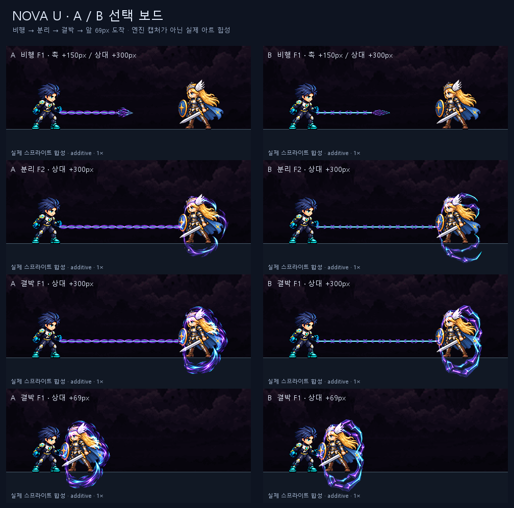

# CODEX-VFX-06 · 노바 포획 광선 후보

완료: **A/B 각 4종, PNG 8개·26프레임·JSON 8개**. 내장 `image_gen`으로 원화 8장을 생성했다. 매 호출에 사용자가 지정한 Nova idle·orb A·field B·sphere A를 참조 이미지로 전달했다. 후보만 납품하며 게임에는 적용하지 않았다.

왼쪽 A는 곡선 촉수, 오른쪽 B는 각진 갈고리다. 실제 idle과 배경 위에 additive로 합성한 그림이며 엔진 캡처가 아니다.

| 항목 | A / B | 규격 | 사람이 판단할 것 |
| --- | --- | --- | --- |
| 비행 촉 | 접힌 세 갈래 곡선 / 접힌 네 갈래 각진 촉 | 48×48, 4장, 16fps 반복, 앵커 24,24 | 작은 촉이 벌어질 구조로 읽히는지, 밝기가 충분한지 |
| 분리 | 곡선이 감겨 닫힘 / 각진 갈고리가 맞물림 | 160×160, 4장, 40fps 단발, 앵커 80,80 | 0.1초 안에 벌어짐→감싸기가 전달되는지 |
| 결박 | 세 촉수의 조임 / 각진 테두리의 조임 | 160×160, 4장, 12fps 반복, 앵커 80,80 | 얼굴·몸통 가독성, 포획 순간 두께·밝기, 바닥 아래로 보이는 하단 윤곽 |
| 연결줄 | 보라 섬유와 심선 / 얇은 각진 마디와 심선 | 64×16, 1장, 가로 반복, 앵커 32,8 | 선 두께, 반복 무늬, 69px 도착 시 손 접점 |

후보 경로: `art/bakeoff/effects/nova/nova_beam_{head,split,bind,tile}-{a,b}-v2.png`와 같은 이름의 JSON.

## 검수와 보드

- [전체 보드](board.png): A 왼쪽 / B 오른쪽, 비행 150px, 분리 4장, 결박 4장, 상대 150px 중간 지점과 69px 도착 지점. 두 캐릭터는 같은 바닥, 기본 상대 거리는 300px다.
- 각 장면은 `a-01…a-11`, `b-01…b-11`의 `-1x.png`와 `-4x.png`로 제공한다. [목록과 좌표](boards.json). 4배 확대를 직접 열어 가림·줄 접점·바닥 위치를 확인했다.
- `head-{a,b}-frames-4x.png`, `split-{a,b}-frames-4x.png`, `bind-{a,b}-frames-4x.png`: 효과 전체 프레임 확대. [타일 3회 반복 4×](tether-seams-4x.png), [중앙 보호 영역](safe-area.png).
- [미리보기](preview.html): 정속/¼속도, 전체 흐름, 비행·결박 반복, 분리 단계 반복, 한 프레임, 1×/2×/4×. JavaScript 구문 검사 통과. **실시간 브라우저 재생은 검증하지 못했다.** 브라우저 호스트 사용 불가에 이어 자동 승인 검토가 Chrome 제어를 거부했다: `Computer Use was not approved to use Google Chrome`.

[verify.py](verify.py) 통과: 크기·프레임 수·fps·앵커·대체 경로·반복 여부, 알파 0/255, 투명 픽셀 RGB 0, 프레임 1px 빈 테두리. 연결줄 좌우 RGBA 차이 0, 심선 전체 연결. **분리 F4 = 결박 F1 완전 일치**. 중앙 50×80 영역은 모든 프레임에서 **91.825% 이상 투명**하다. 반복 네 스트립의 마지막→처음 RGB 변화량은 전체 전환 평균의 **0.986~1.067배**다. 이 수치는 사람의 동작 평가를 대신하지 않는다. 상세: [measurements.json](measurements.json).

## 제작과 현재 상태

원화를 자르거나 투명 여백을 넣은 뒤 LANCZOS 축소·약한 선명화·하드 알파 정리를 했다. 확대는 검토 보드에만 썼다. 분리는 생성된 단계 그림, 결박은 생성된 닫힌 그림에서 중심 고정 조임·광도 맥동·왼쪽 불꽃 이동으로 만들었다. 비행 촉은 윤곽을 고정하고 광도만 반복한다. 분리 마지막 장을 결박 첫 장과 같은 픽셀로 저장했다.

69px 도착 시 왼쪽 꼬리가 Nova 손 뒤로 넘어가지 않도록 효과의 x<55 영역만 55→20px로 축소해 x35부터 배치했다. 보호 영역과 오른쪽 촉은 유지한다. 보드는 코드의 몸 중심(발에서 32px 위)을 사용하며, 줄은 몸통을 가로지르지 않고 왼쪽 분기점에 연결했다. 리드도 이 접점을 사용해야 보드와 같다. 타일은 원화 일부를 거울 반복해 이음을 맞췄고, A 심선은 원화의 노출된 심선 픽셀을 복제해 끊김을 없앴다.

원화: `art/raw/vfx-06/`(git 제외). [프롬프트](prompts.txt), [축소 기록](processing.json). 재생성: `build_effects.py` → `build_boards.py` → `build_preview.py` → `verify.py`. 지정 Python, `PYTHONDONTWRITEBYTECODE=1`, 패키지 설치 없음.

제품 폴더의 시작/종료 상태가 동일하다. Godot 실행·실제 전투 통합 검증은 하지 않았다. [commit.ps1](commit.ps1)은 작성만 했으며 실행하지 않았다. 남은 작업은 사용자 A/B 선택과 리드의 게임 연결·실제 전투 판단이다.

디스크: 이 클론 `C:/Users/TH/Documents/AI/GameProject/SmashNine-units/vfx-b/SmashNine`은 기존 파일·`.git` 포함 약 **2.875GiB**. 이번 후보·원화·보고서는 약 **10.7MiB**다.
