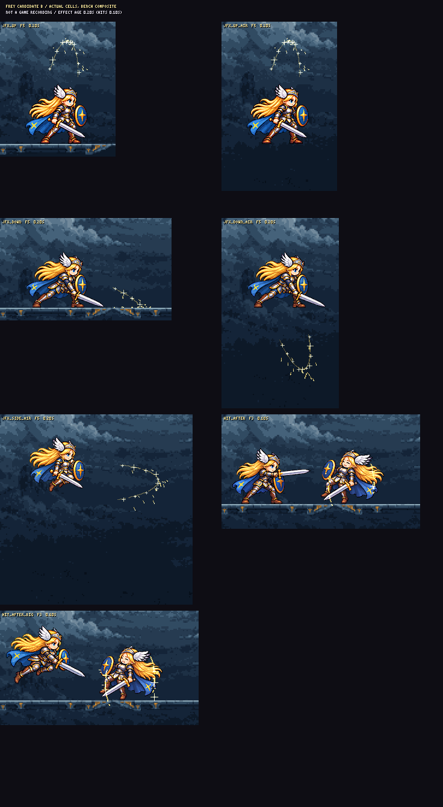

# CODEX-VFX-07 ? Frey ?? B

??: J ?? 5?? ?? ?? 2?? ES ??, PNG ???, ??? JSON, ????? ??? ????. ?? A? ?? ???, ?? ?? ? ?? pixelfx? ???? ???. ?? ??? ????? ??? ??? ???.

[?? ??](board.png) ? [20fps ??? ??](preview.html) ? [?? ??](measurements.json) ? [?? ??](audit.json)



?? Frey ?? ?? ? ????? ??? ??? ?? ????. J? ?? ?? 0.20?, ??? 0.10??? ?? ?? ??? ???. ?? ???? ? ??? 1? ?? ??? 4? ??? ??.

**?? ??**

- J: ?? ??? ?? ?? ?? ?? ?, ??? ?? ??? ???, ?? ???? ?? ???. ?? ?/?J? ? ?? +32?? ? ? ????, ?? 3?? ?? ?? ??? ????.
- ??: ? ??? ?? ??? ?? ???. ??? ??? 3?, ?? ??? 5??? ??? ??? ??? ???. ?? 480 ???? ?? ?? ????? ?????? ???.

**??? ?**

??? ??? 1???? ?? 20fps?. ?? ??? ??? ?/20??. ?? ???? ?? ??? ??? ??? max(R,G,B) ??? ??? ? ?????, ??? ??? ?? ??? ???. ? ??? ?? ?? ? ?? ?? ??? ??? ??? ????.

| ?? / ??? | ??? / ?? ?? | ?? ?? | ?? ?? ?? | ?(px) | ? ?? ???(px) |
| --- | --- | --- | --- | --- | --- |
| ?? ?J ? frey_jfx_up-b | 16 / 0.80? | F1 / 0.00? | F3 / 0.10? | 200?250 | 95?176 |
| ?? ?J ? frey_jfx_up_air-b | 16 / 0.80? | F1 / 0.00? | F3 / 0.10? | 200?370 | 95?240 |
| ?? ?J ? frey_jfx_down-b | 15 / 0.75? | F1 / 0.00? | F2 / 0.05? | 300?150 | 93?37 |
| ?? ?J ? frey_jfx_down_air-b | 14 / 0.70? | F1 / 0.00? | F3 / 0.10? | 240?440 | 90?219 |
| ?? J ? frey_jfx_side_air-b | 16 / 0.80? | F1 / 0.00? | F3 / 0.10? | 330?360 | 114?275 |
| ?? ?? ? frey_hit_after-b | 9 / 0.45? | F1 / 0.00? | F1 / 0.00? | 160?150 | 111?73 |
| ?? ?? ? frey_hit_after_big-b | 12 / 0.60? | F1 / 0.00? | F1 / 0.00? | 200?180 | 167?89 |

- 98??? ?? ? ????? ????. ? ??? ?? ??? ? ??? 0.040~0.737%??, ?? ?? ?? ?? ?? ??. PNG 7? ?? 134.3 KiB. ? ???? ??? RGBA8 ?? ??? ??? 25.51 MiB?? ?? GPU ??? ??? ???.
- ?? 1??? ? ?? 0, 0/255 ?? ?? 0, ?? ???? ??? ?? ?? 0. minLight=40, additive RGB ???. ?? ??? ? ? ?? RGBA? ????.
- ? B ??? ? ?? 40?60 ??? ?? ????? ? ?? 0. ?? ?? ?? ??? 0??. ?? ??????? ?? ??? ??? 0??? ?? ???.
- 120Hz? ?? ??? ???? ?? +32 ??? ?? ?? ??? ????. ?? ?? ?? ??? ??? ?? ?J 3?, ?J 15??. ?? ??? ? ??? ?? ????.
- ?? ??? ?? 0.075? ? ??: ?? 4???/44fps ??? ??? ??? ???. 0.45/0.60?? ?? ?? ???? ????? ? ??? 0.525/0.675??.

**?? ? ??? ??**

?? PNG? ?? 98???? ?? Frey ? ??? 1?? ??? 4?? ?? ????. [?? ??](visual-review.json)? [4? ??? ??](qa/manifest.json)? ??? ??? ???. 4???? ?? 26??? ????.

?? ???? ? ?? ???, ??? ?? ??? ?? ??, ?? ?? ?? ??? ????. ?????? ???? ???? ???. ?? ?? ?? ?? ??? ????, ?? ??? ?? ??? ????? ? ???? ???. ?? ????? ?? ?? ??? ? ?? ??? ?? ???. ?? ???? ??? ????.

**?? ??? ??**

- ??? ??? ?: ??? v2 ???? ??? ????, ?? ??? ?? ??? ???, ? ??? ??? ???, ?? ???? J ??? ??? ? ?????. now/A/B ??? ??? ???????? ???.
- ??? ?? ?, J? ?????, ?? ?? 6???/36fps, ?? ?? 4???/44fps? ????. ? ??? ??? ?? ???? ?? ?????????????? ????? 8????? ??? ???? ???. ?? ?? ? ??? ?? ?? ??? ?? ???.
- HTML? 1? ????? ???? ?? ?? ???. ???? ?? ?? ??? ?? ???. ??? ?? PNG ???? ?? ????.
- ?? ??? .git? ?? ????? ???? ???. commit.ps1? ? ??? ??? ??? ?? ??? ???? ?? ??? ?? ???. ??? ?? ??? ??? ???? ???.

**?? ???**

??? ???? Node 24? ?? ???? ????. ??? ??? ?? ??. ?? pixelfx ??? ?? ??? ?? ???. bench-link.mjs? ???? ?? ??? ??? ?? ??? ?????? ?? ?? pixelfx? ????.

```powershell
node art/bakeoff/effects/pixelfx/frey/b/bake.mjs
node reports/codex-vfx-07/audit.mjs
node reports/codex-vfx-07/preview.mjs
node reports/codex-vfx-07/delivery.mjs
```

next: ??? pick cup?? now/A/B? ??? ? ??? ??? ????. ??? 1?, ? ??, ?? ??? ???? ??? ?? ???? ??. ???? ??? ??? ????.
