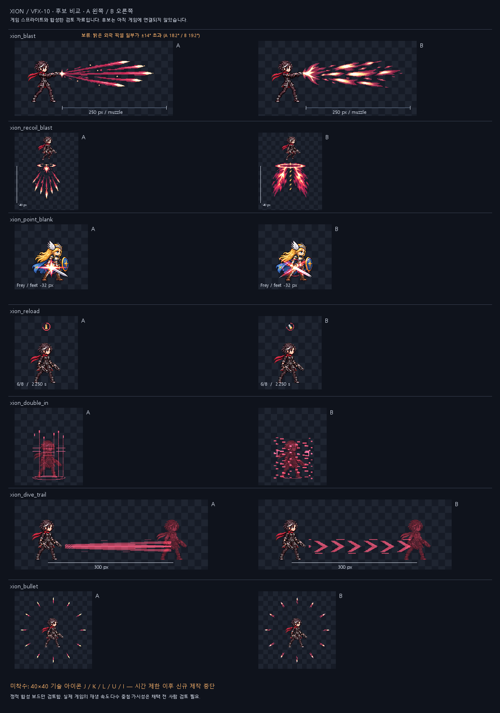
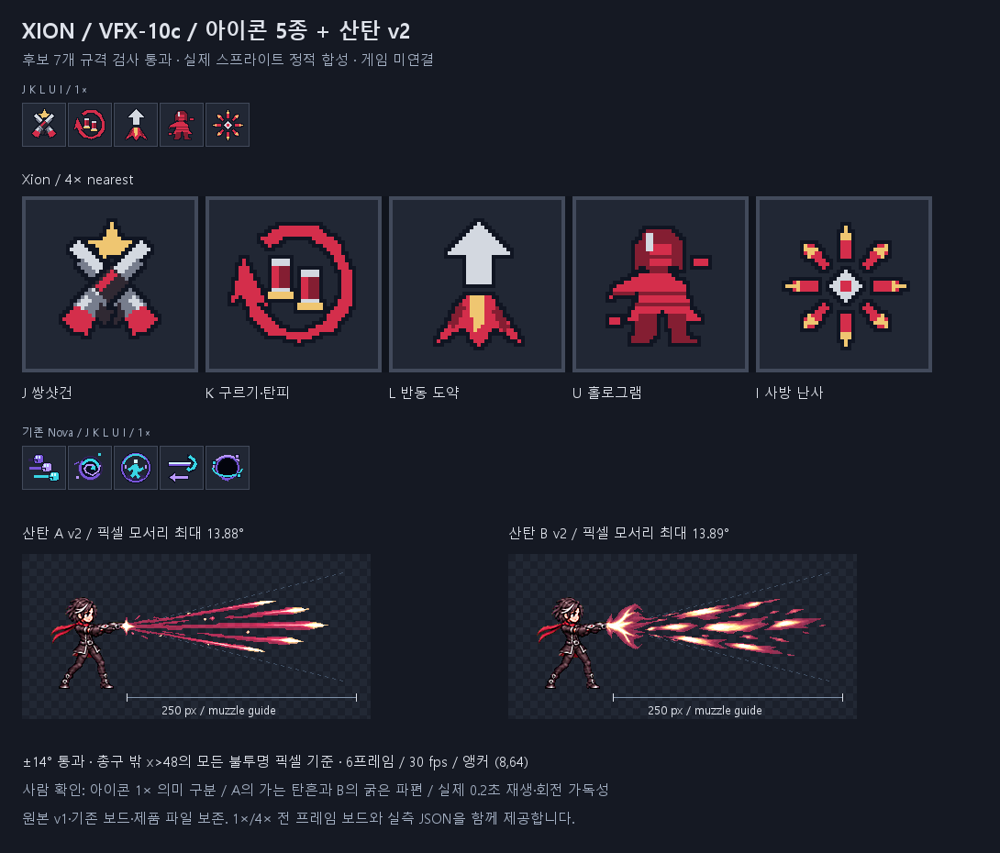

# CODEX-VFX-10 — 시온 효과 후보, 재개 작업 인계

> **최신 상태:** 아래 [후속 실행 VFX-10c](#run-10c)에서 아이콘 5종과 산탄 v2 두 종을 완료했다(7/7 규격 통과). 이 문서의 앞부분은 v1 납품 당시 기록이다.

**부분 완료.** 7종 A/B, 총 14개 스트립과 JSON을 저장했다. 파일 규격은 14/14 통과했으나 추가 형상 검사까지 포함하면 **12 통과 / 산탄 2 보류 / 아이콘 5 미착수**다. 게임에 연결하지 않았으며 제품 파일은 수정하지 않았다.

## 파일과 후보 차이

경로는 저장소 루트 기준이다. 모든 PNG 옆의 같은 이름 `.json`에 한국어 설명, 교체 대상, 프레임 수, fps, 앵커, loop, 합성 방식이 있다.

| 항목 | A | B | 파일 |
|---|---|---|---|
| 산탄 J | 가는 진홍 탄흔, 금백색 끝 | 굵고 짧은 불꽃 조각과 큰 총구 섬광 | `art/bakeoff/effects/xion/xion_blast-{a,b}-v1.png` |
| 반동 도약 L | 발밑 고리에서 가는 산탄이 아래로 퍼짐 | 두 갈래 굵은 불꽃과 가운데 금색 파편 | `art/bakeoff/effects/xion/xion_recoil_blast-{a,b}-v1.png` |
| 근접 적중 | 수평 십자와 가는 원형 고리 | 대각선 파열과 끊어지는 원형 고리 | `art/bakeoff/effects/xion/xion_point_blank-{a,b}-v1.png` |
| 재장전 | 세운 금색 탄피, 연속 원형 고리 | 기울인 은색 탄피, 분절된 각진 고리 | `art/bakeoff/ui/status/xion_reload-{a,b}-v1.png` |
| 홀로그램 소환 U | 수직 스캔 기둥과 가로 주사선 | 엇갈린 글리치 조각과 꺾쇠 | `art/bakeoff/effects/xion/xion_double_in-{a,b}-v1.png` |
| 도약 잔상 U | 연속 리본 세 줄 | 분절된 꺾쇠와 홀로그램 조각 | `art/bakeoff/effects/xion/xion_dive_trail-{a,b}-v1.png` |
| 연사 탄 I | 가는 바늘 머리와 긴 꼬리 | 굵은 금색 탄두와 갈라진 꼬리 | `art/bakeoff/effects/xion/xion_bullet-{a,b}-v1.png` |

## 통과 / 보류

| 항목 | 프레임 크기 × 수 | fps / loop | 앵커 | A / B | 측정·제한 |
|---|---|---|---|---|---|
| 산탄 | 256×128 × 6 | 30 / 아니오 | (8,64) | **보류 / 보류** | 최대 길이 228 / 234 px. 밝은 외곽 픽셀 최대 각도 18.2° / 19.2°로 ±14° 초과 |
| 반동 | 192×176 × 6 | 30 / 아니오 | (96,16) | 통과 / 통과 | 최대 깊이 137 / 138 px, 반폭 72 / 71 px |
| 근접 | 112×112 × 5 | 36 / 아니오 | (56,56) | 통과 / 통과 | 실제 그림 80×48 / 79×48. 138.9 ms. 몸 중심 위 30 px 침범 없음 |
| 재장전 | 24×24 × 8 | 8/3 / 아니오 | (12,12) | 통과 / 통과 | 진행 고리 픽셀 수 단계별 증가, k=0…7 → k/8 |
| 소환 | 128×176 × 6 | 24 / 아니오 | (64,160) | 통과 / 통과 | 인물 없이 발밑에서 상승·해소 |
| 잔상 | 256×48 × 5 | 31 / 아니오 | (128,24) | 통과 / 통과 | 출발점부터 지워짐 |
| 연사 | 24×8 × 2 | 20 / 예 | (12,4) | 통과 / 통과 | 오른쪽 밝은 머리, 서로 다른 2프레임 |
| 아이콘 J/K/L/U/I | 요구 40×40 × 1 | 정지 | 요구 (20,20) | **미착수** | PNG·JSON·아이콘 바 없음 |

14개 모두 RGBA, 알파 `{0,255}`, 프레임마다 빈 1픽셀 테두리, 비어 있지 않은 서로 다른 프레임, 지정 메타데이터를 확인했다. 재장전은 일반 합성, 나머지는 가산 합성이다. JSON의 nearest는 연결 지침이며 게임 임포트 설정은 바꾸지 않았다.

산탄 각도 검사는 총구 장식과 분리하기 위해 **x>48, 불투명, 녹색 채널>140인 밝은 픽셀**을 측정한다. 중심선뿐 아니라 탄두 두께·독립 스파크를 포함하는 보수적 검사다. 완전한 규격 통과로 주장하지 않는다. 외곽 탄흔·스파크의 세로 범위 보정이 남았다.

## 제작 방식

- 원본 5장과 새 근접 B는 내장 `image_gen`. 새 호출에도 지정된 참조 4장을 전부 전달했다. 전문은 [prompts.txt](prompts.txt), [prompt_point_b.txt](prompt_point_b.txt).
- 그림별 원점으로 분리·crop → 축소 → hard alpha → 테두리를 정리했다. 배율은 0.27…0.40으로 확대하지 않았다. 일부 행의 가로·세로 축소율은 다르다. JSON의 `extraction`에 원본 crop·원점·배율이 있다. 총구 뒤로 나온 원본 장식은 캔버스·테두리 밖에서 잘린다.
- 재장전·연사·잔상·소환은 Pillow로 납품 해상도에서 직접 그렸다. 이 네 항목은 image_gen을 쓰지 않았다. 패키지 설치 없음.
- 주사선은 `XionDouble.gd`의 tint `(0.96,0.24,0.34)`, 휘도 `(0.299,0.587,0.114)`, 3픽셀 주기 `.55/1`, 170픽셀 띠와 `TIME*0.7`을 사용했다. **효과 PNG는 이진 알파 때문에 감쇠를 RGB에 적용**했다. 보드의 분신은 실제 셰이더처럼 alpha에 적용한 뒤 `0.62`를 곱했다. 효과 PNG 자체에 인물은 없다.
- 재장전 fps 8/3은 3초 검토용이다. 실제 연결은 `floor(progress*8)`의 0…7번 프레임 선택, 완료 시 숨기기다.

## 시각적 확인



실제 시온 시트와 Frey 대기를 이용한 **정적 합성**이며 실행 캡처가 아니다. overview 일부는 줄였으므로 정확한 픽셀은 개별 보드에서 확인한다.

- `xion_blast-{a,b}-{1,4}x.png`: 전 프레임, 공격 자세 총구, 총구부터 250 px 가이드. 실제 판정 범위를 새로 정의하지 않는다.
- `xion_recoil_blast-{a,b}-{1,4}x.png`: 점프 시트 발 원점 (64,120) 아래. 들린 발끝과 원점 간격은 원래 시트에 있다.
- `xion_point_blank-{a,b}-{1,4}x.png`: Frey 발에서 32 px 위 몸 중심. 정적 보드에서 얼굴 비침범 확인.
- `xion_reload-{a,b}-{1,4}x.png`: 모든 단계, 기절·슈퍼아머·슬로우·Luna 별·Nova 중첩 1/2/3 비교. 비교 아이콘도 같은 배율.
- `xion_double_in-{a,b}-1x.png`: 전 프레임, 셰이더 수식의 분신 합성.
- `xion_dive_trail-{a,b}-1x.png`: 양 끝 300 px. 카드의 런타임 늘이기를 보드에서 재현했고 원본은 256 px 그대로다.
- `xion_bullet-{a,b}-1x.png`: 각 프레임을 시온 주위 12방향에 합성.

## 사람이 판단할 것

1. 산탄 각도 보정 뒤 A의 가는 선과 B의 굵은 조각 중 타격감에 맞는 쪽.
2. 반동 폭발의 발밑 간격·크기. 카드의 깊이 140 px와 현재 코드의 140×84 px 판정은 다르며 이 작업은 판정을 바꾸지 않았다.
3. 139 ms 근접 효과의 실제 속도와 작은 캐릭터에서도 얼굴을 가리지 않는지.
4. 재장전 1× 진행 단계의 가독성. 특히 B의 미충전 고리는 어둡다.
5. 소환 B의 글리치 밀도, A의 선 구조, 잔상 B의 꺾쇠가 게임 아트와 어울리는지.
6. 연사 다수 중첩·밝은 배경·실제 카메라·회전·재생 속도에서 읽히는지. **실시간 게임 재생은 검증하지 않았다.**

## 시간 제한 기록 / 남은 작업

재개 시작 `2026-11-24 07:18:45 KST`, 마감 `09:38:45`. 새 image_gen 반환 뒤 `07:25:37`을 확인했으나 다음 묶음 실행의 시각은 `14:34:16`이었다. 시간 차이의 원인은 확인하지 못했으며 서비스 지연이라고 단정하지 않는다.

시각 출력만 묶음에 넣고 마감 비교로 다음 항목을 차단하지 못했다. 뒤의 자동 묶음이 마감 이후 근접 B 정규화와 수작업 스트립 8개를 저장했다. **140분 제한 준수는 실패했다.** 인지한 뒤 신규 아트는 중단하고 보드·검증·문서·커밋 스크립트만 정리했다.

남은 제작은 `art/bakeoff/skill_icons/xion/xion_{j,k,l,u,i}-v1.png` 5개와 JSON·아이콘 바다. 산탄 A/B ±14° 보정도 남았다.

## 검증 / 커밋

- `python reports/codex-vfx-10/validate.py` → **12 PASS / 2 FAIL / 5 NOT_REACHED**. 수치: [validation.json](validation.json).
- tracked 제품 diff 없음. `smash-nine-prototype/`에 쓰지 않았다. 시작 시 있던 다른 untracked 파일도 건드리지 않았다.
- 작업 후보·원본·보고서는 합계 약 5 MB로 1 GB 미만이다.
- [commit.ps1](commit.ps1)은 manifest의 파일만 stage, `-Commit`이면 커밋한다. `-CheckOnly`는 검사만 한다. raw·캐시·다른 작업은 제외한다. 실제 stage/commit은 하지 않았다.

```powershell
powershell -ExecutionPolicy Bypass -File reports/codex-vfx-10/commit.ps1 -CheckOnly
powershell -ExecutionPolicy Bypass -File reports/codex-vfx-10/commit.ps1 -Commit
```

<a id="run-10c"></a>

## 2026-11-24 후속 실행 — codex/vfx-10c

**완료:** 아이콘 J/K/L/U/I 각 1개와 JSON, 산탄 A/B v2와 JSON, 모든 비교 보드를 추가했다. **현재 상태:** 새 후보 7/7 규격 검사 통과. 정적 합성을 검토했으며 게임 연결·실행 검증은 하지 않았다. v1 PNG·JSON·기존 보드와 제품 파일은 그대로다.

### 아이콘 5종

`art/bakeoff/skill_icons/xion/xion_{j,k,l,u,i}-v1.png`와 같은 이름의 `.json`.

| 키 | 그림 | 불투명 색 수 |
|---|---|---:|
| J | 교차한 펌프 샷건 두 자루, 금색 발사 섬광 | 6 |
| K | 구르기 화살표 안 탄피 두 개 | 5 |
| L | 위로 향한 은색 화살표 아래 하향 폭발 | 5 |
| U | 단발·은색 머리줄·스카프·짧은 코트의 진홍 홀로그램 | 4 |
| I | 가운데를 둘러싸고 바깥을 향하는 탄흔 여덟 개 | 4 |

모두 **40×40, 1프레임, 앵커 (20,20), 정지(fps 0), loop false, 일반 합성, RGBA, 알파 {0,255}, 빈 1픽셀 가장자리**다. Python + Pillow로 납품 좌표에 직접 그렸고, 2픽셀 위주 색 덩어리와 1픽셀 어두운 외곽선을 썼다. 확대·보간·image_gen 호출·패키지 설치 없음. 아이콘에는 글자나 슬롯 배경이 없다. 외곽선 검사가 잡은 L의 장식 덮어쓰기 1곳은 수정 후 통과했다.

[아이콘 1×/4× 비교 보드](icons-10c-1x-4x.png): Xion 왼쪽, 기존 Nova 오른쪽, 양쪽 모두 J K L U I 순서다. Rio에는 U 파일이 없어 5칸 비교는 Nova를 사용했다. 원래 요청의 `rio_k.png`와 Rio/Nova 아이콘은 [스타일 참고 보드](references-icons-10c.png)에서 확인할 수 있다.

### 산탄 A/B v2와 실측

`art/bakeoff/effects/xion/xion_blast-{a,b}-v2.png`와 `.json`. **256×128 × 6프레임(1536×128 스트립), 30 fps, 0.2초, 앵커 (8,64), loop false, 가산 합성, nearest**를 유지했다.

| 후보 | v1 밝은 픽셀 최대 | v2 밝은 픽셀 최대 | v2 모든 픽셀 중심 범위 | v2 픽셀 모서리 최대 | 총구부터 최대 길이 |
|---|---:|---:|---:|---:|---:|
| A — 가는 탄흔 | 18.18° | 12.65° | −13.092° … +13.092° | **13.878°** | 228 px |
| B — 굵은 불꽃 조각 | 19.23° | 12.91° | −13.173° … +13.092° | **13.891°** | 234 px |

각도는 앵커 기준 `atan2(y-64, x-8)`이다. 기존 검사와 동일하게 총구 장식을 제외한 **x>48**을 측정했다. 밝은 픽셀은 기존의 `G>140` 조건, 강화 검사는 밝기 조건 없이 **불투명 픽셀 전체와 각 픽셀의 네 모서리**까지 포함한다. 두 후보 모두 ±14°를 충족한다. v1 전체 픽셀 최대는 A 22.71°, B 26.57°였다.

v1의 y 좌표만 부드럽게 안쪽으로 재배치했다. 전체 프레임에 같은 각도 변환을 사용해 탄흔 방향을 유지하고, 8° 안쪽은 보존한다. 첫 총구 섬광 F1, 모든 프레임의 x≤32 영역, 점유한 x 열, 도달 길이, 원본 팔레트를 유지했다. 충돌하는 픽셀은 원래 색 중 더 밝은 것을 남긴다. 두께는 일부 줄었다. 처음 시험한 열별 압축의 굴곡은 폐기하고 최종본에는 사용하지 않았다. 자세한 변환·원본 SHA-256은 각 JSON에 있다.

- 전 프레임·실제 공격 시트 총구 합성: [A 1×](xion_blast-a-v2-1x.png), [A 4×](xion_blast-a-v2-4x.png), [B 1×](xion_blast-b-v2-1x.png), [B 4×](xion_blast-b-v2-4x.png).
- [v1/v2 비교](blasts-v2-compare-10c.png): 같은 F3, ±14° 점선, 총구 기준 250 px 가이드. 가이드는 판정 범위를 새로 정의하지 않는다.
- 보드는 가산 합성한 정적 검토 자료다. 실행 화면이나 실제 재생 속도 검증이 아니다.

### 한눈에 보기



위쪽은 Xion 아이콘의 1×/4×와 기존 Nova의 1×, 아래쪽은 실제 공격 자세에 합성한 산탄 A/B v2다. 기존 `board.png`는 v1의 과거 상태를 보존한다.

### 검증·시간·인계

- `python reports/codex-vfx-10/validate_10c.py` → **7 PASS / 0 FAIL**. [실측 JSON](validation-10c.json).
- 크기·프레임 수·fps·앵커·loop·합성·이진 알파·빈 테두리·고유 프레임·한국어 메타데이터를 검사했다. 아이콘은 7색 이하와 색 면 바깥의 어두운 외곽선을 검사했다. 산탄은 ±14° 및 위 보존 조건을 검사했다.
- 기준 커밋 `e3998e9d7839d35f2b9ae9e848955e63e02bb5b0`의 v1 원본과 대조했다. `smash-nine-prototype/` tracked diff 없음. 시작할 때 있던 다른 untracked 파일은 건드리지 않았다.
- 시작 **14:46:59 KST**, 90분 종료 **16:16:59 KST**. 각 제작 항목 전에 `Get-Date`를 확인했고, 생성기에도 항목 시작·저장 직전 마감 차단을 넣었다. 마지막 아트/보드 저장 **15:00:42 KST**로 제한 안이다.
- 이번 파일만 [manifest-10c.json](manifest-10c.json)에 열거했다. 이전 manifest·v1·카드·원본·캐시는 stage 대상이 아니다. 수정 허용한 기존 파일은 이 README와 `commit.ps1`뿐이다.
- `commit.ps1 -CheckOnly` 통과: 명시한 **32개 파일**과 UTF-8·LF·후행 공백·분기·범위·규격 검사 완료, index 변경 없음. `git diff --check`도 통과했다. 이번 납품 약 0.84 MiB, 보고서 폴더 약 2.52 MiB다.
- 재현 코드: [finish_10c.py](finish_10c.py), 제작 지시 기록: [prompts-10c.txt](prompts-10c.txt). 재현 생성기는 이번 하드 스톱 이후 저장을 차단한다. 검증기의 `--check-only`는 이후에도 읽기 전용으로 실행할 수 있다.

**남은 제작 없음. 사람이 판단할 것:** 1×에서 J가 쌍샷건으로 읽히는지, K의 구르기/탄피와 L의 상승/하향 폭발이 구분되는지, U가 시온의 홀로그램으로 읽히는지, I가 방패가 아닌 사방 난사로 읽히는지. 산탄은 A의 가는 선과 B의 굵은 조각 중 선택하고, 연결 단계에서 실제 0.2초 재생·45° 회전·좌우 반전·밝은 배경·다수 중첩을 확인한다.

**다음 권장 단계:** 리드가 비교 보드를 검토하고 후보를 시안 월드컵에 올린 뒤 채택본을 연결한다. 이 실행에서 업로드·연결·stage·commit은 하지 않았다.

```powershell
# 검사만: 작업 트리와 index에 쓰지 않음
powershell -ExecutionPolicy Bypass -File reports/codex-vfx-10/commit.ps1 -CheckOnly
# 이번 실행 파일만 stage 후 commit
powershell -ExecutionPolicy Bypass -File reports/codex-vfx-10/commit.ps1 -Commit
```
