# 게임패드를 게임에 넣음 (2026-11-26, 시스템 담당)

게임 품질 트랙(결정 D53) ③번의 나머지 절반이다. 플레이어 1이 패드 하나로 타이틀부터 경기·스토리·연습 모드까지 끝까지 할 수 있다. 배치는 총괄이 정했다(2026-11-26). 바꾸고 싶으면 말해 주면 된다.

문장 끝의 표시: **[잼]** 은 실험이나 검사에서 잰 것, **[코드]** 는 코드에서 읽은 것, **[추정]** 은 재지 않은 것이다.

## 한 문장 결론

**패드로 게임 전체를 할 수 있고, 실제 패드 이벤트로 하는 검사 177개가 통과하며, 웹 빌드에서도 가상 패드로 한 바퀴를 돌았다.** [잼]

- **이 PC에는 패드가 연결되어 있지 않다** (Godot가 찾은 패드 0개). 그래서 모든 확인은 가상 패드와 실제 패드 이벤트로 했다. **실제 기기로 해 보는 것은 사용자의 몫이다.** [잼]
- 키보드의 조작은 그대로다. [잼]
- 웹 빌드는 44.95 MiB(47,133,506바이트)다. 예산 45 MiB까지 52,414바이트 남는다. 게임패드가 더한 양은 17,711바이트다. [잼]
- `MatchHud.gd`(UI 담당 파일)는 한 줄도 고치지 않았다. 패드 글자는 바깥에서 써 넣는다(6절).

## 1. 배치 (Xbox 패드 이름)

| 패드 | 하는 일 | 키보드로는 |
|---|---|---|
| 왼쪽 스틱, 십자키 | 이동과 조준 | A / D, W / S |
| 스틱을 위로 끝까지 (0.75 이상), 십자키 위 | 점프 (조준도 위로) | W |
| 스틱을 위로 살짝 (0.3~0.75) | 위 조준만, 점프 없음 | (없음) |
| A | 점프 | W |
| 아래 + A (얇은 발판 위) | 발판 아래로 내려가기 | S 두 번 (패드에서도 아래 두 번은 그대로 됨) |
| X | 기본 공격 | J |
| Y | 스킬 | K |
| B | 스킬 | L |
| RB | 세 번째 스킬 | U |
| RT | 궁극기 (누르고 있으면 누르고 있는 것) | I |
| LB | 가드 | Space |
| LT | 포털 | Q |
| 오른쪽 스틱 ← / ↑ / → | 소울 카드 1 / 2 / 3 (화면의 왼쪽·가운데·오른쪽 카드) | 1 / 2 / 3 |
| Start | 연습: 연습 메뉴 열기·닫기 / 스토리: 일시정지·이어하기 / 메뉴: 확인 | F1 / Esc / Enter |
| Back | 경기 중에는 Start와 같음 / 메뉴: 뒤로 | Esc |

메뉴, 대화, 목록에서는 스틱과 십자키가 방향키, A가 Enter, B가 Esc, Y가 V(체형)다.

- 데드존은 이동과 조준이 한 값이다: **0.3을 넘으면 누름, 0.2 밑으로 내려오면 뗌**. 경계에서 떨리는 스틱이 눌렀다 뗐다를 되풀이하지 않게 두 값을 둔다. [코드]
- 점프는 0.75 이상에서 눌리고 0.6 밑에서 떼진다. 오른쪽 스틱(카드)은 0.6에서 눌리고 0.4에서 떼진다. 트리거는 0.5에서 눌리고 0.3에서 떼진다. [코드]
- 배치는 `scripts/input/PadInput.gd` 위쪽의 표 몇 개에만 있다. 바꾸려면 그 표만 고치면 된다. [코드]

## 2. 어떻게 넣었나

게임에서 입력을 읽는 곳은 두 가지뿐이다. 선수와 경기는 **액션**(jump, basic_attack …)을 읽고, 메뉴·스토리 화면·대화·연습 모드는 **키**(방향키, Enter, Esc …)를 읽는다. 그래서 패드를 이 두 가지로 바꿔 주는 노드 하나(`PadInput`)만 넣었고, 나머지 코드는 패드가 있는 줄 모른다. [코드]

- 경기 중: 패드 → 액션. 같은 액션을 여러 곳(A와 스틱 위)이 누르고 있으면 모두 뗄 때 떼진다. 키보드와 패드를 섞어 써도 한쪽을 뗀다고 다른 쪽이 떼지지 않는다.
- 메뉴 중: 패드 → 키. 엔진 자체의 패드 처리(포커스 이동, 버튼 누름)는 막았다. 막지 않으면 패드 한 번에 두 번 눌린다(검사로 확인, 5.2절).
- 경기와 메뉴가 바뀔 때: 메뉴로 갈 때 눌려 있던 것을 모두 떼고, 경기로 돌아올 때 아직 기울어진 스틱은 다시 눌린다(연습 메뉴를 닫았을 때 스틱을 계속 밀고 있으면 계속 걷는다).
- 점프는 이제 따로 된 액션이다. W와 ↑는 전처럼 '위'와 '점프'를 같이 누른다. 그래서 키보드는 그대로이고, 스틱을 살짝 올리면 점프 없이 위만 조준할 수 있다.
- 연습 모드에 **연습 메뉴**가 생겼다(Start, Back, 키보드 F1). 키 아홉 개가 하던 일(표적, 봇 캐릭터, 되돌리기, 채우기, 몬스터, 카드, 카드 비우기, 기술 목록, 타이틀로)을 한 목록에서 고른다. 열려 있는 동안 게임이 멈춘다. 패드를 쓰는 동안에는 연습 안내 둘째 줄이 "Start 또는 Back 버튼: 연습 메뉴"로 바뀐다.

## 3. 웹에서 소리

- 브라우저는 클릭, 키, 터치가 있어야 페이지가 소리를 낼 수 있게 한다. 게임패드 버튼은 그 목록에 없다(HTML 표준의 '활성화 입력'). 그래서 실제 브라우저에서는 패드만 누른 채로는 첫 클릭이나 키 입력 전까지 소리가 안 날 것이다. [추정]
- 그래서 **웹에서 페이지의 첫 입력이 패드이면** 화면 아래에 6초 동안 한 줄을 띄운다: "소리는 첫 클릭이나 키 입력 뒤에 나올 수 있습니다." 페이지마다 한 번이다. 웹 빌드에서 클릭·키 없이 패드만 누르자 이 줄이 떴다(사진 web-01). [잼]
- 게임 자체도 웹에서는 첫 입력 전까지 소리를 내지 않는다(기존 규칙). 패드를 누르면 이 대기가 풀린다(검사로 확인). [잼]
- 재지 못한 것: 이 작업에 쓴 브라우저 창은 클릭 없이도 소리를 허락한다(클릭 전에 소리 장치가 이미 "running"). 그래서 이 창으로는 실제 브라우저의 막힘을 재현할 수 없었고, 소리 출력을 읽는 방법도 이 창에서는 0만 나와서(키를 누른 뒤에도) 쓰지 못했다. 실제 패드와 실제 브라우저에서 첫 클릭 전에 소리가 나는지는 **사용자가 확인**해야 한다.

## 4. 알아둘 차이 하나

Nova의 중력장 안 비행: 스틱을 **살짝**(점프가 안 되는 만큼) 올려 날다가 놓으면, W를 놓을 때보다 조금 더 떠오른 뒤 멈춘다. 20프레임 동안 위를 누른 뒤 놓으면 그 다음 20프레임 동안 37px 더 오른다(W로는 25px 안쪽). W를 놓을 때 걸리는 '점프 끊기'가 '위'만 놓을 때는 걸리지 않기 때문이다. 스틱을 끝까지 올렸다 놓으면 W와 같다. [잼] 키트의 규칙이라 그대로 두었다. 바꾸고 싶으면(위를 놓아도 끊기게) 한 줄이다.

## 5. 검사

### 5.1 test_gamepad (run_all에 넣음)

`Input.parse_input_event`로 실제 패드 이벤트(InputEventJoypadButton, InputEventJoypadMotion)를 넣는다. 177개 확인, 38초. [잼]

| 부분 | 보는 것 |
|---|---|
| 메뉴 | 십자키·스틱 한 번에 한 칸, A로 설정 한 단계(두 단계가 아님), B로 뒤로, 선택 화면에서 스틱·십자키로 고르기, Y로 체형, A로 시작, 시작하는 A가 점프하지 않음, 메뉴를 다녀도 '패드 사용 중'이 유지됨, 패드가 게임의 소리 대기를 풂, 웹용 소리 안내 줄 |
| 선수 | 스틱·십자키로 걷기와 멈춤, A·십자키 위로 점프, X·Y·B·RB가 각 기술을 한 번씩, RT로 궁극기(누르는 동안 눌림), LB 가드, LT 포털 한 번, 오른쪽 스틱으로 카드 1·2·3 한 번씩(아래는 아무것도 아님), 키보드와 섞어 쓰기 |
| 스틱 | 0이 아닌 곳에서 떠는 스틱(0.12~0.22)과 트리거(0.1)가 아무것도 누르지 않음, 데드존 경계의 눌림과 뗌, 살짝 위 = 위 공격 조준(점프 없음), 대각선 위도 점프 없음, 끝까지 위 = 점프 한 번 |
| 발판 | A만으로는 점프, 아래 + A는 얇은 발판 아래로(점프 없이), 바닥에서는 아래 + A도 점프 |
| 카드 | 실제 경기에서 소울 25 → 제안 → 오른쪽 스틱 →가 세 번째 카드를 가짐 |
| 연습 | Start로 연습 메뉴(게임 멈춤, 밀고 있던 스틱은 떼짐), 십자키·A로 줄 실행(되돌리기, 표적 바꾸기), Start로 열고 닫기, B로 닫기, 카드 목록에서 오른쪽 스틱으로 카드, 십자키·스틱으로 쪽 넘기기, 마지막 줄로 타이틀, 나간 뒤 눌린 것 없음 |
| 스토리 | 시작 카드와 대화를 A로(쓰이는 중인 줄은 한 번에 다 보이고, 다음 A에 다음 줄), 대화를 끝낸 A가 점프하지 않음, Start로 일시정지, A·B·Start로 이어하기 |
| 화면 글자 | 패드를 쓰면 스킬 칸이 X·Y·B·RB·RT, 아래 안내 줄이 패드용(한·영 폭 확인, 오른쪽 끝 유지), 키를 누르면 다시 J·K·L·U·I. 이름이 배치 표와 맞는지 |
| 글자 (HUD 없이) | 안내 줄이 없거나 숨었거나 없어진 HUD에서도 오류 없음, HUD가 글자를 다시 써도 다음 적용에서 패드 글자가 다시 올라감, 키보드로 돌아가면 HUD가 쓴 글자가 돌아옴 |
| 남은 입력 | 결과 화면에서 눌린 것 없음, 다시 하기 뒤 아직 미는 스틱은 다시 걷기, 모두 떼면 눌린 것 없음 |

엔진의 오류 기록(스크립트 오류, 엔진 오류)을 검사가 직접 세어 하나라도 나오면 실패한다(`tests/support/error_catcher.gd`).

### 5.2 검사가 정말 잡는지

패드 처리를 일부러 14가지로 망가뜨려 보았다. 12가지는 검사가 그 줄에서 실패한다. [잼]

| 망가뜨린 것 | 실패한 확인 |
|---|---|
| 패드가 보낸 키를 키보드로 착각 | 메뉴를 다녀도 패드 사용 중이어야 한다 |
| 엔진의 패드 처리를 막지 않음 (두 번 눌림) | 십자키 아래는 한 칸만 가야 한다 (두 칸 감) |
| 데드존에 두 값을 두지 않음 | 경계 바로 밑에서는 아직 눌려 있어야 한다 |
| 살짝 위로도 점프 | 시험 조건: 점프는 0.75 이상 |
| 아래 + A가 발판을 내려가지 않음 | 아래 + A는 점프 없이 내려가야 한다 |
| 경기가 끝나도 눌린 것을 떼지 않음 | 결과 화면에서 눌린 것이 없어야 한다 (왼쪽이 눌려 있음) |
| 경기로 돌아올 때 미는 스틱을 잊음 | 돌아오면 미는 스틱으로 다시 걸어야 한다 |
| Start가 어디서나 Enter | Start는 연습 메뉴를 열고 게임을 멈춰야 한다 |
| 십자키 위가 점프하지 않음 | 버튼 11(십자키 위)은 점프해야 한다 |
| 연습 안내 줄이 패드에서도 키 목록 | 패드를 쓰면 메뉴 버튼을 안내해야 한다 |
| 오른쪽 스틱 아래가 가운데 카드 | 오른쪽 스틱 아래는 아무것도 누르지 않아야 한다 |
| 메뉴에서 스틱 한 번에 두 칸 | 십자키 아래는 한 칸만 가야 한다 |

나머지 2가지는 이 HUD와 이 엔진에서는 결과가 같아서 실패하지 않는다: (1) 없어진 라벨을 확인 없이 쓰기 — Godot 4.7은 이 경우 오류를 내지 않는다. (2) RB·RT 글자 칸 넓히기를 빼기 — 두 글자가 지금 칸(16px)에 이미 들어간다. 넓히는 코드는 새 HUD를 위해 남겼다.

### 5.3 웹 빌드에서 가상 패드로 한 바퀴

브라우저에 표준 배치의 가상 패드를 넣고(`navigator.getGamepads`), 클릭·키 없이 패드만으로 돌았다(2026-11-26, 영어). [잼]

| | |
|---|---|
| 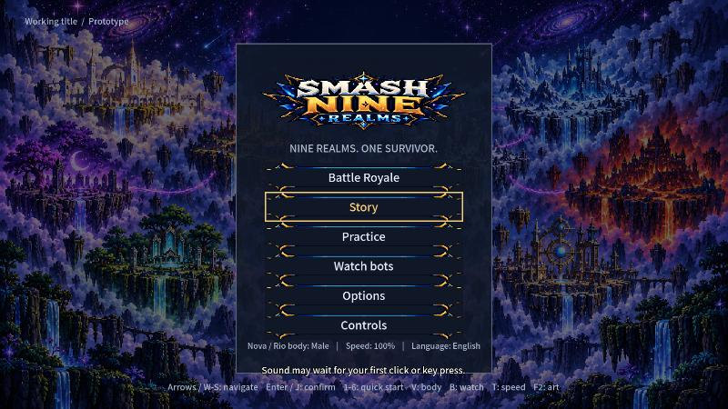 첫 패드 입력(십자키 아래): 포커스가 스토리로, 아래에 소리 안내 줄 | 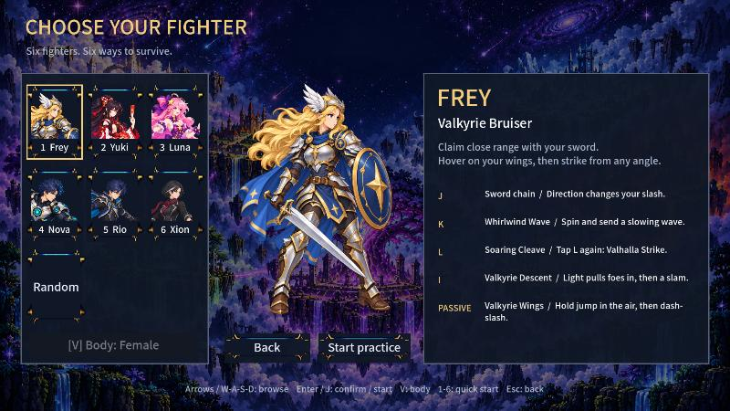 십자키 아래 → A: 연습용 선택 화면 |
| 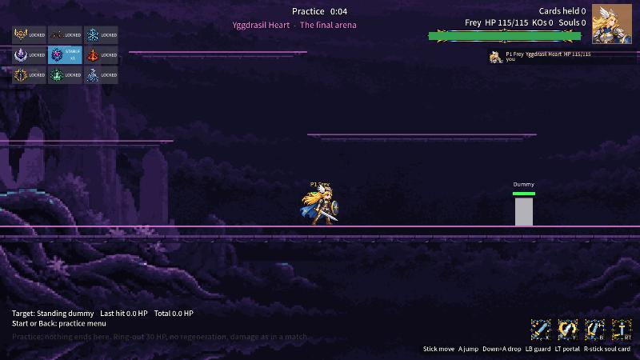 A: 연습 시작. 스킬 칸 X·Y·B·RT, 아래 줄이 패드 안내, 연습 둘째 줄이 "Start or Back: practice menu" | 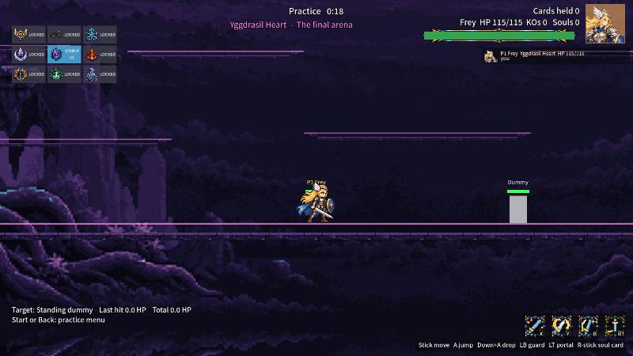 **0에 안 돌아오는 스틱 5초**: 왼쪽 스틱 0.12~0.20 / −0.22~0.08을 30ms마다 흔들고, 오른쪽 스틱 0.2·0.1, 트리거 0.1·0.12. 프레이는 그 자리, 궁극기·카드 없음 |
| 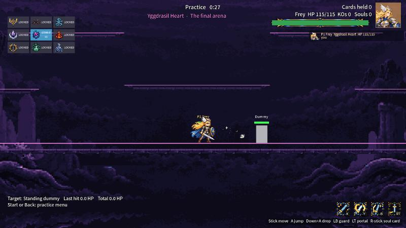 스틱 오른쪽 0.9로 걷기, X로 공격 | 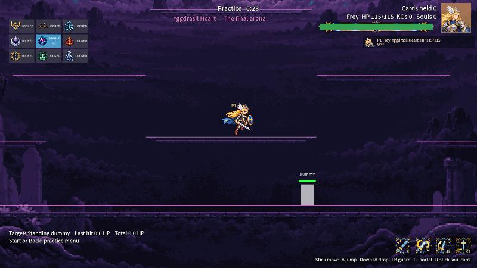 A: 점프해서 위 발판에 |
| 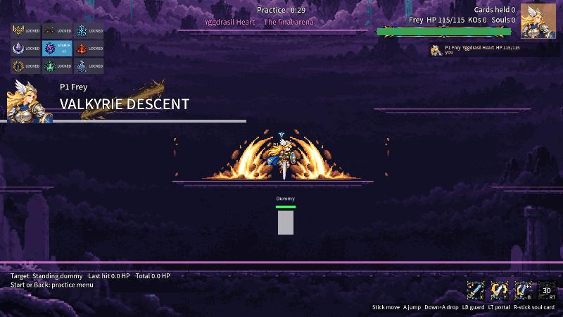 RT: 궁극기 (RT 칸 30초) | 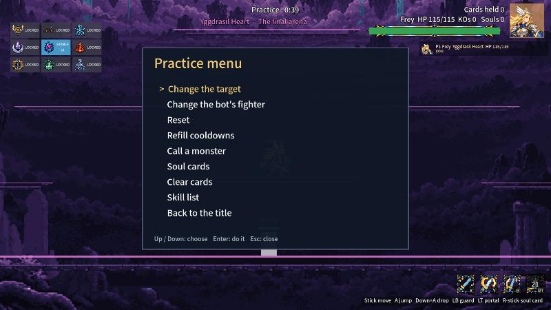 Start: 연습 메뉴 |
| 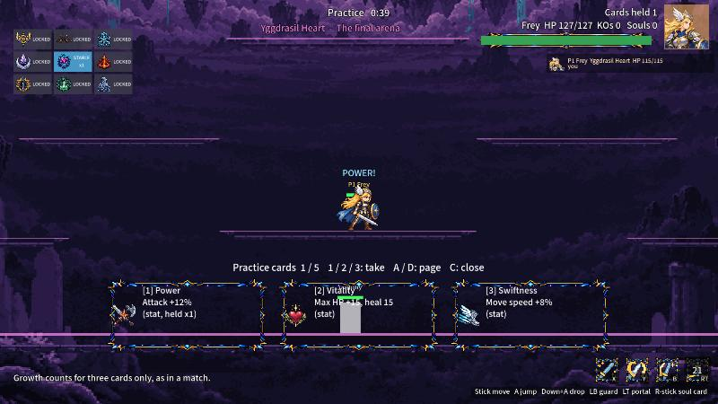 십자키 아래 다섯 번 → A: 카드 목록, 오른쪽 스틱 ←: 힘 카드 (가진 카드 1장, HP 127) | 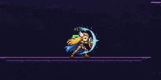 B로 닫고 LB: 가드 |
| 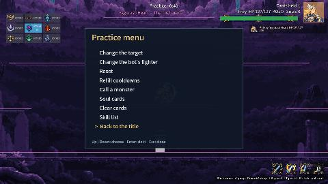 Start → 십자키 위: 마지막 줄 | 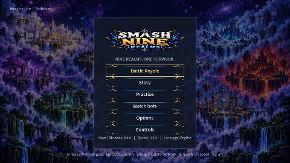 A: 타이틀 |

- 브라우저 콘솔에 오류는 없었다. 경고로는 WebGL의 "Framebuffer is incomplete: Attachment has zero size"가 많이 나왔다. 품질 트랙 ④의 'WebGL 경고'와 같은 줄이고, 이 창이 숨어 있어 화면 크기가 0일 때 나는 것으로 보인다. [추정]
- 캡처는 브라우저 도구의 한계로 800×450이다.

### 5.4 다른 검사

- `test_nova_kit`의 두 곳은 키보드 W를 뜻하던 곳이라, W가 누르는 두 액션('위'와 '점프')을 같이 누르게 고쳤다. 고치기 전에는 4절의 차이 때문에 실패했다. [잼]
- 실제 키로 하는 플레이 검사(`tests/playtest/`)는 물리 키 W를 쓰므로 그대로다. [코드]

## 6. UI·디자인 담당에게

`scripts/ui/`의 파일은 고치지 않았다. 패드를 쓰는 동안 화면의 글자는 `scripts/input/PadGlyphs.gd`가 바깥에서 써 넣는다. 쓰는 곳은 셋이고, 지금 HUD와 UI 브랜치(`8eb8090e`)의 HUD에 같은 이름으로 있다:

1. `skill_slots[slot].key` — 스킬 칸 모서리의 키 글자. J·K·L·U·I 대신 X·Y·B·RB·RT. 두 글자가 칸에 안 들어가면 칸을 왼쪽으로 넓히고(오른쪽 끝 유지), 키보드로 돌아오면 되돌린다.
2. `skill_slots[slot].glyph` — 아이콘이 없을 때 칸을 채우는 큰 글자. 같은 글자.
3. `controls_label` — 스킬 바 아래 안내 줄. 패드용 문구 "Stick move   A jump   Down+A drop   LB guard   LT portal   R-stick soul card"(한국어: "스틱 이동   A 점프   아래+A 하강   LB 방어   LT 포털   오른쪽 스틱 소울 카드"). 줄의 오른쪽 끝은 그대로 두고 왼쪽을 글자에 맞춘다. 이 줄이 없어지면 그냥 건너뛴다.

- 셋 다 쓰기 전에 있는지 확인한다. `Main`이 HUD의 갱신 뒤에 매 프레임 다시 적용하므로, HUD가 갱신 때 이 글자를 다시 써도 패드를 쓰는 동안에는 패드 글자가 위에 온다. HUD가 쓴 새 글자는 키보드로 돌아올 때 그대로 돌아온다.
- 연습 모드의 둘째 줄은 `PracticeSession.show_pad_help()`가 바꾼다(`Main`이 `update_hud()` 뒤에 부름).
- 연습 메뉴는 `PracticeSession._show_menu()`가 기술 목록과 같은 칸(`skills_panel`)에 그린다.
- 웹용 소리 안내 줄은 `PadInput.show_sound_notice()`가 자기 CanvasLayer(층 100)에 만든다. 모양은 손봐도 된다.
- 손보면 좋을 것: 조작법 화면의 패드 표(UI 담당 몫으로 남겼다), 패드 글자의 모양(지금은 키 글자와 같은 칸에 글자만), 연습 메뉴의 모양.
- 지나가며 본 것(패드와 상관없음): 카드 고르기 칸의 가운데가 비쳐서, 뒤에 선 허수아비나 선수가 카드 글자 위로 보인다(사진 web-09의 가운데 카드). 새 HUD에서는 카드 칸이 오른쪽 아래로 가니 그때 함께 보면 된다.

## 7. 코드에서 바뀐 곳

| 파일 | 내용 |
|---|---|
| `scripts/input/PadInput.gd` (새 파일) | 패드 → 액션·키, 배치 표, 데드존, 경기/메뉴 전환, 웹 소리 안내 |
| `scripts/input/PadGlyphs.gd` (새 파일) | 패드 글자 표와 바깥에서 써 넣기 |
| `scripts/Main.gd` | `PadInput`을 만듦, `pad_context()`, `pad_menu_key()`, `pad_drop_through()`, HUD 갱신 뒤 글자 적용과 연습 둘째 줄 |
| `characters/common/PlayerBase.gd` | 점프는 'jump' 액션만 읽음(W·↑가 같이 누름), `drop_through_by_jump()` |
| `characters/frey/Frey.gd` | 날개의 '점프를 누르고 있음'이 'jump' 액션만 읽음 |
| `scripts/practice/PracticeSession.gd` | 연습 메뉴(F1·Start·Back), `show_pad_help()`. 기존 HUD 줄은 그대로 |
| `project.godot` | 'jump' 액션에 W와 ↑를 더함 |
| `assets/i18n/strings.csv` | 14줄 (한국어·영어) |
| `tests/test_gamepad.gd` (새 파일), `tests/test_nova_kit.gd`, `tests/run_all.ps1` | 검사 |

## 8. 사용자가 해 볼 일과 정할 것

1. **실제 패드로 해 보기.** 이 PC에 패드가 없어 가상 패드로만 확인했다. 특히 볼 것: 스틱 위로 점프하는 기울기(0.75)가 손에 맞는지, 아래 + A 내려가기, 오른쪽 스틱 카드, 웹에서 첫 클릭 전에 소리가 나는지.
2. **배치.** 1절의 표다. 바꾸고 싶은 버튼이 있으면 말해 주면 된다.
3. **Nova 비행의 작은 차이(4절).** 그대로 둘지, 스틱을 놓아도 바로 멈추게 할지.

## 병합

(병합할 때 채움)
