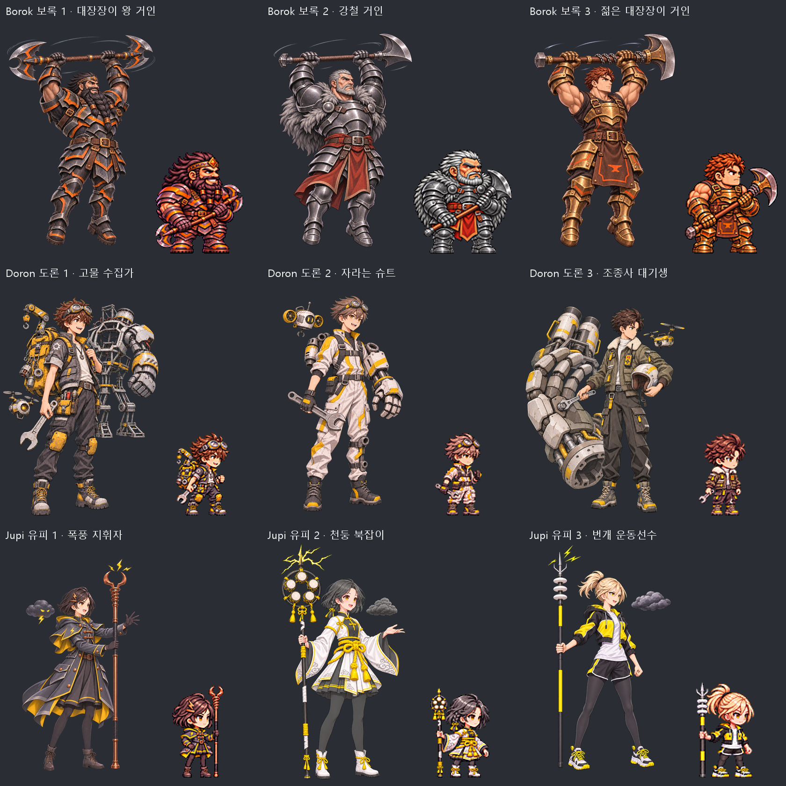

# 새 캐릭터 컨셉 그림: Borok · Doron · Jupi 모습 셋씩 (2026-11-27, 「이미지/스프라이트 담당」)

문장 끝의 표시: **[잼]** 은 잰 것, **[코드]** 는 코드·문서에서 읽은 것, **[추정]** 은 재지 않은 것이다.

## 한 문장 결론

**세 캐릭터의 모습을 셋씩, 모두 아홉 시안으로 그려 시안 월드컵에 올렸다.** 캐릭터마다 한 항목이고, 모습 셋이 한 번씩 붙어 세 경기씩, 모두 9경기다. 고른 모습으로 몸 그림(기준 대기 → 걷기 → 나머지 줄)을 그린다.

## 무엇을 했나

- **요청:** 사용자 말(2026-11-27, 총괄을 거쳐) 그대로 그렸다. "Borok, Doron, 그리고 여기에는 없는 2번째 마법소녀 'Jupi(유피)' 3가지로 진행 …" [코드]
  - 앞서 받은 여섯 후보(Raven·Mira·May·Dohwa 포함)용 카드 ART-98은 멈췄다. 00:07, 납품한 그림은 없었다. [잼]
- **기술표 초안과 맞춤:** 캐릭터 스킬 담당의 초안(`../kits/README.md`, 커밋 `26e8aeed`)에 맞춰 카드를 고쳤다(`0496f9d0`). [코드]
  - Borok: 무쇠 거인, 무쇠 갑옷, 회오리 도끼
  - Doron: 렌치, 작은 드론, 부품 단계(강철 팔 3 · 등 부스터 6 · 골리앗 10)
  - Jupi: 스태프 끝 번개, 따라다니는 먹구름
- **카드:** `design/tasks/CODEX-ART-99.md`. Codex 유닛 둘이 나눠 그렸다. 이 PC는 Codex를 두 대까지만 돌린다. [코드]

  | 유닛 | 모습 | 시작 → 끝 | 병합 |
  | --- | --- | --- | --- |
  | `art-a` | Borok 1·2·3, Jupi 1 | 00:52 → 오전(사용량 한도로 쉰 사이에 끝남) [잼] | `2c086440` |
  | `art-b` | Doron 1·2·3, Jupi 2·3 | 11:21(총괄이 띄움) → 13:00 [잼] | `fa62def1` |

  - `art-a`는 Rio 기술 그림 유닛 하나가 끝나 자리가 나자 띄웠다. 그 사이 이 세션의 Claude 사용량이 한도에 닿아 쉬었다. [잼]
  - `art-b`의 커밋 스크립트는 보고서 끝 공백(마크다운 줄바꿈) 검사에서 멈췄다. 올라간 파일이 모두 허용 경로인 것을 확인하고 리드가 직접 커밋했다. [잼]
- **시안마다:**
  - 메인 일러스트(1024×1536)
  - 얼굴(256×256)
  - 게임 안 대기 1프레임(128칸, 발 y=120)
- **리드 검수:** 아홉 일러스트를 반 크기로 모두 보고, 손·도끼·렌치·스태프를 원본 크기로 잘라 봤다. 대기 프레임은 2·3배로 봤다. 손가락이 틀리거나 무기가 끊긴 곳은 찾지 못했다. [잼]

## 아홉 모습

| 시안 | 생김새 | 대기 키 · 등신(유닛이 잼) |
| --- | --- | --- |
| Borok 1 · 대장장이 왕 거인 | 땋은 수염, 대장간 왕관, 검은 판금에 주황 이음새, 양날 도끼 | 109px · 3.06 [잼] |
| Borok 2 · 강철 거인 | 회색 머리, 모피 망토, 둥근 전신 판금, 긴 자루 도끼 | 111px · 2.97 [잼] |
| Borok 3 · 젊은 대장장이 거인 | 붉은 머리, 청동 판금, 가죽 앞치마(모루 무늬), 사슬 감은 외날 도끼 | 108px · 3.03 [잼] |
| Doron 1 · 고물 수집가 | 크레인 달린 큰 배낭, 큰 렌치, 고글, 고철 드론, 뒤에 반쯤 지은 골리앗 뼈대 | 88px · 2.44 [잼] |
| Doron 2 · 자라는 슈트 | 흰 작업복, 한쪽 강철 팔(로켓 펀치), 다리 보강대, 반쪽 부스터, 드론 | 88px · 2.51 [잼] |
| Doron 3 · 조종사 대기생 | 비행 재킷, 팔에 낀 헬멧, 리모컨, 드론, 정비 중인 거대한 골리앗 손 | 88px · 2.32 [잼] |
| Jupi 1 · 폭풍 지휘자 | 단발과 번개 머리핀, 회색 코트에 노란 안감, 구리 코일 스태프, 눈 달린 먹구름 | 90px · 2.49 [잼] |
| Jupi 2 · 천둥 북잡이 | 검은 단발, 흰 의식복과 노란 매듭, 북 다섯 개가 달린 스태프, 먹구름 | 89px · 2.47 [잼] |
| Jupi 3 · 번개 운동선수 | 금발 포니테일, 검정·레몬색 운동 재킷과 반바지, 애자 달린 스태프, 먹구름 | 90px · 2.57 [잼] |

- **Borok 세 모습:** 일러스트에서 모두 도끼를 머리 위로 돌리며 발이 땅에서 떠 있다(회오리 도끼). 대기는 108–111px로 로스터에서 가장 크고 넓다. [잼]
- **Doron:** 대기는 세 모습 모두 렌치를 든 맨몸이다. 드론은 게임이 따로 그리므로 대기 그림에 넣지 않았다. [코드]
- **Jupi:** 세 모습 모두 분홍·보라·별이 없고, 스태프가 몸보다 길다. Luna(분홍 긴 머리, 짧은 별 지팡이)와 실루엣이 다르다. [잼]
- **유닛이 남긴 작은 문제:** [잼]
  - Borok 1 대기의 도끼가 일러스트보다 작게 읽힌다.
  - Doron 2와 Jupi 3은 등신이 목표보다 조금 길다.
  - Doron 3, Jupi 2·3 일러스트는 인물 높이가 82–84%로 목표 88%보다 작다.

## 게임 화면에서

**어떻게 녹화했나:** `cup_newchar_capture.gd`로 녹화했다. 경기 카메라(0.85배)에서 렐름 배경과 발판을 게임과 같게 그리고, 가운데에 시안을, 왼쪽에 Frey, 오른쪽에 Rio(여)를 세웠다. [코드]
- 시안은 대역 캐릭터(Xion)의 대기 그림을 녹화할 때만 바꿔 끼운 것이다. 이름표와 체력 막대는 숨겼다.
- 게임 코드와 게임 그림은 그대로다.
- 렐름은 가장 어두운 무스펠헤임과 가장 밝은 아스가르드다. 시안마다 48장씩 녹화했다(13:07–13:10). [잼]

**녹화에서 본 것:** [잼]
- **Borok:** 세 모습 모두 Frey·Rio보다 훨씬 크고 넓어, 무거운 몸이 한눈에 읽힌다. 2(은색 판금)가 어두운 렐름에서 가장 밝게 보이고, 1(검은 판금에 주황)과 3(청동)도 묻히지 않는다.
- **Doron:** 맨몸이라 로스터에서 가장 작다. 2(흰 작업복)가 가장 잘 보이고, 1·3은 어두운 렐름에서 조금 작고 어둡다.
- **Jupi:** 2(흰 의식복)와 3(검정·레몬)이 잘 보인다. 1(회색 코트)은 어두운 렐름에서 노란 테두리와 구리 스태프로 읽힌다.

## 시안 월드컵

**라운드 `2026-11-27-rio`** (https://claude.ai/artifact/B6VxzHK5etStnhK7L3bFAx, 페이지 버전 16): 항목 셋 `borok-look`, `doron-look`, `jupi-look`. 캐릭터마다 모습 셋이 한 번씩 붙어 세 경기, 모두 9경기다. [잼]
- 페이지는 한 번에 한 라운드만 보여 준다. 그래서 판정 전이던(기록 0건) 캐릭터 스킬 담당의 Rio 라운드에 세 항목을 더했다. 라운드 이름은 그대로라서, Rio 항목 8개(18경기)의 기록도 그 이름으로 남는다.
- 모두 11항목, 27경기다. [잼]
- 영상(`compose_newchar.py`) 순서: 큰 그림 + 도트 대기 한 프레임(3배) → 무스펠헤임 → 아스가르드, 약 10.4초.
- 고른 뒤 기록은 `cup_matches`에서 이 라운드 이름으로 읽고, 판정을 `cup_verdicts`에 남긴다.

## 다음

1. 사용자가 캐릭터마다 모습 하나를 고른다(메모로 이름·분위기·바꿀 점을 적을 수 있다).
2. 고른 모습으로 한 캐릭터씩 몸 그림을 그린다(D33·D35): 기준 대기 6프레임 → 걷기 8 → 점프·낙하·공격·방어·피격 → 승리·패배. Borok·Doron은 남·여 두 체형이다(D22). Doron의 메카 골리앗은 두 체형이 함께 쓴다.
3. 기술 그림(동작 줄·이펙트·아이콘)은 「캐릭터 스킬 담당」이 시안 월드컵으로 고른다.

## 파일

- 시안: `art/bakeoff/newchar-2026-11-26/{borok,doron,jupi}/{1,2,3}/`
- 유닛 보고서: `reports/codex-art-99a/`, `reports/codex-art-99b/`
- 게임 속 녹화: `smash-nine-prototype/tests/analysis/lead/cup_newchar_capture.gd`(아홉 시안을 한 번에, 렐름마다 한 번)
- 클립: `compose_newchar.py`, 한 장 요약: `overview.py`
- 라운드 파일: `tools/pick_cup/rounds/2026-11-27-rio.json`(Rio 항목 + 새 캐릭터 세 항목)
- 시안 월드컵 영상: `art/cup/2026-11-27-new/{borok,doron,jupi}-look/*.mp4`
