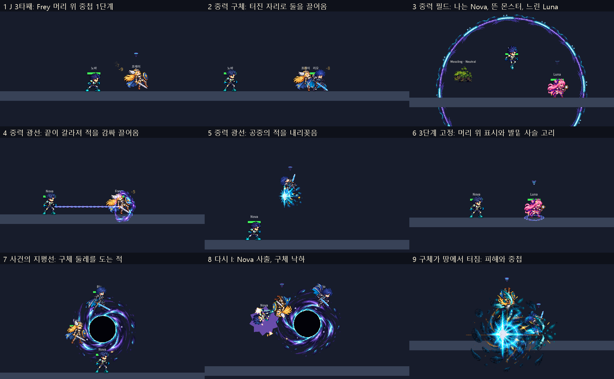

# Nova 새 키트 (2026-11-03, D47)

사용자: Nova 컨셉(원문은 [평가 문서](../nova-rio-concepts-2026-11-03/nova-user-concept-review.md)) → 리드 평가 → "제안대로 넣기". 빈 부분은 평가 문서의 리드 제안대로 채웠다. 플레이 스타일은 **적군·중력 제어**(D46).

엔진 창 캡처(`tests/analysis/lead/nova_kit_capture.gd`)를 1:1로 잘랐다. 보드 스크립트: [board.py](board.py). 그림은 모두 임시(아래).

## 기술

| 키 | 이름 | 하는 일 |
|---|---|---|
| 패시브 | 중력 중첩 | 쌓는 공격에 맞으면 1~3단계. 1단계 이동·점프 높이 80%, 2단계 이동 50%·점프 60%, 3단계는 2초 그 자리에 고정. 2초마다 한 단계씩 내려감 |
| J | 벡터 연타 | 세 번 이어 치기, 3타째가 조금 날리며 중첩 1 |
| K | 중력 구체 | 날아가 처음 닿은 몸이나 사거리 끝에서 터짐 → 둘레를 0.35초 끌어옴 → 중첩 1 |
| L | 중력 필드 | 6초 필드(쿨다운 12초). 안에서 Nova는 날아다님, 다른 캐릭터는 1단계 효과, 몬스터는 뜸 |
| **U (새 칸)** | 중력 광선 | 땅의 적은 끌어오고, 공중·떠 있는 적은 내리꽂음(더 큰 피해). 중첩 1 |
| I | 사건의 지평선 | 머리 위 구체 둘레를 적이 돎 → 다시 I를 누르고 있으면 Nova도 돌다가 떼면 사출 → 구체가 떨어져 터짐. 사출과 폭발 모두 중첩 1 |

기술 이름 중 사용자가 정하지 않은 것(벡터 연타, 중력 구체, 중력 필드, 중력 광선, 중력 중첩)은 리드가 붙였다. 사건의 지평선은 예전 이름을 이어 썼다.

## 조작

- **U**: 세 번째 스킬. 지금은 Nova만 있다. 스킬 바에 U 칸이 생기고(Nova일 때만), 캐릭터 선택 화면은 Nova만 6줄이다.
- **I 두 번째**: 누르고 있는 동안 구체를 돌고, 떼는 순간 누르고 있던 방향으로 사출한다. 방향을 안 누르면 궤도 방향.
- **필드 안**: W/A/S/D로 8방향 비행. 점프는 없다.

## 리드가 채운 빈 부분

평가 문서의 15개는 제안대로 넣었다. 그 밖에 넣으면서 정한 것:

| 정한 것 | 다르게 할 수 있는 것 |
|---|---|
| 필드 안 "점프가 8방향 빠른 이동"은 **W/A/S/D 비행**으로 했다. 이 게임은 W가 점프이자 "위"라서, 점프를 돌진 버튼으로 쓰면 아래·옆으로 돌진할 수 없다 | 필드 안에서는 Space(방어 자리)를 돌진 키로 쓰기 / 점프를 누를 때마다 위쪽 짧은 돌진 |
| 광선으로 끌려온 적은 도착하면 **0.3초 경직** | 경직 없이 바로 행동 |
| 고정 중에는 **순간이동·날개 돌진 금지**(Luna 반짝 도약·별의 정화, Rio 차원의 베기, Frey 날개). 돌진 기술은 써도 몸이 안 움직인다 | 고정 중에는 스킬 전부 금지 |
| 고정은 **잡기·끌기·궁극기 공전보다 우선**한다(고정된 적은 구체에 안 잡힌다) | 궁극기 공전이 고정을 풀기 |
| 몬스터는 중첩이 없고 **끌기·띄우기·돌리기만** 받는다 | 몬스터도 중첩·고정 |
| 공중 J·위아래 J는 **예전 중간 세기**로 고정(운동량 삭제) | 각 기술 수치 따로 조정 |
| 궁극기 구체는 **몸 중심 위 150px**, 둘레 345px 안을 3초 동안 계속 잡는다(처음에 없던 적도 들어오면 잡힘) | 처음 순간에 있던 적만 |
| 공전·사출 중 Nova가 맞으면 **구체가 바로 떨어진다**(잡힌 적은 그대로 터짐을 맞음) | 맞아도 구체 유지 |
| 봇은 U와 필드 안 비행을 거의 쓰지 않는다(깨지지 않게만). 봇은 궁극기에서 한 번 더 눌러 사출한다 | 나중에 봇 손질 |
| U 소리는 임시로 K 소리(`skill_nova_1`)를 복사했다 | 소리 세션에서 새로 |

## 바뀐 공용 부분

- **세 번째 스킬 칸**: 입력 `skill_3`(U), `PlayerBase.skill_three`·`has_skill_three`·`perform_skill_three`, 스킬 바 5칸(U는 세 번째 스킬이 있을 때만 보임), 조작 안내 "K/L/U", 캐릭터 선택 화면 6줄 배치.
- **중력 중첩**: `PlayerBase.add_gravity_stack`·`apply_gravity_field`·`is_gravity_rooted`, 이동·점프 배율, 머리 위 표시. 다른 캐릭터에게도 동작한다.
- **몬스터**: `RealmMonster.apply_gravity_float`(필드)·`apply_gravity_hold`(궁극기·끌기).
- **봇**: Nova는 더 이상 K로 복귀하지 않는다. 궁극기 사출 후 방향 꺾기는 없앴다(기술이 없어짐).

## 그림 (2026-11-03 사용자 선택 적용)

Codex 후보(CODEX-SKM-05·VFX-05)에서 사용자가 골랐다: "중력 중첩은 B, 중력 구체는 A, 중력 필드는 B, 중력 광선은 적에게 닿으면 끝에서 갈라지며 적을 감싼 뒤 자신의 앞으로 끌고오는 식으로. 사건의 지평선은 A, 아이콘은 추천대로."

| 기술 | 지금 | 남은 것 |
|---|---|---|
| 중력 중첩 | 머리 위 3단계 표시와 발밑 사슬 고리(VFX-05 B) | — |
| 중력 구체 | 날아가는 구체(VFX-05 A), 터짐은 기존 중력 폭발 | — |
| 중력 필드 | 밝은 분절 테두리(VFX-05 B) | — |
| 중력 광선 | 곡선 촉수 촉과 꼬인 줄, 맞히면 끝이 갈라져 적을 감싸 끌어옴(VFX-06 A, B·pixelfx C와 비교해 고름) | — |
| 사건의 지평선 | 나선 강착 원반 구체(VFX-05 A), 도는 적 뒤에 그림 | — |
| 아이콘 | 새 아이콘 5개(`nova_u` 포함) | — |
| 몸 동작 | 아직 빌린 줄 | 모션 뷰어에서 고르기: `orb_throw`·`field_fly`(남·여), `gravity_beam`(남·여, 리드 통과), 필드 시전 `zero_gravity` |

게임 화면은 위 보드(새 그림으로 다시 찍음).

## 컨셉 점검

- **컨셉이 보이는가:** 모든 주요 공격이 중첩을 쌓고, 3단계에서 묶인다. 끌기·띄우기·돌리기로 "적을 옮긴다"가 기술마다 보인다.
- **기술을 알아보는가:** 기술마다 모양이 다르다(터지는 구체, 큰 원, 줄, 거대 구체). 다만 지금은 코드 도형이라 그림이 들어가야 확실해진다.
- **연결:** J 3타(1) → U 광선(2) → K 구체(3, 고정) → 고정된 동안 J. 필드 안이면 적이 처음부터 느리다.
- **다른 캐릭터와 다른가:** 끌기는 Frey I·Yuki에도 있지만, Nova는 준비 없이 바로 옮기고 중첩·고정으로 이어진다. 필드 안 비행은 Nova뿐이다.
- **강점·약점:** 여럿 제어, 공중 적 처리, 필드 안 기동이 강하다. 직접 피해가 낮고, 필드 밖에는 이동기가 없어 복귀가 약하다.

## 확인

- `test_nova_kit`(7가지): 중첩 단계·이동/점프 배율·감소, 고정(이동·넉백·순간이동 막힘, 끝나면 0단계), J 3타째만 중첩, 구체 끌기·중첩, 필드(1단계 효과·몬스터 뜸·Nova 비행·6초 끝), 광선(끌기·내리꽂기), 궁극기(잡기·공전·사출·낙하·폭발), U 칸.
- 바뀐 테스트: 스킬 바 5칸, 메뉴 6줄, 소리 id 74개, 봇(복귀·궁극기), 동작 줄, 효과 그림.
- 전체 테스트와 소크 결과는 커밋 기록에 적는다.
