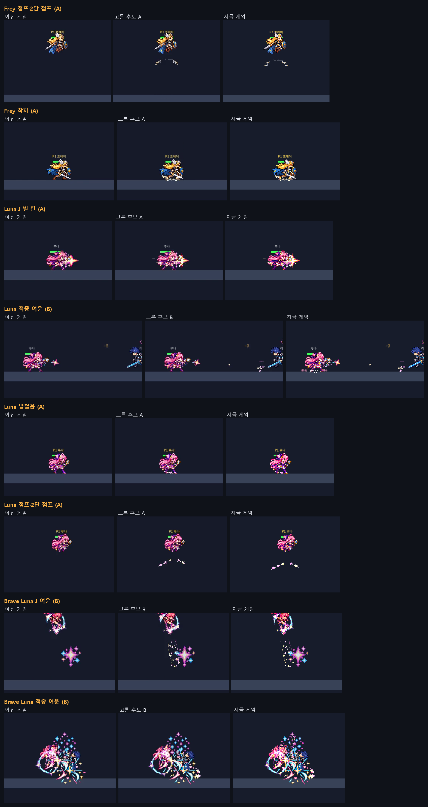

# 시안 월드컵 라운드 2026-11-19: 결과와 게임 적용 (2026-11-23~24)

사용자:
- "시안 월드컵 사이트가 불안정하다. 폰에서도 할 수 있게 비공개 배포해서 핸드폰으로 가능하게 할 수 있나?"
- "열린 이 웹으로 진행 해봤다. 결과가 저장 되었나?"
- "좋아. 전부 진행해."

## 1. 페이지 고침 (판 7, `5cdd6a8e`)

불안정했던 원인은 페이지 버그였다. 11-04에 페이지를 만들 때부터 있었다.

- **버그:** 고르면 경기 이름만 다음 경기로 바뀌고, 영상과 메모 칸은 앞 경기 그대로 남았다.
- **원인:** `renderMatch`가 영상을 다시 불러올지 `state.key`로 판단했는데, `pick()`이 그 값을 먼저 바꿔 버렸다. 지금은 화면에 올라간 경기(`loadedKey`)와 비교한다.
- **함께 고친 것:**
  - 영상을 불러오는 동안에는 고를 수 없다.
  - 두 번 빨리 눌러도 한 번만 기록된다.
  - 저장에 실패하면 그 경기에 남는다.
  - 기록 연결 전에는 고를 수 없다. 전에는 저장되지 않은 채 다음 경기로 넘어갈 수 있었다.
  - 두 영상이 모두 준비되면 함께 처음부터 재생한다.
  - 영상 맞추기 탐색은 0.4초에 한 번만 한다.
- **폰:** 따로 배포하지 않고 같은 비공개 링크를 쓴다. Claude 앱이나 폰 브라우저에서 같은 계정으로 연다. 로그인하지 않은 브라우저에서는 로그인 화면만 나온다(확인함).
  - 두 영상이 위아래로 한 화면에 들어온다.
  - 고르기 버튼은 화면 아래에 붙어 있다.
  - 설명·메모는 "설명·메모"를 누르면 펼쳐진다.
  - 항목 줄은 옆으로 넘긴다.
- **다른 비공개 배포를 쓰지 않은 이유:**
  - Codex Sites(게임과 같은 소유자 전용)에는 고른 기록을 저장할 곳이 없다.
  - 집 와이파이로 PC에 접속하는 방법은 PC가 켜져 있어야 한다.
- **버그가 건드린 기록:** 한 항목 안에서 자동으로 넘어간 2·3번째 경기가 대상이다.
  - 2026-11-19 Xion C 대 D: 3·4위만 가르고, 1위와는 상관없다.
  - 2026-11-04-frey J 여운·적중 여운: 다시 고르기로 올렸다(판 8).
  - 2026-11-04 발걸음 먼지: 기록을 다시 짜 봐도 판정이 같다.

## 2. 결과와 판정 (`cup_verdicts`, 39경기 모두 저장)

| 항목 | 1위 | 승점 | 나머지 |
|---|---|---|---|
| Xion 컨셉 (6안) | **B 짧은 코트** | 15 (5전 5승) | A 12, D 9, C 6, E·F 1 |
| Frey 점프·2단 점프 | **A** | 6 | B 3, 지금 0 |
| Frey 착지 | **A** | 6 | B 3, 지금 0 |
| Luna J 별 탄 | **A** | 6 | 지금 3, B 0 |
| Luna 적중 여운 | **B** | 6 | A 3, 지금 0 |
| Luna 발걸음 | **A** | 6 | B 3, 지금 0 |
| Luna 점프·2단 점프 | **A** | 6 | B 3, 지금 0 |
| Brave Luna J 여운 (7가지) | **B** | 6 | A 3, 지금 0 |
| Brave Luna 적중 여운 | **B** | 6 | A 3, 지금 0 |

- A는 "순간 강조", B는 "방향 있는 여운"이다. 둘 다 Codex CODEX-VFX-08·09가 만든 후보다.
- 사용자 메모는 Xion에만 있다.
  - C: "너무 남성같다", "일러스트 팔 오류"
  - D: "일러스트 신체 비율 수정 필요"
  - E: "일러스트가 애매하다"
- Xion B는 「이미지/스프라이트 담당」에 넘겼다(ART-96·97). 사용자 설정대로 일러스트에 홀로그램 분신을 더하고, 스프라이트 스카프를 일러스트 길이에 맞춘다.

## 3. 게임에 넣은 것 (이펙트 8항목, 그림 22장)

그림은 후보 파일 이름 끝의 `-a`·`-b`만 떼어 `assets/art/effects/motion/`에 복사했다. 크기·앵커·fps는 후보의 `.json`과 같다. 파일 계약은 그 폴더의 `README.md`에 있다.

| 항목 | 언제·어디 | 코드 |
|---|---|---|
| Frey 점프 (A) | 땅 점프: 발이 떠난 자리. 2단 점프: 그 자리. 바라보는 쪽으로 뒤집음 | `PlayerBase.character_jump_effect` → `_spawn_jump_effect` |
| Frey 착지 (A) | 공중 0.12초 이상 뒤 착지. 130px 이상 떨어지면 큰 것. 행동 뒤 회색 먼지도 대신함 | `Frey.character_landing_effect`, `character_landing_effect_turns` |
| Luna 점프 (A) | Frey와 같음. 노말 Luna만 | `Luna.character_jump_effect` |
| Luna 발걸음 (A) | 걷기 4·8번째 그림, 앞발 +17·+18px, 한 걸음 안에 재생. 노말만, 숨었을 때는 없음 | `Luna.STEP_FLASH` |
| Luna J 별 탄 (A) | 별이 생긴 자리에 발사 그림. 날아가는 동안 별에 붙은 꼬리가 반복. 조준 방향으로 돌림 | `Luna._spawn_star_flight_art` |
| Luna 적중 여운 (B) | 별이 실제로 맞을 때 별 하나에 한 번, 맞은 몸 중심. 큰 별은 큰 것이고 폭발로는 더 나오지 않음. 막힘·패리·빗나감에는 없음 | `Luna.on_star_hit(몸, 별)`, `PlayerBase.hit_afterglow_point` |
| Brave J 여운 (B) | 러시 1·2·3타, 어퍼컷(땅·공중), 낮은 후리기, 비행 발차기, 급강하 킥. `luna_brave_slash`와 같은 순간·자리(몸 중심) | `Luna._spawn_brave_follow_through` |
| Brave 적중 여운 (B) | 근접 적중 한 번에 한 번. 넉백 400 이상(회전 킥 520, 어퍼컷 430, 급강하 475)은 큰 것 | `Luna.character_hit_afterglow`(변신 중만) |

## 4. 확인

- **`test_motion_fx`:** 새 검사를 더했다.
  - 두 캐릭터의 점프·2단 점프 그림이 자리와 방향대로 한 번씩 나오고, Brave에는 없다.
  - Frey 착지는 크기별로 한 번 나오고, 바라보는 쪽으로 뒤집히며, 회색 먼지는 없다.
  - Luna 발걸음은 앞발 자리에 나오고, 한 걸음 안에 끝나며, Brave에는 없다.
  - 별 발사 그림의 자리·회전, 꼬리가 별에 붙어 반복하는지를 4방향과 큰 별로 본다.
  - 별 적중 여운은 한 번 나온다. 큰 별 폭발로는 더 나오지 않고, 왼쪽은 뒤집히고, 빗나가면 없다.
  - Brave J 여운은 8가지 경우 모두 자리·방향이 맞다.
  - Brave 적중 여운은 작은 것·큰 것으로 나뉘고, 빗나가면 없다.
  - 원본 아트가 아닌 모습(F2)에서는 아무것도 나오지 않는다.
- **`test_flash_art`:** 회색 착지 먼지 검사를 Frey에서 Rio로 옮겼다. Frey가 자기 착지 그림을 갖게 되었기 때문이다.
- **전체 검사 `run_all`:** 8인 소크까지 ALL PASSED.
- **같은 장면 다시 녹화(`cup_night_capture.gd`, 지금 게임):** 고른 후보의 녹화와 비교했다(아래 그림).
  - Frey 착지, Luna 발걸음, Brave J 여운, Luna 별 탄은 효과가 그려진 픽셀의 96~99%가 고른 후보 쪽에 더 가깝다.
  - 점프는 같은 그림이 같은 자리에 나온다. 다만 녹화 때보다 한 물리 프레임(1/60초) 먼저 시작한다. 2단 점프는 뛰는 순간의 발 위치에 나와서, 녹화보다 몇 px 아래다(후보 설명 "공중 점프 시작 시 발 위치"대로다).
  - Luna·Brave 적중 여운은 같은 자리·순간에 나온다. 같은 장면에 이번에 넣은 별 꼬리와 Brave J 여운이 함께 보여서 숫자로는 비교되지 않아 눈으로 확인했다.
- **웹 빌드(8060, 2026-11-24):** 시작 화면과 경기(Yuki, Luna)가 콘솔 오류 없이 돌아간다. Luna 점프 자국과 별 발사 번쩍임이 보인다.
  - 내려받는 묶음은 46.6MB다. 마지막 배포(v5, 10-15)의 25.5MB보다 크다. 그 뒤 들어간 그림들 때문이다. 웹 크기 예산은 방향 보고서 3단계에서 다룬다.

## 5. 남은 것

- **사용자:** 시안 월드컵에서 Frey 적중 여운·J 여운 다시 고르기(6경기). 지금 게임에는 적중 여운 A, J 여운 B가 들어가 있다. 결과가 다르면 바꿔 넣는다.
- **「이미지/스프라이트 담당」:** Xion B 기본 시트(ART-96·97). 끝나면 「캐릭터 스킬 담당」이 기술 동작·이펙트·아이콘 후보를 만든다.
- **참고:** Luna 착지 별가루는 예전처럼 뒤집지 않는다. 사용자가 고른 그대로다. 이 폴더의 "모두 바라보는 쪽으로 뒤집는다" 규칙과 다르니, 필요하면 다음에 정한다.
