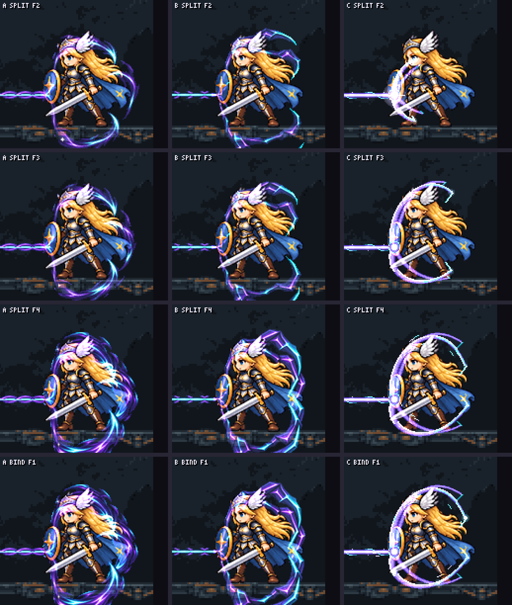
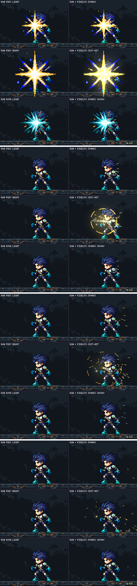
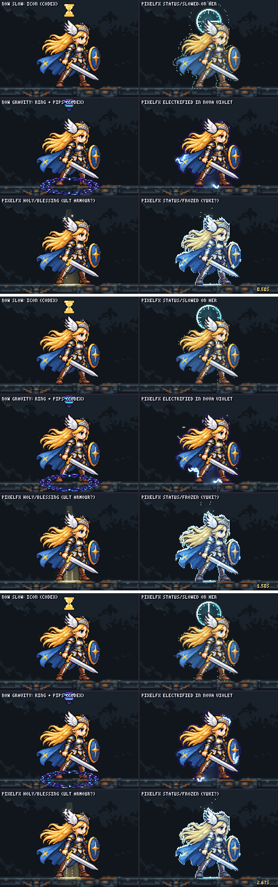

# pixelfx(도트이펙트 스킬) SmashNine 적용 평가 (2026-11-03)

- **요청(사용자, `/dot-effect`):** "새로운 스프라이트 도트 스킬을 게임에 적용할만한지, 어떤 방법과 필요한 분야가 어디일지 생각해볼것. 그리고 예시 생성하여 실제 평가."
- **추가 요청:** "다른 진행중인 세션에도 알려서 서로 비교할수 있게 해볼것." → 세 세션에 알렸습니다(9장).
- **pixelfx:** 코드로 그리는 픽셀 VFX 라이브러리입니다. 고정 사본 `../pixelfx`(`a84159688af3`)를 썼습니다.
- **SmashNine에서 처음 쓴 평가입니다.** 게임 코드(`smash-nine-prototype/`)는 바꾸지 않았고, 후보 시트만 `art/bakeoff/effects/pixelfx/`에 두었습니다.

## 1. 결론

**부분적으로 쓸 만합니다.** Codex 그림을 대신하는 것이 아니라, Codex가 약한 자리를 메우는 도구입니다. Godot은 pixelfx(JS)를 직접 돌리지 못합니다. 그래서 다음 두 방식으로 넣습니다.
- 대부분은 코드로 만든 뒤 **시트로 구워** `Vfx.gd`에 넣습니다.
- 몸 색과 외곽선을 바꾸는 상태 효과만 **셰이더로 옮깁니다.**

| 분야 | 지금 게임 | pixelfx 판정 | 근거 |
|---|---|---|---|
| **몸을 따라가는 상태** (Frey 감속, Nova 중력 표식, 궁극기 장갑, 빙결) | 머리 위 24px 아이콘, 발밑 고리 | **가장 유망** | 실제 실루엣을 따라 몸 색이 바뀌어 아이콘보다 훨씬 잘 읽힘 (`out/status.png`) |
| **적중 여운** (평타·강타) | Codex 별 모양, 0.09초 만에 사라짐 | **혼합 추천**: Codex 별 + pixelfx 불꽃 | 별이 사라진 뒤에도 0.3~0.4초 불꽃이 남음 (`out/hits-mix.png`) |
| **입자** (강한 착지, 소울 줍기, 부활·순간이동) | 0.12초 먼지, 크리스털 그림 확대 후 흐려짐 | 유망 | 튀고 가라앉는 실제 움직임 (`out/dust.png`) |
| **상징적인 큰 모양** (새 기술의 광선 감싸기 등) | Codex A/B | **Codex 유지** (사용자가 C를 보고 A 채택) | pixelfx C는 깔끔하지만 A/B가 더 풍부함 (`out/beam-board.png`) |
| **렐름 분위기**(날씨) | 없음 | 낮음, 맞춤 제작 필요 | 라이브러리 날씨는 자기 하늘·바닥까지 그려서 배경을 덮음 (`out/weather.png`) |

## 2. SmashNine에 넣는 방법

1. **밀도는 1배.** 이펙트 1px = 캐릭터 원화 1px(월드 1배)입니다.
   - 캐릭터는 128px 칸에 몸이 약 60×95px이고(Nova 61×92, Frey 90×99), 카메라는 0.85배입니다.
   - pixelfx 기본 캐릭터(24×38)의 약 2.5배라, 라이브러리 이펙트를 그대로 쓰면 작게 나옵니다. 크기 옵션을 쓰거나 맞춤 이펙트(`sn-*`)를 만들고, 2배 확대는 하지 않습니다(픽셀이 원화보다 굵어짐).
2. **시트로 굽기.** `bench.mjs`의 `bakeStrip`으로 가로 한 줄 시트를 만들고, `Vfx.gd` SPECS에 한 줄(프레임·fps·기준점·additive)로 넣습니다.
   - 더하기 합성 시트는 색과 빛을 RGB에 미리 곱해 넣고, 알파는 0/255 두 값만 씁니다(카드 규칙).
   - 옅은 빛(밝기 40 미만)은 버려야 상대 몸 위에 안개가 깔리지 않습니다(4장).
3. **몸을 따라가는 상태.** pixelfx는 매 프레임 캐릭터 실루엣을 다시 칠하는데, Godot에서는 시트 하나로 안 됩니다.
   - 몸 색·외곽선은 캐릭터 스프라이트의 CanvasItem 셰이더(짧은 코드)로 옮깁니다.
   - 시계 문양·얼음 결정·입자 같은 덧그림은 시트로 굽습니다.
   - 이 방식은 아직 Godot에서 확인하지 않았습니다(8장 다음 단계).
4. **대상 크기 맞춤.** 같은 코드에 대상 상자 크기(rx·ry·cy)만 바꿔 다시 구우면, 몬스터마다 맞는 판을 만들 수 있습니다(`out/beam-fit-monster.png`). Codex 그림은 한 장 크기로 고정입니다.
5. **카메라 0.85배.** 1px 선은 줄 단위로 빠져 깜빡일 수 있으므로, 주요 획은 2px 이상으로 그립니다.
6. **판정은 바꾸지 않습니다.** 히트스톱처럼 게임 시간을 멈추는 연출은 판정 변경이라 따로 허가가 필요합니다.

## 3. 시험 방법 (확인한 것과 못 한 것)

- **시험 벤치(`bench.mjs`):** 게임의 실제 그림을 그대로 씁니다.
  - 캐릭터 시트 셀(발 y=120), 렐름 배경(`bg_far`·`bg_mid`)과 발판, 지금 이펙트 시트를 게임과 같은 규칙으로 합성합니다(기준점, 최근접 확대, Godot 더하기 합성).
  - 수치도 게임 코드에서 가져왔습니다: 적중 크기 공식, 착지 먼지 41.7fps, 상태 아이콘 높이 −121, 광선 1725px/s, 끌기 0.45초.
- **합성 검증:** VFX-06 Codex 보드의 한 칸(A 감싸기 F1, 상대 +300px)을 벤치로 다시 그려 같은 그림이 나오는 것을 확인했습니다(`out/beam-sanity.png`).
- **못 한 것:** Godot 안에서 실제로 재생하지는 않았습니다. 벤치가 같은 그림·크기·합성 규칙으로 계산한 결과입니다. 게임 화면 캡처는 넣기로 정한 뒤의 단계입니다.

## 4. 예시 1: Nova 중력 광선 C안 (캐릭터 스킬 세션 요청)

- **경로 판단:** 몸을 감싸는 모양이고 대상 크기 맞춤이 강점이라 pixelfx로 시험했습니다. 결정 표상 "상징적인 큰 모양"은 Codex가 우세하므로 C는 비교 후보입니다.
- **계약:** VFX-06과 같습니다. head 4×48² 16fps 반복 (24,24), split 4×160² 40fps (80,80), bind 4×160² 12fps 반복 (80,80), tether 64×16.
- **시트:** `art/bakeoff/effects/pixelfx/nova_beam_{head,split,bind,tile}-c-v2.png` + `.json`
- **대상 맞춤판:** `nova_beam_{split,bind}-c-small-v2.png`(톱니 딱정벌레 상자에 맞춤)
- **pixelfx 코드:** 고정 사본의 `src/fx/arcane/_sn-gravity.js`, `sn-gravity-{head,split,bind,tether}.js`

**고친 과정(3회):**
1. 발톱 네 개가 정확한 타원 두 개로 겹쳐 훌라후프처럼 보였습니다.
2. 굵기(밑동 7px)와 빛을 더했지만, 여전히 타원 고리였습니다.
3. 발톱마다 다른 베지어 곡선으로 바꿨습니다. 머리 위를 넘어 오른쪽 허리에 걸고, 발밑을 돌아 정강이 앞에 거는 "닫히는 발톱 우리"입니다.
- 마지막으로 옅은 빛 번짐을 버려, 가운데 칠해진 점이 프레임당 640–900개에서 340–460개로 줄었습니다.

**측정:**

| | A (Codex) | B (Codex) | C (pixelfx) |
|---|---|---|---|
| 알파 값 | — | — | 0/255 두 값 |
| 칸 둘레 1px | — | — | 비어 있음 (줄 시트 좌우 끝 제외) |
| 가운데 50×80에 칠해진 점(감싸기, 프레임당) | 250–330 | 100–140 | 340–460 (앞 발톱이 다리 앞을 지남) |
| `tools/check.mjs` | — | — | 4개 모두 통과 |

**판단:**
- C는 잘 읽히고 깔끔한 "닫히는 발톱 우리"이고, 닿는 순간의 흰 번쩍임이 분명합니다.
- 빛과 붓질의 풍부함, "갈라져 감싸는" 생기는 A/B가 앞섭니다.

**사용자 판정(11-03):** 캐릭터 스킬 세션의 A/B/C 비교판을 보고 **A(Codex 곡선 촉수)를 골랐습니다.** C는 미채택입니다.
- A는 그 세션이 게임에 넣었습니다(head·split·bind·tile).
- C 시트는 후보 폴더에 기록으로만 남깁니다.
- "상징적인 큰 모양은 Codex"라는 결정 표가 이 프로젝트에서도 맞았습니다(도트이펙트 결정 기록에 남김).

**그림:**
- `out/beam-board.png`: VFX-06 보드와 같은 줄, 열은 A | B | C.
- `out/beam-wrap-3x.png`: 감싸는 부분 3배.
- `out/beam-motion.png`·`.mp4`: 게임 타이밍(발사 → 분리 0.1초 → 끌기 0.45초).
- `out/beam-fit-monster.png`·`.mp4`: 몬스터에 감쌌을 때. A/B는 고정 크기, C는 다시 구움.

## 5. 예시 2: 적중 (작게·자주)

| 패널 | 측정·관찰 |
|---|---|
| 지금 Codex 캐릭터별 별 | 가벼운 타격(피해 6·넉백 250) 105px, 강타(12·520) 157px. 4프레임 44fps라 0.09초 만에 사라지고 여운이 없음 |
| pixelfx hit-spark (캐릭터 색) | 24×38 캐릭터용 크기라 SmashNine 몸 옆에서는 작음. 0.3~0.4초 튀는 불꽃 여운은 좋음 |
| pixelfx crit-hit | 고리 + 섬광 + 불꽃. 강타에 크기가 맞음 |
| **혼합**: 지금 별 + pixelfx 불꽃 | 별이 사라진 0.23초에도 여운이 남음. 캐릭터 색은 팔레트 한 줄로 바뀜 (지금 Codex는 캐릭터마다 시트 6장) |

- 판단: 혼합을 추천합니다. 가벼운 타격용 불꽃은 SmashNine 크기에 맞춘 맞춤판(`sn-hit-sparks`)이 필요합니다.
- 그림: `out/hits.png`·`.mp4`, `out/hits-mix.png`·`.mp4`

## 6. 예시 3: 몸을 따라가는 상태 (Frey의 실제 대기 셀을 배우로)

| 패널 | 관찰 |
|---|---|
| 지금 감속: 모래시계 아이콘 | 작은 아이콘 하나뿐. 전투 중 잘 안 보임 |
| pixelfx slowed | 몸 전체가 차가운 회청색으로 바뀌고 머리 뒤에 시계 문양, 가라앉는 먼지. 멀리서도 "느려짐"이 읽힘 |
| 지금 중력: 발밑 고리 + 단계 표시 | 고리는 잘 보이고, 단계 아이콘은 작음 |
| pixelfx electrified (Nova 보라) | 실루엣 보라 테두리 + 작은 전기. 이 크기에서는 약함 |
| pixelfx blessing (궁극기 장갑 후보) | 빛기둥이 가늘어 약함(기본 캐릭터 크기) |
| pixelfx frozen (Yuki 후보) | 얼음색 + 흰 외곽선이 실루엣을 정확히 따라감. 매우 분명함 |

- 판단: 가장 유망한 분야입니다. 같은 효과가 모든 캐릭터의 모든 동작에 그대로 맞습니다. Codex 시트로는 캐릭터·동작마다 따로 그려야 합니다.
- 넣는 방법은 2장 3번입니다(셰이더 + 덧그림 시트).
- 그림: `out/status.png`·`.mp4`

## 7. 예시 4·5: 입자, 렐름 날씨

**입자** (`out/dust.png`·`.mp4`):
- 지금 착지 먼지는 0.12초에 끝납니다.
- pixelfx heavy-landing은 바닥 고리, 먼지, 튀었다가 가라앉는 돌 부스러기가 0.7초 이어집니다. 매 착지에는 과하므로 긴 낙하나 내려찍기 기술용입니다.
- collect-burst(고리, 반짝임, 떠오르는 별)는 소울 크리스털 줍기 후보입니다. 지금은 깨지는 그림을 1.8배로 키우며 흐리게 합니다.
- poof는 부활이나 순간이동 후보입니다.

**렐름 날씨** (`out/weather.png`·`.mp4`):
- 라이브러리 날씨(눈, 낙엽, 반딧불)는 자기 어두운 하늘과 바닥(눈 쌓인 땅, 낙엽 더미, 풀)까지 그리는 장면용이라, 렐름 배경을 덮습니다.
- 낙엽은 전투 화면에 너무 붐빕니다.
- 쓰려면 입자만 남긴 투명 덧그림판을 낮은 밀도로 캐릭터 뒤에 두어야 합니다. 우선순위는 낮습니다.

## 8. 사용자가 정할 것과 다음 단계

- **정한 것:** Nova 중력 광선은 A(Codex)로 정해졌습니다(4장).
- **다음 단계 후보(추천 순서):**
  1. 상태 효과 셰이더 시험: 감속·빙결·중력 표식. Godot 셰이더(몸 색·외곽선) + 덧그림 시트로 게임 안에서 확인.
  2. 적중 여운 혼합: SmashNine 크기 `sn-hit-sparks`를 6캐릭터 색으로 굽고 지금 별 위에 겹치기.
  3. 소울 줍기 collect-burst, 긴 낙하·내려찍기용 heavy-landing.
  4. 렐름 날씨 덧그림판(입자만)
- 고른 것만 게임에 넣습니다.

## 9. 다른 세션과 비교

- **캐릭터 스킬 담당(SmashNine):** 광선 C안을 요청했습니다. 시트 위치와 형식을 보냈고, 그 세션이 A/B/C 비교판을 만들어 사용자에게 보여 드립니다.
- **pixelfx 스킬 분석(CuSurvive 시험 세션):** 결론이 같습니다. 몸을 따라가는 상태가 가장 좋고, 큰 폭발은 Codex가 낫고, 밀도는 1px입니다(`CuSurvive/reports/pixelfx-test-2026-11-03/README.md`). SmashNine에서 새로 나온 점은 다음과 같습니다.
  - Godot라 시트 굽기 + 셰이더로 옮겨야 함
  - SmashNine 캐릭터가 더 커서(약 95px, CuSurvive 75px) 라이브러리가 더 작아 보임
  - 날씨 라이브러리는 장면용임
  - 대상 크기마다 다시 굽는 장점
- **CuSurvive 이미지 세션:** 같은 분야(평타 적중, 몸 따라가기, 줍기 입자)의 보강 계획을 세우는 중입니다(`CuSurvive/reports/fx-plan-2026-11-03/`). 결과를 서로 참고합니다.

## 10. 파일

- 벤치(작업 폴더 루트에서 실행, Node만 필요):
  - `node reports/pixelfx-eval-2026-11-03/beam.mjs [sanity] [strips] [board] [motion] [fit]`
  - `node reports/pixelfx-eval-2026-11-03/areas.mjs [hits] [mix] [status] [dust] [weather]`
- `out/`: 장면 모음 PNG와 MP4(커밋). GIF는 벤치로 다시 만들 수 있어 커밋하지 않았습니다.
- pixelfx 공용 사본: 새 파일만 더했습니다(`src/fx/arcane/_sn-gravity.js`, `sn-gravity-*.js`). 기존 파일, `tools/index.mjs`, 갤러리는 건드리지 않았습니다(CuSurvive 세션과 맞춘 규칙).
  - 11장 캐릭터 시험용으로 더한 파일: `arcane/sn-luna-idle-stars.js`, `impacts/sn-luna-stardust-land.js`, `impacts/sn-frey-step-dust.js`, `impacts/_sn-puffs.js`, `melee/sn-frey-slash-sparks.js`.

## 11. 캐릭터 동작 시험: Luna·Frey (11-03)

- **요청(사용자):** "일단 캐릭터 쪽으로 하나 테스트 해보고 더 판단하자. Luna와 Frey의 일부 모션에 몇가지에 테스트로 /도트이펙트 를 적용한 스프라이트를 추가하여 완성도가 높아지는지를 테스트 하는거야. 선택과 진행은 맡길테니까 한 뒤에 움직이는 이미지로 보여줘."
- **고른 동작:** 결정 표에서 pixelfx가 강한 쪽(빛, 입자, 여운)만 골랐습니다.
  - 상징적인 큰 모양(광선 감싸기)은 사용자가 Codex를 골랐으므로 뺐습니다.
  - 매번 나오는 동작은 작고 짧게 했습니다(도트이펙트 규칙: "매번 하는 동작에는 과하니 큰 순간에만").

| 동작 | 더한 것 | 종류(결정 표) | 지금 게임 | 다듬은 횟수 |
|---|---|---|---|---|
| Luna 대기 | 실루엣 가장자리와 지팡이 별에서 작은 분홍·금 별이 반짝이고, 지팡이에서 빛 알갱이가 떠오름(반복) | 몸을 따라가는 상태(오라) | 효과 없음 | 1 |
| Luna 착지 | 분홍 별가루 뭉치가 양쪽으로 굴러 나가고, 바닥 고리, 튀는 작은 별(회색 먼지 대신) | 입자 · 빛 | Codex 회색 먼지 0.12초 | 4 |
| Frey 달리기 | 앞발이 닿을 때(걷기 4·8번째 그림) 발 뒤로 작은 먼지 뭉치와 알갱이 | 작게 · 자주 | 효과 없음 | 5 |
| Frey J 세 번 베기 | 지금 궤적(`frey_slash`) 위에, 초승달 끝에서 튀는 불꽃과 궤적이 사라진 뒤 곡선을 따라 남아 떨어지는 금빛 반짝임 | 여운 부족(혼합) | 궤적 0.17초 후 바로 사라짐 | 2 |

- **방법:** 모두 SmashNine 크기(몸 약 95px, 1px 디테일)의 맞춤 pixelfx 이펙트입니다. 게임 형식 시트로 구웠고, 움직이는 비교 그림도 이 시트를 시트 fps로 재생해 만들었습니다(게임이 보여 줄 모습).
  - 타이밍은 게임 코드와 같습니다: 대기 6.3fps, 걷기 11.31fps·달리기 약 400px/s, 착지 줄 12fps, J 세 번 베기의 준비·회복 시간과 궤적 배율·회전.
- **후보 시트:** `art/bakeoff/effects/pixelfx/`, 옆 `.json`에 프레임·fps·기준점·혼합 방식·붙일 곳이 있습니다. 게임에는 넣지 않았습니다.
  - `luna_idle_stars-v1`: 16프레임 12fps 반복, 128², 발 기준 (64,120), 더하기
  - `luna_land_stardust-v1`: 10프레임 20fps, 176×64, 발 기준 (88,56), 보통 섞기(반투명)
  - `frey_step_dust-v1`: 8프레임 16fps, 76×32, 발 기준 (54,28), 보통 섞기
  - `frey_slash_sparks_{1,2,3}-v1`: 15프레임 20fps, 280×128, 몸 중심 기준 (20,64)(`frey_slash`와 같은 자리), 더하기. 세 번째 베기는 불꽃이 더 많음
- **리드 판단(완성도):**
  - **Luna 대기:** 높아집니다. 은은해서 방해되지 않고, 마법소녀 느낌이 살아납니다.
  - **Luna 착지:** 높아집니다. 회색 먼지보다 캐릭터다운 착지입니다. 뭉치 양은 회색 먼지보다 적습니다.
  - **Frey J:** 가장 크게 높아집니다. 지금은 궤적이 0.17초에 사라지는데, 반짝임이 0.4~0.6초 남아 손맛이 생깁니다.
  - **Frey 달리기:** 조금 높아집니다. 매 걸음이라 일부러 작게 했고, 밝은 바닥에서 더 잘 보입니다.
- **넣으려면(고르신 뒤):** `Vfx.gd` SPECS에 시트를 넣고, 대기 시작·끝, 착지, 걷기 프레임, 베기에서 부르는 코드가 필요합니다. 판정·속도는 바꾸지 않습니다.
- **그림:**
  - `out/motion-luna-idle`, `out/motion-luna-land`, `out/motion-frey-run`, `out/motion-frey-chain` (`.gif`·`.mp4`·`.png`). 왼쪽(위)이 지금, 오른쪽(아래)이 + pixelfx입니다.
  - 벤치: `node reports/pixelfx-eval-2026-11-03/motions.mjs [luna-idle] [luna-land] [frey-run] [frey-chain] [strips] [strips-v2]`

## 12. 더 잘 보이게: v2 (11-04)

- **사용자 판정(11-04):** "ok. 확실히 이런 식으로 이펙트를 추가하니까 더욱 좋다. 이 방향으로 나아간다면 이 스킬을 적극적으로 사용해도 될 것 같다. 다만 이펙트를 너무 소극적으로 넣은 것 같으니, 앞으로 추가 할 때는 조금 더 잘 보이도록 넣어 볼 것."
- **남긴 곳:**
  - 도트이펙트 결정 기록(네 줄: 채택(방향), 더 잘 보이게)
  - SmashNine 메모(`projects.md`): 이 판정이 "자주 나오는 동작은 작게"보다 앞섬
  - 프로젝트 기억
- **v2:** 같은 네 효과를 더 잘 보이게 다시 만들었습니다. 움직이는 그림은 이제 **지금 | v1 | v2** 세 칸입니다.

| 효과 | v1 → v2 |
|---|---|
| Luna 대기 별 | 반짝임 7 → 12개, 팔 길이 약 1.6배, 빛 0.45 → 0.7. 지팡이 빛·번쩍임을 두 배로 했고 떠오르는 알갱이 4 → 7개(십자 모양). **새로** 허리 둘레를 도는 금·분홍 별 셋(5.6px, 꼬리, 앞은 밝게·뒤는 어둡게) |
| Luna 착지 별가루 | 0.6 → 0.85초. 뭉치 3 → 4개씩·반지름 8.5 → 11px, 바닥 고리 28 → 38px·두께 2배, 별 6 → 10개(1.8~3px), 반짝임 3 → 6개, 닿는 순간 번쩍임 6 → 11px |
| Frey 발걸음 먼지 | 0.5 → 0.7초. 뭉치 2 → 3개·반지름 7 → 9.5px, 더 밝은 색, 알갱이 3 → 5개 |
| Frey J 베기 여운 | 0.75 → 0.95초. 반짝임 6/9 → 11/16개·더 크게, 불꽃 7/12 → 12/20개. **새로** 궤적이 사라진 뒤 0.3초 남는 2px 금빛 초승달 잔상 |

- 시트는 v1을 그대로 두고 `-v2`로 새로 구웠습니다(`art/bakeoff/effects/pixelfx/*-v2.png` + `.json`).
  - `luna_land_stardust-v2`: 17프레임 208×104 (104,72)
  - `frey_step_dust-v2`: 11프레임 96×40 (70,34)
  - `frey_slash_sparks_*-v2`: 19프레임
- 공용 사본의 `sn-*` 이펙트 코드는 이제 v2 기준입니다.
- **리드 판단:**
  - 넷 다 v2가 첫눈에 보입니다.
  - Luna 착지는 닿는 순간 번쩍임이 강해서 지금 회색 먼지보다 눈에 띕니다.
  - Frey J는 세 번째 베기 뒤에 Frey가 대기로 돌아간 뒤에도 금빛 잔상과 반짝임이 남아, 동작이 끝까지 이어져 보입니다.
  - 더 세게 할지, 이 정도에서 게임에 넣을지는 사용자 판단입니다.
- **그림:** `out/motion-*.gif`·`.mp4`·`.png`(지금 | v1 | v2).

**사용자 판정(11-04, v2를 보고):** "Luna의 스탠딩 모션 V2에서 머리 쪽에 너무 반짝임이 과한 것 빼고는 이렇게 강화 한 형태가 더 좋아보인다."
- **강화 형태(v2)를 기준으로 삼습니다.** 도트이펙트 결정 기록·SmashNine 메모·기억에 남겼습니다.
- **Luna 대기 v3**(`luna_idle_stars-v3`): v2 세기를 유지하면서 머리 쪽만 줄였습니다.
  - 실루엣 가장자리 반짝임은 머리 선(발 기준 y −50)보다 위와 얼굴 구역(오른쪽 위: 얼굴·턱·손·지팡이, x > 10이고 y < −36)에서 나오지 않습니다.
  - 지팡이는 자기 번쩍임만 남기고 조금 작게 했습니다.
  - 떠오르던 빛 알갱이는 오른쪽 아래로 흩날립니다(얼굴을 지나가지 않음).
  - 허리 둘레 별 셋은 그대로입니다.
  - `out/motion-luna-idle`은 이제 지금 | v2 | v3입니다.
