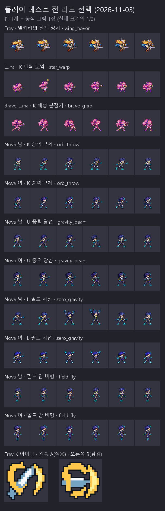

# 플레이 테스트 준비: 리드가 정한 것 (2026-11-03)

사용자: "Rio 하기 전에 Frey와 별의 광선은 일단 네 선택에 따라 정할테니까 적용 하고, Frey, Luna, Nova를 먼저 실제 플레이로 해볼게. 그 다음에 Rio로 넘어가자. 현재 선택하라고 말 한건 이후 현재 진행중인 새로운 스킬을 통해 더 업그레이드 할 수 있으니 일단 지금은 빠르게 통과하자는 뜻이야."

그래서 사용자 선택을 기다리던 것을 리드가 빠르게 정해 게임에 넣었다. 모두 나중에 바꿀 수 있다(아래 "되돌리려면").

보드는 후보 파일을 그대로 1/2 크기로 놓았다. 스크립트: [board.py](board.py).

## 정한 것

| 항목 | 고른 것 | 이유 | 되돌리려면 |
|---|---|---|---|
| Frey K 아이콘 | **A안** (대각선 검·회전 궤적·떨어져 나가는 초승달) | J·L 아이콘과 같은 대각선 검이라 Frey 아이콘끼리 이어진다. 도는 궤적과 초승달이 회오리 검기를 보여 준다. B안은 가로 검이라 예전 돌진처럼 읽힌다 | `art/bakeoff/skill_icons/frey/frey_k-b-v1.png`를 `assets/art/skill_icons/frey_k.png`에 복사 |
| Brave 별의 광선 | **하트 광선 유지** | Brave I 아이콘이 하트이고 `heart_laser` 동작이 손으로 하트를 만든다. 지금 그림이 동작·아이콘과 맞고, 새로 그리지 않아 가장 빠르다 | 별 모양 광선이 필요하면 Codex 그림 후보부터 |
| Frey 날개 정지 자세 | **`wing_hover`** (SKM-03) | 무릎을 접고 공중에서 멈춘 뒤 돌진을 겨누는 자세. 예전에는 돌진 줄의 조준 그림 2장을 빌려 썼다 | 줄 표에서 빼고 `dash_strike` 1~2로 |
| Luna 반짝 도약 | **`star_warp`** (SKM-04) | 웅크림 → 사라짐 → 지팡이를 휘두르며 나타남. 예전 별 혜성 동작을 빌려 썼다 | `star_comet`으로 |
| Brave 혜성 붙잡기 | **`brave_grab`** (SKM-04) | 두 손 뻗어 돌진 → 움켜쥠 → 당김 → 젖힘 → 던짐. 예전 혜성 돌진·Luna Breaker 동작을 빌려 썼다 | `comet_drive`·`luna_breaker`로 |
| Nova K 중력 구체 | **`orb_throw`** (SKM-05, 남·여) | 양손을 모았다가 한 팔로 던진다 | `gravity_brake`로 |
| Nova U 중력 광선 | **`gravity_beam`** (SKM-05, 남·여) | 조준 → 손바닥 발사 → 유지, 맞히면 주먹으로 당기고 받는다 | `vector_side` 5~6으로 |
| Nova L 필드 시전 | **`zero_gravity`** (남·여) | 양손을 위로 밀어 올린다. 예전 "무중력" 후보를 필드 시전에 썼다 | `slingshot_start`로 |
| Nova 필드 안 비행 | **`field_fly`** (SKM-05, 남·여, 반복) | 필드 안 공중에서는 점프·낙하 그림 대신 다리를 모은 비행 자세 | 줄 표에서 빼면 점프·낙하 그림 |

`star_warp`·`brave_grab`·`gravity_beam`은 Codex가 얼굴 비율(1px 안팎)이나 손 동작 순서로 보류했던 것을 리드가 4배로 보고 후보로 넘긴 그림이다. 실제 플레이에서 어색하면 다시 그린다.

## 게임에서 언제 어느 그림이 나오나

| 기술 | 그림 |
|---|---|
| Frey 날개 정지(0.3초) | `wing_hover` 1~6을 20fps로, 마지막(겨누기) 유지 → 돌진은 `dash_strike` 3~6 |
| Luna K | 선딜 동안 1~2(웅크림·사라짐), 순간이동하는 순간 3(나타나며 휘두름), 뒤는 4~6 |
| Brave K | 돌진 1 유지 → 잡으면 2~4(움켜쥠·당김·젖힘) → 던질 때 5~6 |
| Nova K | 1~6, 3번째 그림에서 구체가 나감 |
| Nova U | 쏠 때 1~3(조준·발사·유지). 맞히면 4~6(땅의 적은 끌어오는 0.45초, 공중 적은 내리꽂는 0.3초). 그 사이 다른 기술을 쓰고 있으면 끼어들지 않는다 |
| Nova L | 시전 1~6 |
| Nova 필드 안 | 땅에서 떨어져 있으면 `field_fly` 반복 |

## 바뀐 코드

- 이동 시트 맨 아래에 줄을 붙였다(기존 줄 위치는 그대로): Frey 10줄, Luna 9줄, Brave 10줄, Nova 남·여 13줄. 각 캐릭터 줄 표(`MOVE_SHEET_ROWS`, Brave는 `BRAVE_MOVE_SHEET_ROWS`)에 같은 순서로 더했다.
- 더 이상 안 쓰는 줄(`star_comet`, `comet_drive`, Nova `vector_shift`·`gravity_brake`)은 줄 자리를 지키려고 남겼다.
- 공용 훅 `PlayerBase.character_air_motion()`: 공중에서 점프·낙하 대신 재생할 줄. 지금은 Nova 필드 비행만 쓴다.
- Nova `_play_beam_pull_pose`: 광선이 맞으면 당기는 그림.
- 후보 JSON에 `"adopted": "2026-11-03"`을 달아 모션 뷰어 후보 목록에서 빠지고, 새 줄은 게임 줄로 나온다(모션 뷰어 48판).

## 확인

- `test_moves_sheet`: 새 줄 프레임 수, 각 기술이 새 줄을 재생하는지(Frey 정지, Luna K, Brave K, Nova K·U·L·필드 비행), 시트가 없을 때 예전 대체 그림.
- 전체 테스트(`tests/run_all.ps1 -SkipSoak`): 53개 모두 통과. 이번 변경은 그림과 그림 재생만 바꿔 소크는 돌리지 않았다.
- 엔진 캡처(`tests/analysis/lead/nova_kit_capture.gd`): 필드 안에서 Nova가 `field_fly` 자세로 날고, 광선 쏘기·당기기 자세가 나온다.
- 웹 빌드: 새로 만들어 http://localhost:8060 에서 첫 화면까지 열림, 콘솔 오류 없음.
- 모션 뷰어(https://claude.ai/artifact/188Ryqb526Ue58MDf4BnbU) 48판: 새 줄이 게임 줄로 나오고, 넣은 후보는 후보 목록에서 빠졌다.

## 플레이 테스트에서 볼 것

- **Frey:** 공중에서 점프 꾹 → 날개 정지 자세 → 방향 돌진. K 회오리 검기와 새 K 아이콘.
- **Luna:** K 반짝 도약(사라졌다 나타나는 동작), L 방어막, I 변신 → Brave K 붙잡아 던지기, L 회오리, I 하트 광선.
- **Nova:** J 3타, K 구체 던지기, L 필드(안에서 W/A/S/D 비행 자세), U 광선(맞히면 당기는 동작), I 구체 → I를 다시 누르고 있다가 떼서 사출.
