# 연습 모드를 게임에 넣음 (2026-11-26, 시스템 담당)

게임 품질 트랙(결정 D53) ③번의 앞쪽 절반이다. 타이틀에 "연습"이 생겼고, 고른 캐릭터 한 명과 표적 하나로 기술·카드·궁극기를 끝없이 시험할 수 있다. 게임패드는 다음 작업이다.

문장 끝의 표시: **[잼]** 은 경기나 실험에서 잰 것, **[코드]** 는 코드에서 읽은 것, **[추정]** 은 재지 않은 것이다. 피해는 경기 안에서 실제로 깎이는 HP다.

## 한 문장 결론

**연습 모드가 들어갔고, 실제 메뉴와 실제 키로 하는 검사 748개가 통과하며, 웹 빌드에서도 실제 키로 한 바퀴를 돌았다.** [잼]

- 타이틀 → 연습 → 캐릭터 선택 → 중앙 렐름. 붕괴·탈락·승패·시간 제한이 없다. [잼]
- 키 아홉 개로 표적 바꾸기(H), 봇 캐릭터(N), 되돌리기(R), 쿨다운 채우기(E), 몬스터(M), 카드(C), 카드 비우기(X), 기술 목록(Tab), 나가기(Esc)를 한다. [잼]
- 만들다가 **기존 버그 하나**를 찾아 고쳤다: Rio가 궁극기로 베는 도중에 다른 곳으로 옮겨지면(붕괴에 휩쓸림, 링아웃 뒤 부활) 잠시 뒤 궁극기를 누른 자리로 되돌아갔다. 붕괴 때는 무너진 렐름 안의 자리다(4절). [잼]
- 웹 빌드는 44.93 MiB(47,115,795바이트)다. 예산 45 MiB까지 70,125바이트 남는다. 연습 모드가 더한 양은 15,281바이트다. [잼]
- 타이틀 메뉴가 여섯 줄이 되면서 줄 사이 틈이 없어졌다. 모양은 UI·디자인 담당의 몫이라 바뀐 줄을 7절에 적었다.

## 1. 쓰는 법

타이틀에서 **연습**을 고르면 평소의 캐릭터 선택 화면이 열린다. 시작 버튼이 "연습 시작"으로 바뀌어 있다. 캐릭터를 고르고 Enter(또는 숫자 키 1~6)를 누르면 이그드라실의 심장(중앙 렐름)에서 시작한다.

| 키 | 하는 일 |
|---|---|
| H | 표적 바꾸기: 서 있는 허수아비 → 걷는 허수아비 → 싸우는 봇 → 다시 처음 |
| N | 봇의 캐릭터를 다음 캐릭터로 (처음에는 프레이) |
| R | 되돌리기: 둘 다 시작 자리, HP 가득, 필드에 남은 것 모두 치움 |
| E | 궁극기와 기술 쿨다운을 바로 채움 (봇도 같이) |
| M | 몬스터 한 마리 부르기 (최대 세 마리, 캐릭터 앞에 나옴) |
| C | 카드 목록 열기. 1·2·3으로 가지고, A·D로 쪽을 넘기고, C나 Esc로 닫음 |
| X | 카드 모두 비우기 |
| Tab | 기술 목록 (캐릭터 선택 화면의 설명 그대로). Tab이나 Esc로 닫음 |
| Esc | 목록이 열려 있으면 목록만 닫음. 아니면 타이틀로 |

화면 왼쪽 아래 두 줄이 연습의 안내다. 첫 줄은 지금 표적과 **표적이 마지막으로 받은 피해, R 뒤의 누적 피해**이고, 둘째 줄은 키 목록이다.

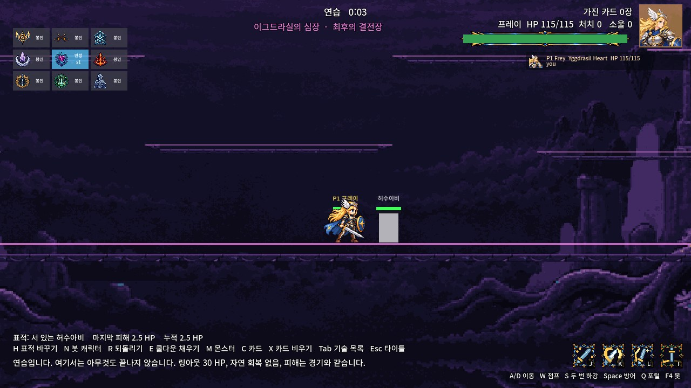

카드 목록과 기술 목록이 열려 있는 동안에는 **게임이 멈춘다**. 그래서 A·D로 쪽을 넘겨도 캐릭터가 움직이지 않고, 싸우는 봇도 그동안 때리지 못한다. [잼]

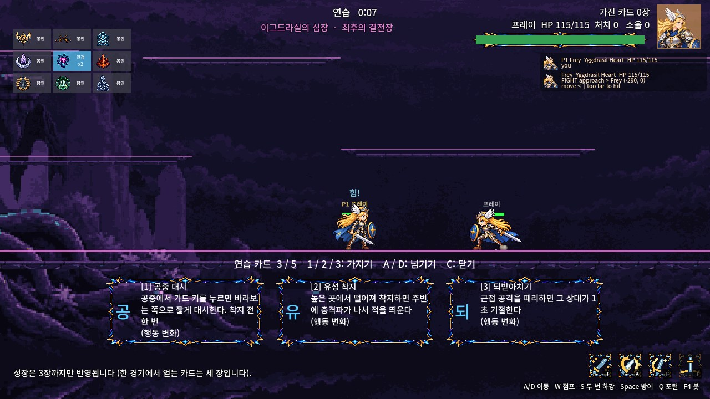

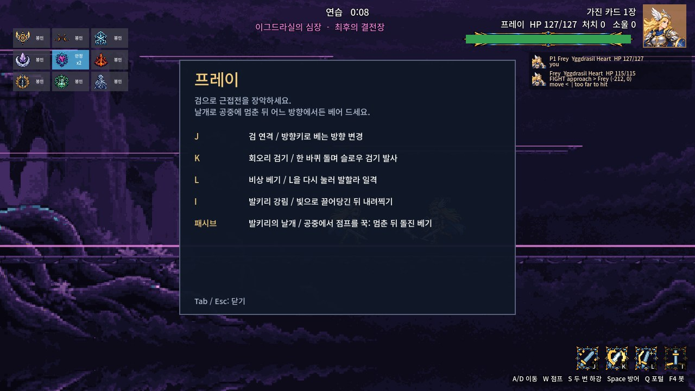

## 2. 정한 것

설계는 총괄이 승인했고(2026-11-26), 아래는 만들면서 정한 세부다. 바꾸고 싶은 것이 있으면 대부분 한두 줄이다.

| 무엇 | 정한 것 | 까닭 |
|---|---|---|
| 규칙값 | 중앙 난투 단계의 값: 링아웃 30 HP, 자연 회복 없음, 전투 피해 ×0.26, 봇 공격성 1.0 [코드] | 경기가 결판나는 단계다. 전투 피해 배율은 모든 단계가 같다 |
| 피해 표시 | 표적이 실제로 잃은 HP. 허수아비도 경기의 피해 배율로 맞는다 | 프레이의 첫 J는 2.5 HP로 나온다. 배율 없이는 같은 공격이 9.4로 나온다 [잼] |
| 피해 표시에서 빼는 것 | 링아웃 피해 (맞은 것만 센다) | 콤보의 합을 보려는 숫자다 |
| 카드 장수 | 한도 없음. 겹치기 한도(공중 도약 2장, 새 카드 1장)는 지킴 | 여러 장을 한꺼번에 시험하는 것이 목적이다 (총괄 확인) |
| 카드의 성장 | 3장 몫까지만 오른다. 네 번째 카드부터는 카드 효과만 붙는다 | 경기에서 카드는 세 장이다. 15장을 다 들면 성장이 45단계 붙어 경기에 없는 수치가 된다. 카드 목록을 열면 화면에 이 안내가 뜬다 |
| R이 남기는 것 | 카드와 궁극기 쿨다운 (X와 E가 따로 있다) | 궁극기가 없는 상황을 연습할 수 있게 |
| R이 같이 푸는 것 | 캐릭터 기술 쿨다운(Luna 방어막, Nova 필드, Rio 반격·분신, Xion 구르기·분신·탄환) [코드] | 캐릭터가 부활할 때 하는 초기화를 그대로 쓴다 |
| E | 봇의 궁극기와 기술도 채운다 | 봇의 궁극기를 상대하는 연습을 바로 다시 할 수 있다 |
| 표적 바꾸기 | 허수아비와 봇을 바꾸거나 봇 캐릭터를 바꾸면 자리도 되돌아간다. 서 있기와 걷기 사이는 그대로다 | 떠나는 표적을 겨누던 것(광선, 표식 등)이 남지 않게 |
| 쓰러졌을 때 | 캐릭터와 봇은 1.6초 뒤, 허수아비는 3초 뒤 시작 자리에서 다시 일어난다. 링아웃도 시작 자리로 돌아온다 | 매번 같은 자리에서 다시 시작 |
| 몬스터 | 중립 근접형(뿌리 수호자), 캐릭터가 보는 쪽 300px 앞 | 사냥꾼 카드를 시험하는 용도. 잡으면 소울이 오른다 |
| 소울 | 오르지만 카드 제안은 열리지 않는다 | 카드는 C로 가진다 |
| 걷는 허수아비 | 시작 자리 좌우 200px을 오간다. 속도는 캐릭터 달리기의 절반쯤 | |

## 3. 저장 파일

연습은 저장 파일을 건드리지 않는다. 검사가 연습 전체(메뉴, 키 전부, 여섯 캐릭터)를 돈 앞뒤로 저장 파일 넷(`story.cfg`, `language.cfg`, `game_speed.cfg`, `audio.cfg`)의 크기와 수정 시각이 같은지 본다. [잼]

경기 결과를 쌓는 통계 파일은 게임에 아직 없다. [코드] 연습 중에 T로 게임 속도를 바꾸면 그 설정은 평소처럼 저장된다(총괄이 제외한 항목).

## 4. 찾아서 고친 버그: Rio의 궁극기가 끊긴 뒤 제자리로 돌아감

R을 궁극기 도중에 누르는 검사가 잡았다. 연습 모드의 버그가 아니라 **경기에도 있던 버그**다.

- **증상:** Rio가 궁극기 두 번째 누름으로 적들을 차례로 베는 사이(한 번에 0.12초, 여섯 번이면 0.72초 [코드])에 다른 곳으로 옮겨지면, 그 0.12초가 끝날 때 "궁극기를 누른 자리"로 순간이동했다. [잼]
- **경기에서 일어나는 경우:** 그 순간 렐름이 무너져 다른 렐름으로 던져질 때(돌아간 자리는 무너진 렐름 안이라, 곧바로 링아웃 판정을 받는다), 벤 상대를 따라 장외로 나가 링아웃된 뒤 부활했을 때. [코드]
- **원인:** 베는 동작이 끊기면 언제나 시작 자리로 돌려보냈다. 붙잡히거나 기절해서 끊긴 경우에는 맞는 동작이지만, 옮겨져서 끊긴 경우에는 아니다.
- **고침:** 난무가 아직 자기 것일 때만 돌아간다. 옮겨질 때는 난무가 먼저 정리되므로 옮겨진 자리에 그대로 남는다(`Rio.gd`, 커밋 `35c6cb17`).
- **검사:** 붕괴가 하는 것과 같은 방법으로 Rio를 옮긴다. 고치기 전에는 40프레임 뒤 (0, 0)에 있고, 고친 뒤에는 옮겨진 (4000, −2)에 있다. 원점 근처와 (9000, 6000) 두 곳에서 같다(`test_rio_kit`의 `_test_flurry_moved_mid_cut`). [잼]

같은 종류를 더 찾으려고 여섯 캐릭터 모두 궁극기 도중 세 시점(4·30·75프레임)에 R을 누르는 검사와, 싸우는 봇 여섯 캐릭터를 세 번씩 되돌리는 검사를 넣었다. 다른 캐릭터에서는 나오지 않았다. [잼]

## 5. 검사

### 5.1 test_practice_mode (run_all에 넣음)

실제 메뉴 클릭과 실제 키 누름으로 한다. 748개 확인, 177초. [잼]

| 부분 | 보는 것 |
|---|---|
| 메뉴 | 타이틀 여섯 줄의 순서와 겹침, 연습 → 선택 화면 → "연습 시작", F2를 눌러도 연습용 선택 화면으로 남음, 배틀로얄로 열면 경기용, 숫자 키로 시작, 중앙 렐름만 열림, 몬스터·크리스탈·지형 위험 꺼짐, 소울 제안 없음, Esc로 깨끗한 타이틀 |
| 표적 | 서 있는 허수아비가 안 움직임, H → 걷기(오가는 거리), H → 봇(**가만히 선 캐릭터를 15초 안에 실제로 때림**), N으로 봇 캐릭터 바꾸기와 떠난 봇이 어디에도 안 남음, H → 다시 허수아비 |
| 되돌리기 | 여섯 캐릭터마다 기술을 쓴 뒤 R(다 나온 뒤와 시동 도중 두 번): Rio 분신, Nova 필드·구체, Yuki 봉인부·부적, Xion 분신·탄환, Luna 방어막·별, 부른 몬스터가 모두 사라짐. 자리·HP·피해 집계가 처음으로. 궁극기 도중 세 시점에 R. 싸우는 봇 여섯을 세 번씩 R |
| 채우기 | 여섯 캐릭터마다 K·L·U를 쓴 뒤 E → 모든 칸 0초, I 뒤 E → 궁극기 준비됨. Xion의 빈 탄창이 가득 참. 봇의 궁극기도 채워짐 |
| 카드 | C로 열면 게임이 멈춤, **D를 30프레임 누르고 있어도 쪽은 한 번만 넘어가고 캐릭터는 그 자리**, 쪽이 돌아옴, 1로 가지면 바로 적용, **공중 대시 카드를 찾아 가진 뒤 점프하고 가드 키를 누르면 실제로 대시함**, 가진 카드는 다시 못 가짐, Esc는 목록만 닫음, 일곱 장을 가져도 성장은 3장 몫, 한국어·영어 모든 쪽이 칸에 들어감, X로 수치까지 원래대로 |
| 기술 목록 | 여섯 캐릭터 × 두 언어: 선택 화면의 줄이 모두 있음, 줄이 칸 안에 있고 서로 겹치지 않음, 연습 안내 줄이 폭 안에 들어감 |
| 피해 줄 | 실제 J 한 번이 허수아비가 잃은 HP와 같은 숫자로 찍힘, 링아웃 피해는 안 셈 |
| 몬스터 | M 네 번에 세 마리, 캐릭터 앞에 나옴, 잡으면 소울이 오르고 카드 제안은 안 열림 |
| 쓰러짐·시간 | 링아웃 30 HP와 시작 자리 복귀, 캐릭터·봇·허수아비가 다시 일어남, 10분을 돌려도 경고·붕괴·종료 없음 |
| 저장 | 전체를 돈 앞뒤로 저장 파일 넷이 그대로 |

### 5.2 검사가 정말 잡는지

연습 모드를 일부러 열세 가지로 망가뜨려 보았다. 열세 번 모두 검사가 그 줄에서 실패한다. [잼]

| 망가뜨린 것 | 실패한 확인 |
|---|---|
| 카드 목록을 열어도 게임이 안 멈춤 | C는 카드 목록을 열고 게임을 멈춰야 한다 |
| R이 필드를 안 치움 | R은 필드를 치워야 한다 (Rio: 칼, 몬스터가 남음) |
| 허수아비의 3초 타이머가 R 뒤에 또 옮김 | R 뒤에 허수아비가 다시 옮겨지면 안 된다 |
| 카드마다 성장이 붙음 | 일곱 장은 3장 몫의 성장이어야 한다 (7장 몫이 됨) |
| E가 캐릭터 쿨다운을 안 채움 | E는 Luna의 L을 준비시켜야 한다 (6.3초 남음) |
| 연습에서 소울이 카드 제안을 엶 | 소울은 카드 제안을 열지 않아야 한다 |
| 목록에서 Esc가 연습을 나감 | 카드 목록의 Esc는 목록만 닫아야 한다 |
| 쓰러지면 경기가 끝남 | 쓰러져도 아무것도 끝나지 않아야 한다 |
| 허수아비가 기술의 원래 숫자로 맞음 | 피해는 경기 HP로 세야 한다 (9.44가 찍힘) |
| 가진 카드를 또 가짐 | 겹치기 한도를 넘는 카드는 거절해야 한다 |
| X가 카드의 수치를 남김 | X는 카드의 수치를 없애야 한다 |
| 연습에서 붕괴 시간표가 돎 | 시계에 예정된 사건이 없어야 한다 |
| H가 경기용 허수아비도 켜고 끔 | H는 연습 표적을 바꿔야지 없애면 안 된다 |

### 5.3 웹 빌드에서 실제 키로 한 바퀴

내보낸 웹 빌드를 브라우저에서 열고, 브라우저에 실제 키 입력을 넣어 한 바퀴 돌았다(2026-11-26, 한국어). [잼]

방향키로 연습까지 내려가 Enter → 선택 화면에서 Enter → H → H → C → D·D → 1 → C → W·Space → R → Tab → Tab → M → Esc.

| | |
|---|---|
| 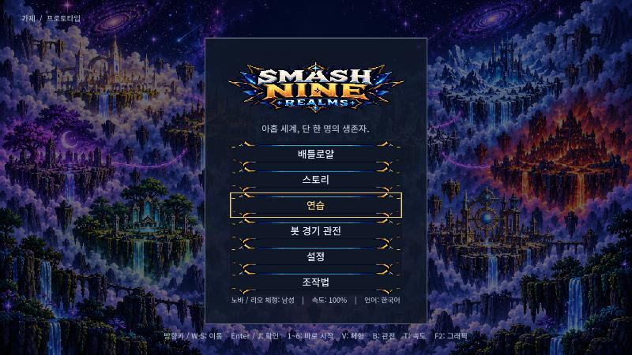 타이틀 여섯 줄, 연습에 초점 | 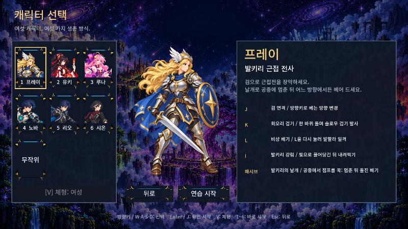 "연습 시작" |
| 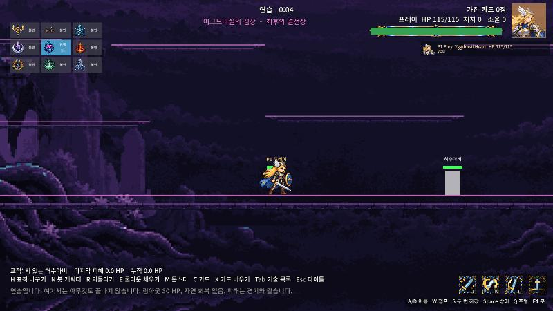 서 있는 허수아비 | 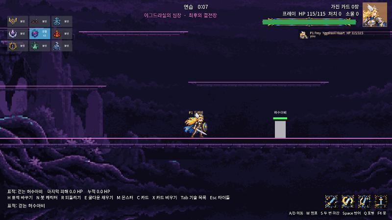 H: 걷는 허수아비 |
| 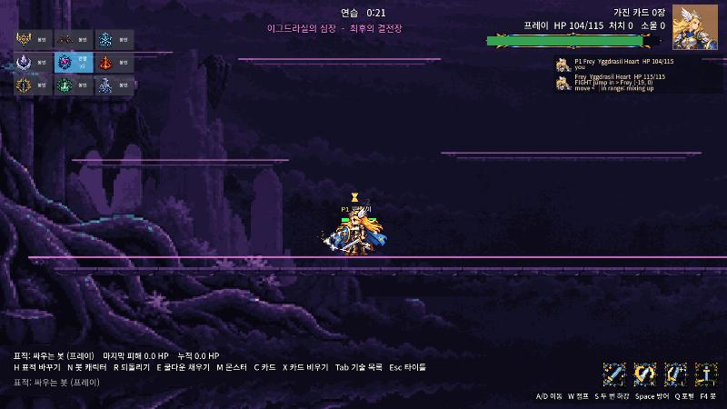 H: 싸우는 봇이 때림 (HP 104/115) | 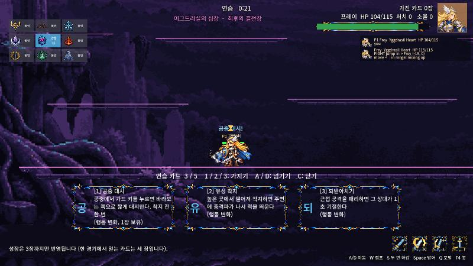 C → 3쪽 → 1: 공중 대시 "1장 보유", 시계 멈춤 |
| 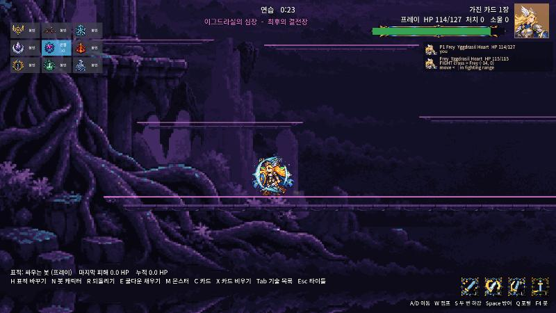 닫은 뒤 W·Space: 공중 대시 | 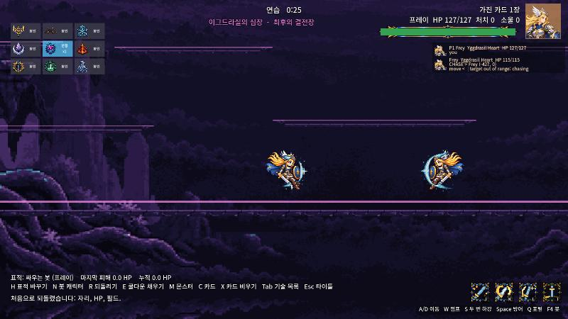 R: 둘 다 시작 자리, HP 가득 |
| 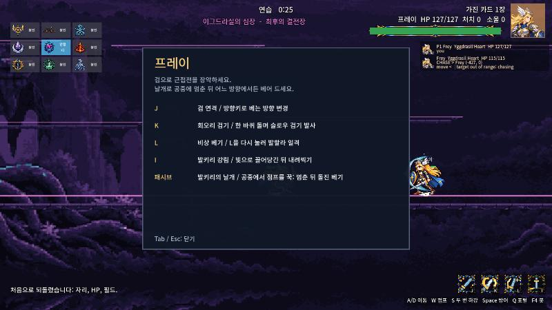 Tab: 기술 목록 (웹에서도 Tab이 게임으로 들어감) | 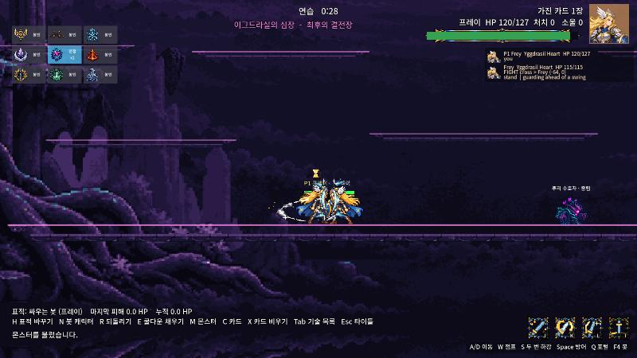 M: 몬스터 |

- Esc로 타이틀에 돌아왔고, 브라우저 콘솔에 오류는 없었다. [잼]
- 캡처는 브라우저 도구의 한계로 800×450이다. 큰 그림(1280×720) 다섯 장은 프로젝트를 창 모드로 실행해 찍은 것으로, 웹 빌드가 아니다(`img/window-*.jpg`).
- 확인하느라 그 브라우저의 언어 설정을 한국어로 바꿨다가 끝나고 영어로 되돌렸다.
- 이 한 바퀴는 커밋 `d8c21e95`의 빌드에서 돌았다. 그 뒤의 변경은 하나다: 카드 목록이 열려 있는 동안에도 오른쪽 위의 "가진 카드 N장"이 바로 바뀐다(위 카드 캡처에서는 0장으로 남아 있다). 이 변경은 검사로 확인했고 웹에서 다시 돌지는 않았다. [잼]

### 5.4 전체 검사와 용량

- run_all: 아래 "병합" 줄에 적는다.
- 웹 빌드 Download: 47,115,795바이트(44.93 MiB), 예산까지 70,125바이트. 연습 모드 전 47,100,514바이트. [잼]

## 6. 코드에서 바뀐 곳

| 파일 | 내용 |
|---|---|
| `scripts/practice/PracticeDirector.gd` (새 파일) | 시간표 없는 규칙: 중앙 렐름만 열림, 탈락·승패 없음, 중앙 난투의 값 |
| `scripts/practice/PracticeSession.gd` (새 파일) | 두 선수, 키, 표적 바꾸기, 되돌리기, 카드·기술 목록, 연습용 HUD 두 줄 |
| `scripts/Main.gd` | 연습으로 들어가는 길(`_start_practice`), 연습에서는 소울 제안·탈락 안내·H 허수아비를 끔 |
| `scripts/ui/FrontendMenu.gd` | 타이틀에 "연습" 한 줄, 선택 화면의 시작 버튼 문구 (7절) |
| `characters/common/PlayerBase.gd` | `revive()`, `refill_cooldowns()`, `clear_upgrades()`, 걷는 허수아비(`dummy_move`). 허수아비의 3초 타이머는 이미 일어나 있으면 아무것도 하지 않음 |
| `characters/{luna,nova,rio,xion}/*.gd` | `character_refill()` 3~6줄씩: E가 채울 그 캐릭터의 쿨다운과 탄환 |
| `characters/rio/Rio.gd` | 4절의 버그 수정 |
| `assets/i18n/strings.csv` | 연습 문구 23줄 (한국어·영어) |
| `tests/test_practice_mode.gd` (새 파일), `tests/test_rio_kit.gd`, `tests/test_frontend_flow.gd`, `tests/test_language.gd`, `tests/run_all.ps1` | 검사 |
| `tests/analysis/lead/capture_practice.gd` (새 파일) | 창 모드 캡처 |

새 그림과 소리는 없다.

## 7. UI·디자인 담당에게

`scripts/ui/` 안에서 바꾼 것은 `FrontendMenu.gd`의 네 군데다. 모양은 손대지 않고 기능만 넣었다.

1. `var select_mode := "match"` (새 변수). 선택 화면이 무엇을 시작하는지: `"match"` 또는 `"practice"`.
2. `show_title()`: 메뉴 목록에 `["Practice", "practice"]`를 스토리 아래 셋째 줄로 넣었다. 줄의 자리는 `Rect2(466, 294 + n * 60, 348, 52)`에서 **`Rect2(466, 286 + n * 52, 348, 52)`** 로 바꿨다. 줄 크기(348×52)는 그대로이고, 첫 줄이 8px 올라갔고, **줄 사이의 8px 틈이 없어져 틀끼리 붙는다.** 마지막 줄은 y 598에서 끝난다(바로 아래 상태 줄이 y 600). 버튼의 실제 높이가 52px 아래로 줄지 않아서 여섯 줄을 넣으려면 이 방법뿐이었다.
3. `show_select()`: 시작 버튼의 문구가 `select_mode`가 `"practice"`일 때 "Start practice"(연습 시작)다. 자리와 크기는 그대로다(558, 584, 162×44).
4. `_activate()`: `"select"`는 `select_mode = "match"`, 새 `"practice"`는 `select_mode = "practice"`로 두고 둘 다 `show_select()`를 부른다.

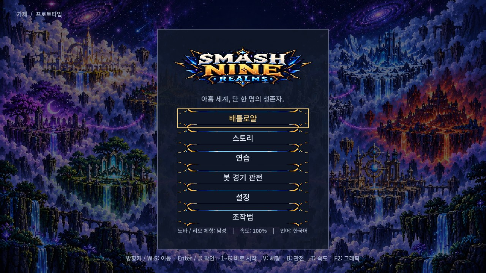

`scripts/ui/` 밖에서 HUD에 올린 것(모두 `PracticeSession.gd`가 만든다):

- **연습 안내 두 줄** `PracticeInfo`: 자리 (24, 618), 크기 960×42, 글자 14px, 왼쪽 아래에 고정. 메시지 줄(y 664) 바로 위이고 스킬 바(x 1004부터)의 왼쪽이다.
- **상태 줄**(오른쪽 위): 연습에서는 "가진 카드 N장 / 이름 HP 처치 소울"로 바꿔 쓴다. 경기의 "생존 n / n"과 "다음 카드 25"는 연습에 맞지 않아서다.
- **카드 목록**: 경기의 카드 칸(`card_panel`)을 그대로 쓰고 제목 줄과 "(종류, N장 보유)"만 바꿔 쓴다.
- **기술 목록** `PracticeSkills`: 자리 (330, 110), 크기 620×470, 가운데 고정. 선택 화면의 패널과 같은 색(INK 0.96, 테두리 59617c)에 글자만 얹었다.

손보면 좋을 것: 타이틀 여섯 줄의 간격, 연습용 HUD의 모양(지금은 글자뿐), 기술 목록 패널의 아래쪽 빈 곳, 카드 아이콘(새 카드 13장은 아직 글자 타일, #223).

## 8. 사용자가 정할 것

급한 것은 없다. 해 보고 바꾸고 싶은 것을 말해 주면 된다.

1. **규칙값.** 지금은 중앙 난투 단계의 값이다(링아웃 30 HP, 회복 없음). 초반 단계의 값(링아웃 20 HP, 회복 있음)으로 하거나 키로 바꾸게 할 수 있다.
2. **카드의 성장을 3장 몫까지만 주는 것.** "카드를 3장까지만 들 수 있게"로 바꿀 수 있다.
3. **표적의 종류.** 가드만 하는 허수아비, 점프하는 허수아비, 봇의 세기 조절은 아직 없다.
4. **렐름.** 지금은 중앙 하나다. 다른 렐름을 고르게 할 수 있다(지형 위험을 켜고 끄는 것 포함).

## 9. 남은 것

- 게임패드 지원 (품질 트랙 ③의 나머지).
- 총괄이 승인한 스트레스 검사: 기술 도중에 몬스터를 여러 시점에 없애 보기. 이번에 넣은 "궁극기 도중 R"과 같은 종류를 경기 쪽에서 찾는다.
- 연습에 아직 없는 것: 콤보 피해 합계(연속으로 맞은 것만 따로), 입력 표시, 한 프레임씩 넘기기.

## 병합

- 올린 커밋: `35c6cb17`(Rio 궁극기 수정), `d8c21e95`(연습 모드), `eec6fd2b`(카드 목록이 열린 동안의 상태 줄), 그리고 이 보고서와 로드맵 한 줄.
- run_all: `eec6fd2b`에서 ALL PASSED. 검사 65개와 소크 1판, 17분, 별도 작업 폴더에서 돌렸다(2026-11-26 17:24~17:41). 그 앞 커밋 `d8c21e95`에서도 ALL PASSED였다. [잼]
- 웹 빌드 Download: 47,115,795바이트(44.93 MiB). [잼]
