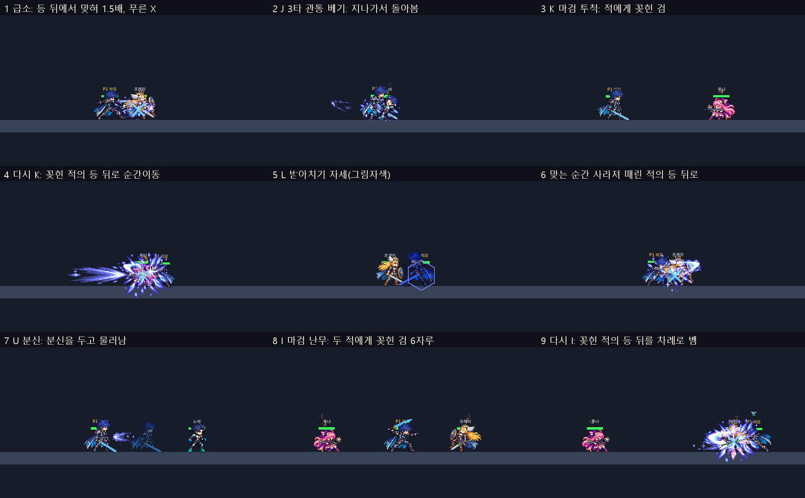

# Rio 새 키트 v3 (2026-11-18, D50)

사용자: [제안 v3](../rio-concepts-2026-11-04/README.md)에 "제안대로 넣기". 칸마다 제안 칸을 그대로 넣었다. 플레이 스타일은 **다양한 이동기로 적을 농락하는 암살자**(D46).

엔진 창 캡처(`tests/analysis/lead/rio_kit_capture.gd`)를 1:1로 잘랐다. 보드 스크립트: [board.py](board.py). 그림은 모두 임시다(아래 "그림").

## 기술

| 키 | 이름 | 하는 일 |
|---|---|---|
| 패시브 | 급소 | 적의 등 뒤(적이 보는 쪽의 반대편)에서 맞히면 피해 1.5배, 그 적 위에 푸른 X. 공중 점프 2회(마력 발판)는 그대로 |
| J | 마력 참격 | 1·2타는 그대로. 3타째 **관통 베기**: 적을 뚫고 150px 지나가며 베고 등 뒤에 서서 그 적을 바라본다 |
| K | 마검 투척 | 던진 마검이 적·벽·땅에 꽂히거나 끝에서 멈춘다. 3초 안에 다시 K로 그곳에 순간이동하며 벤다. 적에게 꽂혔으면 그 등 뒤로 |
| L | 그림자 받아치기 | 0.4초 자세. 첫 공격을 피해 없이 받고, 사라졌다가 때린 적의 등 뒤에 나타나 벤다. 헛치면 빈틈 |
| **U** | 분신 바꿔치기 | 분신을 두고 150px 물러난다. 4초 안에 다시 U로 분신과 자리를 한 번 바꾼다. 분신은 공격을 한 번 대신 맞고 터진다 |
| I | 마검 난무 | 보석 검 6자루를 주변 적에게 꽂는다. 3초 안에 다시 I로 꽂힌 적의 등 뒤를 차례로 베고(무적) 제자리로 돌아온다. 안 누르면 검이 터진다 |

이름은 제안서에서 리드가 붙인 그대로다(관통 베기, 마검 투척, 그림자 받아치기, 분신 바꿔치기, 마검 난무, 급소). 수치는 `design/SKILLS.md` Rio 절에 있다.

## 리드가 채운 빈 부분

제안서에 없던 것을 넣으면서 정했다.

| 정한 것 | 다르게 할 수 있는 것 |
|---|---|
| U 쿨다운 **5초**. 없으면 순간이동을 연달아 쓸 수 있어서 넣었다 | 쿨다운 없음, 3초 |
| K는 쿨다운 없이 던지기 선딜·후딜만. 공중에서는 착지 전 **한 번** 던진다(예전 K와 같은 규칙) | K에도 쿨다운 |
| K 순간이동은 가는 길의 땅·벽에서 멈춘다(Luna 반짝 도약과 같은 규칙). 난무 베기만 벽을 지나 등 뒤로 간다 | K도 막힘 없이 |
| Rio가 맞아도 마검은 **남는다**. 경직이 끝나면 다시 K로 빠져나갈 수 있다 | 맞으면 검이 사라짐 |
| 받아치기는 **첫 공격 한 번**만 받는다. 때린 적이 **500px 안**이면 등 뒤로 가고, 멀리서 쏜 투사체는 피하기만 한다. 잡기(Brave K)는 받아치지 못한다 | 거리 제한 없음, 자세 동안 여러 번 |
| 등 뒤 기준: 적이 보는 쪽의 반대편이고, 중심에서 4px 넘게 떨어져야 한다. 봇은 늘 Rio 쪽을 보므로 순간이동·관통 직후가 급소 기회다 | 공격 방향으로 판정 |
| 관통 베기에 맞은 적은 **Rio가 온 쪽**으로 밀린다(그래서 Rio가 등 뒤에 남는다). 땅에서는 발판 끝에서 멈춘다 | 앞으로 밀기 |
| 분신은 **봇이 노리지 않는다**(사람만 속는다). 몬스터 공격과 투사체에도 터지고, Rio 자신의 공격은 지나간다. 자리 바꾸기는 한 번 | 봇도 분신을 노리게, 여러 번 바꾸기 |
| 난무: 적이 하나면 여섯 자루가 모두 그 적에게 간다. 빗나간 검은 두 번째 I 때 사라지고, 끝나면 **두 번째 I를 누른 자리**로 돌아온다. 던지는 중에 맞으면 그때까지 던진 검만 남는다 | 첫 I 자리로 돌아오기 |
| 봇: 마검이 적에게 꽂히면 0.15초 뒤, 공중(복귀 중)이면 바로 스스로 순간이동한다. 난무는 0.4초 뒤 스스로 벤다. U는 쓰지 않는다(깨지지 않게만) | 나중에 봇 손질 |
| 소리: U는 임시로 K 소리(`skill_rio_1`)를 복사했다. K는 이제 돌진이 아니라서 대시 소리를 뺐다 | 소리 세션에서 새로 |
| 궁극기 이름은 "Blade Flurry"(마검 난무)로 바꿨다(컷인·문구) | — |

## 바뀐 공용 부분

- **피해 배율 훅**: `PlayerBase.damage_scale_against(target)`. 맞는 쪽이 피해를 계산할 때 공격자에게 묻는다(`RealmMonster.apply_hit`도). 지금은 Rio의 급소만 쓴다.
- **몬스터**: `RealmMonster.is_down()`(쓰러짐). 꽂힌 검이 쓰러진 몬스터에서 떨어진다.
- **캐릭터 선택 화면**: Rio도 U가 있어 6줄이다. 문구 영·한을 바꿨다.
- **봇**: 프로필은 그대로다(근접, 복귀용 K, 상대가 휘두를 때 L).

## 그림

모두 임시다. 몸 동작은 예전 줄을 빌려 쓴다.

| 기술 | 지금 | 필요한 것 |
|---|---|---|
| 마검 투척 | 보석 검 그림을 하늘색으로, 던지기 `dimension_slash` 1~3 | 마검, 꽂힌 검, 검 던지기 동작 |
| 순간이동·받아치기 | `rio_blink_trail`, 몸을 그림자 파랑으로, 육각 테두리(코드), 받아치기 `rune_shield` | 사라짐·나타남, 받아치기 자세 동작 |
| 분신 | Rio의 그 순간 그림을 파랗고 반투명하게, 터짐은 룬 폭발 | 분신 모습, 터짐 |
| 관통 베기 | `mana_combo` 5~6, 공용 궤적 | 관통 베기 동작 |
| 마검 난무 | 보석 검 6색(있는 그림), 베기는 `mana_combo` | 꽂힌 보석 검, 난무 베기 동작 |
| 급소 | 코드 X | 급소 표시 |
| 아이콘 | `rio_k`·`rio_l`·`rio_i`는 예전 기술 그림, U는 글자 | `rio_j`·`rio_k`·`rio_l`·`rio_u`(새)·`rio_i` |

## 컨셉 점검

- **컨셉이 보이는가:** 이동기 셋이 가는 곳이 모두 다르다(던진 검, 때린 적의 등 뒤, 분신 자리). 셋 모두 등 뒤로 이어져 급소와 맞물린다.
- **기술을 알아보는가:** 날아가 꽂히는 검, 그림자색 자세, 파란 분신, 보석 검 여섯 자루로 모양이 다르다. 그림이 임시라 아직 거칠다.
- **연결:** K로 꽂고 다시 K로 등 뒤 → J(1.5배) → 3타 관통으로 다시 등 뒤. 반격이 오면 L로 또 등 뒤로. 몰리면 U로 분신을 두고 빠졌다가 바꾼다.
- **다른 캐릭터와 다른가:** Luna 반짝 도약은 정해진 거리를 간다. Rio는 던진 검이 갈 곳을 정한다. Nova는 적을 끌어오지만 Rio는 자기가 적에게 간다. 분신과 등 뒤 보너스는 Rio뿐이다.
- **강점·약점:** 잡기 어렵고 한 명을 빨리 무너뜨린다. 복귀 수단이 많다. HP 96·무게 0.94라서 잘 날아가고, 여럿을 치는 기술은 I뿐이다. K·L·U를 다 쓴 순간이 위험하다.

## 확인

- `test_rio_kit`(14가지, 예전 `test_rio_prototype`): 공중 점프·마력 발판, 급소 1.5배와 표시, 관통(지나가서 돌아봄·뒤로 밀기), 발판 끝 멈춤, 마검(꽂힘·등 뒤 순간이동·베기), 허공에서 멈춘 검과 공중 한 번, 받아치기(피해 없음·등 뒤·쿨다운), 헛친 받아치기, 분신(물러남·한 번 바꾸기·자기 공격 통과·적 공격에 터짐·쿨다운), 난무(두 적·무적·제자리), 난무 터짐, 봇 스스로 잇기, U 칸.
- 바뀐 테스트: 봇 복귀(공중 던지기 한 번), 효과 그림(분신 터짐), 스킬 바(받아치기 쿨다운), 소리(공중 던지기, 쿨다운 초기화).
- 전체 테스트(`tests/run_all.ps1`, 소크 포함): 54개와 봇 소크(시드 1001) 모두 통과.
- 엔진 캡처: 위 보드. 꽂힌 검이 처음에 캐릭터 뒤에 가려져서, 검을 캐릭터보다 위에 그리게 고쳤다.
- 웹 빌드: 새로 만들어 http://localhost:8060 에서 확인했다. Rio 선택 화면에 6줄(J·K·L·U·I·패시브)이 나온다. Rio로 경기를 시작해 U로 분신이 나오는 것을 봤다. 스킬 바에 U 칸(글자)이 있고, 콘솔 오류는 없다.
