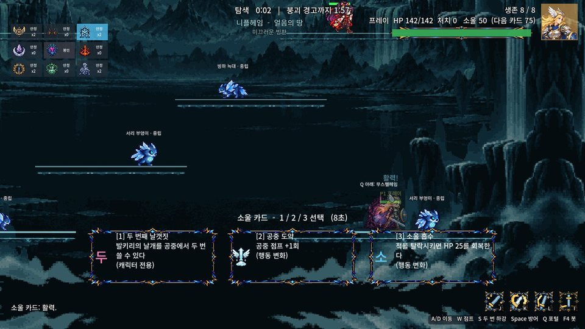
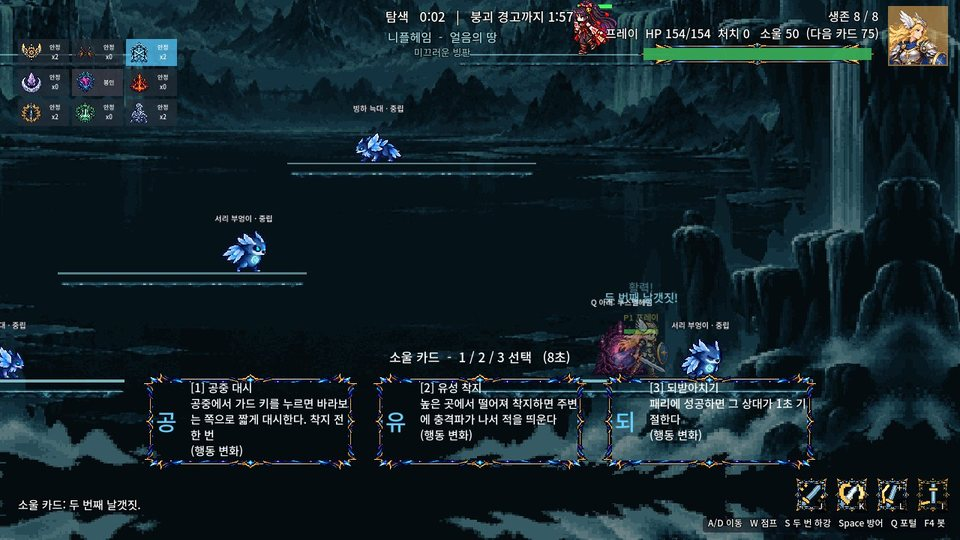
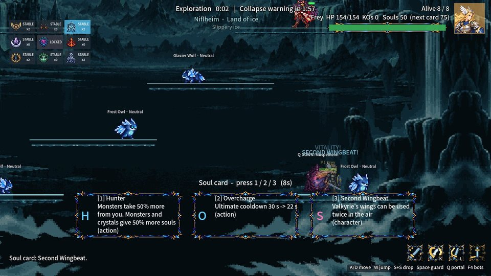
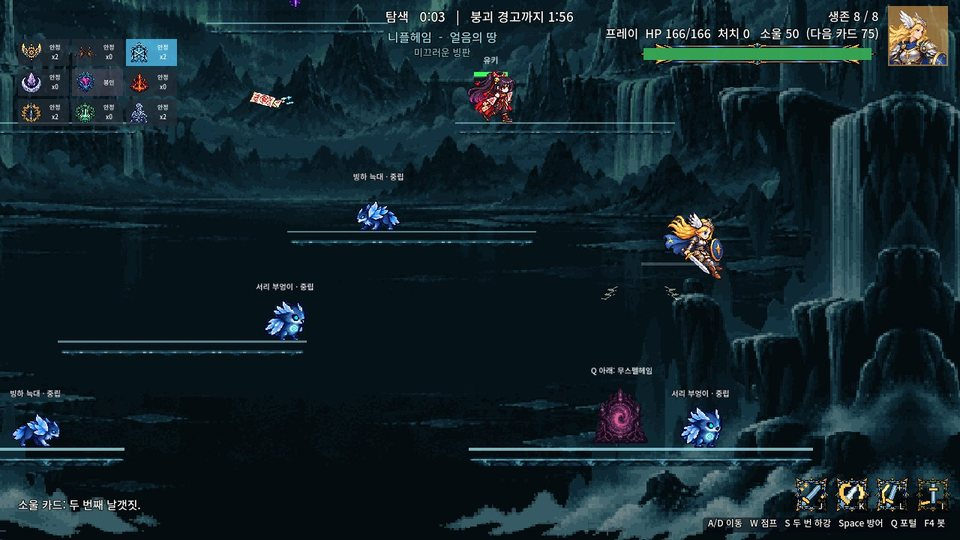
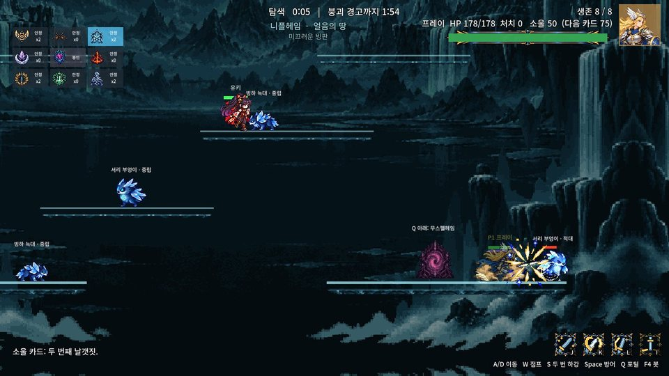

# 소울 카드 19장을 게임에 넣음 (2026-11-26, 시스템 담당)

결정 D54(사용자 2026-11-25 "카드는 추천대로 해")의 카드 풀과 고르는 규칙을 게임에 넣은 기록이다. 제안서는 `reports/soul-cards-2026-11-24/README.md`다. 제안서에 숫자가 있던 것은 그대로 넣었고, 숫자가 없던 곳은 처음 값을 정해 넣어 3절에 모았다.

문장 끝의 표시: **[잼]** 은 경기나 실험에서 잰 것, **[코드]** 는 코드에서 읽은 것, **[추정]** 은 재지 않은 것이다. 피해는 따로 말하지 않으면 경기 안에서 실제로 깎인 HP다.

## 한 문장 결론

**카드 19장과 고르는 규칙 넷이 들어갔고, 새 카드 13장마다 실제 누름과 실제 충돌로 하는 검사가 있다.** [잼]

- 봇 경기 48판(시드 2001~2048)에서 경기 길이(중앙값 285 → 287초)와 링아웃(608 → 620)은 그대로다. [잼]
- 캐릭터별로는 Frey가 오르고(평균 4.7 → 4.0위, 3승 → 8승) Xion이 내렸다(평균 4.6 → 5.6위, 8승 → 0승, 준 피해 −22%). 24판씩 두 묶음에서 방향이 같다. [잼]
- 그 까닭은 새 카드의 효과보다 고르는 규칙 쪽에 있는 것으로 보인다. 카드 19장을 규칙 없이 뽑게 하면 Xion은 24판에 5승을 하고, 규칙대로 뽑으면 120판에 1승이다. 규칙의 어느 부분 때문인지는 가르지 못했다(5.6절). [잼]
- 봇에게는 거의 걸리지 않는 카드가 둘 있다. 쌍둥이 별(30명이 골라 1번)과 되받아치기(고른 봇 한 명이 한 판에 0.6번)다. [잼]
- 웹 빌드는 44.9 MiB(47,105,622바이트)다. 예산 45 MiB까지 약 78KB 남아서, 새 카드 13장의 아이콘 그림은 지금 예산으로는 못 넣는다. [잼]
- 사용자가 정할 것은 8절에 모았다.

## 1. 넣은 카드 (19장)

한 캐릭터가 보는 카드는 공통 14장과 자기 전용 1장이다. Yuki는 전용 카드가 없어 14장이다. [잼]

| 종류 | 카드 | 게임 안 문구 | 겹치기 |
|---|---|---|---|
| 수치 | 힘 (Power) | 공격력 +12% | 제한 없음 |
| 수치 | 활력 (Vitality) | 최대 HP +15, 15 회복 | 제한 없음 |
| 수치 | 신속 (Swiftness) | 이동 속도 +8% | 제한 없음 |
| 수치 | 닻 (Anchor) | 받는 넉백 -15% | 제한 없음 |
| 수치 | 최후의 저항 (Last Stand) | 링아웃 피해 -30% | 1장 |
| 행동 | 공중 도약 (Sky Step) | 공중 점프 +1회 | 2장 |
| 행동 | **공중 대시** | 공중에서 가드 키를 누르면 바라보는 쪽으로 짧게 대시한다. 착지 전 한 번 | 1장 |
| 행동 | **유성 착지** | 높은 곳에서 떨어져 착지하면 주변에 충격파가 나서 적을 띄운다 | 1장 |
| 행동 | **되받아치기** | 패리에 성공하면 그 상대가 1초 기절한다 | 1장 |
| 행동 | **소울 흡수** | 적을 탈락시키면 HP 25를 회복한다 | 1장 |
| 행동 | **마지막 불꽃** | HP가 30% 이하이면 공격 +25%, 이동 +10% | 1장 |
| 행동 | **추격자** | 적을 크게 날린 뒤 2초 동안 이동 +30% | 1장 |
| 행동 | **사냥꾼** | 몬스터에게 주는 피해 +50%, 몬스터와 크리스탈에서 얻는 소울 +50% | 1장 |
| 행동 | **궁극기 가속** | 궁극기 쿨다운 30초 → 22초 | 1장 |
| 전용 (Frey) | **두 번째 날갯짓** | 발키리의 날개를 공중에서 두 번 쓸 수 있다 | 1장 |
| 전용 (Luna) | **쌍둥이 별** | J의 큰 별이 터질 때 작은 별 둘이 더 튀어 나간다 | 1장 |
| 전용 (Nova) | **깊은 중력** | 중력 필드 6초 → 9초, 쿨다운 12초 → 10초 | 1장 |
| 전용 (Rio) | **두 번째 분신** | 분신과 자리를 두 번 바꿀 수 있다 | 1장 |
| 전용 (Xion) | **확장 탄창** | 산탄 10발 → 14발 | 1장 |

- 굵은 글씨 13장이 새 카드다. 처음부터 있던 6장은 효과와 숫자가 그대로다.
- 새 카드는 모두 한 장씩만 고를 수 있다(총괄의 보충 규칙).
- 영어 문구도 함께 넣었다(`assets/i18n/strings.csv`, 27줄).
- 수치와 조건을 코드 이름과 함께 적은 표는 `design/SKILLS.md`의 "소울 카드" 절에 있다.

## 2. 고르는 규칙

| 규칙 (D54) | 넣은 것 | 확인 |
|---|---|---|
| 세 장 가운데 한 장은 반드시 행동이나 전용 카드 | `SoulCards.draw_offer` | 6캐릭터 × 150번 × 세 번의 고르기, 2,700번을 뽑아 모두 그랬다 [잼] |
| 전용 카드는 두 번째 고르기에 반드시 한 번 | 같은 함수 | 전용 카드가 있는 5캐릭터의 두 번째 고르기 750번에서, 첫 고르기에 이미 가져간 경우를 빼고 모두 들어 있었다 [잼] |
| 고르는 시간 5 → 8초 | `SoulGrowth.CHOICE_TIME` | 사람의 고르기가 8초로 열린다. 웹 빌드에서 "(8초)"로 보인다 [잼] |
| 봇은 무작위로 고르고, 공중 대시는 복귀 때 쓴다 | `EnemyAI._recover_intent` | 무대 옆으로 떨어지는 봇이 무대 쪽으로 대시한다. 카드가 없으면 하지 않는다 [잼] |

규칙을 넣으면서 정한 것 셋:

- **세 장의 자리를 섞는다.** 사람이 시간 안에 못 고르면 첫 번째 카드가 자동으로 골라진다. 반드시 들어가는 카드가 늘 첫 자리에 오면 시간 초과가 늘 그 카드가 되므로, 세 장의 순서를 뽑아서 정한다. 전용 카드가 세 자리에 고르게 나오는 것을 검사한다. [잼]
- **Last Stand는 수치 카드로 표시한다.** 제안서의 표에 "수치"로 적혀 있다. 그 전 게임에서는 "행동 변화"로 보였다. 그래서 Last Stand만으로는 "행동 카드 한 장" 규칙이 채워지지 않는다. [코드]
- **Frey 봇은 두 번째 날갯짓을 쓴다.** D54에 봇 규칙으로 적힌 것은 공중 대시뿐이다. 그런데 봇은 날개를 한 번 쓰면 2.5~4.5초를 쉬어서, 그대로 두면 이 카드가 봇에게는 아무 일도 하지 않는다. 카드를 가진 봇은 같은 공중에서 한 번 더 쓸 수 있게 했다(3줄). 빼기 쉽다. [코드]

## 3. 제안서에 숫자가 없어서 정해 넣은 값

사용자가 바꿀 수 있는 값이다. 모두 `characters/common/PlayerBase.gd` 위쪽의 상수이거나 캐릭터 스크립트의 상수다.

| 카드 | 정한 것 | 넣은 값 | 까닭 |
|---|---|---|---|
| 공중 대시 | "짧게"의 거리 | 약 120px (720px/s로 0.17초) | Frey의 날개 돌진(137px)보다 조금 짧게 |
| 공중 대시 | 대시가 끝난 뒤 | 낙하가 처음부터 다시 시작된다 | 복귀에 쓸모가 있게 |
| 공중 대시 | 못 쓰는 때 | 경직, 공격 중, 착지 잠금 중 | 다른 동작을 끊고 나가지 않게 |
| 유성 착지 | "높은 곳" | 낙하 300px 이상 | 한 번 점프의 꼭대기가 200~235px이라, 그냥 점프로는 안 나고 공중 점프나 위 발판에서 떨어지면 난다 |
| 유성 착지 | 충격파 | 양옆에 각 129×78px, 코드 피해 8(평타 한 번쯤), 넉백 400, 위로 띄움 | 제안서의 "평타 한 번쯤의 피해, 띄움" |
| 유성 착지 | 못 내는 때 | 맞아서 경직인 채로 떨어진 착지 | 날아가다 떨어진 것은 내려찍기가 아니다 |
| 되받아치기 | 투사체를 패리했을 때 | 쏜 선수가 기절한다(거리와 상관없이) | 문구 "그 상대"를 그대로 따랐다 |
| 되받아치기 | 기절하지 않는 상대 | 궁극기 슈퍼아머 중, 붙잡힌 중, 무적 중 | 궁극기가 패리 한 번에 끊기지 않게 |
| 소울 흡수 | "탈락시키면" | 링아웃으로 탈락시킨 것도 센다 | 탈락 기록이 원래 그렇게 센다 |
| 추격자 | "크게 날린" | 맞은 선수의 넉백이 480 이상 | 게임이 이미 "강한 타격"으로 다루는 기준(경직이 길어지는 선)과 같다 |
| 사냥꾼 | 소울의 끝수 | 반올림 (6 → 9, 8 → 12, 10 → 15) | |
| 궁극기 가속 | 언제부터 | 고른 뒤에 쓰는 궁극기부터 22초 | |
| 두 번째 날갯짓 | 두 번째의 조건 | 공중 점프가 없어도, 첫 돌진의 착지 잠금 중에도 된다 | 첫 돌진이 공중 점프를 모두 쓰고 착지까지 잠그기 때문 |
| 쌍둥이 별 | 나가는 방향 | 큰 별이 날던 방향의 ±11° | 터진 자리 뒤 200px 안의 적에게 둘 다 닿는다 |
| 쌍둥이 별 | 큰 별이 맞힌 대상 | 작은 별이 지나간다 | "튀어 나간다"가 되게. 안 그러면 그 자리에서 바로 맞는다 |
| 확장 탄창 | 고르는 순간 | 늘어난 4발이 바로 장전된다 | 고른 것이 바로 보이게 |

- 사냥꾼의 "+50%", 궁극기 가속의 "22초", 마지막 불꽃의 "30%, +25%, +10%", 추격자의 "2초, +30%", 소울 흡수의 "25", 깊은 중력의 "9초, 10초", 확장 탄창의 "14발"은 제안서의 숫자 그대로다. [코드]

## 4. 검사

`tests/test_soul_cards.gd`를 새로 만들어 전체 검사(`tests/run_all.ps1`)에 넣었다. 장면은 모두 세계 원점과 (9000, 6000) 두 곳에서 한다. 손으로 `apply_hit`를 부르지 않고, 키를 누르고 실제로 맞힌다. 장면마다 "카드 없이"도 같이 해서, 카드가 없으면 일어나지 않는 것을 함께 본다.

| 대상 | 검사하는 것 |
|---|---|
| 카드 풀 | 19장, 종류별 5·9·5장, 캐릭터가 보는 카드 15장(Yuki 14장), 남의 전용 카드는 안 보임 |
| 고르는 규칙 | 2절의 표. 매치의 `SoulGrowth`를 거쳐서도 확인 |
| 공중 대시 | 공중에서 가드 키 → 바라보는 쪽으로 122px(±14), 떨어지지 않음, 같은 공중에서 한 번, 착지하면 다시. 땅에서는 여전히 가드 |
| 유성 착지 | 380px에서 떨어지면 옆의 적이 맞고 떠오름. 150px에서는 아님 |
| 되받아치기 | 상대의 실제 휘두르기를 패리 → 상대 경직 0.8초 이상. 카드 없이는 0.3초 이하 |
| 소울 흡수 | 실제 휘두르기로 탈락시키면 HP +25, 최대 HP를 넘지 않음 |
| 마지막 불꽃 | HP 30%에서 공격 ×1.25·이동 ×1.1, 같은 휘두르기의 피해가 1.25배, 회복하면 꺼짐 |
| 추격자 | 적을 크게 날리면 2초 동안 이동 ×1.3, 가볍게 민 타격은 아님 |
| 사냥꾼 | 같은 휘두르기가 몬스터에게 1.5배, 몬스터 소울 1.5배(스포너의 실제 처리 경로), 크리스탈 15 대 10 |
| 궁극기 가속 | 쿨다운 22초(스킬 바 포함) |
| 두 번째 날갯짓 | 점프 키를 실제로 눌러 한 번의 공중에서 날개 두 번, 세 번째는 안 됨 |
| 쌍둥이 별 | J 네 번째의 큰 별이 터지면 뒤의 적이 작은 별에 맞음. 큰 별이 맞힌 대상은 추가 피해 없음 |
| 깊은 중력 | 필드 9초, 쿨다운 10초 |
| 두 번째 분신 | 자리 바꾸기 두 번, 세 번째는 안 됨 |
| 확장 탄창 | 고르면 14발, 한 발 쏘면 13발, 재장전하면 14발, 스킬 바 숫자 |
| 봇 | 공중 대시를 복귀에 씀, Frey 봇이 두 번째 날갯짓을 씀 |

- `tests/test_language.gd`: 19장 모두 한국어와 영어로 카드 칸에 들어가는지, 아이콘이 없는 카드에 첫 글자가 나오는지. [잼]
- 전체 검사: 검사 64개와 봇 경기 1판이 모두 통과했다(`tests/run_all.ps1`, 커밋 `97c23d11`, 2026-11-26). [잼]
- 검사를 만들다 찾은 것: 카드를 한 장 고르면 캐릭터의 성장도 3단계 오른다(공격 +5~9%). 그래서 "카드 전후의 피해 비교"는 공격력으로 나눠서 봐야 한다. 처음에는 사냥꾼이 1.58배, 쌍둥이 별이 큰 별에 맞은 대상에게 추가 피해를 주는 것처럼 보였다. [잼]
- 전체 검사에서 찾은 것: 스토리 검사 하나(`test_story_late_flow`의 "막간 회복은 정확히 30%")가 세 번에 한 번 실패했다. 스토리 주인공이 우연히 소울 흡수를 갖고 있으면 라이벌이 쓰러질 때마다 25씩 회복하기 때문이다. 카드는 적힌 대로 움직인 것이라, 검사가 그 카드 없이 재도록 고쳤다. 주인공에게 카드를 쥐여 주면 같은 실패가 나는 것으로 원인을 확인했다. [잼]

## 5. 측정: 같은 판에서 카드 전과 후

### 5.1 잰 방법

- 봇 8명의 경기, `--fixed-fps 60`, 최대 480초. 같은 시드는 같은 경기다.
- 전: `6912cf24`(main, 카드 6장). 후: `e29c45d0`(카드 19장과 규칙). 그 뒤의 커밋은 그림 효과와 카드 칸 크기만 바꿨다.
- 시드 2001~2024(24판)와 2025~2048(24판), 합쳐 48판. 프로젝트의 기준인 "같은 8판"(2001~2008)도 함께 적는다.
- 스크립트 오류는 전후 96판과 대조 측정 120판에서 0건이다. 대조 측정 한 판의 끝에 엔진이 내는 줄("2 resources still in use at exit")이 하나 있었고, 경기 결과와는 상관없다. [잼]
- 원자료는 이 폴더의 `soak-before-*.txt`, `soak-after-*.txt`, `controls/`다. 표는 `cards_summary.py <전> <후>`와 `ban_summary.py`로 다시 만든다.

### 5.2 경기 (전 → 후) [잼]

| | 같은 8판 | 24판 (2001~2024) | 48판 |
|---|---|---|---|
| 경기 길이 중앙값 | 290 → 288초 | 283 → 284초 | 285 → 287초 |
| 링아웃 합계 | 86 → 77 | 307 → 298 | 608 → 620 |
| 선수끼리 타격 합계 | 5,044 → 5,091 | 15,451 → 15,123 | 31,009 → 29,797 |
| 자리당 고른 카드 | 2.50 → 2.48장 | 2.54 → 2.55장 | 2.58 → 2.53장 |

- 경기 길이와 링아웃은 카드 전후가 같다. 목표(5~7분)보다 조금 짧은 것도 그대로다.

### 5.3 캐릭터 (48판, 캐릭터마다 64자리) [잼]

| | 평균 순위 (승), 전 | 후 | 자리당 준 피해, 전 → 후 |
|---|---|---|---|
| Luna | 2.84 (21) | 3.05 (23) | 209 → 203 |
| Rio | 3.72 (14) | 3.78 (11) | 232 → 232 |
| Xion | 4.55 (8) | **5.61 (0)** | 208 → **163** |
| Frey | 4.72 (3) | **3.98 (8)** | 181 → 184 |
| Yuki | 5.47 (0) | 5.56 (3) | 88 → 76 |
| Nova | 5.70 (2) | 5.02 (3) | 116 → 122 |

24판씩 나눠 보면:

| 평균 순위 (승) | 2001~2024, 전 → 후 | 2025~2048, 전 → 후 |
|---|---|---|
| Frey | 4.97 (1) → 4.19 (5) | 4.47 (2) → 3.78 (3) |
| Xion | 3.97 (6) → 5.47 (0) | 5.12 (2) → 5.75 (0) |
| Nova | 5.59 (2) → 5.53 (1) | 5.81 (0) → 4.50 (2) |
| Yuki | 5.62 (0) → 5.06 (3) | 5.31 (0) → 6.06 (0) |
| Luna | 2.91 (10) → 3.03 (11) | 2.78 (11) → 3.06 (12) |
| Rio | 3.94 (5) → 3.72 (4) | 3.50 (9) → 3.84 (7) |

- Frey와 Xion은 두 묶음에서 같은 쪽으로 움직였다. Nova와 Yuki는 묶음마다 방향이 달라서 흔들림으로 본다.
- 기준 8판만 보면 Frey 4.92 (1) → 4.67 (2), Luna 3.33 (2) → 2.67 (3), Nova 4.67 (2) → 5.22 (0), Rio 4.09 (1) → 3.91 (1), Xion 4.25 (2) → 5.42 (0), Yuki 5.55 (0) → 4.82 (2)다. 8판은 판 수가 적어 이 표만으로는 말할 수 없다.

### 5.4 봇이 고른 카드 (후 48판, 384자리가 970장) [잼]

| 종류 | 고른 수 | 비율 |
|---|---|---|
| 수치 5장 | 256 | 26% |
| 행동 9장 | 604 | 62% |
| 전용 5장 | 110 | 11% |

- 카드별로는 수치 카드가 46~58번씩, 행동 카드가 58~80번씩이다. 한쪽으로 몰리지 않았다.
- 전용 카드를 고른 자리: Luna 30/64, Frey 25/64, Rio 25/64, Xion 16/64, Nova 14/64. 봇은 세 장 가운데 아무거나 고르므로, 반드시 나오는 두 번째 고르기에서 셋 중 하나꼴로 가져간다.
- **봇이 가진 수치 카드가 크게 줄었다.** 자리당 수치 카드가 예전 방식에서는 2.12장, 지금은 0.67장이다. 여섯 장 가운데 다섯이 수치이던 풀에서, 열아홉 장 가운데 다섯이 수치인 풀이 됐기 때문이다.

### 5.5 카드 효과가 걸린 횟수 (후 48판) [잼]

| 카드 | 걸린 횟수 | 고른 봇 한 명이 한 판에 |
|---|---|---|
| 추격자 | 722 | 10.9번 |
| 공중 대시 | 396 | 6.0번 |
| 유성 착지 | 218 | 3.3번 |
| 마지막 불꽃 | 104 | 1.3번 |
| 소울 흡수 | 62 | 1.0번 |
| 되받아치기 | 33 | 0.6번 |
| 쌍둥이 별 | 1 | 0.0번 |

- 공중 대시: 봇이 복귀할 때마다 쓴다.
- 쌍둥이 별이 봇에게 걸리지 않는 까닭: Luna 봇은 큰 별(J 네 번째)을 한 판에 1.2번밖에 내지 않는다(J 131번 가운데). 봇의 공격 간격이 0.48~1.05초인데 연사는 0.6초 안에 이어 눌러야 유지된다. 사람은 J를 이어 누르면 네 번째마다 나온다. [잼, 대조 측정 24판]
- Frey의 날개는 자리당 11.5 → 12.8번으로 늘었다(두 번째 날갯짓). Xion의 사격은 자리당 99 → 78번으로 줄었다(일찍 탈락해서다. 생존 시간 평균 200 → 163초).

### 5.6 Frey가 오르고 Xion이 내린 까닭을 찾아봄 [잼]

게임은 그대로 두고, 봇이 고르기 직전에 내놓는 카드만 바꿔서 같은 판을 다시 돌렸다(`tests/analysis/lead/card_ban_probe.gd`). 아무것도 바꾸지 않으면 원래 경기와 글자 하나까지 같게 나오는 것을 먼저 확인했다.

시드 2001~2024, 평균 순위 (승):

| | 카드 전 | 예전 6장을 예전 규칙으로 다시 뽑음 | 19장을 규칙 없이 | 예전 6장에 새 규칙 | 카드 후 |
|---|---|---|---|---|---|
| Frey | 4.97 (1) | 4.66 (2) | 4.00 (2) | 3.91 (2) | 4.19 (5) |
| Xion | 3.97 (6) | 4.84 (3) | 4.94 (5) | 5.03 (1) | 5.47 (0) |
| Luna | 2.91 (10) | 3.00 (10) | 3.22 (10) | 2.75 (12) | 3.03 (11) |
| Rio | 3.94 (5) | 3.78 (7) | 4.12 (5) | 3.78 (6) | 3.72 (4) |
| Nova | 5.59 (2) | 5.53 (1) | 4.84 (1) | 5.56 (2) | 5.53 (1) |
| Yuki | 5.62 (0) | 5.19 (1) | 5.88 (1) | 5.97 (1) | 5.06 (3) |
| 자리당 수치 카드 | (세지 않음) | 2.12장 | 0.86장 | 1.69장 | 0.67장 |

- "규칙"은 D54의 두 가지다: 세 장 가운데 한 장은 행동·전용 카드, 전용 카드는 두 번째 고르기에 반드시.
- "예전 6장에 새 규칙"에서는 행동 카드가 Sky Step 하나뿐이라 모든 고르기에 Sky Step이 나온다(자리당 0.80장).

여기서 읽은 것:

1. **24판 평균은 카드 뽑기만 달라져도 크게 흔들린다.** 첫 두 칸은 풀도 규칙도 같고 뽑힌 카드만 다른데 Xion이 3.97위와 4.84위다. 그래서 24판에서 1위 안쪽의 차이로는 원인을 가를 수 없다.
2. **그래도 Xion의 승수는 고르는 규칙을 따라 갈린다.** 규칙 없이 뽑은 판에서는 96판에 16승(전 48판 8승, 다시 뽑은 24판 3승, 19장을 규칙 없이 뽑은 24판 5승), 규칙대로 뽑은 판에서는 120판에 1승이다(후 48판 0승, 아래 3번의 48판 0승, 예전 6장에 새 규칙 24판 1승). 카드가 19장이 된 것 자체는 원인이 아니다.
3. **두 번째 날갯짓은 원인이 아니다.** 그 카드만 빼고 48판을 다시 돌려도 Frey 4.06위(6승), Xion 5.52위(0승)로 "카드 후"와 같다. 제가 더한 Frey 봇 규칙(2절)이 결과를 바꾼 것이 아니다.
4. 규칙의 어느 부분이 Xion에게 나쁜지는 모른다. 수치 카드가 줄어든 것, 다른 캐릭터의 전용 카드가 두 배로 자주 잡히는 것(자리당 0.14 → 0.29장), 둘 다일 수 있다. Xion의 타격은 넉백이 약해서 추격자가 48판 동안 한 번도 걸리지 않았다(자리당 Frey 4.1번, Rio 3.6번, Nova 2.0번) [잼]. 행동 카드에서 얻는 것이 가장 적은 캐릭터일 수 있다. [추정]

- 더 좁히려면 조건 하나에 48판(약 25분)이 든다. 규칙의 두 부분을 따로 끄는 측정 두 번이면 어느 쪽인지 나온다.
- 이 결과는 봇끼리의 경기다. 봇은 카드를 무작위로 고르고, 사람은 골라서 가진다.

## 6. 카드 고르기 화면 (임시)

카드 고르기 화면은 「UI·디자인 담당」의 몫이고 새 모양은 사용자 판정(#221)을 기다리고 있다. 그때까지 긴 문구가 칸 밖으로 넘치지 않게 지금 화면을 최소한으로 고쳤다. `scripts/ui/MatchHud.gd`의 카드 부분만이다.

| 무엇 | 전 | 후 |
|---|---|---|
| 카드 한 장의 크기 | 224 × 96 | 288 × 132 |
| 세 장 전체 | 700px 폭, 화면 아래 가운데 | 900px 폭, 가운데 그대로, 스킬 바 위에서 끝남 |
| 글 칸 | 152 × 80 (세 줄) | 216 × 108 (다섯 줄: 이름, 설명 세 줄, 종류) |
| 아이콘이 없는 카드 | 빈 칸 | 이름의 첫 글자가 종류 색으로 (수치 금색, 행동 하늘색, 전용 분홍) |
| 문구 형식 | `[번호] 이름 / 설명 / (종류)` | 그대로 |

화면 쪽에 넘기는 값:

- 카드의 `kind`는 `stat`, `action`, `character` 셋이다. 한국어 표시는 "능력 강화", "행동 변화", "캐릭터 전용"이다.
- 고르기(`SoulGrowth.get_offer`)에 `time_total`이 생겼다. 남은 시간 `time_left`와 함께 시간 막대를 그릴 수 있다. 사람은 8초, 봇은 0.6초다.
- 새 카드 13장은 아이콘 그림이 없다. `assets/art/ui/card_<id>.png`가 생기면 글자 대신 그 그림이 나온다.

## 7. 웹 빌드에서 본 것

웹 빌드(`7601d3fb`)를 만든 뒤, 내보낸 팩(`index.pck`)을 창 모드로 띄워 찍었다. 프로젝트 폴더에서 띄운 것이 아니라 웹에 올라가는 팩이다. 스크립트는 `tests/analysis/lead/capture_soul_cards.gd`다.

- 소울 25를 얻으면 고르기가 "(8초)"로 열린다. 두 번째 고르기에는 Frey의 전용 카드가 들어 있다. [잼]
- 새 카드 13장의 문구가 한국어와 영어 모두 칸 안에 들어간다. 아이콘이 없는 카드에는 이름 첫 글자가 종류 색으로 나온다. [잼]
- 공중 대시와 유성 착지가 일어나고, 임시 효과(대시의 선, 착지의 큰 먼지)가 보인다. 유성 착지에 옆의 몬스터가 맞았다. [잼]
- 웹 내려받기: 44.9 MiB(47,105,622바이트). 예산 45 MiB까지 80,298바이트 남았다. 카드 작업으로 16KB 늘었다. [잼]
- 브라우저에서 직접 키를 눌러 보지는 않았다. 키 입력이 대시로 이어지는 것은 검사가 엔진의 입력 경로로 확인한다(`test_soul_cards`의 공중 대시 장면).

두 번째 고르기(전용 카드 "두 번째 날갯짓"이 분홍 글자로 나온다):

가장 긴 문구 세 장:

영어:

공중 대시(발밑의 옅은 선)와 유성 착지(양옆의 먼지, 맞은 몬스터의 HP 막대):

## 8. 사용자가 정할 것과 남은 것

사용자가 정할 것:

1. **3절의 값들.** 그대로 둘지, 바꿀 값이 있는지. 직접 해 보고 정하기 좋은 것은 공중 대시의 거리(120px), 유성 착지가 나는 높이(300px), 추격자가 걸리는 타격의 세기다.
2. **되받아치기가 원거리 공격자도 기절시키는 것.** 지금은 문구대로 투사체를 패리해도 쏜 선수가 1초 기절한다. 근접 공격에만 걸리게 바꿀 수 있다.
3. **봇 경기에서 Frey가 오르고 Xion이 내린 것(5.6절).** 선택지는 셋이다.
   - 그대로 둔다. 봇이 무작위로 골라서 생기는 일이고, 사람은 골라서 가진다.
   - 봇에게는 고르는 규칙 둘을 적용하지 않는다(사람에게만 적용). 측정에서 Xion이 24판에 5승으로 돌아온 조건이다. 다만 24판이라 확실하지 않다.
   - 더 잰다. 규칙의 두 부분을 따로 끄는 측정 두 번(각 48판, 25분)이면 원인이 나온다.
4. **새 카드의 아이콘 그림.** 웹 예산이 78KB 남아서 지금은 못 넣는다. 예산 결정(#223) 뒤에 Codex로 후보를 만들어 시안 월드컵에서 고른다.

알려 둘 것:

- **쌍둥이 별은 봇에게 거의 죽은 카드다.** Luna 봇이 큰 별을 잘 내지 않아서다. 고치려면 Luna 봇이 J를 이어 누르게 해야 하는데, 봇 전반 조절은 멈춰 있고(D30) Luna는 이미 가장 센 캐릭터다. 손대지 않았다.
- **스토리 모드.** 그림자와 라이벌이 받는 카드도 같은 풀에서 뽑힌다(전용 카드는 빼고 공통 14장). 스토리 검사는 모두 통과하지만 난이도가 달라졌는지는 재지 않았다. [추정]
- **Yuki의 전용 카드**는 새 키트를 정할 때 함께 정한다.
- 카드 고르기 화면의 최종 모양은 「UI·디자인 담당」이 사용자 판정(#221) 뒤에 넣는다. 6절은 그때까지의 임시다.
