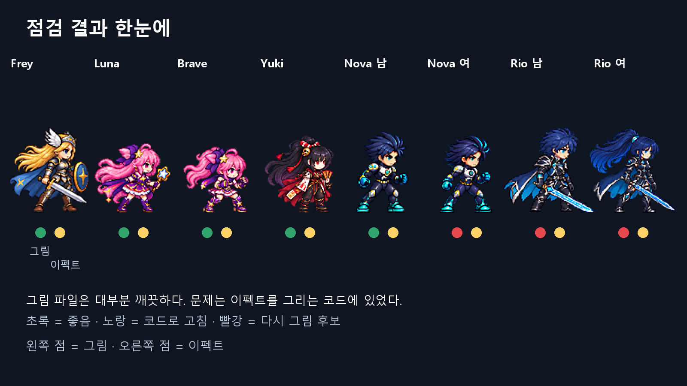
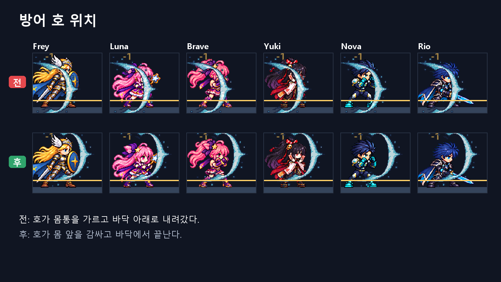
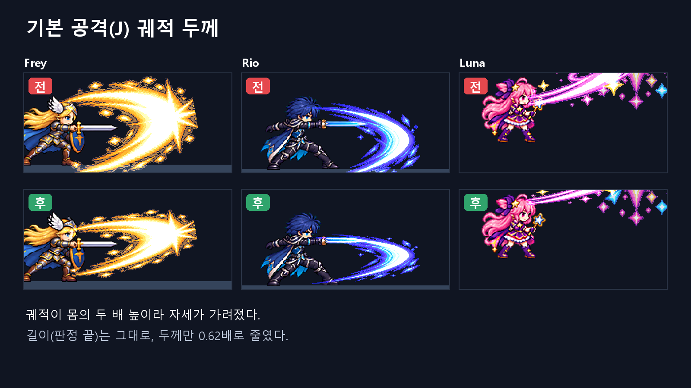
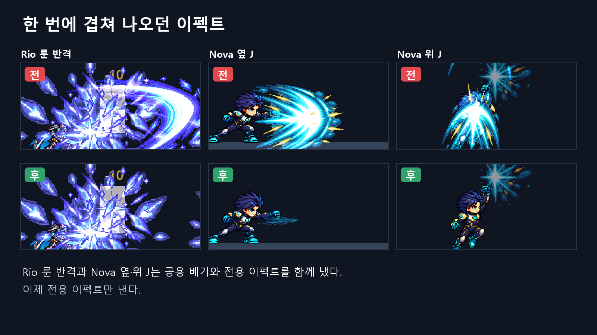
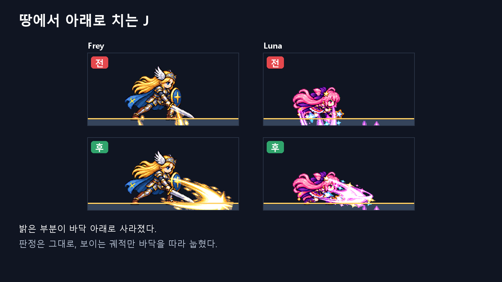
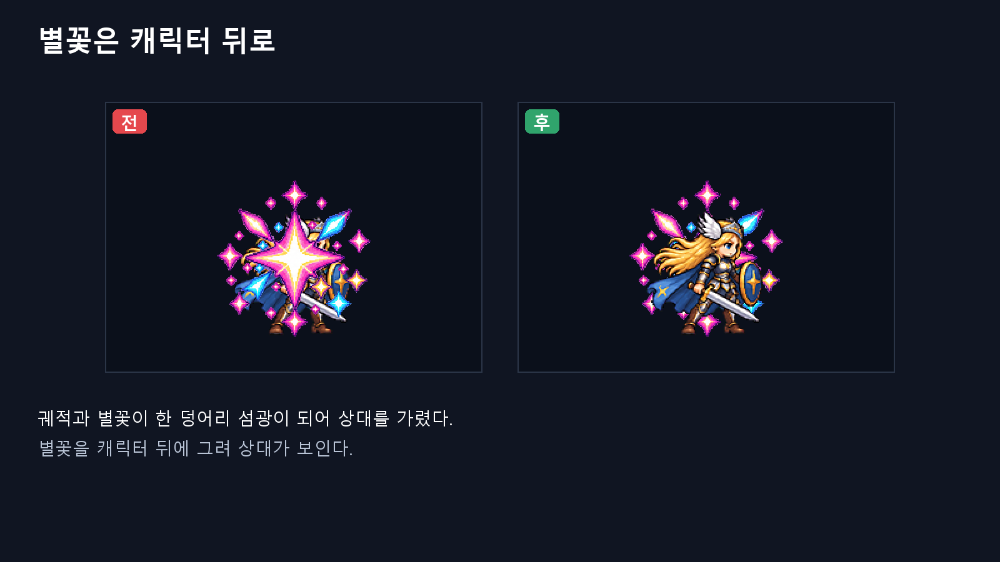
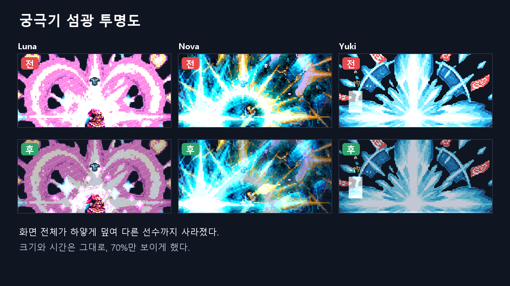
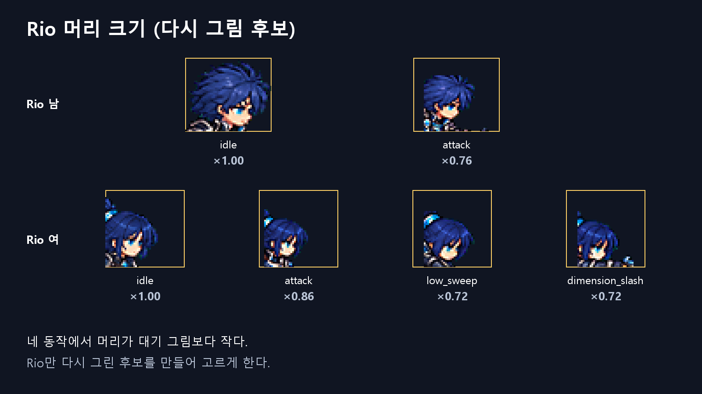
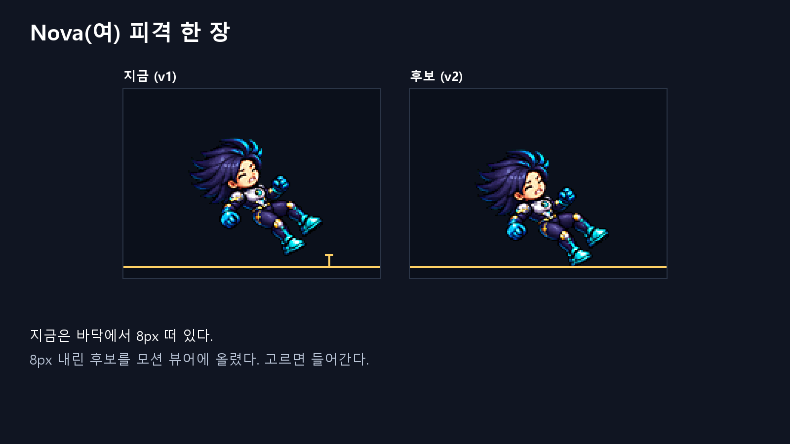
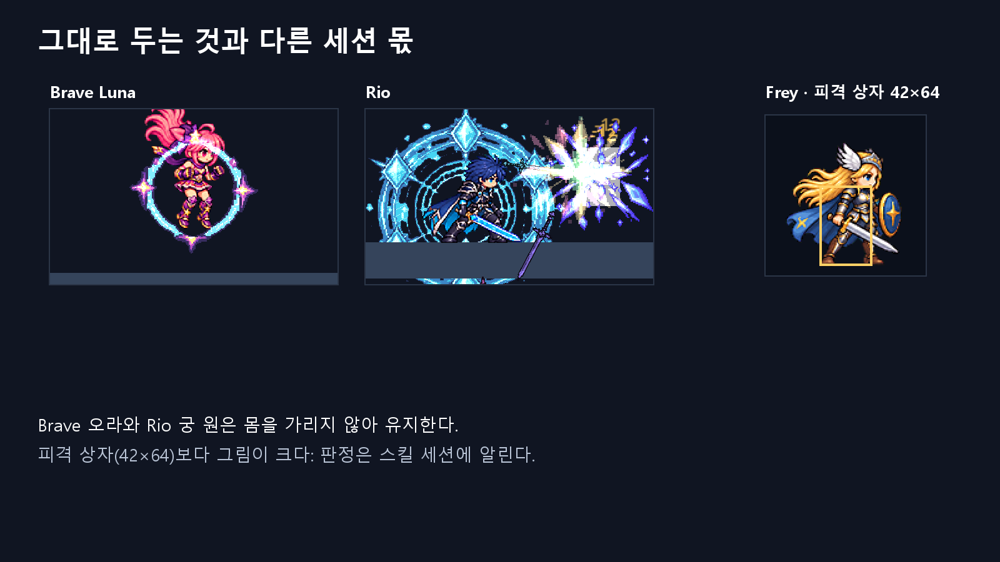

# 캐릭터·이펙트 스프라이트 점검 (2026-10-16)

> "Codex와 함께 현재 캐릭터 스프라이트와 그에 따라오는 이펙트 스프라이트들을 전체 점검. 의견을 주고받고, 서로 반박을 한 뒤 Claude가 최종 결정. 방어 스프라이트 위치가 이상한 것도 수정. 점검 보고서는 알기 쉽게 Codex에게 이미지로 만들어 설명 하게 할 것." (사용자)

그림은 모두 Codex가 실제 게임 프레임과 스프라이트로 만들었다(CODEX-DOC-02). 글자는 리드가 한 자씩 확인했다.

## 어떻게 했나
1. Codex가 리드의 의견을 모른 채 먼저 점검했다(블라인드, CODEX-QA-19).
   - 8폼의 시트 658프레임을 쟀다.
   - 이펙트 50개의 규격을 확인했다.
   - 게임 클립 55장면을 비교했다.
2. 리드도 따로 점검해 입장을 먼저 적어 두었다(`position.md`).
3. Codex가 리드의 입장을 공격했다(7점). 리드가 모든 항목에 답했고, 2라운드에서 Codex가 다시 반박했다.
4. 열린 항목 없이 끝났고, 리드가 결정했다(`reports/debate-sprite-audit/decision.md`, 결정 D40).

결론: 그림 파일은 대부분 깨끗하다. 문제는 이펙트를 **그리는 코드**에 있었다.
- 너무 크게 키웠다.
- 한 타격에 이펙트 두 개를 겹쳤다.
- 바닥 아래로 보냈다.

리드가 놓친 큰 문제 다섯은 Codex가 측정으로 찾았다.

## 그림으로 보는 결과

**방어 호 — 고침.**
- 아트 v2 이후 몸이 80–100px로 커졌는데, 호는 옛 몸 중심 (0,-32)에 그려지고 있었다.
- 그래서 몸통을 가르고 바닥 아래 26px까지 내려갔다.
- 지금은 몸 앞 (24,-58)에 있다.

**J 궤적 두께 — 고침.** 공격 거리만큼 궤적의 두께까지 커져서 몸 높이의 두 배가 됐다. 길이는 그대로 두고 두께만 0.62배로 줄였다.

**겹친 이펙트 — 고침.** Rio 룬 반격과 Nova 옆·위 J는 전용 이펙트가 있는데 공용 베기까지 함께 냈다. 이제 전용 이펙트만 낸다.
- Nova J가 이제 꽤 담백해 보일 수 있다. 너무 약하면 공용 베기를 얇게 되살리는 방법이 있다.

**땅에서 아래로 치는 J — 고침.** Frey·Luna·Brave·Nova가 땅에서 아래로 치면 밝은 부분이 바닥 밑으로 사라졌다. 판정은 그대로 두고, 보이는 궤적만 최대 15°로 눕혔다.

**별꽃 — 고침.** 별꽃이 궤적과 한 덩어리가 되어 상대를 가렸다. 크기는 판정과 같게 두고, 캐릭터 뒤에 그린다.

**궁극기 섬광 — 고침(약하게).**
- Luna 변신, Nova 궁극기, Yuki 마지막 폭발이 화면 전체를 덮어 다른 선수까지 지웠다.
- 크기와 시간은 그대로 두고 70%만 보이게 했다.
- 차이는 크지 않다. 더 줄이려면 수치 하나(`Vfx.ULTIMATE_FLASH_ALPHA`)만 바꾸면 된다.

**Rio 머리 크기 — 다시 그림 후보 (아직).**
- 네 동작의 머리가 대기 그림보다 작다: 남 attack 0.76, 여 attack 0.86, 여 low_sweep·dimension_slash 0.72.
- Rio만 D35 방식으로 후보를 만들어 고르시게 한다. 게임에 쓰이는 low_sweep과 dimension_slash가 먼저다.

**Nova(여) 피격 — 후보를 올림.**
- 다른 7폼은 피격 그림의 발이 바닥선에 닿는데, 이 한 장만 8px 떠 있다.
- 처음 그릴 때 일부러 8px 띄운 것이다(v1 기록 `lift 8`).
- 같은 그림을 8px 내린 v2를 모션 뷰어 후보로 올렸다. 고르시면 들어간다.

**그대로 두는 것과 스킬 세션 몫**
- Brave 오라와 Rio 궁 원은 몸을 가리지 않아 유지한다.
  - Rio 궁 원은 여섯 검과 같은 중심을 돈다. 원을 옮기면 검의 발사 위치(게임플레이)까지 바뀐다.
- 피격 상자(42×64)보다 그림(80–100px)이 커서 머리가 상자 밖에 있다. 판정이라 스킬 세션에 알렸다.
- Rio 2단 공중 점프 신호가 없다. 결함이 아니라 새 기능이라 스킬 세션에 알렸다(SKILLS 작업 목록 4순위).

## 확인
- 전체 테스트 ALL PASSED.
- 새 테스트 `test_effect_layout`은 바꾸기 전 코드에서 실패한다(룬 반격 공용 베기, Nova 공용 베기, 별꽃 z 6, 섬광 알파 1.0).
- `test_skill_fx_art`에 방어 호 위치 검사를 넣었다.
- 웹 빌드 8060: 실행됨, 콘솔 오류 없음.
- 게임 클립을 다시 찍었고(36개 바뀜) 모션 뷰어를 같은 주소에 32판으로 올렸다.

## 남은 것
- **Rio 머리 다시 그림 후보**: Codex 아트 차례. 말씀하시면 시작한다.
- **Nova(여) 피격 v2**: 모션 뷰어에서 고르시면 넣는다.
- **클립에 Nova·Rio 여성 체형이 없다**: 다음 캡처 도구 작업에서 두 체형을 모두 찍는다.
